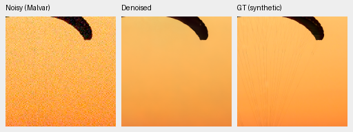
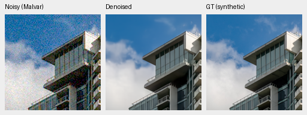

# Original spectral4k training complete; quality review running

Both original4,000-update budgets have finished. The independent production
boundary audit verifies finite model/EMA/AdamW states, original schedule LRs,
retained endpoints, all176 recorded source/forward/supervision pairs,161 shared
scheduled metric rows, identical source archives and final Python/CPU/CUDA RNG.
The control's additional first-resume1,001 log is preserved. Its known final
log-count wrapper failure is independently audited without another control
update; see [completion provenance](spectral-log-completion.md).

| Endpoint |Checkpoint SHA-256|
| --- | --- |
|V88 control4k|`d17891aa95cadfffe02dc497a96a9de3481f6044a3c270762bc014cbca0c16e4`|
|V89 spectral4k|`bf6e15b8d6493a9dad491576d9da7a7a710081f234e56870009db38b779a29a3`|
|V63 original20k parent|`ed70952dd33c5d7da39199bf1306b58b579862920fb0cccd6b222f19871bc9b5`|

The new arms share reviewed88,508 Commons sources, native128 captures/106 groups,
paired32 scenes, native256/B16/BF16, seed55, strict execution and the original
4k schedule. V89 adds a zero-initialized68-parameter RAW-spectral gate with20× head LR;
the common model retains1e-5 base LR. Each arm draws64,000 examples, not a
complete pass over all sources. GFX3879/3880 and siblings remain excluded.
The matched intervention does not isolate data expansion versus earlier models.

[Independent training boundary](results/spectral-original4000-training-boundary-v1.json),
[actual completed-owner/review handoff](results/spectral-original4000-completion-v1.json),
and [original fixed experiment](spectral-v88-v89.md).

Known and unseen camera inference has completed; full427 is running. The first
18 native triplets have actually been viewed before reading numerical model
quality results. They cover control/spectral/parent at two known scenes, two
unseen scenes and two exact synthetic targets. This is an early visual record,
not a completed quality decision or model promotion.

## Fixed exact-GT views

Every triplet below is noisy Malvar → restored → exact synthetic GT. Each panel
is160×160 unchanged pixels. ROI`[48,48,160,160]` is within the seed42/native256
validation tile. Both sources use RGGB, shot.00256/read variance.0000262144
(the declared ISO12800 prior), exposure1/0EV and WB`[2,1,1.5]`. The shared
camera-to-sRGB matrix is

```text
[[ 1.1176470588, -0.0588235294, -0.0588235294],
 [-0.0588235294,  1.1176470588, -0.0588235294],
 [-0.0588235294, -0.0588235294,  1.1176470588]]
```

Noise is keyed by source/condition/CFA with protocol seed20261014. All three
methods have identical noisy/GT pixels and transforms. The8-bit sRGB previews
do not replace the unquantized FP32 evaluation. Full source/cache, ROI, seed,
checkpoint and PNG hashes are in the
[publication record](results/spectral-original4k-early-GT-publication-v1.json).

V88 control:


V89 spectral:


V63 parent, same observations:





The canopy's fine radial cords remain absent in all three restored views.
Building edges survive while fine cloud structure stays soft. The new spectral
endpoint has no obvious detail advantage in these selected views. The known
shelf/chart and unseen brown-surface/fabric comparisons also look similar;
their independently demosaiced AHD references are **not exact RGB GT**.
These observations do not determine the population statistics or final gates.

Sources: [Roy Egloff's Swiss Riviera photograph](https://commons.wikimedia.org/wiki/File:CH.VD.Villeneuve_2007-08-25_Vertigo-Swiss-Riviera_2392_3x2-R_4K.jpg)
and [Dietmar Rabich's Vancouver photograph](https://commons.wikimedia.org/wiki/File:Vancouver_(BC,_Canada),_Coal_Harbour_Seaside_Park,_Blick_in_den_Himmel_--_2022_--_2158.jpg),
[CC BY-SA4.0](https://creativecommons.org/licenses/by-sa/4.0/), modified by8×
linear binning, crop, physical camera/noise simulation, restoration and rendering.
Camera development sources are Brummer/De Vleeschouwer's
[RawNIND](https://doi.org/10.14428/DVN/DEQCIM), with the retained per-scene credits/
CC0 grants; these views use registered low-noise CFA and auxiliary AHD RGB.

## Remaining review

Full427, source sensitivities, analytic/all192 ADC cases, hue, GFX sky/building/
foliage/fence, sign/platform and remaining native/reference boards still require
completion and actual inspection before numerical decisions. The original
criteria remain fixed. No new full102MP export, speed result, README/reference
change, training extension or promotion follows from completing these budgets.
SOTA and decisive real-photo superiority remain unproven.
