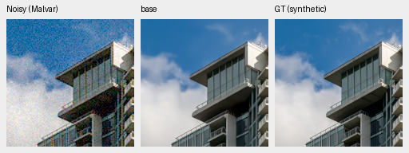
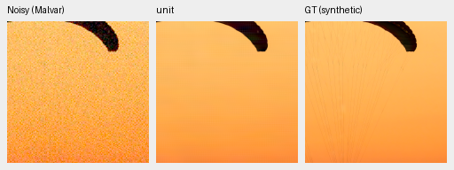
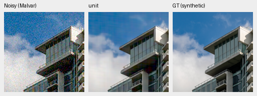
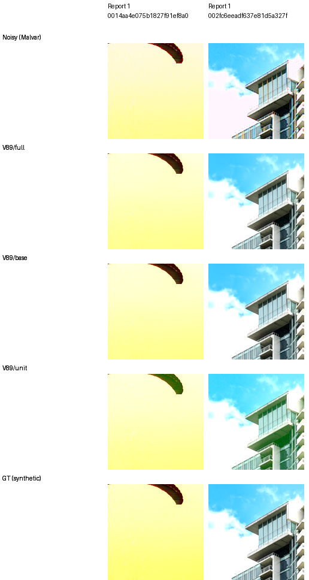
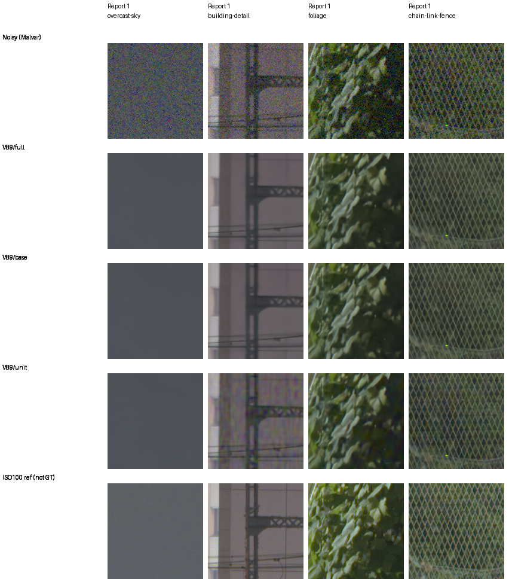
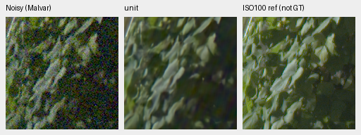
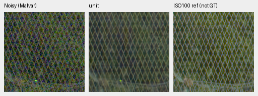

# Unit spectral gating damages the fixed photographic pilot

The same fixed unit-gate intervention that restores the
[analytic carriers](spectral-gate-components.md) creates periodic texture and
color errors on natural images. It lowers sRGB PSNR and SSIM on both selected
photos in every noisy condition. The standing GFX building wall gains a strong
colored grid. Unconditional unit gating is rejected; this pilot provides no
reason to install it, run a full427 evaluation or extend training.

This is a diagnosis of the genuine V89 step4000 EMA, not a newly trained model.
Full uses its trained scalar gate; base is its own adapted trunk immediately
before the spectral head; unit adds one copy of the same input-only innovation
to that base. Base is not V88 or V63. There is no gate sweep, reference fitting,
new parameter update or serving change. V43 remains the working reference.

## Fixed inputs and results

The pilot uses the same two previously selected development photos, all seven
original conditions, RGGB and the original CUDA noise seed20261014. Each
forward covers a native256 field; scores exclude an8px border. There are14
photo observations, each evaluated under three fixed interventions. These are
two source images with repeated conditions, not14 independent scenes. No
population interval or generalization claim follows.

Means below average those two source crops. PSNR units are dB. Positive SSIM
and PSNR differences favor the first named intervention.

| Condition | Unit−trained linear PSNR | Unit−trained sRGB PSNR | Unit−trained SSIM | Trained−base sRGB PSNR |
| --- | ---: | ---: | ---: | ---: |
| ADC only | +0.93540 | +0.76584 | +0.0007001 | +0.05243 |
| ISO100 prior | +0.16642 | −1.48487 | −0.0060711 | +0.01898 |
| ISO1600 prior | −0.93007 | −2.79560 | −0.0227370 | +0.00788 |
| ISO12800 prior | −1.02111 | −2.62751 | −0.0337879 | +0.00424 |
| Shadows | −1.06242 | −1.87033 | −0.0096253 | +0.00382 |
| Highlights | −0.15400 | −6.31321 | −0.0193273 | −0.00076 |
| Legacy noise | −1.01792 | −2.80034 | −0.0299383 | +0.00543 |

Both ADC-only sources improve in PSNR under unit gating. All twelve noisy
source/condition observations lose sRGB PSNR and SSIM. Linear and display
metrics can disagree, as the ISO100 row shows. The linear metric retains the
original clipped camera-RGB target convention; it is not a physical RAW-camera
accuracy score. Complete per-source metrics and contrasts are in the
[CUDA result](results/spectral-photo-components-CUDA-v2.json) and
[array audit](results/spectral-photo-components-array-audit-v2.json).

Photo gates range from.002787 to.017307; the clipped-highlight gates are
.002787/.006038. Upper-censored packed fractions in that condition are
63.20%/32.09%. These are observed diagnostics, not a calibrated inference rule.
Unit artifacts also occur in conditions with no upper-censored samples, so
clipping alone does not explain the photographic failures.

## Native synthetic-target comparisons

Every panel below contains160×160 unchanged pixels. The order is noisy Malvar
→ intervention output → exact synthetic GT. The photos are8×-binned
linear-sRGB uint16 Commons targets converted by the original camera simulation;
they are not measured RAW ground truth. All methods share source coordinates,
WB[2,1,1.5], the original camera matrix and display exposure1/0EV.

Checkpoint SHA256:
`bf6e15b8d6493a9dad491576d9da7a7a710081f234e56870009db38b779a29a3`.
The highest-noise crops use shot.00256/read variance.0000262144. Native field
ROI[48,48,160,160] corresponds to cache ROI[237,51,160,160] for the canopy
and[243,137,160,160] for the building. Full source/cache/checkpoint/noise/matrix
bindings for every published triplet are in the
[asset index](results/spectral-photo-components-native-assets-v2.json).

Trained V89:

Its own pre-head base:

Fixed unit intervention:

The canopy cords remain missing. Unit gating adds horizontal banding and edge
color variation there, plus a visible crosshatch/grid in the building's blue
sky. Full and base look close at this scale. The clipped condition adds green
color casts in the unit canopy edge and building shadows:

That condition uses exposure4, shot.00008/read variance.0000000256, with the
same display exposure1 and coordinates. Its final row is exact synthetic GT.

Sources: [Roy Egloff, Swiss Riviera canopy](https://commons.wikimedia.org/wiki/File:CH.VD.Villeneuve_2007-08-25_Vertigo-Swiss-Riviera_2392_3x2-R_4K.jpg)
and [Dietmar Rabich, Vancouver building](https://commons.wikimedia.org/wiki/File:Vancouver_(BC,_Canada),_Coal_Harbour_Seaside_Park,_Blick_in_den_Himmel_--_2022_--_2158.jpg),
[CC BY-SA4.0](https://creativecommons.org/licenses/by-sa/4.0/). Modified by
binning, cropping, simulated observation generation and restoration.

## Standing GFX captures

The four previously fixed native512 contexts reuse cached DSCF3879 ISO6400
observations. DSCF3880 ISO100 f/5.6 is an independently demosaiced qualitative
reference, taken3m38s later with aperture, framing and moving-subject differences.
It is not exact GT and receives no reference-based score. This scene and its
siblings stay out of training. No RAF decoding or source-drive access was
needed.

All interventions share the original WB/matrix, shot.0014635775921166604,
read variance.0000010715704128646712 and display exposure4/+2EV. Noisy crop
origins are sky[5800,1400], building[5790,2690], foliage[8890,5570] and
fence[2240,6000]; all are160px square. The reference building/fence x origins
are5791/2241, using the previously fixed integer offsets, without warping or
resizing. Full contexts and source hashes are in the asset index.

The unit building wall acquires strong colored periodic mottling. The sky
stays smooth; fine foliage remains painted/smooth. Some fence contrast increases
alongside colored patterned variation, without a demonstrated fidelity gain.
The native foliage and fence unit triplets are also available separately:

## Replay, recovery and arithmetic

The [fixed plan](results/spectral-photo-components-plan-v2.json) binds genuine
V89 weights, all46 actual original training modules and the earlier component
worker. The two later physics implementation cleanups are excluded. New
[CPU preflight](results/spectral-photo-components-CPU-v2.json) checks inputs;
the genuine-weight hook itself had already passed six CPU engineering batches
in the preceding analytic diagnosis. CUDA uses IEEE FP32, benchmark disabled,
a16GiB allocation quota and explicit RAM/disk/time guards.

The first attempt stopped at a serialization bug: the original shadow cases
have no highlight-boundary support and correctly report null metrics. The
worker tried to subtract those nulls. The
[failed record](results/spectral-photo-components-failed-v1.json) retains the
original executed source and all partial artifacts. The correction reuses
the original evaluator's nullable-number convention and requires identical
support; finite tolerances, data and interventions stay fixed. All saved
arrays from the first four completed conditions replay byte-for-byte in the
corrected run. The failed attempt is not a completed quality result.

All108 finite classical metric witnesses match the original evaluation exactly;
all four nullable field slots preserve support. The complete trained GFX
float32 RGB output also matches its original saved output exactly. Model state,
genuine DINO hash370a84…540fd and CPU/CUDA RNG remain unchanged. Both output
identities are byte-exact for all18 observations:
`full = base + gate × innovation`; `unit = base + innovation`.

An independent CPU NumPy audit checks all eight input batch fingerprints and
recomputes84 linear/sRGB PSNR scalars from saved arrays. Maximum differences
are.00000472/.00000751dB. FP64 spectral-mask reconstruction differs from the
FP32 execution by at most.00001655. SSIM is not independently reimplemented;
it uses the original frozen evaluator. All54 triplets and90 board cells retain
exact source PNG pixels. The84 plan inputs and52 frozen source/helper files
revalidate. Compressed arrays total103.62MiB outside Git.

All eight boards/90 native cells were actually inspected before interpreting
new component statistics. The
[pre-statistics view receipt](results/spectral-photo-components-native-review-v2.json)
records the observations; [final review](results/spectral-photo-components-review-v2.json)
records the decision. Complete boards:
[ADC](images/spectral-photo-components-v2-photo-adc-only.png),
[ISO100](images/spectral-photo-components-v2-photo-iso100-prior.png),
[ISO1600](images/spectral-photo-components-v2-photo-iso1600-prior.png),
[ISO12800](images/spectral-photo-components-v2-photo-iso12800-prior.png),
[shadows](images/spectral-photo-components-v2-photo-shadows.png),
[highlights](images/spectral-photo-components-v2-photo-highlights.png),
[legacy noise](images/spectral-photo-components-v2-photo-legacy-noise.png),
[GFX](images/spectral-photo-components-v2-gfx.png).

Executed sources, failed artifacts and complete arrays remain under
`/mnt/external/demosaic/experiments/spectral-photo-components-v{1,2}/`.
The inference result isolates a failure of the fixed innovation's selectivity
on these photographs. It does not isolate whether phase ambiguity, statistical
noise assumptions, clipping, window dependence or another mechanism causes
each artifact. Those need evidence before choosing another gate or support
rule. Analytic carrier recovery alone is insufficient; no production policy,
checkpoint, training schedule or protected-final data changes. The complete
project quality and100MP/10s objectives remain open.
