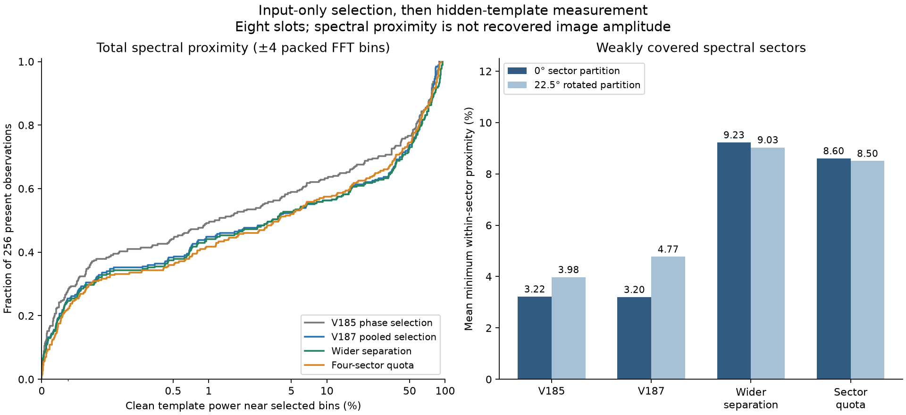
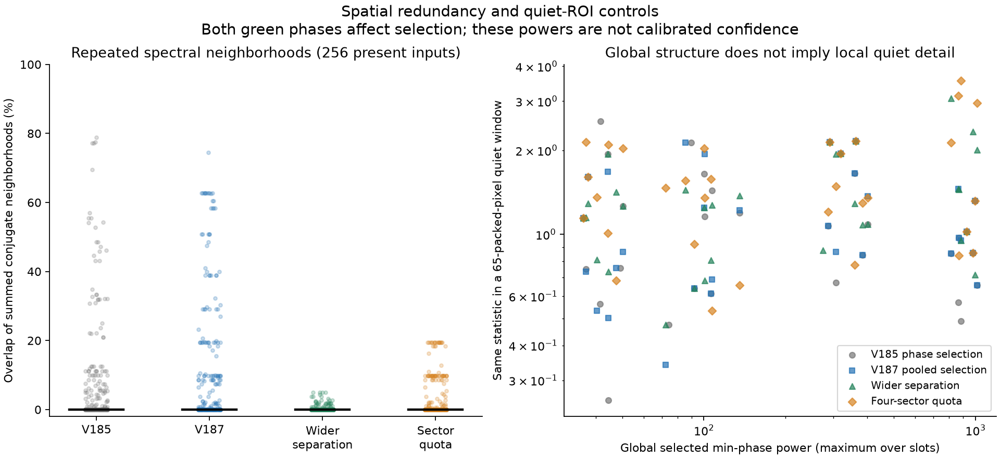

# Spectral allocation still misses weak directions

V188 supports a matched trial of **wider peak separation** before adding fixed angular quotas. On 256 constructed present inputs, mean clean-template proximity rises from **24.84% with V187's bins to 25.93%**, while the minimum within substantial spectral sectors rises from **3.20% to 9.23%**. Most inputs are unchanged, and tighter proximity falls. This is a diagnostic of frequency allocation, **not an improved denoiser, recovered amplitude or a recovery bound**. [V187](pooled-phase-wave-comparison.md) remains the latest trained model and current experimental wave option.

The left panel retains all 256 present observations. The right averages the minimum proximity within angular sectors containing at least 5% of principal half-plane template power. The second partition rotates the *measurement sectors* by 22.5°; the selector itself is not rotated. These sectors describe folded CFA spectral coordinates, not exact separate wire families or a test of arbitrary rotation invariance. The 64 underlying procedural scenes reuse noise and Bayer variants, so the plotted observations are correlated.

## Fixed eight-slot comparisons

All new allocations use V187's equal mean of two green-phase, supplied-noise-normalized powers, smoothed over a circular 3×3 frequency neighborhood. Selected centers retain the native 1/16–1/3 cycles/pixel band. Both phases influence every new pick; no phase is a selection holdout, and selected powers are not calibrated confidence.

V185's saved bins occupy eight phase-direction slots and may duplicate frequencies. V187's saved bins occupy eight unique slots with radius-one conjugate suppression. The FP64 bridge reproduces all actual V187 bins in all 550 contexts. Two counterfactuals retain eight slots:

- **Wider separation:** change the suppression radius to ceil(maximum packed axis / 65), which is four bins for the 512-native-pixel constructed contexts. Greedy ranking otherwise stays the same.
- **Four-sector quota:** retain radius-one suppression, with at most two selections from each of four fixed 45° principal angular sectors. This can force selection of unrelated noisy bins.

| Present-template proximity | V185 saved slots | V187 saved bins | Wider separation | Sector quota |
| --- | ---: | ---: | ---: | ---: |
| Mean, ±4-bin neighborhood | 21.253% | 24.844% | 25.928% | 24.237% |
| Median, ±4 bins | 1.178% | 3.455% | 3.455% | 3.920% |
| Mean, ±1 bin | 17.342% | 20.938% | 19.414% | 19.105% |
| Mean minimum substantial-sector proximity, 0° partition / ±4 bins | 3.221% | 3.201% | 9.225% | 8.604% |
| Same minimum with 22.5° partition | 3.976% | 4.775% | 9.031% | 8.503% |

The wider neighborhood has radius ceil(256/65)=4 in packed FFT coordinates. It is a descriptive scale from the wave window, not the exact filter response or a reconstruction ceiling. Hann sidelobes, local coefficient interpolation, nonlinear mixing and CFA aliases prevent that interpretation. Both neighborhood sizes matter: wider separation gains 1.084 percentage points in overall ±4 proximity but loses 1.524 points within ±1 bin.

Wider separation improves ±4 overall proximity on 51 inputs, worsens 46 and leaves 159 unchanged. The 0° minimum-sector metric improves on 56, worsens two and leaves 198 unchanged; the rotated metric improves on 55, worsens eight and leaves 193 unchanged. Its unchanged median limits any claim about a typical weak case. The sector quota improves 0° minimum-sector proximity on 162 inputs but worsens 44; overall ±4 mean proximity falls 0.607 points, despite a small median gain.

## Quiet and absent controls

Mean overlap among summed conjugate ±4 neighborhoods is 7.92% for V185, **10.88% for V187**, 0.35% for wider separation and 3.37% for the quota. Every median is zero: redundancy is concentrated in a subset, not universal. Overlap is a geometric descriptor, not wasted model capacity by definition.

Absent inputs use their *hypothetical present* template only for diagnosis. Mean ±4 proximity is 1.696% for V185, 1.768% for V187, 1.787% for wider separation and 1.802% for the quota. Those small increases demonstrate chance alignment with nonexistent structure; they do not predict restored false-detail amplitude.

For each selected bin, the quiet plot uses the smaller of its two green-phase powers, then takes the maximum across slots. The same measurement is made globally and in a fixed 65-packed-pixel window centered inside the exact quiet ROI. Median local values are **1.047 / 0.996 / 1.269 / 1.412** for V185 / V187 / wider separation / quota; median global values are about **211 / 211 / 205 / 211**. Global nearby structure and locally quiet pixels therefore remain different questions. These selected, overlapping statistics establish no confidence threshold, false-discovery rate or noisy-sky safety. All 32 local values happen to be below four in each method; four is not an inference rule.

## Protected real inputs

No ISO100/AHD or JPEG reference pixels are read or scored here. These are input-only local powers from the held-out ISO6400 captures. The ordinary V187 [native viewer](images/v187-pooled-wave-v1/native-viewer.html) retains both real families and their independently processed qualitative references, with source, noise, checkpoint and display metadata.

Wider separation leaves the main sky's selected bins unchanged, replaces five building bins, four foliage bins and five coarse-fence bins. The quota adds two new sky bins. Both allocations replace five and three bins, respectively, in each fine-cab noise profile. Dominant local measurements remain in the retained bins; stronger input power alone is not correct recovered geometry.

| Cab input / ROI | New bins under wider separation | Largest local min-phase power among new bins | Same value under quota |
| --- | ---: | ---: | ---: |
| Nominal, left `[206,229,160,160]` | 5 | 17.327 | 2.098 |
| Nominal, right `[426,189,160,160]` | 5 | 1.554 | 1.239 |
| Profile3879, left | 5 | 24.963 | 3.022 |
| Profile3879, right | 5 | 2.168 | 1.728 |

The two ROIs share DSCF3842 and each noise profile reuses that capture. They are not independent photographs. The right ROI's new measurements remain weak. This evidence does not prove that either selection recovers its missing crossings.

## Consequence for the next trial

Test wider suppression at V187's same readout, initializer, eight-slot and training budget before adding fixed angular quotas. It offers a simpler allocation change, improves weak-sector proximity under both recorded partitions and exposes new left-cab measurements, while avoiding forced absolute sector counts. The tighter-proximity loss, absent chance alignment and higher local quiet powers remain reasons to require both trained endpoints, all flat/absent/quiet controls and actual protected native views. The present study does not justify promoting an untrained selector or increasing readout amplitude.

## Reproducibility

The original CPU owner completed 550 input contexts, then 512 exact present-minus-empty templates and 200 region-method records across 40 ROIs. The full input journal closed before clean arrays were read. Existing V185/V187 selections are reused; templates exactly match the earlier V186 fingerprints. There are no model/checkpoint loads, new RGB predictions, source/noise draws, RAW decodes or original/dataz access. All 101 neural files remain unchanged, and both GFX families/JPEGs/siblings remain excluded from training.

Twenty-two focused CPU checks cover sorted allocation, conjugate suppression, quota budgets, tie behavior, green-phase dependence, toroidal proximity and independent QR references. The audit checks 1,650 input fingerprints and 22,000 bound bin records; on the fixed first 12 contexts, it verifies 288 independently ranked QR bins and 960 global phase powers. It independently checks **all 5,120 template fractions**, 133,120 sector values, all 3,200 local powers and 110 Decimal means. Maximum errors are 7.11e−15 for phase power, 1.78e−15 for pooled score, 4.45e−16 for template fraction and 2.17e−12 for local power.

Both figures were actually viewed. PNG, SVG and PDF artifacts preserve the plotted data; a pre-execution correction aligned CDF case IDs with their sorted values and widened the overlap axis. The original prepared source and seal are archived; no scientific measurement or plotted result was replayed.

[Exact evidence and source capsule](results/v188-selection-diversity-v1.json) · [Publication verification](results/v188-selection-diversity-publication-verification-v1.json).
