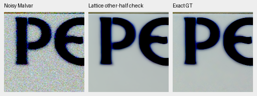
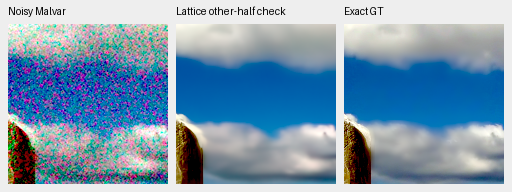

# Checking fine detail on complementary Bayer samples

Checking proposed detail on the opposite Bayer half cuts ISO6400 fine-increment
error by 3.13 DN16 and flat error by 13.68 DN16 versus checking it on the same
half, at unit correction strength with quincunx interpolation. The full-input
Corpus 100k result is much cleaner and retains more fine detail than either
half-input guide. At matched quiet-region strength, checking detail above the
full-input estimate adds 0.003 percentage points of response and 0.002 DN16 of
fine-increment error. The correction produces no visible new cab crossings.

[Machine results](results/split-bayer-neural-v1/publication.json) ·
[Frozen drivers and receipts](results/split-bayer-neural-v1/evidence.tar.xz) ·
[Native provenance](images/split-bayer-neural-v1/manifest.json).

## Bayer sample split

Assign whole 2 × 2 Bayer cells to checkerboard halves so each half keeps all
four CFA phases. Predict from each half using the unchanged Corpus 100k EMA
`87b96f3c487b9edaf1c477742b6c38f2a82cc6b20a94716d51cc8cf46a17a760`
in CUDA IEEE FP32. Supply the missing cells using the mean of the four axial
neighbors of the same CFA phase or a reflected Fourier quincunx interpolant.
The latter has a soft diamond passband, with width 0.032 cycles per packed
cell and a 16-cell reflection margin. Both fills preserve the original measured
samples exactly. Propagated marginal variance uses squared filter coefficients.
Cross-pixel covariance and repeated reflection terms are omitted. A third arm
doubles the neural shot/read conditioning and variance using the same Fourier
interpolation. The physical Bayer test uses the original capture coefficients
in all three cases.

For each local 32-pixel patch at stride 16, extract a 58-mode luminance shape
from the guide in the 0.0625–0.140625 cycles/pixel band. Fit smooth tone and
the shape's coefficient to actually observed green measurements. Score the
same shape on the guide's measurements or on the other half. Average the
overlapping, tapered, zero-DC corrections. When delivering a correction to the
full-input output, subtract the detail already projected onto that shape by
the full-input estimate. That estimate saw both halves, so the final
single-capture correction can still share noise with the full-output error.

The source split is the same 16 calibration and 48 held-out backgrounds as
the exterior covariance study, with matched natural, attenuated and exact-flat
inputs at ISO400 and ISO6400. Each arm's frozen dose adds 0.25 DN16 mean fine
RMS to the exact-flat predictions in ISO6400 calibration. Held-out absolute
flat RMS appears below. Bootstrap intervals resample by source.
[Source split and previous correction](scene-raw-covariance.md).

## Held-out ISO6400 results

| Unit-strength prediction | Fine response | Fine-increment RMS | Fine-flat RMS |
| --- | ---: | ---: | ---: |
| Full Corpus 100k | 65.729% | 155.719 DN16 | 5.371 DN16 |
| Mean of neighbor-filled half guides | 25.842% | 198.273 DN16 | 17.970 DN16 |
| Neighbor guide with same-half test | 26.971% | 198.349 DN16 | 26.069 DN16 |
| Neighbor guide with opposite-half test | 26.415% | 197.900 DN16 | 18.030 DN16 |
| Mean of quincunx-filled half guides | 47.623% | 185.942 DN16 | 42.669 DN16 |
| Quincunx guide with same-half test | 47.787% | 189.093 DN16 | 56.359 DN16 |
| Quincunx guide with opposite-half test | 47.659% | 185.961 DN16 | 42.681 DN16 |
| Mean of quincunx-filled guides with doubled neural noise | 35.897% | 190.646 DN16 | 16.172 DN16 |

Compared with the same-half test, the opposite-half quincunx test reduces
fine-increment RMS by 3.13 DN16 [1.74, 5.04] and flat RMS by 13.68 DN16
[12.06, 15.27], with 0.128 percentage points less response. Doubling the
noise supplied to the quincunx guides removes 26.50 DN16 of flat variation
and gives up 11.73 response points before any correction.

At matched quiet-region dose, the positive quincunx correction delivered
above the full-input estimate adds **0.0026 percentage points** of response
[0.0014, 0.0044], **0.0018 DN16** of fine-increment RMS [0.0006, 0.0034]
and **0.0150 DN16** of absolute fine-flat RMS [0.0107, 0.0202]. The signed
version reduces increment RMS by 0.0043 DN16 and gives up 0.0052 response
points. Doubling neural noise leaves the positive full-input gain at 0.0043
response points, with 0.0025 DN16 more increment error. The ISO400 positive
quincunx gain is 0.0032 points with 0.0009 DN16 more increment error.
Transferring the half-input boost before subtracting detail already recovered
by the full-input model yields a larger apparent +0.198 points for the
neighbor guide and costs 0.056 DN16 of fine-increment RMS at matched dose.

The masked-input validation replaces withheld values and their variances with
NaNs before filling. Both fills are invariant and copy all retained samples.
A known interior sinusoid at `(25/128,17/128)` cycles per packed cell has
75.21% amplitude after the neighbor fill and 99.998% after the Fourier fill.
The real photos show the limits of that single-band result.

## Native exact-target triplets

Each crop is 160 × 160 native pixels at `[48,48,160,160]` within a fixed
256-pixel query. Noisy Malvar, the full-input output with the calibrated
opposite-half quincunx correction, and exact GT share the same transform.
Both inputs use ISO6400 shot/read `0.00128/6.5536e-6`, capture exposure ×0.33,
16-bit simulation, black level 0.03, display ×3.0303 and contrast ×2.

**Calexón dos Perigos, Ribadeo**, Fernando Losada Rodríguez, CC BY-SA 4.0.
GBRG, query `[174,460,256,256]`. Fine-increment RMS falls 0.010 DN16,
the largest held-out decrease for this arm. Letter edges still look softer
than the exact target. [Source](https://commons.wikimedia.org/wiki/File:Calex%C3%B3n_dos_Perigos.001_-_Ribadeo.jpg) ·
[All outputs](images/split-bayer-neural-v1/exact/027-iso6400-split-comparison.png).

**House of the Lake, Delos**, Bernard Gagnon, CC BY-SA 3.0. GRBG, query
`[138,248,256,256]`. Fine-increment RMS rises 0.062 DN16, the largest
held-out increase. Soft cloud edges and the dark foreground transition
remain. [Source](https://commons.wikimedia.org/wiki/File:House_of_the_Lake,_Delos_02.jpg) ·
[All outputs](images/split-bayer-neural-v1/exact/038-iso6400-split-comparison.png).

## Standing GFX100S comparisons

The single-half quincunx guides add mottle in the sky and colored moiré
on the coarse fence. Doubling neural conditioning calms the sky, while
coarse crossings remain degraded in the guide and the cab keeps color
speckles around fine lines. The delivered corrections stay close to
Corpus 100k. The sky remains smooth, the coarse fence retains its crossings
and the building wires and leaves remain soft. Fine left cab crossings are
still missing and the transferred profile retains clearer right diagonals.
The calibrated full-input quincunx addition changes main camera RGB by
0.03–1.14 DN16 RMS and the four cab crops by 0.11–0.39 DN16.

The main DSCF3879/3880 boards use display ×4 and the fine DSCF3842/3835
boards use ×16. Independent ISO100 AHD crops and both cab JPEGs are
qualitative references with different aperture, exposure and motion.

[Sky](images/split-bayer-neural-v1/standing/main-overcast-sky-main-overcast-sky.png) ·
[Building](images/split-bayer-neural-v1/standing/main-building-detail-main-building-detail.png) ·
[Foliage](images/split-bayer-neural-v1/standing/main-foliage-main-foliage.png) ·
[Coarse fence](images/split-bayer-neural-v1/standing/main-chain-link-fence-main-chain-link-fence.png).

| Cab shot/read | Left | Right |
| --- | --- | --- |
| Nominal `0.00128/6.5536e-6` | [Native board](images/split-bayer-neural-v1/standing/mesh-nominal-fine-green-mesh-left.png) | [Native board](images/split-bayer-neural-v1/standing/mesh-nominal-fine-green-mesh-right.png) |
| Transferred `0.0014635775921166604/1.0715704128646712e-6` | [Native board](images/split-bayer-neural-v1/standing/mesh-profile3879-fine-green-mesh-left.png) | [Native board](images/split-bayer-neural-v1/standing/mesh-profile3879-fine-green-mesh-right.png) |

This is an inference-only component study with fixed weights. The numerical
scope is the 64-background panel and both standing GFX comparisons.
[Corpus 100k broad scores](full-corpus-long100k.md#broader-evaluation).
