# V174 spread sample initialization: completed quality

V174 preserves wide sample positions, but does not recover more fine detail than
V172. EMA quiet-field total RMS improves **0.12–0.17% versus V172**, with 24/32
inputs improving; spatial RMS improves **0.04–0.08%** on 29/32 and DC color error
improves **0.36–0.43%**. These are small measured gains, with no clear visual
cleanup in the native crops. Mesh response slips **0.25% to 3.868% of constructed
GT amplitude**, with 208/256 responses lower. Natural fine-band response slips
0.016–0.023%, with 124/128 lower. Present/absent mesh RMS changes only
−0.0002/−0.0082%. Full-flat means change **+0.008/−0.072%** at ISO6400/12800;
coarse-flat means worsen **0.020/0.004%**, with 33/48 individual inputs worse.
Raw quiet total RMS instead worsens 0.12–0.19% versus V172. The seven-method
tables below retain both endpoints and the earlier quiet/flat alternatives.

The six observed EMA contexts retain a coarsest-block 90th-percentile sample
distance of about **90.7 native pixels**, versus about 12.04 for V172. Middle
blocks reach about 45.3 and fine blocks 22.6–23.0. Wider positions alone did not
produce a useful detail gain in this matched 900-update schedule. The bias change
also changes the tanh derivative and optimization conditioning, so this single
seed does not isolate geometric reach as the sole cause. Sample positions do
not measure whether distant content supplies the final RGB correction.

All 60 figures were inspected at original detail. Synthetic seed2302 remains
nearly blank at ordinary exposure and mottled at 40×; seed2309 retains mostly
one wire family while missing crossings. Both fine green cab windows and both
noise priors remain close to V172, with smeared strands and incomplete crossings.
The main sky has no obvious new texture at ordinary exposure, but amplified
quiet and flat crops retain broad colored patches. Building, foliage and bird/
branch/insect controls remain softened. ADC controls keep V169 exactly. Real
ISO100 and independently demosaiced/JPEG references differ in aperture, depth of
field, shutter, motion and processing; they are qualitative references, not GT.

Keep **V172 as the balanced matching baseline for detail work**. V173 remains a
stronger quiet/spatial-error option, V171 a stronger standalone-flat option,
V161 the stronger learned mesh prototype and V120 Small the general choice.
V174 records a small quiet-color gain rather than a combined quality advance.
The [native-pixel viewer](images/v174-spread-matching-v1/native-viewer.html)
opens with V173 EMA versus V174 EMA; select V172 EMA for the main matched
comparison. Click the flip tile or press F. Its
[browser pixel verification](results/v174-native-viewer-verification-v1.json)
checks every displayed crop against the PNG pixels.

A separate posthoc [V175 shortcut diagnostic](results/v175-local-shortcut-diagnostic-v1.json)
tests six selected V174 EMA inputs by removing the whole matching path at its
last fusion. The remaining head-to-tail path is evaluated directly, using six
head and six tail CUDA convolution calls, with no sampler, full matching,
frozen-component or parent/DINO forwards. Its difference from the full added
correction has 18–84% of that correction's RMS. The complete added correction is
only 0.20–0.22 DN16 RMS on these inputs. This rejects a complete bypass on the
tested inputs; it neither isolates distant samples nor explains the remaining
detail loss. Six saved local corrections and their FP32 compositions are
independently checked. Case selection is disclosed, including the absent case
chosen for available saved arrays. This is a functional contribution probe,
not a trained V175 model or a new 822-case quality comparison. Its calls are
separate from V174's matching-work counts below. Further work needs to test how
matching learns useful content and correction amplitude while retaining flat
controls; simply widening positions has not solved the problem.

[Final evidence and exact sources](results/v174-spread-matching-final-v1.json) · [Native pixels, source ROIs, checkpoint, noise and display metadata](images/v174-spread-matching-v1/manifest-v1.json).

## Mesh response and actual blank error

| Metric | V143 parent | V169 EMA | V171 EMA | V172 EMA | V173 EMA | V174 raw | V174 EMA |
| --- | ---: | ---: | ---: | ---: | ---: | ---: | ---: |
| Present full RMS | 9.111243 | 8.956287 | 8.909846 | 8.955686 | 8.948849 | 8.954198 | 8.955665 |
| Present signed template gain | 0.02202090 | 0.03836594 | 0.03884819 | 0.03877185 | 0.03723868 | 0.03859862 | 0.03867667 |
| Present actual blank RMS | 5.523323 | 5.609300 | 5.544439 | 5.610812 | 5.590872 | 5.607871 | 5.609727 |
| Present blank spatial RMS | 5.343113 | 5.431940 | 5.361961 | 5.429880 | 5.410955 | 5.427398 | 5.428378 |
| Present blank DC RMS | 1.289621 | 1.289568 | 1.300170 | 1.299983 | 1.294365 | 1.300240 | 1.300955 |
| Absent full RMS | 5.237910 | 5.305929 | 5.248144 | 5.309113 | 5.291708 | 5.306320 | 5.308678 |
| Absent signed template gain | 0.00003236 | -0.00000719 | 0.00001071 | 0.00000519 | -0.00003993 | -0.00000805 | -0.00000498 |
| Absent actual blank RMS | 5.237910 | 5.305929 | 5.248144 | 5.309113 | 5.291708 | 5.306320 | 5.308678 |
| Absent blank spatial RMS | 5.099652 | 5.169538 | 5.102240 | 5.167332 | 5.151649 | 5.165758 | 5.166379 |
| Absent blank DC RMS | 1.098115 | 1.098120 | 1.135453 | 1.122982 | 1.113479 | 1.119975 | 1.125281 |

## Quiet fields beside detail

| Metric | V143 parent | V169 EMA | V171 EMA | V172 EMA | V173 EMA | V174 raw | V174 EMA |
| --- | ---: | ---: | ---: | ---: | ---: | ---: | ---: |
| iso6400-prior whole RMS | 27.105631 | 26.806949 | 27.302897 | 26.801695 | 26.860185 | 26.802330 | 26.797020 |
| iso6400-prior quiet RMS | 3.898845 | 4.046127 | 5.289473 | 4.033561 | 4.012548 | 4.038550 | 4.026601 |
| iso6400-prior quiet spatial RMS | 3.268502 | 3.439626 | 3.429768 | 3.441249 | 3.417869 | 3.436762 | 3.438372 |
| iso6400-prior quiet DC RMS | 2.016074 | 2.018205 | 3.855646 | 1.991393 | 1.991098 | 2.006873 | 1.982841 |
| iso12800-prior whole RMS | 36.747466 | 35.462223 | 36.176612 | 35.435967 | 35.609092 | 35.432838 | 35.430797 |
| iso12800-prior quiet RMS | 6.152652 | 6.344343 | 7.979617 | 6.295703 | 6.278894 | 6.307667 | 6.288010 |
| iso12800-prior quiet spatial RMS | 5.341833 | 5.559786 | 5.525857 | 5.557772 | 5.540053 | 5.555778 | 5.555586 |
| iso12800-prior quiet DC RMS | 2.849060 | 2.853327 | 5.513166 | 2.780697 | 2.778718 | 2.795475 | 2.770721 |

## Native 512-pixel standalone flats

| Metric | V143 parent | V169 EMA | V171 EMA | V172 EMA | V173 EMA | V174 raw | V174 EMA |
| --- | ---: | ---: | ---: | ---: | ---: | ---: | ---: |
| iso6400-prior full RMS | 18.546808 | 18.618871 | 18.394478 | 18.607969 | 18.561545 | 18.608880 | 18.609537 |
| iso6400-prior spatial RMS | 18.235130 | 18.308796 | 18.067235 | 18.308685 | 18.249657 | 18.310474 | 18.312272 |
| iso6400-prior coarse32 RMS | 13.440561 | 13.438463 | 13.205937 | 13.435593 | 13.434259 | 13.437155 | 13.438287 |
| iso12800-prior full RMS | 24.071890 | 24.219097 | 23.850667 | 24.198471 | 24.125142 | 24.173300 | 24.180955 |
| iso12800-prior spatial RMS | 23.596861 | 23.747288 | 23.431650 | 23.747758 | 23.675332 | 23.742478 | 23.745663 |
| iso12800-prior coarse32 RMS | 17.932544 | 17.930574 | 17.619500 | 17.921661 | 17.925292 | 17.920726 | 17.922356 |

## Natural photographic detail

| Metric | V143 parent | V169 EMA | V171 EMA | V172 EMA | V173 EMA | V174 raw | V174 EMA |
| --- | ---: | ---: | ---: | ---: | ---: | ---: | ---: |
| retained512/photo-faint full RMS | 33.963754 | 33.966492 | 33.965750 | 33.965651 | 33.972592 | 33.964056 | 33.965226 |
| retained512/photo-faint band response | 0.298560 | 0.298025 | 0.298141 | 0.298194 | 0.290365 | 0.298123 | 0.298145 |
| retained512/photo-faint band error | 0.824639 | 0.824693 | 0.824595 | 0.824629 | 0.824737 | 0.824645 | 0.824629 |
| retained512/photo-dark full RMS | 29.097715 | 29.094009 | 29.115518 | 29.095378 | 29.108366 | 29.094865 | 29.095377 |
| retained512/photo-dark band response | 0.531446 | 0.530900 | 0.531020 | 0.530919 | 0.516410 | 0.530819 | 0.530799 |
| retained512/photo-dark band error | 0.661447 | 0.661251 | 0.661223 | 0.661241 | 0.661891 | 0.661235 | 0.661235 |
| organic384/photo-faint full RMS | 37.469061 | 37.483612 | 37.498859 | 37.482240 | 37.489719 | 37.481811 | 37.483229 |
| organic384/photo-faint band response | 0.150701 | 0.149160 | 0.149403 | 0.149407 | 0.145102 | 0.149344 | 0.149378 |
| organic384/photo-faint band error | 0.924117 | 0.925058 | 0.924904 | 0.924935 | 0.925212 | 0.924965 | 0.924941 |
| organic384/photo-dark full RMS | 33.685796 | 33.685928 | 33.717351 | 33.687728 | 33.688935 | 33.686798 | 33.687788 |
| organic384/photo-dark band response | 0.398945 | 0.397799 | 0.398053 | 0.397914 | 0.386519 | 0.397833 | 0.397835 |
| organic384/photo-dark band error | 0.781612 | 0.781691 | 0.781667 | 0.781679 | 0.781560 | 0.781682 | 0.781680 |

## ADC-only controls

| Metric | V143 parent | V169 EMA | V171 EMA | V172 EMA | V173 EMA | V174 raw | V174 EMA |
| --- | ---: | ---: | ---: | ---: | ---: | ---: | ---: |
| Photo full RMS | 18.149871 | 18.142182 | 18.142182 | 18.142182 | 18.142182 | 18.142182 | 18.142182 |
| Photo band error | 0.101855 | 0.101800 | 0.101800 | 0.101800 | 0.101800 | 0.101800 | 0.101800 |
| fresh-flat512 full RMS | 3.322910 | 3.322910 | 3.322910 | 3.322910 | 3.322910 | 3.322910 | 3.322910 |
| fresh-flat512 coarse32 RMS | 0.538587 | 0.538587 | 0.538587 | 0.538587 | 0.538587 | 0.538587 | 0.538587 |
| adc-sloped512 full RMS | 3.771369 | 3.776943 | 3.776943 | 3.776943 | 3.776943 | 3.776943 | 3.776943 |
| adc-sloped512 coarse32 RMS | 0.574652 | 0.573442 | 0.573442 | 0.573442 | 0.573442 | 0.573442 | 0.573442 |

RMS values are camera-RGB DN16. Template gain 1 means exact constructed amplitude; a small signed absent-template mean does not certify absence of false structure. Coarse32 is spatially centered block-mean error. Paired values and increase/decrease counts are retained. This adaptively reused cohort does not establish blind performance or seed uncertainty.

## Spread initialization and matched training

The pinned sampler adds a unit 3×3 grid to 9*tanh(offset_CNN). V172 starts its final offset-predictor weights/biases at zero. V174 sets only the existing bias vectors to atanh(7*grid/9), giving nominal grid spacing 8 feature pixels. The search bound remains 9. Initial corner distances are 22.63/45.25/90.51 native pixels across scales, compared with 2.83/5.66/11.31. Wider initial samples are not automatically corresponding samples.

Only five bias vectors/60 scalar values change; all other 183 state tensors match the V172 initialization exactly. The forward graph, all 96 neural sources, 2,088,906 trainable parameters/141 tensors, frozen V169 EMA/V143-DINO parent, local feature/output units, V168 cache/pair units, all seven criterion terms and AdamW/LR/clipping/EMA are unchanged. The training/runtime/resource/restoration ASTs and criterion bytes match. A zero tail retains the initial V169 RGB. All seven actual initial loss terms, mask and total reproduce V172 exactly. Clean targets/masks/pairs remain training-only. [Initial batch](results/v174-actual-initial-loss-isolation-v1.json) · [Original protocol](results/v174-spread-matching-v1/original-protocol-v1.md).

Six prior V172 EMA forwards replay existing fingerprints exactly. Reconstructed sample distances stay below 12.05 native pixels at the coarsest block and 2.72–5.92 in finer blocks on those selected inputs. These are positions reconstructed from captured pre-tanh fields in NumPy FP64, not retained bit-exact CUDA coordinates, full-model receptive fields or causal RGB influence. Convolutions and the frozen DINO parent also supply context. The observation motivates this initialization test without proving why V172 misses crossings. [Baseline probe](results/v174-V172-offset-usage-v1.json).

The 1,000 cached rows contain 341 mesh, 243 photo, 156 mixed, 153 flat and 107 weak-detail batches, including V168 fine-wire/contrast coverage. No new source/noise draws, parent/DINO calls or original/dataz reads occur. Both protected capture families, siblings and JPEGs remain excluded; originals are read-only and unused. Zero supplied local variance retains V169 and whole-image ADC controls bypass matching. This is not a noisy-flat guarantee.

All 133 focused CPU checks pass, including ten new independent NumPy geometry, exact state/RNG, unit-spacing, repeat-initialization and invalid-parameter checks. New native admission uses three batch-4 512-pixel backwards and one 768-pixel inference, four candidate matching calls/13 images/three discarded updates. Primitive/core parity and adjoints inherit unchanged source/library evidence, not repeated calls. Atomic CUDA sampler input-gradients remain warn-only nondeterministic. [Preparation](results/v174-spread-matching-preparation-v1.json) · [Readiness](results/v174-runtime-readiness-v1.json).

The schedule completes 900 updates/100 ADC skips/3,600 images. A real step-8 checkpoint restores model, Adam, EMA and CPU/CUDA RNG state exactly and continues at step 9 without replay. All 1,000 cache/input/parent/unit bindings, 900 independently summed NumPy FP32 loss totals, 900 inherited mask fingerprints, 141 final Adam states and both strict endpoints pass. All trainable tensors receive nonzero gradients. State restoration does not imply a bit-exact retraining trajectory.

Quality completes 1,644 composed calls, 1,500 candidate matching calls and 7,500 nested samplers. All 1,644 V169 fingerprints replay exactly and 144 ADC final outputs retain V169. All 6,576 actual input fingerprints and durable event/row bindings pass. Independent in-process FP32 residual addition covers 1,186,725,888 channels. V172/V173/V171 numeric comparisons reuse previously audited scores on identical cached inputs, not new inference.

Full new RGB arrays cover only 36 selected native cases: 72 RGB plus 72 residuals, 430,196,736 bytes. Independent posthoc metrics/addition check those arrays, 582 scalars and 53,772,288 channels. Other outputs were scored/fingerprinted and independently norm/decomposition/addition checked in process but not retained. No complete all-822 new-array archive/posthoc audit is claimed. Decimal arithmetic checks 939 grouped means.

The six primary EMA offset captures reuse existing quality forwards and retain 30 FP32 pre-tanh tensors, 102,780,672 bytes. An independent posthoc audit binds all arrays to actual input/parent/prediction records and reconstructs the five blocks’ sample-position distributions. This measures positions on six inputs, not causal contribution of distant samples or a whole-pipeline receptive field. [Offset audit](results/v174-spread-matching-v1/offset-audit-v1.json).

Candidate matching work totals 2,404 CUDA calls; the baseline probe adds six V172 calls, for 2,410 new matching calls in total and no CPU matching-core calls. Frozen-component CUDA calls total 2,554; these are nested components, not DINO-parent calls. All four recorded owners are terminal without a failed scientific phase or repeated prefix. Training/quality CUDA peaks are 6.278757/2.786150 GiB. No new full-frame/100MP or ten-second claim is made.

Reserves are 49/110 GiB local/external plus 0.5 GiB projection margin, 32 GiB runtime RAM, 52 GiB launch RAM and 24 GiB CUDA. Older guards and receipt bytes remain unchanged. Existing MIT and embedded Caffe sampler notices remain in provenance.

## Fixed native comparisons

All 60 figures were actually viewed in 15 original-detail sheets: 48 boards and 12 noisy/restored/exact constructed GT triplets. Each cell is 160×160 native pixels without resizing. Sources/ROIs, checkpoint hashes, noise conditioning, exposure, camera transform, contrast and anchors are in the manifest. Mesh uses RGGB 512, ROI [176,176,160,160], shot 0.00128/read variance 6.5536e-6, exposure 8 and contrast 1/40. Quiet uses ROI [80,176,160,160], exposure 8 and contrast 40; flats use ROI [176,176,160,160], exposure 4 and contrast 40. ISO12800 uses shot 0.00256/read variance 2.62144e-5. [Photographic credits](fine-mesh-training.md#photographic-credits).

Main DSCF3879 ISO6400/DSCF3880 ISO100 includes sky, building, foliage and coarse fence at exposure 4. Cab DSCF3842/3835 includes both priors, windows [206,229,160,160]/[426,189,160,160] in 768-pixel contexts, exposure 16 and both camera JPEGs. ISO100/AHD/JPEG references differ in aperture, shutter, motion and processing; they are qualitative, not exact GT and not pixelwise scored. [Main scene](../configs/gfx-qualitative-20231231.json) · [Fine cab mesh](../configs/gfx-green-mesh-20231231.json).

### All native comparison boards

mesh-seed2026112302-present-iso6400-prior-RGGB; ROI `[176, 176, 160, 160]`, exposure 8, contrast 1.

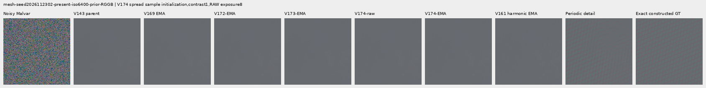

mesh-seed2026112302-present-iso6400-prior-RGGB; ROI `[176, 176, 160, 160]`, exposure 8, contrast 40.

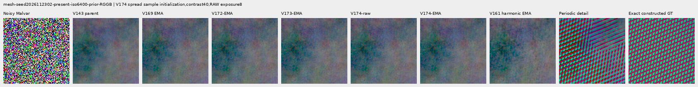

mesh-seed2026112309-present-iso6400-prior-RGGB; ROI `[176, 176, 160, 160]`, exposure 8, contrast 1.

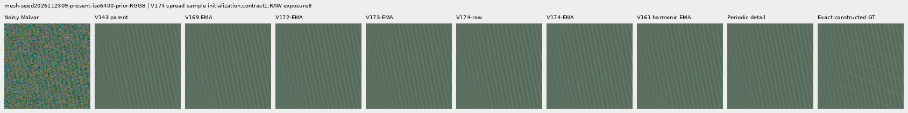

mesh-seed2026112309-present-iso6400-prior-RGGB; ROI `[176, 176, 160, 160]`, exposure 8, contrast 40.

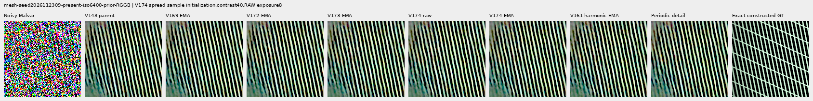

mesh-seed2026112304-absent-iso6400-prior-RGGB; ROI `[165, 0, 160, 160]`, exposure 8, contrast 40.

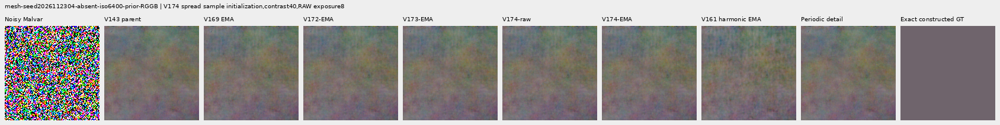

main-overcast-sky; ROI `[176, 176, 160, 160]`, exposure 4, contrast 1.

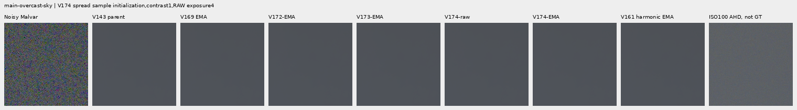

main-building-detail; ROI `[176, 176, 160, 160]`, exposure 4, contrast 1.

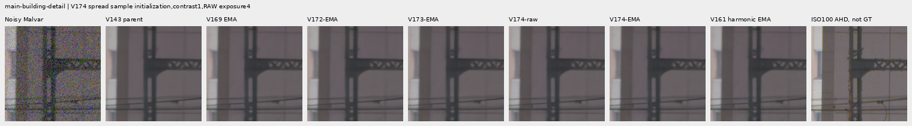

main-foliage; ROI `[176, 176, 160, 160]`, exposure 4, contrast 1.

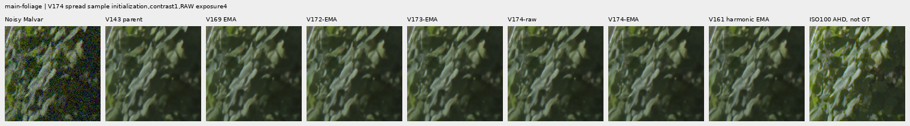

main-chain-link-fence; ROI `[176, 176, 160, 160]`, exposure 4, contrast 1.

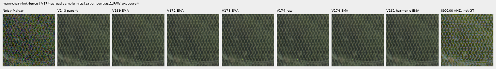

mesh-nominal; ROI `[206, 229, 160, 160]`, exposure 16, contrast 1.

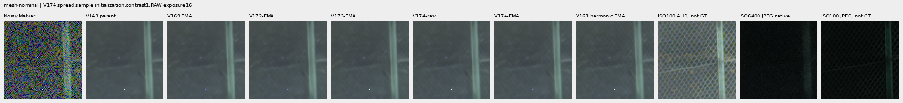

mesh-nominal; ROI `[426, 189, 160, 160]`, exposure 16, contrast 1.

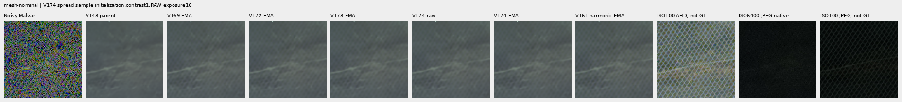

mesh-profile3879; ROI `[206, 229, 160, 160]`, exposure 16, contrast 1.

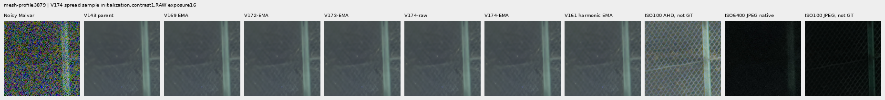

mesh-profile3879; ROI `[426, 189, 160, 160]`, exposure 16, contrast 1.

organic-02a76fd33b5e1414a0504f0b3f0aeb03a569b6f4-photo-faint-RGGB; ROI `[112, 112, 160, 160]`, exposure 14.3883, contrast 8.

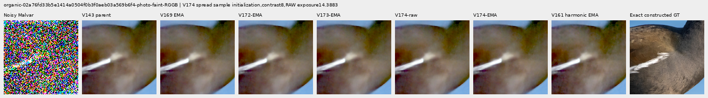

organic-dabacecd4780a1c230f8e9fce6ca1a604bdeab4c-photo-dark-RGGB; ROI `[112, 112, 160, 160]`, exposure 102.758, contrast 1.

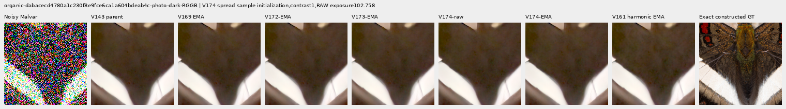

organic-6b3920bceba82d95ecf9351d47f6f94267694bd0-photo-dark-RGGB; ROI `[112, 112, 160, 160]`, exposure 64.0491, contrast 1.

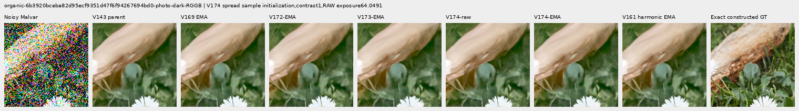

gray-l0.02-adc-only-RGGB; ROI `[48, 48, 160, 160]`, exposure 4, contrast 40.

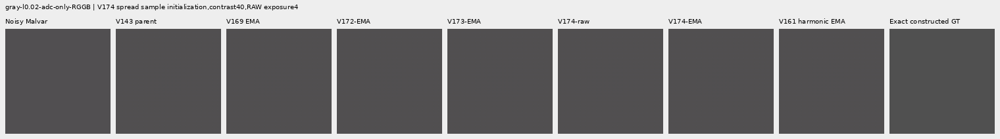

gray-l0.02-iso12800-prior-RGGB; ROI `[48, 48, 160, 160]`, exposure 4, contrast 40.

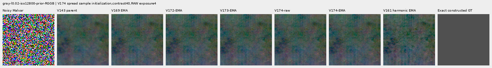

flat512-gray-l0.02-adc-only-RGGB; ROI `[176, 176, 160, 160]`, exposure 4, contrast 40.

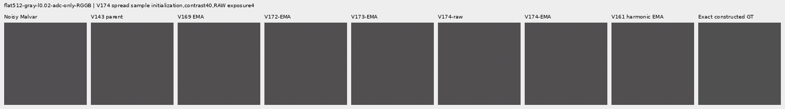

flat512-gray-l0.02-iso6400-prior-RGGB; ROI `[176, 176, 160, 160]`, exposure 4, contrast 40.

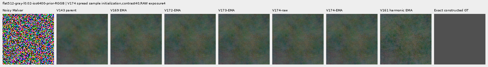

flat512-gray-l0.02-iso12800-prior-RGGB; ROI `[176, 176, 160, 160]`, exposure 4, contrast 40.

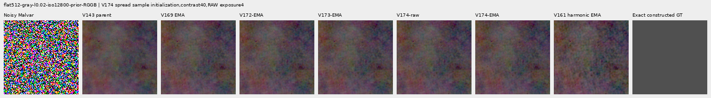

flat512-h210-s0.50-l0.02-iso6400-prior-RGGB; ROI `[176, 176, 160, 160]`, exposure 4, contrast 40.

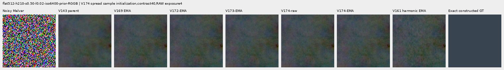

flat512-gray-l0.18-iso12800-prior-RGGB; ROI `[176, 176, 160, 160]`, exposure 1, contrast 8.

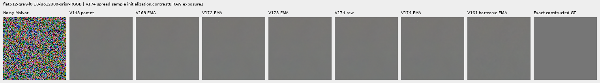

flat512-gray-l0.90-iso12800-prior-RGGB; ROI `[176, 176, 160, 160]`, exposure 1, contrast 4.

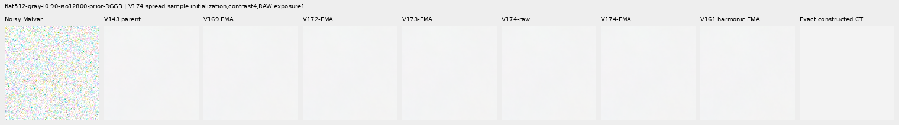

photo-3e638bbb56ed80abc88939468783e3bf9b92ee77-photo-faint-RGGB; ROI `[176, 176, 160, 160]`, exposure 12.1494, contrast 8.

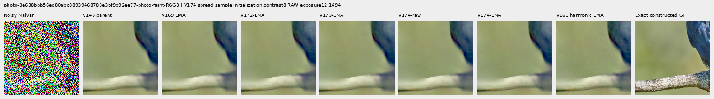

photo-3e638bbb56ed80abc88939468783e3bf9b92ee77-photo-dark-RGGB; ROI `[176, 176, 160, 160]`, exposure 80.9959, contrast 1.

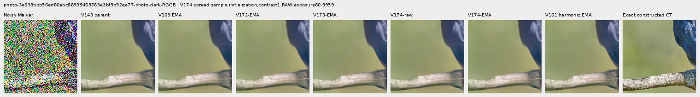

mixed-vertical-step-iso6400-prior-RGGB; ROI `[80, 176, 160, 160]`, exposure 8, contrast 40.

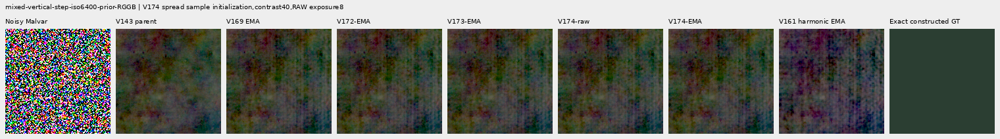

mixed-vertical-step-iso6400-prior-RGGB; ROI `[240, 176, 160, 160]`, exposure 8, contrast 1.

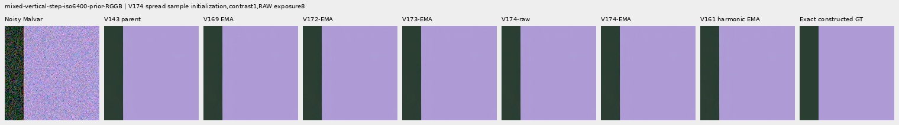

mixed-vertical-step-iso12800-prior-RGGB; ROI `[80, 176, 160, 160]`, exposure 8, contrast 40.

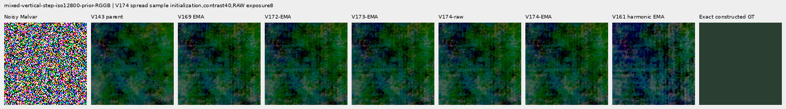

mixed-vertical-step-iso12800-prior-RGGB; ROI `[240, 176, 160, 160]`, exposure 8, contrast 1.

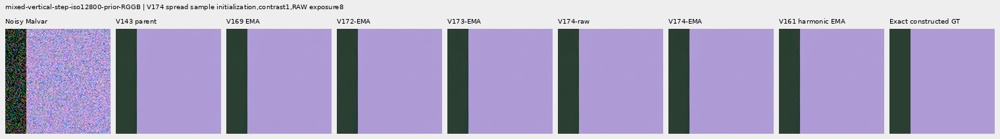

mixed-narrow-bar-iso6400-prior-RGGB; ROI `[80, 176, 160, 160]`, exposure 8, contrast 40.

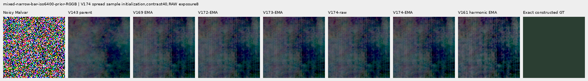

mixed-narrow-bar-iso6400-prior-RGGB; ROI `[240, 176, 160, 160]`, exposure 8, contrast 1.

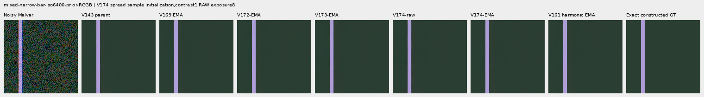

mixed-narrow-bar-iso12800-prior-RGGB; ROI `[80, 176, 160, 160]`, exposure 8, contrast 40.

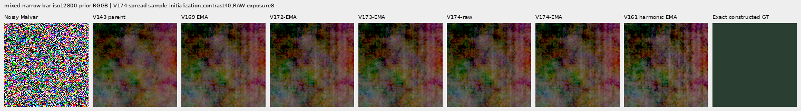

mixed-narrow-bar-iso12800-prior-RGGB; ROI `[240, 176, 160, 160]`, exposure 8, contrast 1.

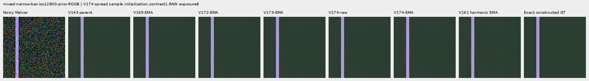

mixed-slanted-step-iso6400-prior-RGGB; ROI `[80, 176, 160, 160]`, exposure 8, contrast 40.

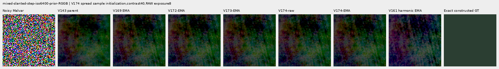

mixed-slanted-step-iso6400-prior-RGGB; ROI `[240, 176, 160, 160]`, exposure 8, contrast 1.

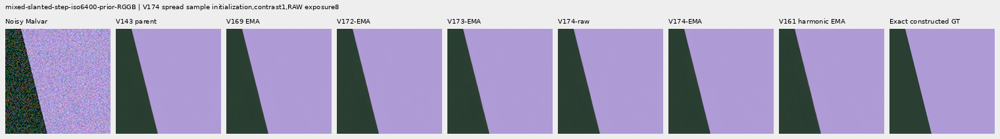

mixed-slanted-step-iso12800-prior-RGGB; ROI `[80, 176, 160, 160]`, exposure 8, contrast 40.

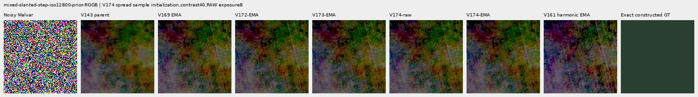

mixed-slanted-step-iso12800-prior-RGGB; ROI `[240, 176, 160, 160]`, exposure 8, contrast 1.

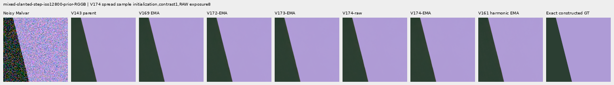

mixed-striped-patch-iso6400-prior-RGGB; ROI `[80, 176, 160, 160]`, exposure 8, contrast 40.

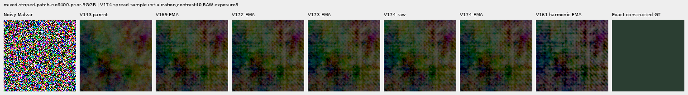

mixed-striped-patch-iso6400-prior-RGGB; ROI `[240, 176, 160, 160]`, exposure 8, contrast 1.

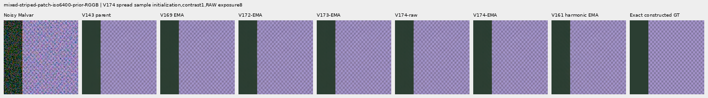

mixed-striped-patch-iso12800-prior-RGGB; ROI `[80, 176, 160, 160]`, exposure 8, contrast 40.

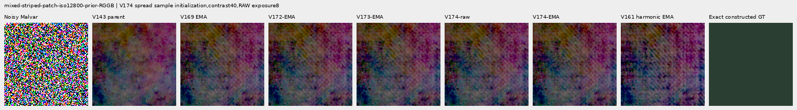

mixed-striped-patch-iso12800-prior-RGGB; ROI `[240, 176, 160, 160]`, exposure 8, contrast 1.

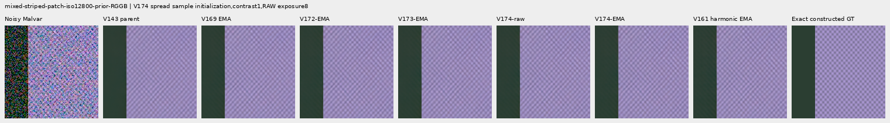

V150-control-bark-contrast0p025-adc-RGGB; ROI `[48, 48, 160, 160]`, exposure 1, contrast 40.

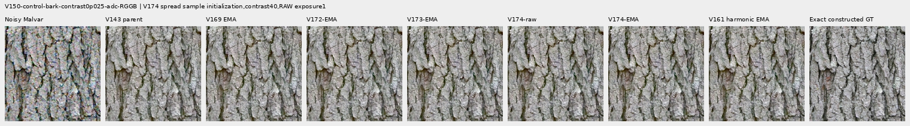

V150-control-raccoon-fur-contrast0p025-adc-RGGB; ROI `[48, 48, 160, 160]`, exposure 1, contrast 40.

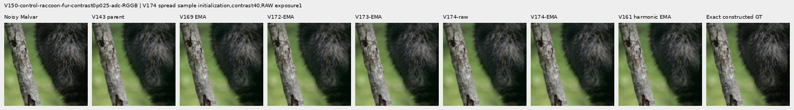

V150-control-ADC-plane0-RGGB; ROI `[176, 176, 160, 160]`, exposure 45, contrast 8.

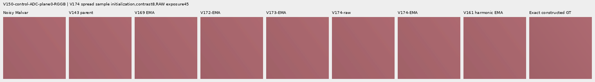

V150-control-ADC-plane1-RGGB; ROI `[176, 176, 160, 160]`, exposure 9, contrast 8.

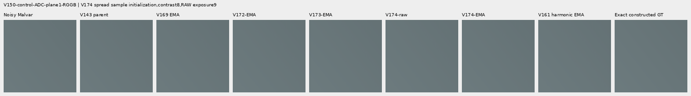

V150-control-ADC-plane2-RGGB; ROI `[176, 176, 160, 160]`, exposure 1, contrast 8.

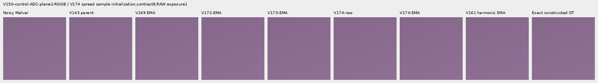

V150-control-ADC-plane3-RGGB; ROI `[176, 176, 160, 160]`, exposure 0.24, contrast 8.

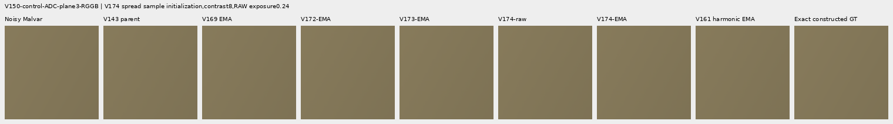

### Noisy, restored and exact constructed GT triplets

mesh-seed2026112302-present-iso6400-prior-RGGB; ROI `[176, 176, 160, 160]`, exposure 8, contrast 1.

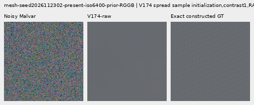

mesh-seed2026112302-present-iso6400-prior-RGGB; ROI `[176, 176, 160, 160]`, exposure 8, contrast 1.

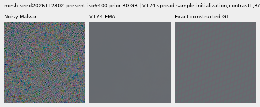

mesh-seed2026112309-present-iso6400-prior-RGGB; ROI `[176, 176, 160, 160]`, exposure 8, contrast 1.

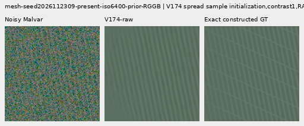

mesh-seed2026112309-present-iso6400-prior-RGGB; ROI `[176, 176, 160, 160]`, exposure 8, contrast 1.

flat512-gray-l0.02-iso6400-prior-RGGB; ROI `[176, 176, 160, 160]`, exposure 4, contrast 40.

flat512-gray-l0.02-iso6400-prior-RGGB; ROI `[176, 176, 160, 160]`, exposure 4, contrast 40.

flat512-gray-l0.02-iso12800-prior-RGGB; ROI `[176, 176, 160, 160]`, exposure 4, contrast 40.

flat512-gray-l0.02-iso12800-prior-RGGB; ROI `[176, 176, 160, 160]`, exposure 4, contrast 40.

mixed-vertical-step-iso6400-prior-RGGB; ROI `[80, 176, 160, 160]`, exposure 8, contrast 40.

mixed-vertical-step-iso6400-prior-RGGB; ROI `[80, 176, 160, 160]`, exposure 8, contrast 40.

mixed-vertical-step-iso12800-prior-RGGB; ROI `[80, 176, 160, 160]`, exposure 8, contrast 40.

mixed-vertical-step-iso12800-prior-RGGB; ROI `[80, 176, 160, 160]`, exposure 8, contrast 40.

[Independent publication verification](results/v174-spread-matching-publication-verification-v1.json).
