# Physical variance stabilization with a frozen Gaussian prior

This is an experimental comparison path alongside the DINOv3 model. It does
not replace reviewed V16. The eight-step RGB reconstruction improves measured-CFA
PSNR over V16 on both complete development panels and over RawNIND on the
unseen-camera mean. It still trails RawNIND on known cameras and unseen-camera
SSIM; the small scene-bootstrap intervals include zero. The GFX fence is much
clearer, but foliage remains soft and isolated colored dots survive in the sky.
On the same 16 synthetic-noise validation photos it gains 1.82064 dB rendered
PSNR over V16; the full 427-photo comparison remains to be run. This does not
establish state-of-the-art photographic quality.

The implementation supplies explicit nonnegative shot/read coefficients from
the same input-only calibration or nominal sensor priors used by the other
methods. It never fits weights or transform parameters to evaluation photos
and never derives gains from a reference image. Original GFX files remain
read-only and the scene/siblings stay out of training.

For shot coefficient `a > 0` and read variance `v`, the generalized Anscombe
transform maps a measurement to approximately unit noise variance. This
independent implementation uses an additive centering constant and a stable
rational expression, with float64 physical arithmetic followed by float32
neural inference and RGB output. The inverse tabulates the expected transformed
Poisson/Gaussian observation over means 0..128, then interpolates that expectation
back to signal. A continuous, matched asymptotic tail handles larger counts;
a signed linear extension handles estimates below the mean-zero endpoint.

The numerical table uses 96-node Legendre quadrature after a square-root change
of variable, removing the clipped root's endpoint singularity, and Poisson
counts 0..320. It is a numerical approximation. The published closed-form inverse
and biased algebraic inverse remain explicit diagnostic options. See
[Mäkitalo and Foi's primary paper, sections II-B and III-E/F](https://webpages.tuni.fi/foi/papers/OptGenAnscombeInverse-doublecolumn-preprint.pdf).
The inverse of an expected transformed noisy measurement differs from a plain
algebraic inverse; this matters for shadow bias.

`StabilizedGaussianPrior` applies the verified frozen grayscale DRUNet to each
original packed CFA phase, then WB-aware Malvar interpolation. Independent
phases retain native geometry. Pure Gaussian noise uses its supplied standard
deviation directly; zero stochastic noise preserves Malvar's ADC-only result.
Exactly constant phases bypass the network. The method is nonblind to its
provided physical priors and has no learned camera-specific parameters.

`JointGaussianPrior` instead alternates a closed-form CFA data-consistency step
with a frozen RGB DRUNet at native RGB resolution in stabilized camera units.
The pilot uses a short fixed schedule, motivated by the
[DPIR authors' reconstruction code](https://github.com/cszn/DPIR/blob/master/main_dpir_demosaick.py)
and [penalty schedule](https://github.com/cszn/DPIR/blob/master/utils/utils_pnp.py).
It is a new Poisson/Gaussian-domain experiment, **not a reproduction of DPIR or
Noise2VST scores**. The initial pilot has four denoising strengths 8/4/2/1 and
weight 0.23. A second pilot uses eight logarithmically spaced strengths 4→0.5
and weight 0.05. Both pilots used the first two named development scenes in each
panel. The eight-step schedule was then frozen before expansion to all four/five
development scenes and a 16-photo synthetic screen. This is development/model
selection evidence: the expanded panels include the pilot scenes. The protected
final scenes remain unused. Parameters are fixed across images; no per-image
fitting occurs.

The external neural source and original KAIR weights are checksum-verified,
loaded strictly, frozen and archived with MIT notices. The comparator source stays outside
this repository. [Gray source/weight receipt](results/noise2vst-source-and-weights.json),
[RGB four-step receipt](results/gaussian-color-source-and-weights.json),
[fixed eight-step recipe and weights](results/gaussian-color-joint8-source-and-weights.json).
The [Noise2VST authors' repository](https://github.com/sherbret/Noise2VST) supplies
the inspected network implementation; its transform-fitting procedure is not
used here. No additional dependency was installed.

All 214 tests passed, including independent dense Gaussian-coordinate integration
of expected transforms, low/high-count inversion, table-boundary continuity,
sub-16-bit algebraic round-trip precision at widely differing noise ratios,
all CFA layouts, constant/ADC-only cases, CPU/CUDA arithmetic, RGB data-projection
geometry, and archived-source/weight corruption rejection. Tests use independent
properties and numerical oracles; they do not establish photographic quality.

The comparators are opt-in:

```bash
source scripts/env.sh
uv run --no-sync python scripts/evaluate_paired_raw.py /path/to/v16.pt \
  --prepared /path/to/prepared-development/manifest.json \
  --rawnind /mnt/external/demosaic/references/rawnind \
  --gaussian-reference docs/results/noise2vst-source-and-weights.json \
  --output /mnt/external/demosaic/evaluation/gaussian-next
uv run --no-sync python scripts/report_raw_pair.py \
  configs/gfx-qualitative-20231231.json /path/to/v16.pt \
  --gaussian-reference docs/results/noise2vst-source-and-weights.json \
  --full-frame --output /mnt/external/demosaic/evaluation/gfx-gaussian-next
```

`demosaic quality` also accepts `--gaussian-reference`. Reports archive source,
frozen weights, exact conditioning and native triplets. Existing defaults and
checkpoint arithmetic are unchanged. The full gray GFX run produced complete
11662×8746×3 uint16 linear-camera-RGB and ICC sRGB files. Single shared-machine
restoration took 148.05 s, excluding decode/load/render/encoding, versus 31.35 s for
V16 in that run. This is not a controlled idle benchmark and the 10-second goal
remains unmet. All four TIFFs were verified for geometry, dtype, 16-bit sample
tags and >256 distinct sampled values; both sRGB outputs carry ICC profiles.

To reproduce the fixed Joint8 comparison, use
`docs/results/gaussian-color-joint8-source-and-weights.json` as
`--gaussian-reference`, the pinned V16 checkpoint above, `--batch-size 2`, and
each prepared development manifest recorded in the numerical receipt. The
synthetic screen command is:

```bash
source scripts/env.sh
uv run --no-sync demosaic quality /path/to/v16.pt \
  --manifest /mnt/external/demosaic/evaluation/manifests/common-8192-44732-val-v1.jsonl \
  --config configs/evaluation.yaml --precision float16 --batch-size 2 \
  --limit 16 --synthetic-count 4 \
  --rawnind /mnt/external/demosaic/references/rawnind \
  --gaussian-reference docs/results/gaussian-color-joint8-source-and-weights.json \
  --output /mnt/external/demosaic/evaluation/joint8-synthetic-next
```

## Complete real development panels

Means balance crops within pairs, then pairs within scenes. Known cameras have
four scenes/eight pairs/72 crops; the unseen M100 panel has five scenes/ten
pairs/90 crops. Primary PSNR uses registered low-noise **measured CFA** samples.
Rendered RGB PSNR/SSIM use the independently demosaiced AHD reference and are
auxiliary, not exact RGB GT. RawNIND uses publisher ADC normalization and the
observed-CFA global least-squares gain, without reference-derived gains. All
methods see identical prepared observations and render transforms.

| Panel | Method | Measured-CFA PSNR | AHD RGB PSNR | AHD SSIM |
| --- | --- | ---: | ---: | ---: |
| Known, 4 scenes | V16 | 53.27465 | 39.15834 | .921518 |
| Known, 4 scenes | Independent gray phases | 53.28781 | 38.34481 | .905832 |
| Known, 4 scenes | **Joint RGB, 8 steps** | **53.81110** | **39.40695** | **.921144** |
| Known, 4 scenes | RawNIND | 54.06860 | 39.67805 | .928811 |
| Unseen, 5 scenes | V16 | 53.07856 | 37.65963 | .907179 |
| Unseen, 5 scenes | Independent gray phases | 52.08223 | 35.28710 | .855573 |
| Unseen, 5 scenes | **Joint RGB, 8 steps** | **53.84615** | **38.43221** | **.915720** |
| Unseen, 5 scenes | RawNIND | 53.56220 | 38.14484 | .918380 |

Joint8 minus RawNIND scene-bootstrap 95% intervals are −0.25750 dB
[−0.73856, +0.22356] on known-camera primary PSNR and +0.28395 dB
[−0.04577, +0.60362] on unseen-camera primary PSNR. Unseen auxiliary RGB PSNR
improves +0.28737 dB [−0.19525, +0.73207], while SSIM falls .002660.
The pilot's +0.64220 dB unseen primary gain shrinks after expansion. Neither
small panel supports a broad superiority claim. Independent gray denoising
fails especially on the unseen camera despite retaining some GFX texture.

Joint8 minus RawNIND primary PSNR by scene shows the remaining regressions:

| Scene | Difference, dB |
| --- | ---: |
| 2pilesofplates | +.07781 |
| 7D-1 | −.72270 |
| MuseeL-CopteArch-C500D | −.75442 |
| D60-2 | +.36932 |
| LucieB_3apples | +.45067 |
| LucieB_Coulicoco | +.83374 |
| LucieB_bedroom_tapestry | +.09134 |
| LucieB_stick_figurine | −.31686 |
| LucieB_top_of_Expedit | +.36085 |

[Complete receipts](results/stabilized-gaussian-review.json) record original
summary hashes, frozen checkpoints/source hashes, per-pair/group metrics,
conditioning and exact native crops. V16's hash is
`5589d6c2ff8d9985ee6515628aed5744c3593375aec7078bc15da4b1851bf5c1`;
RGB DRUNet's hash is
`479abe3c5327dfd10ff54a80ec7d4098ca80752a5c9492cdff31cee430bec4b4`;
gray DRUNet's hash is
`e27fb29456732c604c8ee3ac3e92ecadd2a7a4e36a8be675e92ebbf93a240de4`.
Neural precision is V16 FP16 base/FP32 refinement and DRUNet IEEE FP32;
stabilization/inversion use float64. No test-image training occurs.

## Native real crops

Each image contains 160×160 noisy Malvar → denoised → low-noise AHD reference
panels. Open the original PNG at 100%; no pixels were resized. PNGs are 8-bit
sRGB previews; scores use unquantized predictions. Exposure is ×1 with the
recorded shared white balance/color matrix. ROIs, complete input-only Haar/nominal
noise conditioning and source/checkpoint hashes are in the linked receipt.

LucieB_3apples ISO6400, then LucieB_Coulicoco ISO12800; fixed middle crops from
the first two unseen-camera scenes, selected by the evaluation protocol.

Joint RGB, eight steps:

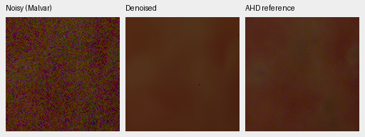
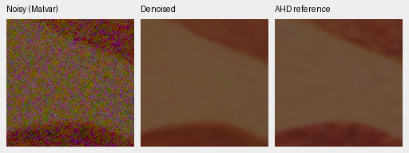

Matched V16:

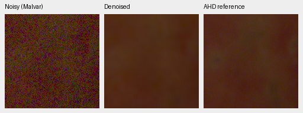
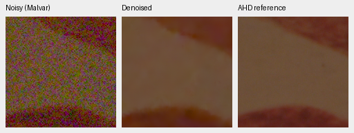

Matched RawNIND:

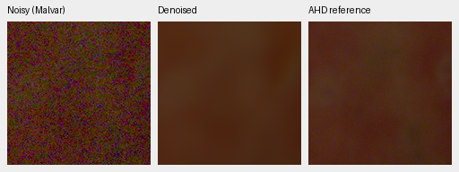
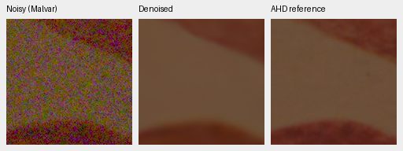

## Standing GFX foliage and fence

DSCF3879 ISO6400 versus DSCF3880 ISO100, the standing evaluation-only pair.
The latter is **not exact GT**: aperture, motion and capture time differ. These
are matched 512px-context restorations, not full-frame results. Every method
uses the same 160px ROIs, +2 EV display exposure, white balance and color matrix.
Noisy and reference panel pixels were checked for exact equality across methods.
Foliage starts at (8890,5570); fence at (2240,6000), with reference fence shifted
one integer pixel to (2241,6000). No resampling or output-dependent alignment.
Sky/building crops and all original RAF hashes are also in the receipt.

Joint RGB, eight steps; foliage then fence:


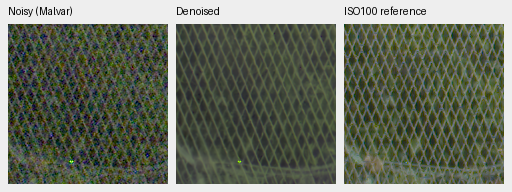

Matched V16:


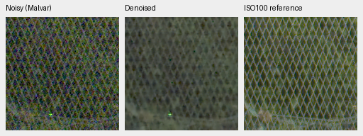

Matched RawNIND:


Independent gray phases:

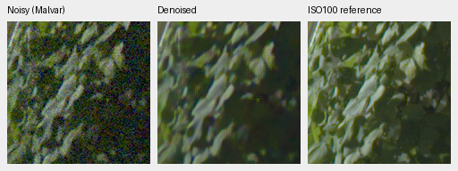
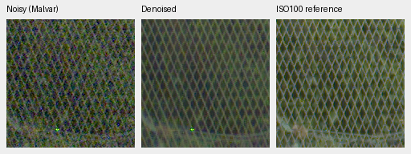

The RGB prior removes much of the independent-phase checkerboard/color noise
and preserves considerably more fence structure than V16/RawNIND. Leaves remain
smoothed and isolated colored dots persist, especially in sky/shadows. The
sharper f/5.6 reference cannot establish which missing details the f/1.7 capture
contains. No pixelwise scores are computed for this pair.

## Full 102 MP GFX output

The fixed Joint8 method completed the entire 11662×8746 image, tiled at 512px
with 64px overlap, batch4 and 520 tiles. [The full-frame receipt](results/gfx-joint8-full-review.json)
includes source/checkpoint hashes, exact native ROIs and all six output TIFF
hashes/validations. Files are under
`/mnt/external/demosaic/evaluation/gfx-3879-3880-gat-joint8-v2-full/`:
`restored-{0,1,2}-{linear16,srgb16}.tiff`, with indices V16, RawNIND, Joint8.

| Method | Restoration seconds | Peak CUDA GB |
| --- | ---: | ---: |
| V16 FP16 base / FP32 refinement | 29.51 | .972 |
| RawNIND IEEE FP32 | 15.99 | 1.512 |
| Joint8 IEEE FP32 neural / float64 physical | **967.31** | .882 |

These are single shared-machine timings, including overlapping CPU work and
another user's GPU process; they exclude RAW decoding, loading, rendering and
TIFF encoding. Peak CUDA allocation is not total UMA. The 10-second target is
unmet; Joint8 is currently an expensive qualitative/reference method.

All six files were rehashed and verified as 8746×11662×3 uint16 with 16-bit sample
tags. All three sRGB files carry ICC profiles. Subsampled unique output codes
range from 5,441 to 5,510 for linear files and 25,508 to 26,006 for sRGB files,
confirming more than 256 levels. This validates output precision/geometry, not
quality. An averaged full-frame overview was inspected for gross artifacts;
that does not establish seam-free behavior at every native pixel.

The following panels come from the blended FP32 **full-frame** output, not the
512px-context experiments above. Same native160px foliage/fence coordinates,
shared +2 EV, WB and matrix. The last panel remains the independent ISO100
qualitative reference, **not GT**. Native pixel hashes and identical noisy/
reference panel bytes across methods were checked.

Joint8 foliage, then fence:


Matched V16:

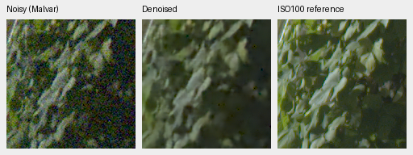
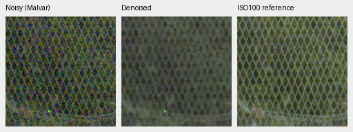

Matched RawNIND:


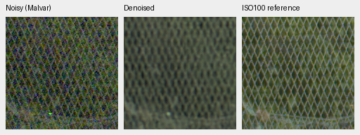

The fence structure advantage survives full-frame blending. Foliage is still
soft; isolated colored dots remain. Neither capture's different aperture/motion
nor this comparison supports an exact-detail recovery claim. The
[V28 trainable pretrained RGB/DINO experiment](pretrained-rgb-restoration.md)
tests a single-pass direction; it is not yet quality reviewed.

## Earlier pilots and rejected gain diagnostic

These **two-scene** means must not be compared to the full-panel means above.

| Pilot panel | Method | Measured-CFA PSNR | AHD RGB PSNR | AHD SSIM |
| --- | --- | ---: | ---: | ---: |
| Known first 2 | V16 | 54.25509 | 40.17862 | .922623 |
| Known first 2 | Joint4, 8/4/2/1, weight .23 | 54.26174 | 40.02211 | .929674 |
| Known first 2 | Joint8, 4→.5, weight .05 | 54.91668 | 40.38193 | .919366 |
| Known first 2 | RawNIND | 55.23912 | 40.91232 | .932820 |
| Unseen first 2 | V16 | 52.73458 | 37.98150 | .915239 |
| Unseen first 2 | Joint4, 8/4/2/1, weight .23 | 52.15833 | 38.24181 | .923313 |
| Unseen first 2 | Joint8, 4→.5, weight .05 | 53.68378 | 39.02677 | .926887 |
| Unseen first 2 | RawNIND | 53.04158 | 38.20981 | .922831 |

The four-step pilot's matched apples/Coulicoco crops:

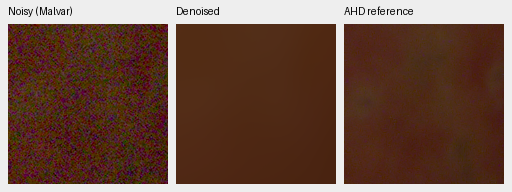
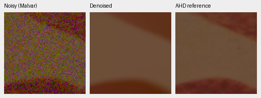

A predetermined apples ISO6400 crop was also checked with input-only scalar,
per-channel least-squares and per-channel mean gains. All lowered its primary
PSNR (52.76152 → 52.68430/52.69930/52.72285). No gain normalizer was added.
This is a one-crop diagnostic, not evidence about all images. The numerical
receipt preserves its full settings/results.

## Synthetic screens with exact targets

The gray comparison uses 64 validation photos + 8 procedural sources; Joint8
uses 16 validation photos + 4 procedural sources. Both use all four Bayer
layouts and seven fixed ADC/noise/exposure conditions, including clipped
highlights and deep shadows. **Compare methods only within the same screen**;
these sample counts differ. Neither is the full 427-photo evaluation or the
untouched final test.

| Screen | Source type | Method | Rendered PSNR | SSIM |
| --- | --- | --- | ---: | ---: |
| 64 photos + 8 procedural | photo | V16 | 31.96724 | 0.924058 |
| 64 photos + 8 procedural | synthetic | V16 | 29.22482 | 0.910983 |
| 64 photos + 8 procedural | photo | Independent gray | 30.36167 | 0.912048 |
| 64 photos + 8 procedural | synthetic | Independent gray | 27.56619 | 0.880424 |
| 64 photos + 8 procedural | photo | RawNIND | 27.41317 | 0.802686 |
| 64 photos + 8 procedural | synthetic | RawNIND | 23.65220 | 0.705132 |
| 16 photos + 4 procedural | photo | V16 | 32.41824 | 0.937421 |
| 16 photos + 4 procedural | synthetic | V16 | 29.74338 | 0.925096 |
| 16 photos + 4 procedural | photo | Joint RGB, 8 steps | 34.23888 | 0.954308 |
| 16 photos + 4 procedural | synthetic | Joint RGB, 8 steps | 32.52197 | 0.955809 |
| 16 photos + 4 procedural | photo | RawNIND | 27.70768 | 0.826958 |
| 16 photos + 4 procedural | synthetic | RawNIND | 24.64040 | 0.813535 |

Rendered PSNR by condition on the **same 16 photos** (average over all four
CFA patterns):

| Condition | V16 | Joint8 | RawNIND |
| --- | ---: | ---: | ---: |
| adc-only | 32.71452 | 30.97452 | 27.33323 |
| iso100-prior | 32.85615 | 34.12677 | 27.32638 |
| iso1600-prior | 32.45051 | 36.14201 | 27.25859 |
| iso12800-prior | 30.80898 | 33.78507 | 26.93806 |
| shadows | 37.61692 | 39.97946 | 34.55870 |
| highlights | 28.62634 | 28.96996 | 23.38632 |
| legacy-noise | 31.85425 | 35.69438 | 27.15248 |

Joint8's zero-noise case intentionally falls back to WB-aware Malvar rather
than a learned demosaicer. Highlight-boundary/chroma and shadow metrics are
preserved per condition in the receipt. A single aggregate score does not
establish successful clipped-highlight reconstruction.

On these 16 photos, Joint8 minus V16 rendered PSNR is +1.82064 dB with a
source-bootstrap 95% interval [+1.39089, +2.33632]; versus RawNIND it is +6.53120
dB [+5.89874, +7.16611]. The improvement spans six of seven condition means;
the ADC-only fallback loses 1.74000 dB to V16. This small development screen
warrants a full photographic evaluation, not promotion based on the pilot.

The following native 160px triplets use the same first two validation sources,
RGGB, ISO12800 nominal prior (`shot=.00256`, `read=.0000262144`), ×1 display
exposure, WB [2,1,1.5] and the shared protocol matrix. Exact sources, crop
coordinates, seed, checkpoint and noise settings are in the receipt. Source
images were linearly binned 8×8 before evaluation; these are native **binned
evaluation** pixels, not 100% crops of the original camera JPEG. No crop pixels
were resized.

Joint8; paraglider fabric then building/sky:

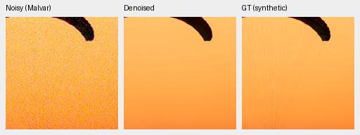
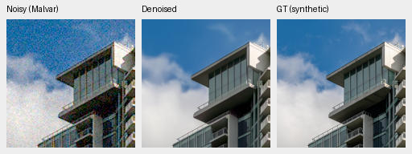

Independent gray phases, at the same coordinates/display settings:


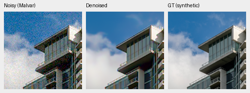

Matched [V16 fabric](images/gat-joint8_synthetic16-00.png),
[V16 building](images/gat-joint8_synthetic16-01.png),
[RawNIND fabric](images/gat-joint8_synthetic16-04.png) and
[RawNIND building](images/gat-joint8_synthetic16-05.png) triplets are retained.
Fine fabric lines are still lost. The RGB prior recovers cleaner, more coherent
building boundaries than the independent-phase prior; the native figures also
show its smoothing of cloud texture.

Sources: [Roy Egloff](https://commons.wikimedia.org/wiki/File:CH.VD.Villeneuve_2007-08-25_Vertigo-Swiss-Riviera_2392_3x2-R_4K.jpg)
and [Dietmar Rabich](https://commons.wikimedia.org/wiki/File:Vancouver_(BC,_Canada),_Coal_Harbour_Seaside_Park,_Blick_in_den_Himmel_--_2022_--_2158.jpg),
[CC BY-SA 4.0](https://creativecommons.org/licenses/by-sa/4.0/).
Modifications: linear-light binning, evaluation crop, synthetic Bayer/noise,
restoration and display encoding. The derivative previews retain that license.
All source attribution/cache hashes are in the numerical receipt.
