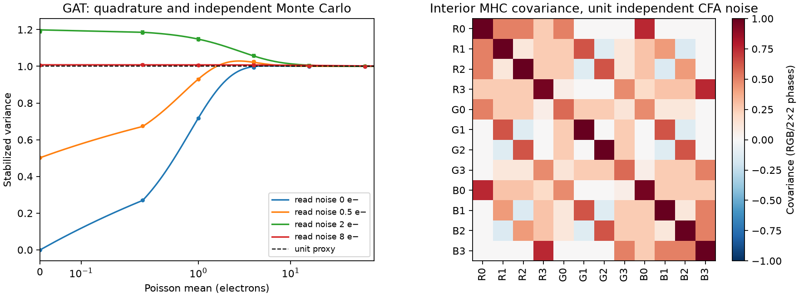

# Check the RGB trunk's unit-noise approximation

The stabilized RGB path assigns unit variance to each stochastic CFA phase,
demosaics it with Malvar and supplies a unit scalar noise proxy before affine
normalization. A generated CPU diagnostic separates the transform's actual
variance from the demosaicer's covariance. No network, photograph, reference,
training update or fitted camera parameter is used.

For the dark and bright gray flat intensities used as the backgrounds of our
weak-carrier tests, the unclipped/unquantized noise model gives:

| Gray level | Poisson mean | GAT variance | Mean RGB/spatial-phase variance after MHC | Proxy |
| ---: | ---: | ---: | ---: | ---: |
| .01 | 3.90625 | 1.05792645 | .96976591 | 1 |
| .18 | 70.3125 | 1.00038867 | .91702295 | 1 |

Both use shot .00256 and read variance .0000262144, or2 read-noise electrons.
These are flat-field moments, not carrier response or learned restoration
measurements. At the dark level, the average variance is close to the proxy.
Other tested read/signal regimes deviate in both directions. This does not
support a large uniform reduction of noise conditioning as the next fix.
ADC-only paths already use zero stochastic variance, so this unit-noise
approximation does not directly apply to their weak-detail failures.

Even exact marginal variance would not whiten the demosaiced noise. For unit
independent CFA noise, the interior MHC variance averaged over RGB/2×2 phases
is exactly **11/12**. At an RGGB red site, the RGB covariance is

```text
[[1,      .5,      .75    ],
 [ .5,    .5625,   .46875 ],
 [ .75,   .46875,  .953125]]
```

The complete12×12 RGB/cell covariance has eigenvalues .02285884–3.28472562.
A scalar adjustment cannot remove these cross-channel/spatial correlations.
This establishes a conditioning approximation, not that the trained network
fails because of it or that whitening would improve quality.
These covariance values use unbalanced/GAT coordinates, without white-balance
rescaling.



Verification uses128/256-node conditional quadrature plus the analytic second
moment of the positive part of a normal variable; Poisson counts run0–320,
and the Gaussian integral spans±12 standard deviations. All24 moment cases
agree with262,144 independent samples per case within the declared six-SE
checks. The production expectation tables agree at the checked means. Exact
stencil-energy fractions check the12 diagonal variances for each CFA impulse
operator. Four Gaussian cases and two complete GAT→MHC flat cases each use
32,768 generated fields to check the full covariance. Maximum Gaussian
covariance error is3.134 estimated SE. The selected cell has full filter support;
these are interior results and exclude reflected boundary statistics.

A numerical rerun after correcting the plot's nonnegative axis reproduces all
24 moment rows and12 stored coefficient/covariance arrays byte-for-byte.
The plot was actually viewed. Static AST/byte checks bind GAT construction,
forward/expectations, MHC and the noise/normalization calculations to the
actual frozen training package. Both recent implementation cleanups leave
the tested physics unchanged. Torch's CPU RNG stays exact and CUDA is hidden.

[Complete receipt](results/stabilized-noise-proxy-CPU-v2.json),
[individual moments](results/stabilized-noise-proxy-moments-v2.json),
[source/replay audit](results/stabilized-noise-proxy-source-replay-v2.json).
The standalone PDF and arrays are in
`/mnt/external/demosaic/experiments/stabilized-noise-proxy-CPU-v2/`.
Reproduce with `scripts/env.sh` loaded, CUDA hidden and
`scripts/diagnose_stabilized_noise_proxy.py --output NEW_DIRECTORY`.
`scripts/audit_stabilized_noise_proxy.py` checks the saved replay/source links.

There is no change to inference/training noise priors or the active V88/V89
comparison. ADC quantization, saturation and real-camera variance truth are
outside this study. A covariance-aware representation would need its own
matched trained quality, flat/detail, native crop and full-frame review; these
moments alone do not justify adding one.
