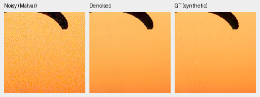
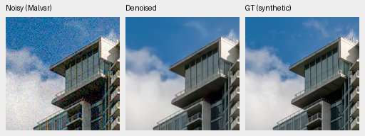
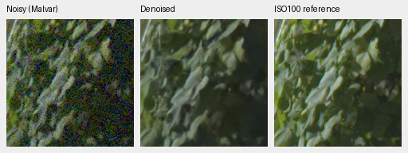
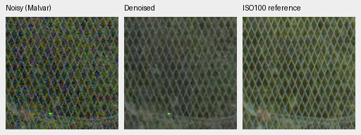

# V29: matched variance-stabilized RGB trial

V29 improves the 16-photo synthetic screen by **1.32563 dB** over V28 at
the same 1,000 training steps. Known-camera real development also improves,
but unseen-camera rendered PSNR falls. This is an experimental representation
trial; the full photographic suite and full 102 MP output remain unreviewed.

[Complete numerical/crop receipt](results/stabilized-rgb-v29-1k-review.json),
[V28 completed 5k review](pretrained-rgb-v28-5k-review.md),
[training configuration](../configs/dino-stabilized-pretrained-rgb-v29.yaml).
V29 step1000 SHA256:
`2ddda6500639e5e320d326095d2946675c7c18de26ccb6bd51097c8cd01f6d7f`.

## What the experiment changes

The neural tensors at step zero are exactly V28's original initialization,
including the DINO adapter and zero fusion gate. Both trials use seed45,
the same per-step data RNG, batch4, LR1e-4, planned 5,000-step schedule and
50% Commons/procedural, 25% paired RAW, 25% binned native-RAW proportions.
All 41 logged observation hashes/domains through step1000 match exactly;
unlogged batches were not separately hashed. No final-test or GFX sources enter
training or transform fitting.

V29 replaces linear camera RGB restoration coordinates with a centered
generalized Anscombe transform (GAT) using explicit supplied shot/read priors.
It transforms each CFA measurement, performs Malvar interpolation in that
domain, and feeds the pretrained native RGB trunk a unit-variance noise proxy.
The output uses a numerical expectation inverse. Pure Gaussian noise uses
division/multiplication by its standard deviation; zero-noise ADC cases retain
the linear path. DINO still sees the ordinary camera/WB-rendered RAW preview.
The learned adapters and parameter counts are unchanged.

Transforms/inverses use float64 intermediates and FP32 output. Neural RGB/input
boundaries remain IEEE FP32, with BF16 deep features in training and FP16 in
these evaluations. Profiles are transient, excluded from checkpoints/EMA, and
are supplied explicitly by training, evaluation and tiled inference. High-read
inverse tables now integrate the centered expression directly with Hermite
quadrature, avoiding cancellation in the Gaussian limit.

## Matched synthetic screen

16 binned validation photos and four procedural sources; four Bayer layouts
and seven fixed noise/exposure conditions. Means balance conditions/layouts
within sources. These are synthetic-noise scores, not real-camera superiority.

| Method | Photo PSNR | Photo SSIM | Procedural PSNR | Procedural SSIM |
| --- | ---: | ---: | ---: | ---: |
| V28 step1000 | 33.43530 | .947856 | 31.76320 | .961572 |
| V28 step5000 | 33.88736 | .953252 | 32.61865 | .968475 |
| **V29 step1000** | **34.76093** | **.957497** | 32.44542 | .966411 |
| RawNIND global-CFA LS | 27.70768 | .826958 | 24.64040 | .813535 |

V29 minus matched V28 step1000 photo PSNR: +1.32563 dB, source-bootstrap 95%
[+1.12241,+1.52662]. Against V28 step5000: +.87357 dB [+.49204,+1.29529].
With identical untrained neural weights, V29 already scored 31.62691/.915038
versus V28's 30.59366/.904216; the representation changes initial behavior.

Two native **160×160** noisy Malvar → V29 → exact synthetic GT triplets:
RGGB, ISO12800 nominal prior (`shot=.00256`, `read=.0000262144`), ×1 display,
WB[2,1,1.5] and the fixed protocol matrix. ROIs are [48,48,160,160] within
the prepared evaluation tiles. These are native 8×8-binned evaluation pixels;
no crop pixels are resized. Open PNGs at 100%. Metrics use unquantized output;
PNGs are 8-bit sRGB previews.

Thin fabric lines are still almost entirely lost, and cloud edges are soft.
Matched V28/RawNIND crops, source/cache hashes, display matrices and attribution
are in the receipt. Sources: [Roy Egloff](https://commons.wikimedia.org/wiki/File:CH.VD.Villeneuve_2007-08-25_Vertigo-Swiss-Riviera_2392_3x2-R_4K.jpg)
and [Dietmar Rabich](https://commons.wikimedia.org/wiki/File:Vancouver_(BC,_Canada),_Coal_Harbour_Seaside_Park,_Blick_in_den_Himmel_--_2022_--_2158.jpg),
[CC BY-SA 4.0](https://creativecommons.org/licenses/by-sa/4.0/); modified by
linear-light binning, crop, simulated Bayer/noise, restoration and rendering.
Derivative previews retain that license.

## Real-camera development

Known: four scenes/eight pairs/72 crops. Unseen M100: five scenes/ten pairs/90
crops. Primary scores compare registered measured CFA; auxiliary RGB uses
independent LibRaw AHD demosaicing, **not exact RGB GT**. Input-only shot/read
estimates, crop coordinates and display transforms are shared across methods.

| Panel | Method | Measured-CFA PSNR | AHD RGB PSNR | AHD SSIM |
| --- | --- | ---: | ---: | ---: |
| Known | V28 step1000 | 53.99180 | 39.06454 | .922445 |
| Known | V28 step5000 | 54.11062 | 39.50919 | .927015 |
| Known | **V29 step1000** | **54.14376** | **39.73981** | **.929373** |
| Known | RawNIND | 54.06860 | 39.67805 | .928811 |
| Unseen | V28 step1000 | 53.62905 | 38.05576 | .913260 |
| Unseen | V28 step5000 | 53.65897 | 38.12501 | .916569 |
| Unseen | **V29 step1000** | **53.59622** | **37.91679** | **.913810** |
| Unseen | RawNIND | 53.56220 | 38.14484 | .918380 |

Known means slightly exceed RawNIND; unseen rendered PSNR/SSIM still trail it.
The small development panels and mixed direction do not establish superiority.

Standing GFX100S DSCF3879/3880, foliage and chain-link fence, native 160px sensor
crops with shared +2 EV/WB/matrix and input-only conditioning. These use 512px
context, not full-frame inference. The independent ISO100 f/5.6 exposure is a
qualitative reference, **not GT**; aperture, time and moving subjects differ.

Foliage is more coherent than V28 and the fence has less colored texture, but
wires remain soft/thick and irregular. The fixed eight-step RGB prior still
shows cleaner mesh geometry. Colored hot dots remain. No output-driven
registration or exposure changes were used; all matched noisy/reference panel
bytes were checked for equality.

## Clipped-highlight observability and the next trial

A synthetic flat-white check found that the unanchored normalization makes
ISO100 and ISO12800 inputs nearly identical: normalized RGB differed by less
than 8e-6, normalized noise was exactly .125 in both, and adapter inputs differed
by less than 5e-7. Yet the required normalized white/color corrections differ
substantially. This loses calibration needed for the clipped-highlight task.
The probe and values are included in the receipt; no GFX fitting was involved.

The optional `physical_anchors` flag addresses that ambiguity in a separate
trial. It replaces three otherwise constant unit-variance log channels with
normalized sensor black/white measurement coordinates and a noise-family/read
ratio tag. It adds no parameters; zero-initialized adapters preserve the same
step-zero predictions. Black/white anchors describe sensor **measurements** and
use the algebraic transform relationship; denoised predictions continue to use
the expectation inverse. V29 checkpoints retain their original behavior.

Software validation: **238 tests passed in 19.18s**. Genuine DINO BF16 backward
checks produced finite FP32 outputs, nonzero adapter/gate gradients and no
frozen-backbone gradients. These checks establish execution and invariants,
not final image quality. V29 is stopped at step1000 pending the anchored trial.
