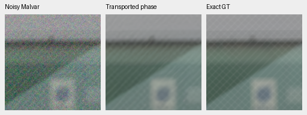
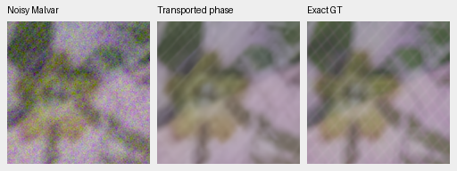

# Refining weak-wire phase between Fourier bins

The learned transported-phase head recovers **42.42%** of planted
ISO6400 wire signal versus **41.92%** for the integer-bin head scaled
to similar added gap texture. Intact-increment RMS falls **1.12 DN16**
and absolute gap RMS falls **1.30 DN16**. The gains are specific to the
constructed wire panel. The fine cab crossings remain incomplete.
[Checkpoint and results](results/subbin-spectral-witness-v1/publication.json) ·
[Drivers and receipts](results/subbin-spectral-witness-v1/evidence.tar.xz).

## Measuring phase from disjoint Bayer windows

The [integer-bin head](learned-spectral-gaps.md) assumes a whole number of
periods when moving a coefficient from a neighboring 32-pixel Bayer window.
A wire whose true frequency falls between bins can rotate substantially
over that distance. Summing the unrotated coefficients can weaken or invert
the proposed phase.

The refined head evaluates up to 25 frequencies around each original bin
on a four-times denser Fourier grid. It separately phase-aligns the
physical green Bayer sites. Each candidate uses only the four cardinal
neighbor windows, all disjoint from the query window. It rotates their
coefficients to a common query origin, selects the strongest
noise-standardized coherent sum with a penalty for offsets, then measures
signed evidence at that frequency on the query greens, red and blue.
The query samples therefore see the selected phase after selection.
In the third head the red and blue samples support a fourth proposal.
Its signed green amplitude and exterior phase are projected into the
original synthesis bin with the native taper response. The trained head
sets a bounded coefficient for that proposal alongside the three earlier
ones. The native output remains an achromatic correction to Corpus 100k.

The audit tests signed transport in both orientations and all four Bayer
layouts. Changing every sample in a center window leaves its nominated
frequency and phase identical. On a separate 24-photo ISO6400 diagnostic,
scoring the bin of the known planted wire, mean cosine agreement with its
true phase improves from −0.083 to 0.643. Mean per-source AUC separating
intact and truly absent windows rises from 0.433 to 0.832 across 12 gapped
sources. The diagnostic isolates the known direction to measure phase
accuracy. The learned output uses every selected bin.
[Isolation and alignment audit](results/subbin-spectral-witness-v1/evidence.tar.xz).

## Matched training

All heads reuse the 448 training photos and exact sensor arrays from the
[gap study](learned-spectral-gaps.md#data-and-training). There are 224
ordinary-photo and 224 planted-wire backgrounds, at ISO400 and ISO6400
and all four CFA layouts. They are disjoint from the scored panels and
exclude the protected captures and families. The fixed Corpus 100k EMA
parent has hash
`87b96f3c487b9edaf1c477742b6c38f2a82cc6b20a94716d51cc8cf46a17a760`.
The run reuses the parent observations generated with standard CUDA
FP16 autocast and FP32 output. It also reuses the prior sampling, seed
and AdamW schedule.

The three jointly trained arms use refined Bayer features with the
matched loss, refined features with exact gap loss, and refined features
with the transported proposal and matched loss. The matched and gap
objectives are the same as in the integer-bin comparison. The transported
model adds one bounded output coefficient. Every arm trains for **672
updates** over six passes, four photos per update, 2,688 photo visits and
8,064 role queries. Optimization is FP32. AdamW uses a 24-update warmup and
cosine decay from 0.001 to 0.0001 with EMA 0.99. Joint training takes
**15.55 s**, separately from **22.81 s** to assemble the refined feature
cache. The joint checkpoint hash is
`61984f51d596a0534c6b93d5221bb14879742b7c955e9d8b732dc434254f901d`.
Tables and real crops use EMA. The archive includes raw weights and
scores. The integer-bin comparator is the earlier witness EMA from
`f1ef6679e3831fd92c7c500483fdcb17fcaae2dcec44371a68a97ebefe88ce2f`.
The V120 EMA control uses
`a9d9b6b4f974e24a6b11e5e740aab32314233a7f53c056cf37c7d2aac1c589fb`.
[Training and model bindings](results/subbin-spectral-witness-v1/evidence.tar.xz).

On one held ISO6400 256-pixel query, the median CPU witness feature
time rises from **6.6 ms to 44.8 ms** across 20 interleaved warm
observations per method. This timing covers the witness feature stage.
[Timing receipt](results/subbin-spectral-witness-v1/evidence.tar.xz).

## Held-out performance

The 24 held-out wire backgrounds include 12 true gaps and 12 continuous
controls. A separate 24-photo panel sets a single multiplier on each
integer-bin head to target the same average added texture in true gaps.
The multipliers are held fixed on the scoring panel. Absolute gap RMS
scores the reconstruction against the known target. Paired gap RMS
measures the error in the difference between present and weak-free
captures. Error units are scene-luminance DN16.

| ISO6400 EMA | Intact response | Intact RMS | Added gap RMS | Absolute gap RMS | Paired gap RMS |
| --- | ---: | ---: | ---: | ---: | ---: |
| V120 | 31.61% | 207.41 | 21.80 | 154.01 | 163.67 |
| Corpus 100k | 33.66% | 207.82 | 0.00 | 152.65 | 162.47 |
| Integer-bin witnesses | 41.02% | 213.56 | 19.37 | 153.05 | 171.19 |
| Refined witnesses | 41.59% | 213.23 | 20.10 | 152.44 | 170.99 |
| Refined witnesses with gap loss | 31.17% | 202.23 | 13.42 | 151.68 | 155.80 |
| Transported phase | 42.42% | 213.33 | 21.64 | 151.97 | 171.31 |
| Integer-bin head at comparable transport gap change | 41.92% | 214.45 | 21.74 | 153.27 | 172.39 |

Relative to each independently scaled integer-bin control, the three
refined heads gain **0.21**, **0.51** and **0.50** intact-response points,
respectively. The 95% source-paired interval for the transported head
is [0.06, 0.90] points. Its absolute gap improvement is 1.30 DN16
[1.02, 1.59]. At ISO400 it lowers absolute gap error by 0.26 DN16 and
added gap RMS by 0.61 DN16. Forcing its new weights to use exact Fourier
bins again drops ISO6400 response from 42.42% to 40.85%. The transported
head still increases intact error and paired gap error over the frozen
Corpus 100k parent. The gap-loss head reduces those errors and weakens
the true continuous-dip signal.
[Matched-amplitude scores](results/subbin-spectral-witness-v1/evidence.tar.xz).

On independent ISO6400 observations from 48 natural photos outside wire
calibration, transported phase changes fine response from 69.56% to
69.67% over the integer-bin head. Fine-increment RMS rises from 133.40 to
133.48 DN16 and exact-flat RMS from 8.20 to 8.34 DN16. Corpus 100k retains
lower error on both measures. Raw-weight and complete 64-photo replay
results are archived.

A separate scoring replay applies a refined local phase gate to the
luminance band of the existing [shared Bayer gap lift](query-shared-gap.md).
The gate cuts added gap RMS from 47.96 to 34.37 DN16 and drops intact
response from 59.60% to 50.20%. For a score-only comparison at that same
held-out gap RMS, uniform attenuation retains 52.25% response. The refined
gate also loses more signal in genuine dips.
[Fixed analytic replay](results/subbin-spectral-witness-v1/evidence.tar.xz).

## Exact native comparisons

The examples reuse the prior gap study's two fixed test views. Each
panel shows 160 × 160 native pixels at `[48,48,160,160]` in the
256-pixel query. Both use synthetic ISO6400 shot/read
`0.00128/6.5536e-6`, capture exposure 0.33, 16-bit ADC, black level
0.03, display exposure ×2 and contrast 1.0. All methods use the same
transform and coordinates. Restored panels use the EMA checkpoints
specified above.
[Full crop provenance](images/subbin-spectral-witness-v1/manifest.json).

**St. Valentin railway**, GT1976, CC BY-SA 4.0. RGGB, source scene
`[376,16,512,512]`, query `[128,128,256,256]`. The constructed central
gap remains diffuse. The fine diagonals outside it are still weaker than
in the exact target.
[Photo source](https://commons.wikimedia.org/wiki/File:2018-05-04_(217)_33_53_9332_586-5_at_Bahnhof_St._Valentin.jpg) ·
[Comparison](images/subbin-spectral-witness-v1/exact/012-iso6400-comparison.png) ·
[Refined triplet](images/subbin-spectral-witness-v1/exact/012-iso6400-refined-triplet.png) ·
[Refined gap-loss triplet](images/subbin-spectral-witness-v1/exact/012-iso6400-refined-gap-triplet.png).

**Dianthus superbus**, Uoaei1, CC BY-SA 4.0. GRBG, source scene
`[66,32,512,512]`, query `[128,128,256,256]`. The continuous dip and
the planted lattice are clearer in the exact target. The restored
diagonals over the petals remain faint.
[Photo source](https://commons.wikimedia.org/wiki/File:Dianthus_superbus_Auernig_01.jpg) ·
[License for both photo crops](https://creativecommons.org/licenses/by-sa/4.0/) ·
[Comparison](images/subbin-spectral-witness-v1/exact/014-iso6400-comparison.png) ·
[Refined triplet](images/subbin-spectral-witness-v1/exact/014-iso6400-refined-triplet.png) ·
[Refined gap-loss triplet](images/subbin-spectral-witness-v1/exact/014-iso6400-refined-gap-triplet.png).

## Standing GFX100S comparisons

All eight boards were inspected. The composition is frozen Corpus 100k
EMA followed directly by the named EMA component. The boards show the
earlier spectral head, the integer-bin control and V120 separately.
The sky looks smooth. Coarse fence geometry remains coherent, with
fine building wires and foliage soft. The fine cab left diagonals
stay diffuse and the right crossings remain incomplete and mottled.
The independent ISO100 AHD views and the two camera JPEGs provide
qualitative comparisons with differences in exposure, aperture and motion.
[Main capture configuration](../configs/gfx-qualitative-20231231.json) ·
[Cab capture configuration](../configs/gfx-green-mesh-20231231.json) ·
[Coordinates, noise priors and display exposures](images/subbin-spectral-witness-v1/manifest.json).

| Scene and conditioning | Native boards |
| --- | --- |
| DSCF3879/3880 main, nominal | [Sky](images/subbin-spectral-witness-v1/standing/main-overcast-sky-main-overcast-sky.png) · [Building](images/subbin-spectral-witness-v1/standing/main-building-detail-main-building-detail.png) · [Foliage](images/subbin-spectral-witness-v1/standing/main-foliage-main-foliage.png) · [Coarse fence](images/subbin-spectral-witness-v1/standing/main-chain-link-fence-main-chain-link-fence.png) |
| DSCF3842/3835 cab, nominal | [Left](images/subbin-spectral-witness-v1/standing/mesh-nominal-fine-green-mesh-left.png) · [Right](images/subbin-spectral-witness-v1/standing/mesh-nominal-fine-green-mesh-right.png) |
| DSCF3842/3835 cab, transferred DSCF3879 prior | [Left](images/subbin-spectral-witness-v1/standing/mesh-profile3879-fine-green-mesh-left.png) · [Right](images/subbin-spectral-witness-v1/standing/mesh-profile3879-fine-green-mesh-right.png) |

Training, scoped numerical evaluation and native viewing are complete.
This is a crop component study. Fixed 427-photo and known/unseen
camera results remain outside its scope. The wire improvement provides
a measured mechanism for a narrower development comparison. V120
remains the general recommendation.
[Current model guide](current-model.md) ·
[Comparable PSNR history](performance-history.md).
