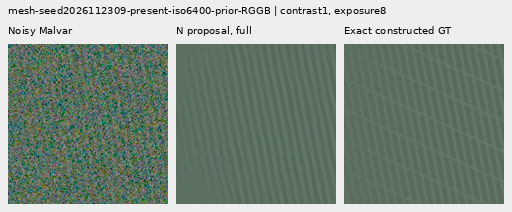
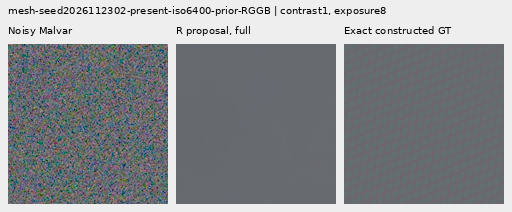

# V152 crossover: the proposal carries most of the quiet regression

Holding the original support maps fixed shows that V152's frequency proposal
carries most of its additional quiet-region error over the noisy-only control.
The relative proposal with the native map retains small mesh/flat improvements,
but quiet error and natural-band attenuation remain worse than the native
original. Swapping only to the relative map has a smaller quiet cost.
**None of the six outputs restores convincing new real cab-fence crossings or
noisy organic texture in the reviewed native crops.**

Opening support fully now raises mean synthetic mesh response **16.17–17.91%
over V143**, unlike the older V147 result. Absolute response is still only
**2.56–2.60% of constructed GT**. Actual mesh-blank errors rise .42–.51%,
exact quiet errors rise 1.35–3.30%, and natural-photo response falls. That
response gain is useful evidence about the updated proposals, with a clear
flat-region cost. It does not justify a general inference replacement.

All six fixed compositions cover the same 822 cases. Both original heads
replay exactly; all 6,330 score rows and 4,932 fixed compositions pass
independent audits. All 84 native figures were actually inspected. The
[final evidence](results/v152-support-crossover-final-v1.json) preserves the
receipts and [native manifest](images/v152-support-crossover-v1/manifest-v1.json).
This is a posthoc diagnostic, without new training or new weights.

## What was crossed

The [fixed recipe](../configs/support-crossover-v152.yaml) uses the completed
raw1k heads. `N` is the native noisy-only control, exactly reproduced from
V151; `R` is V152 relative phase. Each original forward produces a packed
proposal `p` and a spatial support map `q`. Maps stay fixed after those
original forwards:

```text
NN = parent + Malvar(pN * qN)       original native output
RR = parent + Malvar(pR * qR)       original relative output
RN = parent + Malvar(pR * qN)       relative proposal, original native map
NR = parent + Malvar(pN * qR)       native proposal, original relative map
N1 = parent + Malvar(pN)            full-support native proposal
R1 = parent + Malvar(pR)            full-support relative proposal
```

Targets and references never enter these compositions. Crosses depend on both
input-only heads, rather than one trained checkpoint. An original map is
**not recomputed on the other proposal**: this is a comparison of actual
data-dependent fields, not an isolated change of gate weights or training
causality. Full support1 is a diagnostic boundary, not a trained variant.
Relative phase also changes input evidence and parameter count together.

The same adaptive reused cohort includes 256 present/256 absent meshes,
noisy photos/flats, exact quiet regions beside strong patterns, ADC photos
and slopes, and both standing real scenes. Four CFA placements are related;
these are not 822 independent scenes or a new blind test. See the
[completed V152 protocol](relative-phase-estimator.md) for inherited data and
training controls. Change energy is a footprint, separate from actual error.

## Mesh response and actual blank errors

Errors are means of per-observation RMS in unclipped camera RGB ×65535.
Response projects onto the exact plane-detrended procedural texture; ideal is1.
The 256 present observations are 64 related recipes across four CFAs.

| Method | Present full RMS | Response | Actual blank RMS | Blank spatial RMS | Added blank RMS |
| --- | ---: | ---: | ---: | ---: | ---: |
|V143|9.111243|0.02202090|5.523323|5.343113|0.00000000|
|NN|9.090038|0.02361132|5.524396|5.344220|0.30090071|
|RR|9.084343|0.02394498|5.523011|5.342786|0.32348204|
|RN|9.086109|0.02378312|5.522361|5.342114|0.29857907|
|NR|9.088624|0.02375738|5.525215|5.345067|0.32602593|
|N1|9.081140|0.02558059|5.551704|5.372438|0.69995607|
|R1|9.072097|0.02596467|5.546641|5.367198|0.69470526|
|Existing periodic detail|8.586126|0.07089755|5.523328|5.343118|0.00063557|

RN keeps response .023783 versus NN's .023611, with slightly lower actual blank
error. NR gives .023757 but raises blank error above both NN and V143. N1/R1
reach .025581/.025965, with the lowest whole-scene mesh RMS here; their blank
errors are higher. Absent-scene RMS is 5.237898/5.236600 for NN/RR,
5.236041/5.238620 for RN/NR, and 5.262042/5.257448 for N1/R1, versus
V143's 5.237910. Thus opening support does not simply deliver the gains for free.
The existing periodic detail option still has much stronger selected response,
with incomplete orientations, seams/spill and weak nonperiodic gains.

## Exact quiet regions identify a proposal problem

There are 16 observations per prior: four strong patterns across four CFAs.
Whole-scene and exact quiet160 errors remain separate.

| Prior | Method | Whole RMS | Quiet RMS | Quiet spatial RMS |
| --- | --- | ---: | ---: | ---: |
|ISO6400|V143|27.105631|3.898845|3.268502|
|ISO6400|NN|27.042380|3.913870|3.285032|
|ISO6400|RR|27.026897|3.931359|3.305015|
|ISO6400|RN|27.031716|3.926685|3.299642|
|ISO6400|NR|27.037772|3.916494|3.288029|
|ISO6400|N1|26.986681|3.971685|3.350998|
|ISO6400|R1|27.000427|4.027514|3.414929|
|ISO12800|V143|36.747466|6.152652|5.341833|
|ISO12800|NN|36.593953|6.164208|5.355044|
|ISO12800|RR|36.567995|6.178347|5.370711|
|ISO12800|RN|36.580593|6.173267|5.364967|
|ISO12800|NR|36.581339|6.167271|5.358532|
|ISO12800|N1|36.435417|6.235984|5.436350|
|ISO12800|R1|36.454768|6.290103|5.496684|

RN reduces some of RR's quiet error, but remains .327%/.147% worse than NN
under ISO6400/12800 priors. NR is only .067%/.050% worse than NN. Full support
has the largest quiet penalty, even when whole-scene RMS improves. Diagnostic
40× views retain broad colored mottle and show extra fine grain at full support.

For additive risk arithmetic, use per-case **MSE**, not the square of a mean
RMS. The [fixed-array risk receipt](results/v152-support-crossover-v1/conditional-effects-v1.json)
reports both conditional swap orders in DN16²:

| Prior | Proposal at N map | Proposal at R map | Map at N proposal | Map at R proposal |
| --- | ---: | ---: | ---: | ---: |
|iso6400-prior|0.099163|0.115124|0.020200|0.036161|
|iso12800-prior|0.106836|0.130944|0.036222|0.060330|

The equal average of the two orders decomposes RR-minus-NN MSE as follows:

| Prior | NN MSE | RR MSE | Average proposal change | Average map change | Total change |
| --- | ---: | ---: | ---: | ---: | ---: |
|iso6400-prior|15.682651|15.817975|0.107144|0.028180|0.135324|
|iso12800-prior|38.737327|38.904493|0.118890|0.048276|0.167166|

The proposal contributes about **79.2% and 71.1%** of the added mean quiet MSE.
These are equal-weight arithmetic comparisons of fixed fields, **not a unique
causal attribution of training, feature design or gate weights**. The four
conditional changes are reported because the effect depends on the other field.
The [independent risk audit](results/v152-support-crossover-v1/conditional-effects-audit-v1.json)
checks all 2,176 region rows against the independently audited scores, both
swap orders and Decimal group reductions. Real references are not scored.

## Noisy flats and natural photographs

Each flat group contains 24 observations. Block32 measures broad error in the
full field; central crops alone cannot establish flat safety.

|Flat test|V143|NN|RR|RN|NR|N1|R1|
| --- | ---: | ---: | ---: | ---: | ---: | ---: | ---: |
|Native512 ISO6400 full RMS|18.546808|18.528288|18.520569|18.521522|18.527886|18.546267|18.530426|
|Native512 ISO6400 spatial RMS|18.235130|18.216253|18.208396|18.209365|18.215845|18.234633|18.218499|
|Native512 ISO6400 block32 RMS|13.440561|13.441084|13.440935|13.440900|13.441133|13.441964|13.441568|
|Native512 ISO12800 full RMS|24.071890|24.045198|24.036749|24.037680|24.044884|24.079899|24.061677|
|Native512 ISO12800 spatial RMS|23.596861|23.569561|23.560951|23.561904|23.569236|23.605064|23.586473|
|Native512 ISO12800 block32 RMS|17.932544|17.931834|17.931555|17.931611|17.931798|17.931221|17.930715|
|Older native256 ISO12800 full RMS|27.233548|27.205031|27.193266|27.194695|27.204387|27.235711|27.211249|
|Older native256 ISO12800 spatial RMS|26.017191|25.987255|25.974863|25.976358|25.986587|26.020038|25.994221|
|Older native256 ISO12800 block32 RMS|19.539875|19.538363|19.538810|19.538846|19.538313|19.536718|19.537918|

RN nearly retains RR's full-RMS improvement on native512 noisy flats, whereas NR
remains closer to NN. Full support gives less improvement than their learned
maps, including worse ISO12800 full RMS than NN. Broad colored blobs persist
in all variants. ISO6400 coarse block error rises slightly for all six; ISO12800
coarse error falls slightly. These tiny changes do not visibly clean the blobs.
All 48 constant ADC cases remain exactly at their parents under all six
compositions: **288 exact predictions**. Sloped fields are measured separately.

Each photo group has 32 related observations. Native DCT16 luma coefficients
use the 1/8–1/3 cycles/pixel annulus. Lower band error is better; response is
reported separately to expose attenuation.

|Photo test|V143|NN|RR|RN|NR|N1|R1|
| --- | ---: | ---: | ---: | ---: | ---: | ---: | ---: |
|Retained512 faint full RMS|33.963754|33.961754|33.961358|33.961364|33.961719|33.964690|33.966116|
|Retained512 faint band error|0.824639|0.824602|0.824550|0.824554|0.824601|0.824634|0.824546|
|Retained512 faint band response|0.298560|0.298248|0.297581|0.297662|0.298219|0.297856|0.296541|
|Retained512 dark full RMS|29.097715|29.094260|29.093227|29.093369|29.094070|29.093690|29.095461|
|Retained512 dark band error|0.661447|0.661397|0.661389|0.661392|0.661393|0.661363|0.661377|
|Retained512 dark band response|0.531446|0.531073|0.529957|0.530078|0.531041|0.530610|0.528379|
|Organic384 faint full RMS|37.469061|37.468482|37.466956|37.466971|37.468563|37.472329|37.469998|
|Organic384 faint band error|0.924117|0.924289|0.924265|0.924248|0.924309|0.924623|0.924545|
|Organic384 faint band response|0.150701|0.150213|0.149864|0.149933|0.150169|0.149599|0.148973|
|Organic384 dark full RMS|33.685796|33.683572|33.682922|33.683026|33.683458|33.683301|33.683982|
|Organic384 dark band error|0.781612|0.781638|0.781610|0.781609|0.781641|0.781702|0.781652|
|Organic384 dark band response|0.398945|0.398467|0.397692|0.397794|0.398425|0.397871|0.396363|

The natural-band response follows the proposal more than the map: RN remains
near RR's lower response, and NR near NN. Full support lowers response further
for both proposals in all four groups, despite a higher procedural mesh response.
Band-error/full-RMS means are mixed and do not establish restored texture.
Native feather, moth, grass, bark and bird/branch views remain soft; no convincing
new useful organic detail appears under the crosses or full support.

## ADC photographs and slopes

Eight ADC photo cases are two held-out Commons targets across four CFAs.
Channel-mean deviations are scaled by .025, shot/read are zero, black is .03,
and quantization is 16-bit. Sixteen native512 slope cases cover four level/tint/
slope recipes across four CFAs. These have exact constructed targets.

|ADC test|V143|NN|RR|RN|NR|N1|R1|
| --- | ---: | ---: | ---: | ---: | ---: | ---: | ---: |
|Photo full RMS|18.149871|18.108684|18.091100|18.091368|18.108433|18.108358|18.090942|
|Photo band error|0.101855|0.101627|0.101561|0.101562|0.101626|0.101626|0.101561|
|Photo band response|0.968329|0.968329|0.967721|0.967721|0.968329|0.968329|0.967721|
|Sloped512 full RMS|3.771369|3.764842|3.750437|3.753074|3.764136|3.760488|3.746776|
|Sloped512 spatial RMS|3.397249|3.390132|3.374485|3.376985|3.389489|3.385513|3.370806|
|Sloped512 block32 RMS|0.574652|0.576346|0.580016|0.577844|0.576826|0.577234|0.582387|
|Sloped512 crop block32 RMS|0.088145|0.088139|0.088127|0.088131|0.088138|0.088132|0.088119|
|Sloped512 worst absolute DC|11.176981|11.176543|11.169503|11.178441|11.174113|11.175748|11.170118|

ADC photo improvement mostly follows the relative proposal, but all variants
remain far below V150's roughly3.06% RMS gain over V143. Fine bark and fur stay
similar in the native crops. Full support lowers slope full/spatial RMS further,
with larger coarse block-error costs, especially for the relative proposal.
These results preserve a useful ADC/flat tradeoff rather than showing a broadly
better estimator.

## Native 100% triplets and standing real scenes

All 84 primary figures were actually inspected at original detail in 21 unscaled
sheets. Every crop cell is **160×160 original pixels** with identical ROI and
display transforms across methods. Thirty-six triplets repeat cells rather than
add observations. The [manifest](images/v152-support-crossover-v1/manifest-v1.json)
binds source/ROI, both proposal/support checkpoint hashes, conditioning, exposure,
anchor and contrast. Full support has no learned support checkpoint.

All compositions use these raw1k exports:

| Head | Checkpoint SHA256 |
| --- | --- |
| N: V151 noisy-only native control | `54b859a8badc0b6ccc32a092753028c06a37354186f384159db8d1f3e4399b10` |
| R: V152 relative phase | `7e40e675286a47ddc787451cfee5f0a27fd76023e129f062a8a3b660c276889d` |

Two fixed procedural mesh crops for each derived composition: **noisy → restored
→ exact constructed GT**. Native512 RGGB, ROI `[176,176,160,160]`, shot .00128,
read6.5536e-6, display exposure8, contrast1; seeds end2302/2309. The first stays
nearly flat, the second retains one family without the exact crossing lattice.







The matching original triplets are
[NN2302](images/v152-support-crossover-v1/comparison-00-native-native-triplet.png),
[NN2309](images/v152-support-crossover-v1/comparison-02-native-native-triplet.png),
[RR2302](images/v152-support-crossover-v1/comparison-00-relative-relative-triplet.png) and
[RR2309](images/v152-support-crossover-v1/comparison-02-relative-relative-triplet.png).

The [ADC bark](images/v152-support-crossover-v1/comparison-42.png) and
[fur](images/v152-support-crossover-v1/comparison-43.png) boards include all six
methods and exact constructed targets. Native256, ROI `[48,48,160,160]`, display
exposure1, contrast40 about target channel means, shot/read0 and black.03.
Bark: Derek Ramsey (Ram-Man), CC BY-SA2.5, source SHA1
`0ae232278265dabbdd54f52c34045a3d03323aa7`; fur: Korall, CC BY3.0,
`2b5a51667b9906eecead8f82e08c7ba11750f8c6`.

The noisy [feather](images/v152-support-crossover-v1/comparison-13.png) uses
Alexis Lours, CC BY4.0, SHA1 `02a76fd33b5e1414a0504f0b3f0aeb03a569b6f4`,
native384, ROI `[112,112,160,160]`, exposure14.388348 and contrast8.
[Dark bird/branch](images/v152-support-crossover-v1/comparison-25.png):
Andrew Mercer, CC BY-SA4.0, SHA1 `3e638bbb56ed80abc88939468783e3bf9b92ee77`,
native512, ROI `[176,176,160,160]`, exposure80.995917 and contrast1.
Both use shot .00128/read6.5536e-6. Targets are exact constructed references.

Standing DSCF3879 ISO6400/DSCF3880 ISO100 retain
[sky](images/v152-support-crossover-v1/comparison-05.png),
[building](images/v152-support-crossover-v1/comparison-06.png),
[foliage](images/v152-support-crossover-v1/comparison-07.png) and
[chain-link fence](images/v152-support-crossover-v1/comparison-08.png), exposure4.
DSCF3842/3835 fine cab mesh retains both windows under
[nominal left](images/v152-support-crossover-v1/comparison-09.png),
[nominal right](images/v152-support-crossover-v1/comparison-10.png),
[profile3879 left](images/v152-support-crossover-v1/comparison-11.png) and
[profile3879 right](images/v152-support-crossover-v1/comparison-12.png) priors.
Native768 contexts, left/right ROIs `[206,229,160,160]` / `[426,189,160,160]`,
exposure16 and contrast1. Both SOOC JPEGs remain native unboosted sRGB8.
Independent ISO100/AHD/JPEG references differ in aperture, shutter, processing
and motion: **qualitative references, not exact GT**, never pixelwise scored.
Main sky remains close to parent and fine cab crossings remain incomplete.
Captures, JPEGs, siblings and validation sources remain excluded from training.
Original media stays read-only; `/mnt/dataz` is unused.

The exact [quiet ROI](images/v152-support-crossover-v1/comparison-26.png) at40×
and [whole-edge view](images/v152-support-crossover-v1/comparison-27.png) at1×
show why whole-image improvement does not establish local flat safety.

## Audits and next implementation

Five composition tests pass in .82s: independent NumPy signed-Malvar stencils
across four CFAs, complementary-map linear partitions and invalid map rejection.
All 86 neural source files are unchanged. Both heads replay all 822 archived
arrays exactly: **1,644 learned forward calls**, with unchanged weights and
CPU/CUDA RNG. The four new compositions produce **3,288 new output arrays**.
Separately counted fixed operators add 1,644 FFT synthesis calls and 4,932
Malvar compositions; these are not extra learned forwards. There is no training,
new weight, parent/DINO call, noise draw, original lookup or RAW decode.
Peak allocated CUDA is1.46GiB. All six controller/worker owners are terminal,
without scientific failure or restart.

Independent metrics pass 54,246 scalar checks and 656 Decimal reductions across
6,330 rows, maximum difference5.12e-13; 42 real rows remain unscored.
Independent float64 NumPy reconstruction covers all 4,932 compositions, maximum
camera-RGB difference6.21e-8 and RMS difference .000980 DN16, within the fixed
2-FP32-ULP plus3e-9 allowance. Display/PNG checks cover42,470,400 RGB channels.
The conditional-risk audit adds8,704 risk checks,15,232 algebra checks and374
Decimal reductions. All19 public scientific receipts are byte-exact copies.

The next matched experiment should test spectral supervision **after support,
overlap synthesis and signed demosaicing**. The present spectral term scores
pre-support four-CFA coefficients; pixel and gradient losses already score the
delivered RGB. Compare the original spectral term with delivered mosaic error
and all-RGB phase-packed error, keeping architecture/data/updates fixed. This
tests whether the spectral term's evaluation point and RGB coverage help the
proposal learn useful corrections while accounting for support and interpolation.
The [active V153 comparison](delivered-spectral-objective.md) now implements
these three objectives with identical fresh relative-phase heads. Its objective,
forward-compatibility and genuine8+2 CUDA checks pass; production is active and
quality remains unmeasured. Gate-only changes are unlikely
to address the main fixed-proposal cost by themselves.

The [current model choices](current-model.md) retain V120 for general inference,
V143 periodic detail as an explicit option, V151 as the quieter learned control,
V150's stronger ADC result and V152's useful relative-frequency inputs. No new
general inference default is introduced by this diagnostic. The broader detail/
clean-sky goal remains active. See the
[local-time diary](../diary/2026-11-03-17-31-24-v152-support-crossover.md).
