# Restore wave contrast inside measured support

**The new `detail` option raises fresh mesh response 26.4% and lowers image RMS
1.0% versus reciprocal support.** All 256 fresh absent cases retain their parents.
The cost is higher added blank-region RMS: mean .000447→.000636 DN16 and worst
.10535→.13526 DN16. Compared with `wide`, response is 15.3% higher, image RMS .18%
lower, and mean/worst added blank RMS 94.5%/84.7% lower. These are matched results
on the same new observations, not comparisons across separate validation sets.

Complete GFX crops show stronger mesh contrast under both fixed priors. Recovery
remains soft and uneven; weak orientations, support seams and unsupported stripe
continuation remain. All 64 new photographic controls retain their parents, so
nonperiodic texture is not improved. Average procedural response is only 7.1% of
ideal. General model choice remains V120; the periodic stage remains opt-in.

[Implementation](../src/demosaic/phase_tv.py) ·
[Preserved execution and evidence](results/supported-wave-amplitude-publication-v1.json) ·
[Source/ROI/checkpoint/noise/display manifest](images/supported-wave-amplitude-v1/manifest.json).

## What changes

The earlier [reciprocal support](cross-phase-support.md) rule rejects unsupported
wave regions but keeps both global and local amplitude shrinkage. The new option
uses a positive original global gate as selection, then removes its amplitude
shrink only inside the unchanged reciprocal mask:

```
old added field = taper * sum(mask * wave)
new added field = taper * sum(mask * wave / positive_global_gate)
```

Each `wave` already includes that positive gate. Frequencies, variance floor,
original inactive gates, sparse-TV coefficients, local power shrink 9, magnitude
cap 3, mask threshold .5, aprons and FP32 blending remain. This changes contrast
without adding support or fitting new frequencies. Removing different gains can
alter cancellation between waves, so whole-image blank spill is measured directly.
Observed-clipped windows retain the exact prior fixed-bin TV amplitude policy.
An image shorter than 512 in either dimension retains the exact sparse fallback.

The broader contrast/support distinction has precedents in
[Deledalle et al., CLEAR](https://arxiv.org/abs/1606.05158). This implementation is
not CLEAR and does not inherit its guarantees. Frequency/floor/support selection
reuse the observed data; the gates are not calibrated confidence. Restoring
contrast also strengthens existing errors inside accepted support.

## Development and fixed validation

The previous 64-recipe/512-parent cross validation became development. Removing
only global shrink improves response 20.1% and image RMS .82%; 42 changed cases
improve image error and two regress, at most .01002 DN16. Removing local shrink
as well raises worst spill to .12790 DN16. Bounded joint amplitude refitting gives
higher response but larger error regressions, up to .26108 DN16. Eroding support
by eight native pixels before refitting reduces mean spill but loses true
boundary texture: 16 regressions, up to 1.03490 DN16. Those alternatives and their
original evidence remain archived. Independent checks cover both 2,560-row
ablation tables. The interrupted first sweep was recovered from its completed
prefix and rescored; its original partial outputs and logs are preserved.

One policy was fixed before new draws, lock SHA256
`c57ecbb754a0b87e13736e782fd9d09972f4341af84ef635cb3d7195b2eb0f0a`.
Fresh seeds 2026112300–2363 supply 64 native 512 mesh/empty recipes × four CFAs ×
presence/absence = 512 actual V1435k/DINO forwards. Continuous 1024 geometry
precedes twofold area sampling; scene level .02, zero optical blur, original
.005–.2 relative mesh contrast, shot .00128/read 6.5536e−6, ADC16/black .03.
These are 64 scene recipes, not 512 independent scenes. Learned weights,
backbone, input and RNG checks pass. All methods share each noisy RAW and actual
parent; exact GT enters scoring and labeled common display controls only.

| Fresh present observations | V143 parent | Edge | Wide | Cross | Detail |
| --- | ---: | ---: | ---: | ---: | ---: |
| Full 512 template response, ideal 1 | 0.022021 | 0.046345 | 0.061500 | 0.056102 | 0.070898 |
| Full 512 image RMS, DN16 | 9.11124 | 8.75839 | 8.60154 | 8.67341 | 8.58613 |
| Central 160 spatial RMS, DN16 | 13.25868 | 12.61989 | 12.27858 | 12.39340 | 12.18716 |
| Mean added blank RMS, DN16 | 0.000000 | 0.008946 | 0.011621 | 0.000447 | 0.000636 |
| Worst added blank RMS, DN16 | 0.00000 | 0.45910 | 0.88675 | 0.10535 | 0.13526 |
| Changed present cases /256 | 0 | 44 | 56 | 55 | 55 |

All 55 changed present cases gain response versus `cross`; 54 lower image error,
one increases it by .00545 DN16, and 201 stay unchanged. Added blank RMS increases
in six and stays unchanged in 250. Blank-GT RMS falls in one, rises in five
(maximum +.000506 DN16), and is unchanged in 250. Its mean changes only
5.523326→5.523328 DN16; parent mean is 5.523323. An unchanged parent can still have
its own error or mottling. Sixteen recipe seeds activate correction.

Versus `wide`, 49 present cases gain response, seven lose it and 200 are unchanged.
Image RMS improves in 34 and worsens in 22, at most .46072 DN16. Better aggregate
results do not mean every image improves. `cross` retains the lower tested mean
and worst added blank RMS for users who prefer that tradeoff.

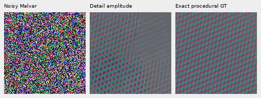

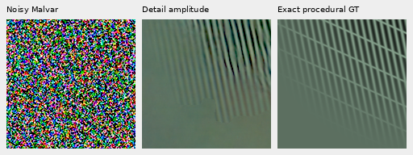

The first two active recipe seeds supply these retained-detail triplets. Within
each source, the ROI maximizes detail-added RMS on the fixed native 160 grid at
starts 0/160/320, selected after evaluation. Every column shares
`empty + 8*(value-empty)` before WB/matrix/+3EV; the exact empty field is a display
base only. Recovery is partial and often one-directional, with seams still
visible. The predeclared metric ROI stays [176,176,160,160].

[Central comparison 1](images/supported-wave-amplitude-v1/mesh-seed2026112302-present-iso6400-prior-RGGB-comparison.png) / [exact-GT triplet](images/supported-wave-amplitude-v1/mesh-seed2026112302-present-iso6400-prior-RGGB-triplet.png) · [Central comparison 2](images/supported-wave-amplitude-v1/mesh-seed2026112309-present-iso6400-prior-RGGB-comparison.png) / [exact-GT triplet](images/supported-wave-amplitude-v1/mesh-seed2026112309-present-iso6400-prior-RGGB-triplet.png) · [Central comparison 3](images/supported-wave-amplitude-v1/mesh-seed2026112324-present-iso6400-prior-GBRG-comparison.png) / [exact-GT triplet](images/supported-wave-amplitude-v1/mesh-seed2026112324-present-iso6400-prior-GBRG-triplet.png) · [Central comparison 4](images/supported-wave-amplitude-v1/mesh-seed2026112310-present-iso6400-prior-BGGR-comparison.png) / [exact-GT triplet](images/supported-wave-amplitude-v1/mesh-seed2026112310-present-iso6400-prior-BGGR-triplet.png).

## Default compared directly with Edge

A post-lock comparison runs the existing Edge default on the same 576 retained
observations: no new neural forwards or noise draws, and no numerical policy
tuning. Versus Edge, Detail raises mesh response 53.0%, lowers image RMS 1.97% and
central spatial RMS 3.43%, and reduces mean/worst added blank RMS 92.9%/70.5%.
All 55 changed cases improve response and image RMS; 201 are unchanged. Added blank
RMS falls in 31, rises in one by .000490 DN16 and stays unchanged in 224. All absent
cases are unchanged in both modes. Edge changes three dark photo cases: two tiny
improvements and one regression, giving no aggregate photo improvement here.

This comparison combines the earlier context/floor/support changes with the new
amplitude rule; it is not an isolated amplitude ablation. The stronger mesh and
lower tested false structure support making Detail the default within the
explicitly enabled stage. General inference still leaves periodic correction
off. Edge remains available explicitly. This is a default-selection comparison
on reused observations, not another independent holdout.

[Standing sky](images/supported-wave-amplitude-v1/main-fixed-Haar-main-overcast-sky-edge-comparison.png) · [Building](images/supported-wave-amplitude-v1/main-fixed-Haar-main-building-detail-edge-comparison.png) · [Foliage](images/supported-wave-amplitude-v1/main-fixed-Haar-main-foliage-edge-comparison.png) · [Chain-link fence](images/supported-wave-amplitude-v1/main-fixed-Haar-main-chain-link-fence-edge-comparison.png) · [Nominal mesh left](images/supported-wave-amplitude-v1/mesh-nominal-mesh-nominal-fine-green-mesh-left-JPEG-edge-comparison.png) · [Nominal mesh right](images/supported-wave-amplitude-v1/mesh-nominal-mesh-nominal-fine-green-mesh-right-JPEG-edge-comparison.png) · [Nearby mesh left](images/supported-wave-amplitude-v1/mesh-nearby-Haar-mesh-profile3879-fine-green-mesh-left-JPEG-edge-comparison.png) · [Nearby mesh right](images/supported-wave-amplitude-v1/mesh-nearby-Haar-mesh-profile3879-fine-green-mesh-right-JPEG-edge-comparison.png) · [Fresh mesh2302](images/supported-wave-amplitude-v1/mesh-seed2026112302-present-iso6400-prior-RGGB-comparison-edge-comparison.png) · [Fresh mesh2309](images/supported-wave-amplitude-v1/mesh-seed2026112309-present-iso6400-prior-RGGB-comparison-edge-comparison.png) · [Faint bird/branch](images/supported-wave-amplitude-v1/photo-3e638bbb56ed80abc88939468783e3bf9b92ee77-photo-faint-RGGB-comparison-edge-comparison.png) · [Dark bird/branch](images/supported-wave-amplitude-v1/photo-3e638bbb56ed80abc88939468783e3bf9b92ee77-photo-dark-RGGB-comparison-edge-comparison.png) · [Per-method summary](results/supported-wave-amplitude-default-summary-v2.json).

## Empty support and photographic limits

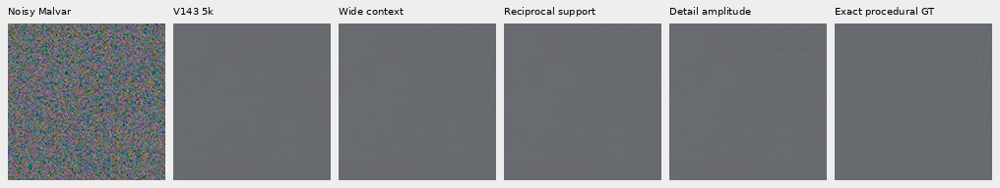

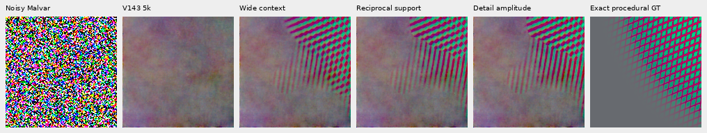

The fresh worst absolute added blank-RMS case uses the maximum added pixel in
exact blank support to center/clamp a native 160 crop. Normal and common 40×
camera-linear contrast views show unsupported stripe continuation beside true
texture. Maximum added blank-pixel values are 15.06 DN16 for Detail, 11.73 for Cross
and 25.12 for Wide; a low regional RMS does not bound every false pixel. The earlier 1938/GRBG detached false patch remains removed, with zero
added values in its exact blank support; that is a known development control.

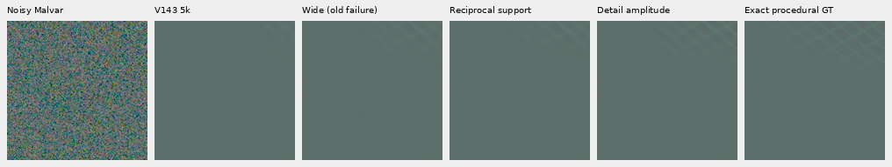

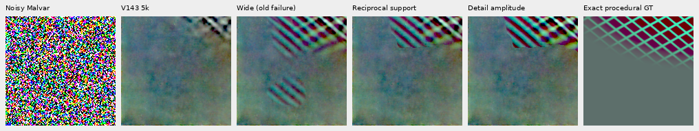

The earlier 4,096 matched and 1,024 mismatched ideal-flat controls retain their
parents by audited unchanged selection and an early empty-peak return. This is
a derived compatibility result: **zero new executions or noise draws**. It is
separate from the 256 fresh absent neural cases, whose outputs were executed.

Eight preselected Commons val sources add 64 actual forwards: native center 512
crops from read-only linear RGB16 bin8 caches, two variants and four CFAs. The
variants use mean linear sRGB .02 with contrast .125 about channel means, and
mean .003 with full contrast. No crop is resized. Selected source IDs are absent
from train rows in V143's main/reference photographic manifests. All 16 clean
transforms were checked before noise generation. These are exact constructed
camera-RGB targets, not exact references to a physical scene.

All three periodic modes leave all 64 photo outputs unchanged. Faint/full-dark
mean image RMS remains 33.96375/29.09772 DN16; central spatial RMS remains
41.48465/35.97717 DN16. Native bird/branch comparisons still show washed-out bark
and feather detail. This result does not establish broader photographic gains.

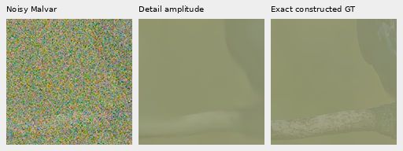

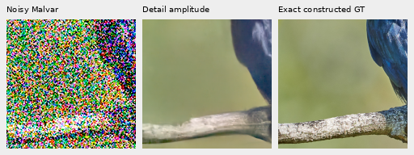

The shown source is [Spangled Drongo](https://commons.wikimedia.org/wiki/File:Spangled_Drongo_-_AndrewMercer_-_DSC00966.jpg)
by Andrew Mercer, [CC BY-SA 4.0](https://creativecommons.org/licenses/by-sa/4.0/).
The panels are cropped, binned, contrast/exposure modified and synthetically
noised/restored derivatives; attribution and all eight sources are in the manifest.

## Complete GFX photographs

Three complete 101,995,852-pixel outputs reuse cached RAW and actual V143 parents:
DSCF3879/3880 for the standing scene, DSCF3842/3835 for fine mesh under nominal and
nearby priors, with both camera JPEGs. ISO100 f/5.6 AHD/JPEG exposures are
**independent qualitative references, not exact GT**: aperture, exposure, motion
and processing differ. Captures, JPEGs and siblings stay excluded from training;
originals remain read-only. No real RAF decode or source-drive access was added.

Main scene, common +2EV: noisy → V120 → V143 → sparse → wide → cross → detail →
independent ISO100 reference.

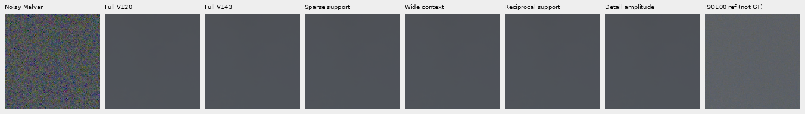

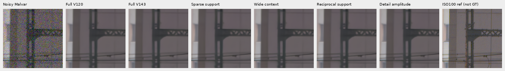

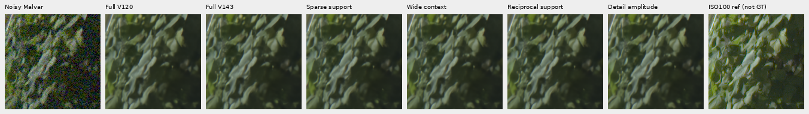

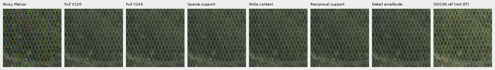

Fine mesh, common +4EV: noisy → V143 → sparse → wide → cross → detail → ISO6400
JPEG → independent ISO100 AHD → ISO100 JPEG. Nominal prior, then nearby prior.

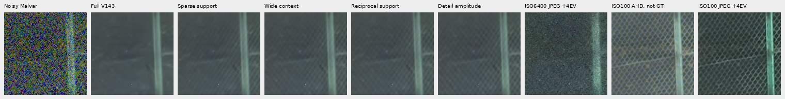

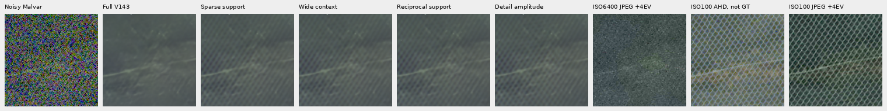

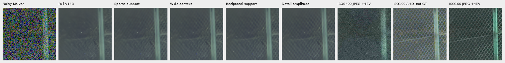

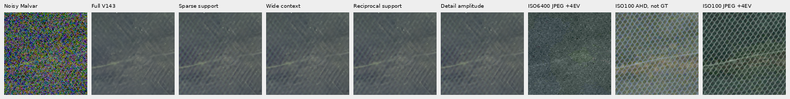

Native inspection finds stronger crossing-lattice contrast, with a large gap to
the independent ISO100 exposures. Foliage remains painterly and building detail
soft. The 2.88MP sky box [5200,200,2400,1200] keeps all 8,640,000 parent channels
exactly. The maximum added-channel values remain 8288.47/11638.23/12083.39 DN16;
bright-sign color and clipped-window errors remain unresolved.

Nominal conditioning is shot .00128/read 6.5536e−6; main and nearby use historical
Haar shot .0014635775921166604/read 1.0715704128646712e−6. These are fixed comparison
priors, not newly calibrated profiles. Every relevant added-floor context is
recorded. The complete context records and TV/support/mask solve, cap and iteration
counts match the prior cross runs exactly.

Outcome-selected strongest total fields and largest changes from cross use a fixed native 160 grid and common −2EV. Independent reference registration uses input Malvar only, integer offsets within 16 pixels; there is no resize or output-based alignment.


[main-fixed-Haar total](images/supported-wave-amplitude-v1/main-fixed-Haar-strongest-total.png)

[main-fixed-Haar delta](images/supported-wave-amplitude-v1/main-fixed-Haar-strongest-delta.png)

[mesh-nominal total](images/supported-wave-amplitude-v1/mesh-nominal-strongest-total.png)

[mesh-nominal delta](images/supported-wave-amplitude-v1/mesh-nominal-strongest-delta.png)

[mesh-nearby-Haar total](images/supported-wave-amplitude-v1/mesh-nearby-Haar-strongest-total.png)

[mesh-nearby-Haar delta](images/supported-wave-amplitude-v1/mesh-nearby-Haar-strongest-delta.png)

Sky views: [1](images/supported-wave-amplitude-v1/wider-sky-1.png), [2](images/supported-wave-amplitude-v1/wider-sky-2.png), [3](images/supported-wave-amplitude-v1/wider-sky-3.png).

## Numerical checks, runtime and use

| Full frame | Correction seconds | Active local fits | Mask caps/solves |
| --- | ---: | ---: | ---: |
| main-fixed-Haar | 1619.38 | 259 | 44/78 |
| mesh-nominal | 1342.40 | 145 | 43/56 |
| mesh-nearby-Haar | 1632.21 | 296 | 33/89 |

Times are correction-only with three CPU workers sharing CUDA graphs, concurrent
with validation; they are not isolated speed rankings or end-to-end times. The
100MP/10s target remains far away. Fresh mask fits cap at 8192 in 198/228 solves,
maximum relative gap 2.10e−5 versus target 1e−6, absolute gap .003407. These bounded
estimates are not fully converged objectives or calibrated certainty. Hard support
boundaries can move with further optimization.

The V1435k checkpoint SHA256 is
`96d146d017c54196288c585f8b7eddcf030e8a235061049c31e985b9380b7ce4`.
This study adds 576 actual neural forwards/unique sensor observations, zero
training updates, V120 calls or real RAW opens. Reused development parents and
postprocessing repeats are not additional independent samples.

All 80 release modules match the tested release snapshot. An AST audit proves
that 78 modules match the complete-frame snapshot byte-for-byte; the CLI/API
modules differ only in defaults and the API docstring. All explicit-mode
computations remain identical. Public/private
whole 512 outputs agree exactly across all 576 observations and three modes:
1,358,954,496 values. Independent affine/template and direct
pixel/blank/DC/block checks verify 2,304 metric rows. Four active actual-parent
patches covering all CFAs match CPU/CUDA to 3.47e-18,
with unchanged RNG; this is not 576 CPU tests. All 149 phase tests pass; the 57
focused integration checks are a subset.

All 53 native boards were actually viewed. Independent PNG checks verify
26,880,000 channel values, including common 8×/40× displays. All 917,962,668 linear
RGB16 export channels match clip/round/orientation exactly; all three sRGB16
exports are within 1 DN of independent FP64 rendering, with 16-bit/ICC metadata
checked. Original source snapshots, failures, partial runs and earlier receipts
remain preserved.

Use the ordinary `infer` arguments with:

```bash
--phase-harmonic --phase-harmonic-envelope detail
```

`cross` remains useful for lower tested added blank RMS; `wide` and earlier modes
retain their comparisons. The optional stage now defaults to `detail`; select `edge` explicitly to
reproduce the earlier stage. V120 is
the broadly measured general recommendation. Very faint/nonperiodic texture,
complete orientation recovery, support seams, false boundary structure,
highlight color and speed remain unresolved.
