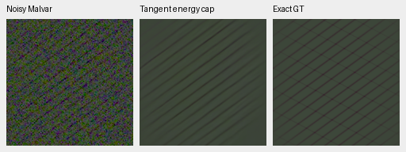
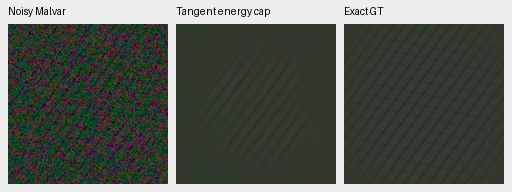

# Phase-aligned RAW averages inside fitted surfaces

The [query background comparison](query-rail-background.md)
suppressed false rail and building texture by fitting two edges.
This replay holds the selected planar guides and those A-only fits
fixed. It tests whether local, phase-aligned samples can recover
more of the faint direction than the existing phase-profile refit.

## Matched ways to pool measurements

Each fold uses the eight-knot phase profiles, conditional null,
competing direction and variance from its own query fit. The
measurement kernel subtracts a weighted local mean from a
phase-conditioned mean of the residual. Both averages use the same
CFA color and fitted surface region. The two boundaries define
three regions when the rail fit is supported. The kernel uses
24 circular bins, triangular assignment, fixed circular smoothing
and a 24-pixel native query stride. It removes a constant under the
supplied weights. Prediction and parent replacement use the same
signed residual operator.

Square pooling uses a 97×97 window. Tangent pooling uses an
equal-area ellipse with a 2:1 axis ratio, aligned with the wire
and clipped to the native query. The comparison changes the
measurement footprint. All arms retain the original validation
windows and CFA coordinates.

The square and tangent arms test the resulting phase-average
predictor on reserved RAW. The third arm uses the exact tangent
estimate with the original wave predictor's validation weights.
All retain per-color discovery reliability and require both folds
to improve their respective held-out scores. The parent appears
only after these scores are fixed. The earlier
[aggregation study](phase-measurement-aggregation.md) used a single
boundary and found more quiet error and color bands. This replay
directly tests whether the surface segmentation and wave gate
contain those effects.

The retained exact-target panel has sources 88–95 at ISO400 and
ISO6400, with independent no-wire, strong-only and two-family
RAW roles. One arm uses archived full-frame guides and the other
uses nominal center frequencies from the recipe. Both preserve
the original profile-specific gate and correction scale. The more
conservative gate is one unit higher.

The energy-capped arm also limits each emitted camera color to the
full query's correction norm from the paired wave refit. It uses
only the candidate images and their common parent after validation.
This preserves the measured estimate where its correction is already
smaller. It can still concentrate error within a small part of the
query, which the native null controls measure separately.

## Exact-target response

The original wave refit's quiet RMS sets the ceiling in each
comparison, and each arm may retain or reduce the original scale.
Rows use the nominal gate. Response is the projected fraction of the
exact weak-wire increment. Increment RMS measures error after
subtracting the corresponding strong-only reconstruction.

| Guides, noise | Method | Weak response | Quiet RMS (DN16) | Increment RMS (DN16) |
| --- | --- | ---: | ---: | ---: |
| Full-frame, ISO400 | V143 EMA | 0.888% | 2.43489 | 11.20201 |
| | Wave refit | 4.801% | 2.45083 | 11.18019 |
| | Square average | 2.634% | 2.45083 | 11.18771 |
| | Tangent average | 2.662% | 2.45083 | 11.18794 |
| | Tangent with wave gate | 5.322% | 2.44134 | 11.18428 |
| | Tangent with energy cap | 5.034% | 2.44014 | 11.18149 |
| Exact center, ISO400 | Wave refit | 9.005% | 2.44768 | 11.15730 |
| | Tangent with wave gate | 10.802% | 2.43845 | 11.16607 |
| | Tangent with energy cap | 9.595% | 2.43806 | 11.16219 |
| Full-frame, ISO6400 | Wave refit | 0.661% | 7.59569 | 25.43795 |
| | Tangent with energy cap | 0.658% | 7.59414 | 25.43660 |

The measurement predictors' own gates lose faint response after
matching quiet error. Under the fixed wave gate, tangent averaging
gives a small additional response with lower quiet RMS and slightly
higher increment error on the primary full-frame panel. The cap
gives up some response and brings increment error closer to the refit.
Exact nominal guides still recover little of the ISO6400 signal.
A leave-one-geometry-out mixture of the capped and original fits
selects from five fractions using the other seven geometries. It
delivers **4.910%** weak response on the ISO400 full-frame panel
with 11.18217 DN16 increment RMS. The matched refit reaches 4.801%
and 11.18019 DN16.

The same capped method on a geometry-disjoint replay of sources
80–87 with the archived appearance-first guides improves ISO400
weak response from **6.44% to 6.98%**. Quiet RMS drops from 2.34032
to 2.33846 DN16 and increment RMS from 11.20227 to 11.20132 DN16.
At ISO6400 the disjoint panel reaches 2.81% versus the wave
refit's 2.46%, with a slight increment-error increase from 22.94546
to 22.94621 DN16. Both panels reuse archived noise and checkpoint
predictions. The second panel checks the behavior on other
geometries with a different guide-selection history.
[Complete matched results](results/surface-phase-aggregation-v2/summary.json).

## False structure with guides deliberately enabled

This is the same 36-case flat, single-step and rail panel from the
[query background study](query-rail-background.md#forced-guide-rail-and-edge-controls).
Every case starts from its exact clean delivery parent and gets both
periodic guides. Reported errors measure the correction itself on
native 160×160 crops. Each row pools 12 scenes across the two noise
profiles and uses the nominal gate.

| Structure | Wave refit RMS | Square average RMS | Tangent RMS | Tangent with wave gate RMS | Tangent with energy cap RMS |
| --- | ---: | ---: | ---: | ---: | ---: |
| Flat | 0.077 | 0.014 | 0.037 | 0.169 | 0.062 |
| Step | 0.460 | 2.113 | 2.137 | 1.151 | 0.338 |
| Rail | 0.789 | 5.382 | 5.052 | 1.981 | 0.802 |

The cap brings average rail error close to the refit, with a larger
peak error of **32.90 versus 13.58 DN16**. Both methods change 11 of
12 rail crops. With the stricter gate the cap changes 9 of 12,
with rail RMS 0.431 versus 0.426 DN16 and peak error 13.64 versus
8.76 DN16. The remaining peak artifacts matter even when the
average correction energy is constrained.
[Frozen null recipes, measurements and logs](results/surface-phase-aggregation-v2/evidence.tar.gz).

## Native exact-target crops

The triplets show noisy Malvar, the energy-capped estimate using
the full-frame guide and exact GT. Both use ROI `[176,176,160,160]`,
shot/read `8e-5 / 2.56e-8`, ADC16, exposure ×2 and contrast ×5.
The V143 EMA SHA256 is
`96d146d017c54196288c585f8b7eddcf030e8a235061049c31e985b9380b7ce4`.
The displayed correction scale is 0.82212 at threshold 2, with the
same transform on every column. The weaker crossing family remains
mostly absent.

[Source 88, all shown methods](images/surface-phase-aggregation-v2/iso400-source88-RGGB-comparison.png) ·
[Source 89, all shown methods](images/surface-phase-aggregation-v2/iso400-source89-BGGR-comparison.png).

## Native GFX100S review

With full-frame guides, the sky, building and foliage are exact
V120. All four cab crops also return to the parent under the
energy-capped estimate. The coarse fence retains existing crossings.
Using its own gate, tangent averaging adds 22.44 DN16 RMS on the
coarse-fence crop, with more color variation. The energy cap limits
the change to 8.54 DN16 RMS, close to the 8.99 of the wave refit.
Fine cab crossings remain unresolved.

Holding the deliberately retained spectral guide fixed in the
building crop, the cap reduces the change from V120 from
3.92 to 0.36 DN16 RMS. Unrestricted tangent averaging with its own
gate changes the crop by 7.47 DN16 and introduces more visible
color. The capped result stays close to the parent; no new building
detail is evident.

Each cell is an unchanged native 160×160 crop. V120 EMA SHA256 is
`a9d9b6b4f974e24a6b11e5e740aab32314233a7f53c056cf37c7d2aac1c589fb`.
Nominal shot/read are `0.00128 / 6.5536e-6`, with display exposure
×4 for the main scene and ×16 for the cab. The transferred cab
profile uses `0.0014635775921166604 / 1.0715704128646712e-6`
and the same ×16 display exposure. DSCF3880 and DSCF3835 ISO100
AHD and the two cab camera JPEGs are independent references.

| RAW and profile | Native comparisons |
| --- | --- |
| DSCF3879 nominal | [Sky](images/surface-phase-aggregation-v2/main-overcast-sky.png) · [Building](images/surface-phase-aggregation-v2/main-building-detail.png) · [Foliage](images/surface-phase-aggregation-v2/main-foliage.png) · [Coarse fence](images/surface-phase-aggregation-v2/main-chain-link-fence.png) |
| DSCF3842 nominal | [Left](images/surface-phase-aggregation-v2/mesh-nominal-left.png) · [Right](images/surface-phase-aggregation-v2/mesh-nominal-right.png) |
| DSCF3842 transferred | [Left](images/surface-phase-aggregation-v2/mesh-profile3879-left.png) · [Right](images/surface-phase-aggregation-v2/mesh-profile3879-right.png) |

CPU collection took 275.64 seconds for the main panel and
134.99 seconds for the geometry-disjoint replay. The review
verifies 120 retained arrays bit for bit. Ten native comparison
boards and two triplets were inspected. A first collection
encountered a missing side-eligibility attribute on the camera
path. The corrected rerun verifies all prior predictive controls,
and exact-structure decisions from the earlier run reproduce.
No neural calls, training updates or standard full427 and camera
panel scores were added.

[Native provenance](images/surface-phase-aggregation-v2/manifest.json) ·
[Measurements](results/surface-phase-aggregation-v2/summary.json) ·
[Publication hashes](results/surface-phase-aggregation-v2/publication.json) ·
[Frozen evidence](results/surface-phase-aggregation-v2/evidence.tar.gz).
