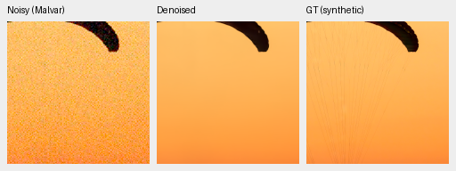
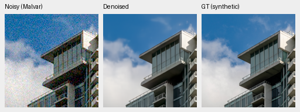
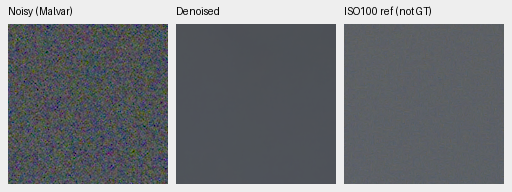
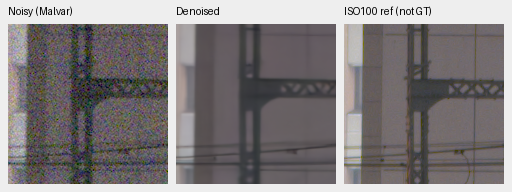
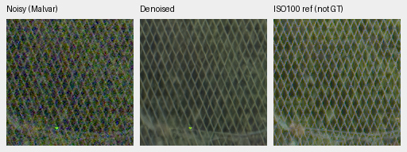
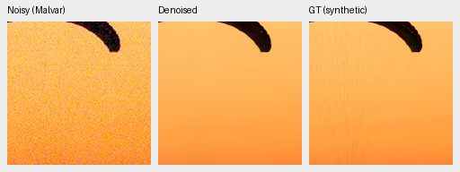
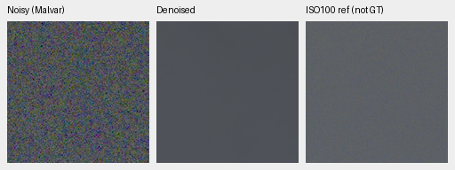
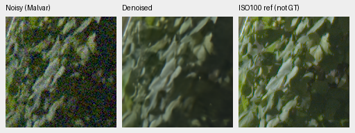
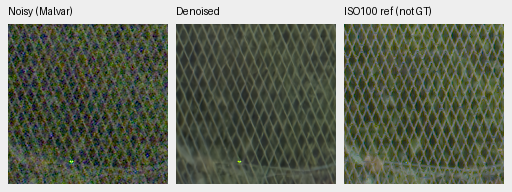

# Completed V86/V87 original4k input-context comparison

Larger input context does not demonstrate a photographic benefit in this fixed trial. Context−control sRGB PSNR is **+0.00099 [-0.00114, +0.00455] dB**; the source interval crosses zero. Both arms fail the known-camera promotion criteria and both high-noise weak-carrier gain requirements fail. All 192 ADC detail-loss limits pass. **Neither endpoint is promoted or extended; V43 remains the working reference.**

[Full results and evidence](results/training-context-original4k-complete-v1.json). [Fixed criteria](training-context-v86-v87.md). [Original4000 training and matched-state checks](results/training-context-original4000-completion-v1.json).

Both fresh arms start from genuine V63 original20k EMA, with seed54, B16/BF16/channels-last, deterministic execution, LR1e-5, warmup100 and the original4000-update schedule/10% floor. They prepare identical native320 source/noise fields and supervise the same central256 pixels; actual forwards are256 versus320. Common data contain50912 geometrically eligible Commons sources,128 native captures/106 groups and32 paired scenes. Geometry/PSF precede final area2; sensor-valid targets/losses and official frozen DINOv3/DRUNet architecture stay fixed. Future data and GFX3879/3880 plus siblings stay outside this trial. Each arm draws64000 examples; context uses more computation.

Both exact training owners/controller exited. All176 recorded source/actual-supervision pairs match, intended actual forward fields differ,161 source/domain/LR/supervision logs match, and final Python/CPU/CUDA RNG and source archives match. Both endpoints have finite91-model/91-EMA/89-AdamW states with counters4000. Final last.pt and retained step4000 bytes match; no best/interim selection occurs. Unrecorded draws are not independently replayed.

All ten FP32 review stages and saved-array/arithmetic checks finish, with432 known/540 unseen/74424 photographic and procedural records. Retained V43/RawNIND comparisons require matching source/protocol/classical witnesses. All eight final boards are actually viewed before numerical decisions:125 unchanged native160 cells representing81 source triplets. One training seed and source bootstrap do not establish training-repeat reliability or convergence.

## Photographic and camera results

Photo means balance427 sources, seven conditions and four CFAs. Source/scene bootstrap95% intervals use1000 resamples and seed42;16 procedural sources are retained separately. Real primary scores use registered measured CFA sites. Independently demosaiced AHD RGB scores are auxiliary references, without exact RGB GT.

| Model | Photo sRGB PSNR | Change from V63 [95% source interval], dB | Photo SSIM |
| --- | --- | --- | --- |
| V86-original4000 | 36.19663 | +0.26365 [+0.19247, +0.35531] | 0.964112589 |
| V87-original4000 | 36.19762 | +0.26464 [+0.19270, +0.35635] | 0.964100428 |
| V63-parent | 35.93298 | reference | 0.963289824 |

Matched context effects: known CFA -0.01463 [-0.05278, +0.02388]dB, unseen CFA +0.01032 [+0.00091, +0.02155]dB, photo SSIM -0.000012162. The small positive unseen mean does not establish the required photographic benefit. Parent gains also include4000 extra updates, fresh optimization, sensor-valid supervision and the restricted source cohort; they do not isolate surrounding context.

| Model | Known4 change from V63 [95% scene interval], dB | Unseen5 change from V63 [95% scene interval], dB |
| --- | --- | --- |
| V86-original4000 | -0.01610 [-0.03661, +0.00442] | +0.05125 [+0.02559, +0.07280] |
| V87-original4000 | -0.03072 [-0.07806, +0.02196] | +0.06157 [+0.04715, +0.07644] |

Each arm requires at least+.05dB and positive lower bounds on photo, known4 and unseen5, with photo-SSIM loss at most.0001. Both pass photo/unseen and fail known4. The matched.03dB camera-loss ceilings pass, while the positive matched-photo lower bound fails. No full-frame eligibility follows.

| Photo condition | Control−V63, dB | Context−V63, dB | Context−control, dB |
| --- | --- | --- | --- |
| adc-only | +0.20765 | +0.21863 | +0.01099 |
| iso100-prior | +0.45741 | +0.45863 | +0.00122 |
| iso1600-prior | +0.34625 | +0.34411 | -0.00214 |
| iso12800-prior | +0.16845 | +0.16327 | -0.00518 |
| shadows | +0.00628 | +0.00189 | -0.00438 |
| highlights | +0.32778 | +0.33742 | +0.00963 |
| legacy-noise | +0.33175 | +0.32856 | -0.00320 |

These condition means are descriptive. Adverse canonical camera-linear photo changes remain: control−parent -2.06336 [-2.17733, -1.93254]dB; context−parent -2.06972 [-2.18199, -1.93922]dB; matched context−control -0.00635 [-0.01006, -0.00402]dB. Evaluation clips reference-white before inverse camera transport, while training uses sensor-valid physical targets. This convention limits interpretation; all unfavorable values and procedural/condition means remain in the registry.

| Photo sources | Control−V63, dB | Context−V63, dB | Context−control [95% source interval], dB |
| --- | --- | --- | --- |
| 427 | +0.26365 | +0.26464 | +0.00099 [-0.00114, +0.00455] |
| 418 | +0.26541 | +0.26641 | +0.00100 [-0.00115, +0.00442] |
| 416 | +0.26583 | +0.26685 | +0.00102 [-0.00121, +0.00526] |

The predeclared418/416-source sensitivities also do not establish a positive matched context benefit. These finite source exclusions do not prove complete scene independence. Real-camera and selected native comparisons do not establish broad superiority over RawNIND.

## Weak detail, color and native views

Each high-noise gain contrast requires at least+.05 signed coherent improvement, with flat spatial-luma RMS at most1.25×control. Each mean includes four CFAs/four draws.

| Level/contrast/period | Control gain | Context gain | Change | Flat RMS ratio |
| --- | --- | --- | --- | --- |
| 0.01/0.1/8 | 0.00440356 | 0.00534323 | +0.00093967 | 1.004796 |
| 0.18/0.02/16 | 0.33423355 | 0.29218771 | -0.04204585 | 1.019601 |

Both gain gates fail; both flat ceilings pass. All1344 analytic cases/84 groups remain recorded. All192 ADC layout/draw loss limits pass; worst change is -0.00697598 at [0.18, 0.1, 4, 'GRBG', 0]. Some ADC groups improve; all192 individual changes and12 group means are retained. These fixtures are descriptive, without photographic confidence bounds or a general camera MTF claim.

All1176 hue observations/3528 fresh predictions/54 groups pass array/metric/native checks. High-noise mean maximum absolute channel-mean error / mean centered camera-RGB RMS:

| Saturation/peak | Control | Context | V63 |
| --- | --- | --- | --- |
| 0.0/0.18 | 0.00079743 / 0.00043822 | 0.00083968 / 0.00044429 | 0.00073790 / 0.00045348 |
| 0.98/0.02 | 0.00011117 / 0.00015701 | 0.00011055 / 0.00015711 | 0.00011977 / 0.00016074 |
| 0.98/0.18 | 0.00032662 / 0.00047406 | 0.00030848 / 0.00047229 | 0.00039867 / 0.00049250 |
| 0.98/0.9 | 0.00110558 / 0.00150498 | 0.00105323 / 0.00143232 | 0.00573934 / 0.00183866 |

All54 groups retain favorable and adverse values. The fixed palette, WB/camera, one draw per cell and RGB8 previews limit inference; descriptive quantiles are not confidence intervals.

[full427 native board](images/context4k-full427-all-methods-native.png): All current models remove noise but suppress fine canopy suspension lines. Building/roof geometry is restored and clouds/window detail remain soft. V86/V87 look close; these two patches show no clear context-detail advantage.
[known native board](images/context4k-known-all-methods-native.png): Plate variation remains smoothed while the thin light fiber survives in current models. Chart edges and isolated light points survive. RawNIND looks softer/fringed in these patches; current models are close. AHD has residual variation and is not exact RGB GT.
[unseen native board](images/context4k-unseen-all-methods-native.png): Brown object/illustration patches are smoothed similarly by current checkpoints. The independent AHD reference has more fine variation. No distinct broad context advantage or new conspicuous color failure is visible here.
[gfx native board](images/context4k-gfx-all-methods-native.png): All current models smooth sky noise and retain continuous fence diamonds. Foliage and fine building wires remain soft. V86/V87/parent/V43 look close; RawNIND fence is more broken/checkered. A small bright green point persists in current fence views. Separate ISO100 is sharper/different and not GT.
[analytic native board](images/context4k-analytic-all-methods-native.png): The dark high-noise carrier is almost erased in both arms. The brighter weak carrier has faint vertical bands, substantially below analytic contrast. Displayed flat fields appear smooth; numerical gain/false-detail checks remain necessary.
[hue native board](images/context4k-hue-all-methods-native.png): Both new arms reduce the parent bright-magenta mottling. New arms look close with subtle residual variation. The fixed RGB8 fields do not rule out mean-color bias or smaller numerical differences.
[hue-extra native board](images/context4k-hue-extra-all-methods-native.png): The four additional palette patches look close across new arms. Parent bright-pink variation is stronger. No new glaring artifact appears in these selected fields, without a general color-accuracy claim.
[highlights native board](images/context4k-highlights-all-methods-native.png): Both arms suppress fine cyan/blue neon wave detail; broad sign and platform geometry remain. No clear context advantage is visible. The independent ISO100 AHD reference differs in aperture/exposure time/moving subjects/lighting and is not exact GT.

GFX uses cached DSCF3879 ISO6400 and independently demosaiced DSCF3880 ISO100 f/5.6, with shared+2EV display. Time/aperture/motion differ; ISO100 is a qualitative reference and receives no pixelwise quality score. No source HDDs were opened. Fine cords/foliage/wires and neon-wave detail remain limited; no broad context-detail gain is visible.

## Native crop triplets

Each source panel is160×160 at native resolution, copied byte-for-byte without resizing or method-specific exposure/color fitting. Each checkpoint has two exact synthetic-GT triplets and four GFX reference triplets. Source/ROI/checkpoint/noise/CFA/WB/matrix/display metadata and attribution accompany every image in the registry. Synthetic targets are at the original8× evaluation resolution; display PNGs are RGB8, while scores use unquantized FP32 outputs. Shot is a coefficient; read is a variance.

### V86-original4000

Checkpoint SHA256: `0b1329fed98b93b35b9fa0364e3cbc55debca7de89e71776670ce5ff4a0b3a25`.

Source/ROI: `[237, 51, 160, 160]`; noise/conditioning: `{"exposure": 1.0, "name": "iso12800-prior", "read": 2.62144e-05, "shot": 0.00256}`; display exposure ×1.0.

Source [File:CH.VD.Villeneuve 2007-08-25 Vertigo-Swiss-Riviera 2392 3x2-R 4K.jpg](https://commons.wikimedia.org/wiki/File:CH.VD.Villeneuve_2007-08-25_Vertigo-Swiss-Riviera_2392_3x2-R_4K.jpg), Roy Egloff; [CC BY-SA 4.0](https://creativecommons.org/licenses/by-sa/4.0). Binned, cropped, simulated noise and restoration.

Source/ROI: `[243, 137, 160, 160]`; noise/conditioning: `{"exposure": 1.0, "name": "iso12800-prior", "read": 2.62144e-05, "shot": 0.00256}`; display exposure ×1.0.

Source [File:Vancouver (BC, Canada), Coal Harbour Seaside Park, Blick in den Himmel -- 2022 -- 2158.jpg](https://commons.wikimedia.org/wiki/File:Vancouver_(BC,_Canada),_Coal_Harbour_Seaside_Park,_Blick_in_den_Himmel_--_2022_--_2158.jpg), Dietmar Rabich; [CC BY-SA 4.0](https://creativecommons.org/licenses/by-sa/4.0). Binned, cropped, simulated noise and restoration.

Source/ROI: `{"context_green_correlation": null, "name": "overcast-sky", "noisy_xy": [5800, 1400], "reference_xy": [5800, 1400], "selection_method": "Same sensor coordinates; sky has no fixed registration landmarks", "size": 160}`; noise/conditioning: `{"read": 1.0715704128646712e-06, "shot": 0.0014635775921166604}`; display exposure ×4.

DSCF3879 ISO6400 and independently demosaiced DSCF3880 ISO100 differ in aperture, exposure time and moving subjects. The ISO100 image is a qualitative reference, not a pixelwise scoring target.

Source/ROI: `{"context_green_correlation": 0.6824449896812439, "name": "building-detail", "noisy_xy": [5790, 2690], "reference_xy": [5791, 2690], "selection_method": "Maximum normalized green correlation in input/reference 512px contexts; integer offsets only, no output-dependent selection", "size": 160}`; noise/conditioning: `{"read": 1.0715704128646712e-06, "shot": 0.0014635775921166604}`; display exposure ×4.

DSCF3879 ISO6400 and independently demosaiced DSCF3880 ISO100 differ in aperture, exposure time and moving subjects. The ISO100 image is a qualitative reference, not a pixelwise scoring target.

Source/ROI: `{"context_green_correlation": 0.9597686529159546, "name": "foliage", "noisy_xy": [8890, 5570], "reference_xy": [8890, 5570], "selection_method": "Maximum normalized green correlation in input/reference 512px contexts; integer offsets only, no output-dependent selection", "size": 160}`; noise/conditioning: `{"read": 1.0715704128646712e-06, "shot": 0.0014635775921166604}`; display exposure ×4.

DSCF3879 ISO6400 and independently demosaiced DSCF3880 ISO100 differ in aperture, exposure time and moving subjects. The ISO100 image is a qualitative reference, not a pixelwise scoring target.

Source/ROI: `{"context_green_correlation": 0.9550720453262329, "name": "chain-link-fence", "noisy_xy": [2240, 6000], "reference_xy": [2241, 6000], "selection_method": "Maximum normalized green correlation in input/reference 512px contexts; integer offsets only, no output-dependent selection", "size": 160}`; noise/conditioning: `{"read": 1.0715704128646712e-06, "shot": 0.0014635775921166604}`; display exposure ×4.

DSCF3879 ISO6400 and independently demosaiced DSCF3880 ISO100 differ in aperture, exposure time and moving subjects. The ISO100 image is a qualitative reference, not a pixelwise scoring target.

### V87-original4000

Checkpoint SHA256: `fb0c6d20b97760c218bb3d69b05791081467e8e40d25184e320a3b27aa02daf7`.

Source/ROI: `[237, 51, 160, 160]`; noise/conditioning: `{"exposure": 1.0, "name": "iso12800-prior", "read": 2.62144e-05, "shot": 0.00256}`; display exposure ×1.0.

Source [File:CH.VD.Villeneuve 2007-08-25 Vertigo-Swiss-Riviera 2392 3x2-R 4K.jpg](https://commons.wikimedia.org/wiki/File:CH.VD.Villeneuve_2007-08-25_Vertigo-Swiss-Riviera_2392_3x2-R_4K.jpg), Roy Egloff; [CC BY-SA 4.0](https://creativecommons.org/licenses/by-sa/4.0). Binned, cropped, simulated noise and restoration.

Source/ROI: `[243, 137, 160, 160]`; noise/conditioning: `{"exposure": 1.0, "name": "iso12800-prior", "read": 2.62144e-05, "shot": 0.00256}`; display exposure ×1.0.

Source [File:Vancouver (BC, Canada), Coal Harbour Seaside Park, Blick in den Himmel -- 2022 -- 2158.jpg](https://commons.wikimedia.org/wiki/File:Vancouver_(BC,_Canada),_Coal_Harbour_Seaside_Park,_Blick_in_den_Himmel_--_2022_--_2158.jpg), Dietmar Rabich; [CC BY-SA 4.0](https://creativecommons.org/licenses/by-sa/4.0). Binned, cropped, simulated noise and restoration.

Source/ROI: `{"context_green_correlation": null, "name": "overcast-sky", "noisy_xy": [5800, 1400], "reference_xy": [5800, 1400], "selection_method": "Same sensor coordinates; sky has no fixed registration landmarks", "size": 160}`; noise/conditioning: `{"read": 1.0715704128646712e-06, "shot": 0.0014635775921166604}`; display exposure ×4.

DSCF3879 ISO6400 and independently demosaiced DSCF3880 ISO100 differ in aperture, exposure time and moving subjects. The ISO100 image is a qualitative reference, not a pixelwise scoring target.

Source/ROI: `{"context_green_correlation": 0.6824449896812439, "name": "building-detail", "noisy_xy": [5790, 2690], "reference_xy": [5791, 2690], "selection_method": "Maximum normalized green correlation in input/reference 512px contexts; integer offsets only, no output-dependent selection", "size": 160}`; noise/conditioning: `{"read": 1.0715704128646712e-06, "shot": 0.0014635775921166604}`; display exposure ×4.

DSCF3879 ISO6400 and independently demosaiced DSCF3880 ISO100 differ in aperture, exposure time and moving subjects. The ISO100 image is a qualitative reference, not a pixelwise scoring target.

Source/ROI: `{"context_green_correlation": 0.9597686529159546, "name": "foliage", "noisy_xy": [8890, 5570], "reference_xy": [8890, 5570], "selection_method": "Maximum normalized green correlation in input/reference 512px contexts; integer offsets only, no output-dependent selection", "size": 160}`; noise/conditioning: `{"read": 1.0715704128646712e-06, "shot": 0.0014635775921166604}`; display exposure ×4.

DSCF3879 ISO6400 and independently demosaiced DSCF3880 ISO100 differ in aperture, exposure time and moving subjects. The ISO100 image is a qualitative reference, not a pixelwise scoring target.

Source/ROI: `{"context_green_correlation": 0.9550720453262329, "name": "chain-link-fence", "noisy_xy": [2240, 6000], "reference_xy": [2241, 6000], "selection_method": "Maximum normalized green correlation in input/reference 512px contexts; integer offsets only, no output-dependent selection", "size": 160}`; noise/conditioning: `{"read": 1.0715704128646712e-06, "shot": 0.0014635775921166604}`; display exposure ×4.

DSCF3879 ISO6400 and independently demosaiced DSCF3880 ISO100 differ in aperture, exposure time and moving subjects. The ISO100 image is a qualitative reference, not a pixelwise scoring target.

No new full-frame16-bit export, protected-final scoring, default change or speed result follows. SOTA, decisive real-photo superiority and100MP/10s remain unmet or unproven.
