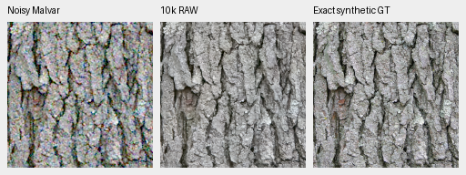
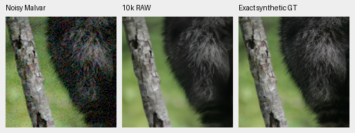
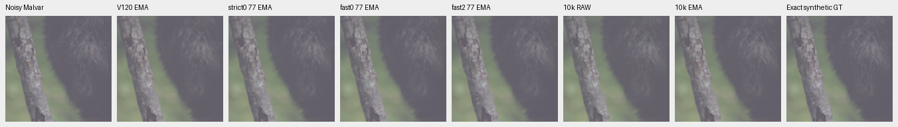
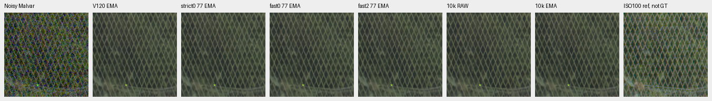
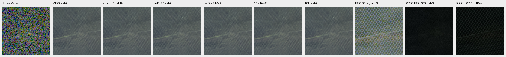

# Execution profiles and the 10k raw/EMA comparison

**The early backend comparison does not explain the later weak-detail loss.**
At77 updates, strict0 and zero-worker throughput fast0 differ by only0.000215 dB
in mean faint-detail PSNR. Both have mixed source effects, and this short test
cannot establish long-run equivalence. At10k, raw weights are worse than EMA
on ordinary, shadow and faint means; changing weight selection does not repair
the regression. V120 remains recommended, with EMA retained for scaling reviews.

All110 observations/six models, numerical analysis and actual viewing of26
native boards are complete. These are existing checkpoints, not new training
or completed20k/100k horizons. The [larger-corpus control](full-corpus-scaling.md)
has separately passed its first complete90,778-photo epoch; its endpoint reviews
are [queued behind successful completion](full-corpus-primary-admission.md).

[Exact receipts/frozen sources](results/full-corpus-execution-followup-v1/publication.json) ·
[Independent numerical/pixel audit](results/full-corpus-execution-followup-v1/independent-quality-audit.json) ·
[Actual native viewing](results/full-corpus-execution-followup-v1/actual-native-viewing.json) ·
[All60 native images and source/ROI/noise/display provenance](images/training-execution-quality-v1/manifest.json).

## What was compared

The original execution profiles each trained77 updates/1,232 target examples
from the same V120 EMA, including a valid75+2 resume, B16/native256, seed70 and
100k cosine horizon. **All use BF16**, `rgb_hidden_autocast:false`, and the same
FP32 native head/tail/skip and physical path. Strict0 selects deterministic
backend execution; fast0 selects throughput with zero workers; fast2 adds two
workers per domain. Output path/backend/worker fields are the only config
differences. All five historical complete input witnesses match at1/2/6/76/77;
the original profile did not record all77 batches as complete tensor hashes.

All91 raw/91 EMA tensors and89 Adam states are finite at77. Raw/EMA weights
are not bit-identical across profiles: fast0 versus strict0 has maximum tensor
changes6.51e-5/5.62e-5. The new CPU inference verifies the chosen raw or EMA state
exactly, with the same frozen DINO hash, fixed physical arguments and conditions.
[Saved source/config/state comparison](results/full-corpus-execution-followup-v1/profile-source-comparison.json).

| Checkpoint | SHA256 | Evaluated state |
| --- | --- | --- |
| V120 | `a9d9b6b4f974e24a6b11e5e740aab32314233a7f53c056cf37c7d2aac1c589fb` | EMA |
| strict0 step77 | `6b5fb720bc63ded82c5fc2b560af9fad9b242a761adb007ee1a83b1f7e8f8c2e` | EMA |
| fast0 step77 | `69fcd58211a90b816370f9681b6f5cc7ac378533c7589a19e5817603b451a360` | EMA |
| fast2 step77 | `bf7a21bce358038b03f11317fb08e6aecaa4b48816af2df5d92d11993959a22e` | EMA |
| Corpus control step10k | `41d45a9c2f5b3ec33922940280e5780fdea1a0065c1f1f522f8f54f935dc330b` | Raw and EMA, separately |

The profiles' original timed50-update/800-patch windows took53.9968/32.0473/
33.3680s, or14.8157/24.9631/23.9751 patches/s for strict0/fast0/fast2. These
exclude25 profiling warmup updates, initialization, checkpoints and the resumed
suffix; full77-update wall durations were not recorded by those receipts.
Optimizer warmup is100 updates, distinct from profiling warmup. The10k budget,
data and partial6,278.845s loop measurement remain in its [original review](full-corpus-control10k-review.md).
No completed-horizon duration is invented.

New review inference took **1,750.178s excluding load**, under concurrent jobs:
660 actual CPU restoration calls,110 frozen DINO executions and550 verified
replays. This is an observed cost, not an isolated speed benchmark. All methods
use IEEE FP32, contiguous B1 and two threads. No new GPU/RAW decode/noise draw/
optimizer call was needed. Every110 V120 and110 tenk-EMA prediction is bit-exact
to the earlier sealed two-model collection.

## Results and limits

Four sources/all four CFAs, one retained actual draw per input:16 ordinary,
64 shadow and16 faint ADC-only inputs. ROI[48,48,160,160]; shadow predictions
and targets both receive the existing exposure compensation. These repeatedly
used development cases are not the complete427-photo/camera primary panels.

| Method | Ordinary ΔdB | Shadow ΔdB | Faint ADC ΔdB versus V120 |
| --- | ---: | ---: | ---: |
| strict0 step77 EMA | −0.000867 | +0.009834 | +0.010895 |
| fast0 step77 EMA | −0.000836 | +0.009785 | +0.010680 |
| fast2 step77 EMA | −0.000834 | +0.009796 | +0.007588 |
| Corpus10k raw | −0.005758 | −0.013651 | **−0.946079** |
| Corpus10k EMA | +0.001181 | +0.003617 | **−0.614314** |

The77-step positive sRGB means hide bark/fur regressions. For strict0, faint
bark/fur/grass/wood differences are−0.16102/−0.08619/+0.08210/+0.20868 dB.
Faint camera-RGB mean PSNR decreases for all three profiles. Tiny pooled gains
are not established general weak-detail improvements. Fast2 differs from strict0
by−0.00331 dB in this mean; no long-run backend/loader equivalence is claimed.

At10k, raw is0.33177 dB worse than EMA on faint detail and regresses on all four
sources. EMA is helping this checkpoint's measured tradeoff. This narrows the
next investigation toward what the optimization trajectory learns, while leaving
long-run execution effects, source coverage and reviewed-example density open.
It does not identify a cause or justify resetting the running schedules.

On the same two selected ADC colors/all CFAs, maximum absolute channel-mean
error / centered RGB RMS in DN16 is:

| Method | Max mean bias | Max centered RMS |
| --- | ---: | ---: |
| V120 | 15.0789 | 4.6402 |
| strict0 step77 EMA | 18.6975 | 5.0565 |
| fast0 step77 EMA | 18.8937 | 5.0368 |
| fast2 step77 EMA | 18.7496 | 5.0434 |
| Corpus10k raw | 28.8713 | 9.3697 |
| Corpus10k EMA | 7.8681 | 8.6865 |

These eight inputs are a spot check, not the complete588-case color panel.
The flat boards appear uniform at8-bit display; the small errors require
unquantized tensors. The independent audit verifies576 material rows,360
original-source strata,48 flat rows and all26 boards'16,588,800 channels, plus
22 exact triplet subsets. Maximum score disagreement is1.42e-14 dB.
[Complete numeric rows](results/full-corpus-execution-followup-v1/quality-report.json).

## Native evidence

All26 original boards were actually opened. The77-step profiles remain visually
close to V120. Ordinary detail still loses fine strands/grain, deep shadows
remain clumpy/blurred, and10k raw attenuates faint fur more than EMA. No method
provides convincing new faithful cab crossings. The main sky stays smooth,
building/foliage remain soft, and coarse chain-link geometry changes little.
Both fixed cab ROIs, nominal/nearby profiles and both SOOC JPEGs were inspected.
Independent ISO100/binned PIXLS references remain qualitative references, not GT.

Each model has two separately linked native noisy/restored/exact-constructed-GT
triplets, extracted without resizing from the viewed boards:

| Model | Bark | Fur |
| --- | --- | --- |
| V120 EMA | [Native triplet](images/training-execution-quality-v1/bark-RGGB-draw0-V120-triplet.png) | [Native triplet](images/training-execution-quality-v1/raccoon-fur-RGGB-draw0-V120-triplet.png) |
| strict0 step77 EMA | [Native triplet](images/training-execution-quality-v1/bark-RGGB-draw0-strict0-77-EMA-triplet.png) | [Native triplet](images/training-execution-quality-v1/raccoon-fur-RGGB-draw0-strict0-77-EMA-triplet.png) |
| fast0 step77 EMA | [Native triplet](images/training-execution-quality-v1/bark-RGGB-draw0-fast0-77-EMA-triplet.png) | [Native triplet](images/training-execution-quality-v1/raccoon-fur-RGGB-draw0-fast0-77-EMA-triplet.png) |
| fast2 step77 EMA | [Native triplet](images/training-execution-quality-v1/bark-RGGB-draw0-fast2-77-EMA-triplet.png) | [Native triplet](images/training-execution-quality-v1/raccoon-fur-RGGB-draw0-fast2-77-EMA-triplet.png) |
| Corpus10k raw | [Native triplet](images/training-execution-quality-v1/bark-RGGB-draw0-scale-control10k-raw-triplet.png) | [Native triplet](images/training-execution-quality-v1/raccoon-fur-RGGB-draw0-scale-control10k-raw-triplet.png) |
| Corpus10k EMA | [Native triplet](images/training-execution-quality-v1/bark-RGGB-draw0-scale-control10k-ema-triplet.png) | [Native triplet](images/training-execution-quality-v1/raccoon-fur-RGGB-draw0-scale-control10k-ema-triplet.png) |

The same RGGB ROI[48,48,160,160], exposure1, shot0.00256/read0.0000262144,
ADC16/black0.03 applies to all these ordinary triplets. Bark/fur are the same
licensed Derek Ramsey/Korall photographs and exact constructed targets as in
the [10k report](full-corpus-control10k-review.md). Representative raw outputs:

Shared contrast20 shows the faint attenuation; the target supplies only the
common display anchor, never inference input:

All other sky/building/foliage/cab/profile/JPEG boards and detailed provenance
are in the manifest. No new427/known/unseen score is claimed or inserted into
PSNR history. The first generalized collector stopped on an obsolete two-model
count assertion after its first six predictions; the failed source/log/outputs
are preserved and the corrected new collection completed. No training was
restarted. Completed endpoint and broad weak-band evidence remain next.
