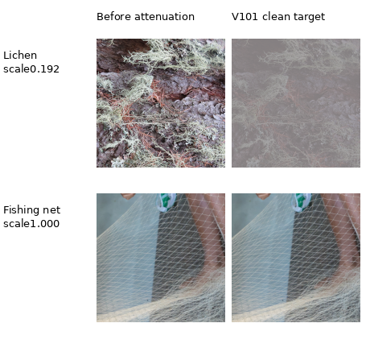

# Training data work, sampling order and batch size

The three requested changes are implemented and measured: geometry/PSF runs
between4× binning and the final2× reduction; only the selected domain is loaded;
and repeated throughput sweeps retain batch16. The matched geometry comparison
gains.50990dB over8×-then-geometry on all427 photos. On the actual RGB pipeline,
batch32 is only1.3% faster than16 while using roughly twice the CUDA allocation.
Details and limitations are recorded below.

The [active V111/V112 quality trial](loss-scale-training.md) starts from the exact
V104 EMA on 90,864 reviewed sources. V111 completed20k with [material gains](v111-early-quality.md),
and V112 has also completed20k. Full matched evaluation is running. Both retain
128 native/32 paired targets,
zero optical PSFs,weak textures,photographic contrast attenuation and the same
six reviewed regions. The [completed V102/V103 study](v102-v103-quality-review.md)
compared six/32 regions at the same5% conditional-photo probability on88,477
sources; its photo difference was small. Earlier V100/V101 used88,484 sources.
[Source review](incoming-commons-quality.md) records new eligible photos and
frozen cohort boundaries. Later measurements retain their actual source pools
and architecture labels.

The completed [spectral](spectral-original4k-review.md) and
[late RGB](late-rgb-original4k-review.md) trials use native 256×256/B16 and all88,508
reviewed Commons training sources. Neither is promoted. The opt-in
[head-only training scope](late-rgb-head-only-engineering.md) protects the
mature common path and avoids its backward graph while learning refinement;
it retains the same geometry, selected-domain loading and controlled batch16.
Its [completed original4k review](late-rgb-head-only-original4k-review.md)
retains exact common tensors but fails quality promotion. It provides no new
training-throughput or data-expansion claim.

The default-off [input-context experiment](training-context-v86-v87.md)
separates prepared source size, actual forward size and central loss size.
`patch_size: 320`, `forward_patch_size` set to `256` or `320`,
`loss_patch_size: 256` and `validation_patch_size: 256` let both arms share
source/noise/target draws while only one sees the surrounding 32px border. RGB targets/masks and packed
RAW/variance/auxiliary fields retain their own coordinate units and Bayer
alignment; resume rejects changed geometry. Legacy recipes omit these options.
The [completed original4k comparison](training-context-original4k-review.md)
finds no positive matched photographic effect: +.00099dB with an interval
crossing zero, failed known-camera promotion and failed weak-detail gains.
Neither endpoint is promoted or extended; the default remains unchanged.

The [geometric source counts](results/training-context-original4k-publication-v1.json)
also constrain larger patches when preserving the final2× reduction:

| Native output size | Required4× cache short side | Existing train sources | Reviewed future sources |
| --- | --- | --- | --- |
| 256 | 512 | 84,867 | 88,508 |
| 320 | 640 | 50,912 | 54,059 |
| 384 | 768 | 21,709 | 23,674 |
| 512 | 1,024 | 1,305 | 1,679 |

The existing320 count matches the actual frozen cohort's source IDs exactly.
These are metadata-based geometric counts, without larger-patch performance or
throughput claims. Native256 retains the full reviewed source population for
the next experiment; the full future corpus is not qualified for320.

The mixed trainer previously prepared a Commons batch on **every** optimizer
step, including steps that replaced it with paired RAW or native-RAW synthetic
data. Domain selection now precedes loading. Each loader samples only its
selected global steps, starts workers on first use, and stops prefetch at the
requested training endpoint. This removes discarded Commons augmentation while
preserving original sample indices, domain decisions and physical noise draws.

The three requested changes have now been measured: augmentation runs between
the 4× and final 2× reductions, selected-domain loading removes discarded Commons
batches, and batch16 remains the controlled setting after repeat throughput
sweeps. The matched [augmentation quality comparison](geometry-corpus-v34-v36-review.md)
improved full427-photo PSNR by .50990dB versus8×-then-geometry, with unchanged
validation targets. The [RGB-pipeline sweep](current-pipeline-batch-sweep.md)
found batch 32 only 1.3% faster than 16 while using roughly twice the CUDA allocation;
the [later RAW-head sweep](raw-kernel-training-batch-sweep.md) also retained 16.

An [opt-in deterministic execution policy](training-execution.md) now passes
two fresh six-update CUDA replays across all three domains, including exact
model/EMA/optimizer/RNG states. The throughput policy remains the default;
execution settings and dataset additions need their own controlled measurements.

A separate [normalization study and opt-in training augmentation](normalization-augmentation.md)
addresses sensitivity to the region used for neural feature coordinates. It
keeps RAW/targets fixed and leaves the geometry order intact. Its
[completed original4k GPU review](normalization-v68-v69-original4k-review.md)
found a small matched photo gain; texture/color limitations prevented promotion.
The [experimental RAW-native backbone](packed-isotropic.md) retains the same
geometry and selected-domain loading. Its completed sweep selects batch4 for
that architecture; the older RGB model retains batch16. The later
[mixed optimizer-batch comparison](mixed-optimizer-batches.md) finds four B4
source groups faster than a joined B16 for the RAW-native model. Its
[completed160k-example quality review](packed-isotropic-mixed16-quarter-review.md)
finds gains over its own parents but losses against older equal-example models.
Neither new arm is promoted or automatically extended. These model comparisons
change additional training factors and do not establish a batch-only quality gain.

For seed45's first 1,000 steps, 514 select Commons/procedural, 230 paired RAW and
256 native-RAW synthetic. Batch4 formerly consumed 4,000 Commons examples
(plus possible unused prefetched work);
the new route prepares 2,056. **All 41 logged V30 observation/target fingerprints
were reproduced exactly** with selected-only loading. Unlogged observations were
not separately hashed. Mixed-domain interruption/restart tests retain identical
weights and EMA, and guards reject any fetch from an unselected domain.

## Augmentation before the final reduction

The optional `augmentation_downsample: 2` training path is:

1. Decode original Commons images with their ICC profile, convert to linear
   sRGB, and average 4×4 source cells into a uint16 cache.
2. Crop at twice the target resolution. Apply exact quarter-turns/flips.
3. When projective augmentation is drawn, combine crop-to-output scaling and
   projective rotation/shear in one resampling operation at twice the target
   resolution. Otherwise use area scaling at that resolution.
4. Apply sampled optical PSFs in final-pixel units at the higher resolution.
5. Average 2×2 linear cells to the final patch; then apply camera/exposure,
   Bayer masking, Poisson/read noise and ADC simulation.

There is no geometric interpolation after the last reduction. Synthetic detail
and smooth fields also use the higher intermediate resolution in this mode.
Interpolation error is reduced in a controlled test; it is not eliminated.
For one continuous cosine/projective fixture, MSE against a denser integration
reference falls from .00493965 to .00047290. This single sampling experiment is
not evidence of trained-model quality or universal improvement.

The loader requires metadata declaring 4×-binned caches, and outputs native
256px patches as FP32. Four actual source checks found at most one uint16 code
of difference between unaugmented 4×→2× reduction and the old direct 8× cache.
Source files and frozen manifests remain unchanged. Existing configurations
default to the original path, preserving ongoing experiments.

Prepare the same source selection at 4× without changing held-out membership:

```bash
source scripts/env.sh
uv run --no-sync demosaic prepare --source /mnt/external/qi \
  --output /mnt/external/demosaic/commons-frozen44732-bin4-v1 \
  --factor 4 --min-size 512 --workers 2 \
  --selection-manifest /mnt/external/demosaic/audits/commons-44732-v1/manifest.jsonl
```

Both complete frozen 4× corpora are prepared and checked: 40,170 and 41,978
training sources, with unchanged 2,303 validation and 2,255 test sources.
Preparation followed the batch sweep and full-frame review to avoid competing
with throughput measurements. Excluded sources remain excluded; only
training rows enter the training loader. Use `manifest` for the new 4× training
selection and explicitly retain the original 8× audited `validation_manifest`
in a new experiment configuration. Validation source hashes and source snapshots
are recorded, and resume rejects a changed validation/augmentation recipe.
Newly downloaded images are not silently admitted by this frozen rebinning job.

The option also applies to [native camera-linear targets](native-raw-targets.md#augmentation-before-the-final-reduction)
via `raw_clean_augmentation_downsample: 2`. Their4× cache is complete with the
same53 training captures/31 scenes. Registered paired RAW uses exact sensor-phase
transforms. Existing experiments retain their original8× configurations.

`scripts/freeze_rebinned_manifest.py` freezes the complete Commons4× producer
output only after its lock is released and all active source identities/splits
match the audited selection exactly. Partial output, changed protected splits,
missing sources and an existing frozen manifest are rejected. A waiting owned
job created `/mnt/external/demosaic/audits/commons-bin4-frozen44732-v1/manifest.jsonl`
after full preparation. [V34's matched augmentation recipe](../configs/dino-anchored-pre-downsample-b16-v34.yaml)
points there, with original8× validation; it cannot accidentally train on the
producer's earlier 256-source partial manifest. V34 and V36 have completed their
first 1,000-update and full-photo reviews.

For general ingestion while the archive downloads, SQLite now reads committed
WAL data in read-only mode and releases its metadata snapshot before decoding.
The old immutable connection could miss newly committed downloads. Frozen
selection rebinning reads its supplied manifest instead of the changing index.

## Reviewed photographic regions

The opt-in reader supports the current
[32-region fine-detail catalogue](../configs/low-contrast-training-rois-curated-v3.json)
and its exact88,477-source V102/V103 manifest. It preserves the original six regions
and adds 26 source photographs after actual native inspection.
[Examples, source decisions and all 32 real-reader checks](corpus-source-review.md#reviewed-weak-and-fine-texture-rois).
`reviewed_roi_catalogue` names that file; `reviewed_roi_fraction` defaults to
`0.0` and gives the selection probability **conditional on a photographic
Commons sample**. Flat and synthetic samples retain their existing shares.
Completed V101 used the [original six-region catalogue](../configs/low-contrast-training-rois-v1.json)
at `.05`; V100 left it disabled. Their [current selected-detail results](heldout-detail.md)
and the [full matched results](v84-curated-quality-review.md) are available. The expanded catalogue
is used by V103 with its matching manifest; V102 uses the same original six
regions rebound to that manifest. Both production endpoints are still running.

Selection happens before opening the image cache. A selected sample loads only
its reviewed source, crops within the recorded 512×512 bin4 region, applies the
existing geometry, then performs the final area2 reduction. Native256 uses the
whole recorded context before augmentation; smaller patches stay within it.
This requires the training split, `augmentation_downsample: 2` and a prepared
patch no larger than256. It changes source and field-of-view sampling, so a
future comparison must account for both effects. Blur, contrast attenuation,
noise and domain scheduling retain their separately configured policies.

The reader checks exact training membership, manifest and cache hashes, aligned
ROI bounds, dtype/shape, and recorded crop/target hashes. The trainer snapshots
the catalogue bytes and SHA256; resume rejects a changed catalogue or fraction.
`CleanDataset.reviewed_roi_for_index(index)` exposes the deterministic choice
for data audits. The catalogue's area2 target hash identifies its reviewed
unaugmented view; it does not identify every augmented training tensor.

The [CPU readiness receipt](results/reviewed-ROI-loader-CPU-readiness-v1.json)
records141 passing focused checks, including actual tiny CPU training with
exact interrupted/resumed model, EMA and optimizer state. A separate clean-data
probe checked224 real samples from the first24 scheduled steps: all224 disabled
outputs matched the archived V95 reader, and all162 untreated active outputs
remained bit-exact. It selected62 ROI samples covering all six sources, loaded
one cache per photograph, and matched six tensors across two spawned workers.
That probe used fraction0.5 solely to exercise the reader. It ran no denoising
model, optimizer or sensor-noise simulation. These are implementation checks;
V101 now has trained evidence for its complete recipe package; the ROI-only
effect is not isolated. The expanded 32-source catalogue has reader/data proof,
and the [completed V102/V103 comparison](v102-v103-quality-review.md) shows
a tiny mixed ROI effect. V102 final20k also shows
[selected-detail progress](heldout-detail.md) using the original six regions;
it does not measure the expanded32-region effect.

## Current recipe sampling and targets

The V101 recipe keeps `.20` total synthetic and `.10` flat shares within the
Commons domain. `weak_texture_fraction: .15` takes 15 percentage points from
that synthetic total; it is roughly 75% of synthetic Commons samples, not 15%
of that component. Photographic contrast attenuation has probability `.25`
conditional on a photographic sample. Reviewed-region sampling has its own
conditional probability `.05`.

Reconstructing the exact seed59 full10,000-update/B16 schedule gives:

| Source type | Scheduled examples | Share of all examples |
| --- | ---: | ---: |
| Photographic Commons, including reviewed regions | 55,843 | 34.902% |
| Weak synthetic | 11,970 | 7.481% |
| Other synthetic | 4,106 | 2.566% |
| Flat fields | 8,049 | 5.031% |
| Native RAW synthetic | 40,512 | 25.320% |
| Registered paired RAW | 39,520 | 24.700% |

The schedule selects 4,998 Commons, 2,532 native and 2,470 paired steps.
Within the photographic Commons row, 2,844 examples use reviewed regions:
5.093% of those photographs and 1.778% of all160,000 examples. Each of the six
reviewed sources is scheduled443–517 times. These are deterministic schedule
counts for the completed V101 schedule, not the new V102/V103 runs.
The [full source-coverage audit](results/training-v100-v101-source-coverage-v1.json)
reconciles these counts with the finished endpoints.

Actual clean-target reconstruction at each source's earliest scheduled index
confirms finite FP32 native256 tensors and zero optical-PSF calls in those
six reads. One draw applies linear contrast attenuation with scale `.191659`;
the other five do not. The reader mixes toward the patch's per-channel mean,
preserving geometry while reducing contrast. The captured before/after pair
matches that affine operation within2e-7 in linear units.



Each panel is an unchanged160×160 crop at [48,48,160,160] inside its augmented
256-pixel target, with shared ×1 exposure and linear-sRGB→sRGB display.
These are clean training-data illustrations, without sensor noise or a neural
prediction. They do not establish improved trained detail retention.
[Source/ROI/sample-index/display metadata](images/training-v101-targets-native.json) ·
[Counts, frozen reader references and actual viewing](results/training-v101-sampling-and-targets-v1.json).
All six reconstructed contexts were inspected through12 native before/after
cells; the illustration repeats four of those cells without resizing.

Sources: [GT1976, pale beard lichen](https://commons.wikimedia.org/wiki/File:2017-07-20_%28153%29_Unidentified_Usnea_%28beard_lichen%29_at_Zedlacher_Paradies,_Matrei_in_Osttirol,_Austria.jpg)
and [Basile Morin, fishing net](https://commons.wikimedia.org/wiki/File:Sitting_boy_weaving_a_fishing_net_in_Laos.jpg),
[CC BY-SA4.0](https://creativecommons.org/licenses/by-sa/4.0), modified through
binning, cropping, training geometry and the indicated contrast attenuation.

## Batch-size sweep

The current joint RAW-kernel model has its own
[completed batch sweep](raw-kernel-training-batch-sweep.md): B4/B8/B16 average
14.62/15.72/15.81patches/s including selected-domain loading and augmentation.
B16 is only.56% above B8. B32/48/64 are memory skips, not measurements. The
production model/data/schedule/LR remain unchanged; all timing updates are discarded.
The earlier RGB-model measurements below do not settle its batch choice.

`scripts/benchmark_training.py` runs fresh processes for batches 4/8/16/32/64,
two repeats in a deterministic shuffled order, using the same initializer,
model, frozen manifests, mixed-domain schedule, LR and data-worker counts.
It excludes 15 warmup steps and measures 45 steps per case. Timing includes
actual selected-domain I/O/augmentation, physical degradation/GAT conditioning,
frozen DINO features, forward/backward, AdamW and EMA. It excludes validation,
startup and checkpoint serialization. All cases must share the same source hash.

```bash
source scripts/env.sh
uv run --no-sync python scripts/benchmark_training.py \
  configs/dino-anchored-stabilized-rgb-v30.yaml \
  --initialize /mnt/external/demosaic/runs/dino-anchored-stabilized-rgb-v30/initialization-v30.pt \
  --output /mnt/external/demosaic/benchmarks/mixed-training-batch-sweep-v1
```

The completed sweep used the existing 8× data path so only batch size varies.
Larger batches change samples per optimizer update and are not a convergence
comparison. A new batch size must be evaluated for image quality; throughput
alone does not justify scaling LR or claiming a better model. The 4×→2× path
also needs its own throughput check before choosing its production settings.

| Batch | Mean images/s | Two-run range | Peak CUDA GB |
| ---: | ---: | ---: | ---: |
| 4 | 22.52 | 22.40–22.64 | 2.23 |
| 8 | 24.56 | 24.38–24.74 | 3.72 |
| **16** | **26.14** | **25.19–27.09** | **6.94** |
| 32 | 26.42 | 25.67–27.18 | 13.39 |
| 64 | 26.27 | 25.53–27.01 | 26.28 |

Choose **batch16** for the next quality trial: approximately16% more images/s
than batch4, within1.1% of batch32's mean, with about half its CUDA allocation.
The largest batch provides no measured benefit here. Ranges reflect two shared
machine runs, not confidence intervals; no claim of a unique hardware optimum.
Keep LR unchanged and review image quality before extending training. Peak CUDA
allocation is not total system RAM usage. All10 cases share the same archived
source hash. [Complete measurements and reproduction receipt](results/training-batch-sweep-v1.json).

The [second sweep](current-pipeline-batch-sweep.md) is complete on the actual
4× Commons/native128 pipeline, using V43's frozen first1000 EMA initializer.
It repeats batches 4/8/16/32/64 twice with 15 excluded warmup and 45 measured
updates. Batch16 reaches **30.81 native 256×256px patches/s**, 12.1% above batch4.
Batch32 is only 1.3% faster, using 13.41 GB versus 6.95 GB peak CUDA allocation.
Batch64 adds no clear benefit. Keep batch16 fixed in controlled quality trials.
All ten cases verify the same initializer, source and data/augmentation recipe.
The owned corpus evaluation finished and exited before this sweep started.
[Complete measurements](results/training-batch-sweep-v2.json).

[V31's recipe](../configs/dino-anchored-stabilized-rgb-b16-v31.yaml) continues
frozen V30 step1000 with batch16, retaining model/AdamW/EMA/RNG state and the
existing8× dataset. It stops after1,000 additional updates (step 2000) for paired,
synthetic and GFX review. This processes16,000 additional examples and changes
global sample indices to the batch16 recipe. It is not an equal-image or
batch-only quality ablation. The complete4× selection prepares separately;
current training does not silently switch to its partial output.

A genuine DINO BF16 backward smoke on the actual 4×→2× Commons batch also passed:
finite FP32 output and nonzero measurement-adapter gradients. This verifies
execution, not the quality of a model trained with the new augmentation path.

Validation: **248 tests passed in 20.53s**, including sampling precision,
projective/constant-color behavior, frozen source splits, live WAL ingestion,
selected-domain fetch guards, and deterministic mixed-data restart. Ruff passed.

Subsequent [invariant-grid caching](expectation-grid-performance.md) removes
repeated Poisson table work without changing numeric outputs. The
[V31 quality review](anchored-rgb-b16-v31-review.md) finds synthetic gains but
real-camera regression after batch16 continuation, so V30 remains the quality
reference. Lower-LR/data-mixture trials are separate from the throughput choice.

The subsequent invariant-grid comparison reaches29.07images/s versus26.18
with the original table construction at batch16 (two alternating runs each,
same6.94GB allocation). Full validation including the native4 extension and
complete-manifest freeze gate now passes **256 tests**. Model quality remains
under development; these software/throughput checks do not establish it.

The completed [V32/V33 lower-LR mixture review](low-lr-paired-v32-v33-review.md)
uses batch16 and the cached grid with the original8× data. V32 improves full427
photo PSNR by.17289dB over V30; V33 improves real rendered means while giving up
unseen measured-CFA accuracy versus V30. V33 continues only to its next review
gate. The [first Commons extension](results/commons-extension-20261016-v1.json)
adds1,808 eligible training sources in a separate frozen manifest. Neither this
extension nor partial4× preparation has been admitted to these matched trials.
The new ingestion/audit tests bring the full suite to **260 passing tests**.

## Matched corpus and augmentation pilot

These four recipes share the V30 step1000 EMA initializer, fresh AdamW/EMA,
batch 16, seed 46, LR 3e-5 / planned 3,000 steps and a first review after 1,000
updates. Domain proportions stay 25% paired / 25% native / 50% Commons, with
the same paired/native source identities. Every arm validates on the original
frozen 8× manifest. This is a single-seed pilot, not convergence evidence.

| Commons train corpus | Existing 8× augmentation | 4× → geometry/PSF → 2× |
| --- | --- | --- |
| 40,170 sources | V32: first1k/2k reviewed, stopped | [V34](../configs/dino-anchored-pre-downsample-b16-v34.yaml): first1k/full427 reviewed |
| 41,978 sources | [V35](../configs/dino-anchored-expanded-b16-v35.yaml): first1k/2k reviewed, stopped | [V36](../configs/dino-anchored-expanded-pre-downsample-b16-v36.yaml): first1k/full427 reviewed |

The geometry change applies to both Commons and native synthetic targets;
registered paired RAW keeps its exact sensor-phase transforms. The corpus change
adds only the [1,808 audited Commons training sources](results/commons-extension-20261016-v1.json).
V35's validation, paired and native manifest hashes and runtime code/initializer
match V32. All 27 shared logged paired/native batches match at the first 1k gate;
Commons draws change with the corpus.
V34/V36 started only after their complete frozen 4× manifests existed. The expanded
4× job prepares only new sources and reuses old cache paths, preserving protected
membership and attribution.

[V35's first review](expanded-v35-1k-review.md) finds +.04306 dB unseen primary
PSNR versus V32 (95% scene interval[+.00727,+.07886]) and −.06106 dB on the
16-photo synthetic screen. No decisive GFX visual gain is established. Both
have now completed [the matched step2000 gate](corpus-v32-v35-2k-review.md) and
stopped. At2k the expanded arm improves known means but trails V32 on unseen
means; its own unseen primary mean falls .10983dB versus its first1k. All51
logged paired/native hashes match across82 observations per arm. Full427 and
full102MP checks are complete. The [gain diagnostic](paired-bias-v35.md)
does not support adding an input-only gain correction to this model.
[Startup/runtime identities and rebin implementation](results/commons-augmentation-pilot-startup.json)
are retained; V35's report records its frozen first 1k weights separately.

[V33's step 2000 continuation review](paired50-v33-2k-review.md) is complete and
stopped: better unseen primary PSNR versus its first 1k, mixed rendered scores,
and a lower photographic screen mean. It does not replace these matched controls.
The rebin/merge guards bring validation to **271 passing tests**.

The [preparation worker sweep](results/commons4-preparation-workers-v1.json) selects
eight workers for the remaining base4× preparation, reusing26,314 finished
caches. New-source4× preparation is complete (1,808 train, no failures). Its
merge completed after the full base audit. The detached V34/V36 workflow waited
for the preceding full quality review to finish before either trainer started,
checks exact original source memberships and source-module bytes, and retains
the same initializer/schedule. The source bundle hash also includes the native
manifest, so the4× versus8× hashes intentionally differ in that data file;
code files, validation and paired sources must match exactly. Logged paired
draws must match V32; native draws must match between V34/V36. Public RAW
candidates remain outside these recipes. Current validation passes **279 tests**.


Both [complete4× corpora](results/commons-four-complete.json) are now frozen,
with40,170/41,978 training sources and unchanged2,303/2,255 validation/test
membership. V34 started on2026-10-16 at02:53:56UTC; V36 followed sequentially.
The preflight verified source-module bytes and the initializer against V32;
all12 logged paired batches through step625 match. The new source-bundle SHA is
`15af15b4c3e817599e54d1e3995dbd95f9f14213dace0e3a7735985cef8300ea`;
its native4× manifest is the intended data-file difference from the8× control.
The full V32/V35 review is also complete: V32-2k gains.06767dB over its first1k
on all427 photos, while the expanded arm trails it by.12055dB. Full-frame
RGB16/ICC outputs and both RawNIND calibrations are verified. Small screens did
not predict the continuation gains; use the [full report](corpus-v32-v35-2k-review.md).


The [completed augmentation review](geometry-corpus-v34-v36-review.md) confirms
V34's **+0.50990 dB** full-photo gain over V32 at the matched first 1,000 updates,
95% source interval [+0.47646,+0.54728]. The expanded arm gains +0.63571 dB over
its own old-order control. V36 differs from V34 by only +0.00916 dB, with an
interval crossing zero and weaker procedural/unseen means. V34's real-camera
primary changes are small and uncertain. The new order becomes the next trial's
training recipe; its original 8× scoring protocol remains fixed. All 16 logged
paired hashes match across V32/V34/V36, and all 11 logged native hashes match
between the two 4× arms. Both stop at the review gate. Fine texture is still
too soft; the full-frame GFX review is documented with the same fixed regions.

The subsequent [packed detail review](packed-detail-v40-v41-review.md) uses this
same geometry, batch 16 and selected-domain loading. Its physical detail prior
recovers much of the first packed model's real-camera noise loss, but remains
below the full-resolution control. A 10× phase-head LR does not close the gap.
All 41 logged V38/V40/V41 observation hashes match, and the full 427-photo and
102 MP GFX checks are complete. The final source passes 321 tests; the stronger
augmentation order remains adopted independently of these architecture trials.
