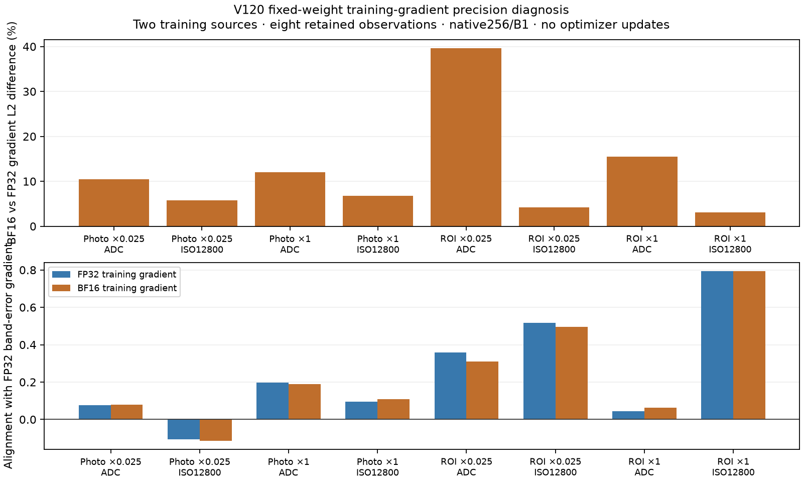

# Training precision and faint-detail gradients

**An audited fixed-weight probe finds mixed BF16/FP32 gradient differences;
it motivates a matched training trial, without establishing a quality gain.**
One faint ADC observation has39.6% relative gradient difference and weaker
alignment with the selected detail correction in BF16. Most other gradients
are close in direction. The [V130 trial](training-precision-pilot.md) tests the
training consequence against the saved V129 BF16 control.

[Standalone SVG](results/training-precision-gradients-v1/parameter-gradient-precision.svg) ·
[Eight observations and gradient summaries](results/training-precision-gradients-v1/gradients.csv) ·
[Model/input/source bindings and independent audit](results/training-precision-gradients-v1/result.json).

The probe uses V120's saved20,000-step EMA and the actual current sensor-valid
Charbonnier.0003 training loss. The frozen official DINO backbone remains fixed.
Two previously selected training sources represent new-photo and reviewed-region
strata. Each retains contrast factors.025/1 and ADC-only/ISO12800 observations.
All native256/B1 input bytes are retained; no new noise draws or RAW decoding.
These eight observations are a small training diagnostic, not heldout performance.

There are16 new differentiable forwards: IEEE FP32 and BF16 for each observation,
with alternating order. Hidden-convolution hooks verify the actual compute dtype;
physical head/tail calculations retain their configured FP32 behavior. There are
16 training-gradient evaluations plus eight FP32 detail-gradient evaluations.
No optimizer is constructed or stepped. All weights, frozen-backbone state,
configuration and Python/NumPy/Torch CPU/CUDA RNG states remain unchanged.

The common detail quantity is
`Q = 0.5 ||B(prediction − target)||² / ||B(target)||²`, using a differentiable
FP64 DCT16 and the fixed1/8–1/3-cycle/pixel annulus. Eligible blocks come only
from the target in the central160px ROI, with valid display channels, luminance
.02–.9 and band RMS≥1e−5. Both training gradients are compared to the **same FP32
Q gradient**. Positive cosine means a normalized Euclidean SGD descent direction
would reduce Q to first order; this does not describe an actual AdamW update.

| Stratum | Contrast | Condition | Gradient cosine BF16/FP32 | Relative L2 difference | FP32 / BF16 alignment with Q |
| --- | ---: | --- | ---: | ---: | ---: |
| Photo |.025 | ADC |.99556 |10.44% |.07749 / .07972 |
| Photo |.025 | ISO12800 |.99851 |5.76% |−.10749 / −.11362 |
| Photo |1 | ADC |.99826 |12.01% |.19734 / .18880 |
| Photo |1 | ISO12800 |.99780 |6.79% |.09565 / .10908 |
| Reviewed region |.025 | ADC |.96124 |39.59% |.35936 / .30952 |
| Reviewed region |.025 | ISO12800 |.99924 |4.19% |.51593 / .49526 |
| Reviewed region |1 | ADC |.98987 |15.52% |.04466 / .06333 |
| Reviewed region |1 | ISO12800 |.99966 |3.06% |.79491 / .79420 |

The faint noisy photo has negative alignment in both precisions: reducing the
full reconstruction objective can locally oppose this particular band correction.
Other cases move in both directions. These results do not identify BF16 as the
cause of missing mesh, nor prove a general precision preference.

The independent CPU/NumPy audit uses mirrored-FFT DCT reductions, reopens all16
saved predictions and checks all712 layer Gram records. Full gradients were
retained prospectively for both faint ADC cases:534 arrays containing197,428,224
FP32 values, independently hashed and reduced for1,068 unique Gram entries.
The other six cases retain per-layer hashes and two independent live reductions,
without full raw vectors; those gradients are not independently redifferentiated.
Two math tests check band-energy differentiation and gradient geometry.

Actual peak CUDA allocation is1,338,443,776 bytes for this B1 probe; that is
not a B16 qualification or speed measurement. The frozen successful plan is
`.cache/current-quality-20261023-v1/training-precision-gradients-v2/plan-v1.json`.
The preceding prepared plan was superseded for formatting before any forward;
its zero-call preparation receipt remains intact. Neither plan is rerun.
