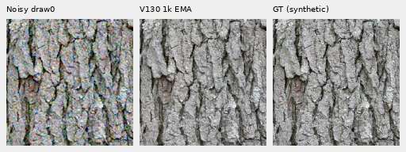
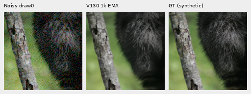
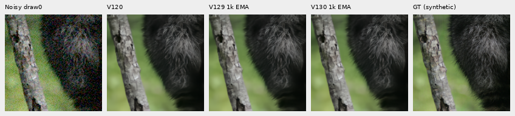
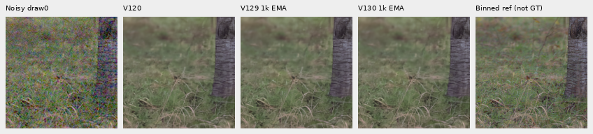

# V130: matched FP32 training pilot

**Completed V130 slightly improves selected faint-ADC detail against V129's
BF16 control, with no clear large recovery in noisy materials or either GFX
scene.** The 1,000-update precision-only trial changes ordinary/shadow mean
sRGB PSNR by +0.00009/+0.00055 dB. On the separate faint-ADC panel, selected weak
fur, grass and wood bands improve slightly in both gain and relative error,
while global sRGB PSNR falls by 0.01720 dB. These small gains and remaining
weaknesses are documented directly. V120 remains the general recommendation.

[Training, scores and independent audit](results/v130-fp32-pilot-quality-v1.json) ·
[Complete material summaries](results/v130-fp32-pilot-quality-v1.csv) ·
[Native source/ROI/checkpoint/noise/display metadata](images/v130-fp32-pilot-quality-v1/manifest.json) ·
[Completed faint-ADC comparison](faint-adc-precision.md).

## Matched training and execution

Only compute precision changes from the [completed V129 control](reviewed-detail-training-pilot.md).
Both start freshly from V120's 20,000-step EMA, with seed70, 90,782 sources/27
regions, reviewed-region quota0.5, native256/B16, single noise view, zero optical
blur, paired32/native128, LR1e−5 and100 warmup steps. Feature, shadow, band and
conditional-mean terms stay off. Both endpoints are evaluated in IEEE FP32.
[Recipe](../configs/quality-v120-fp32-pilot-v130.yaml) ·
[Source-frozen runner](../scripts/train_precision_pilot.py).

All 1,000 source/domain, clean-tensor and noisy-tensor hashes match saved V129
exactly. Production completed 1,000 training/optimizer steps, 16,000 target
contexts and64 validation forwards, for1,064 encoder calls. Domain counts are
477 Commons/262 native/261 paired;91 model/EMA tensors and89 Adam states are
finite, with every optimizer state at1,000. Peak CUDA allocation was
11,337,181,696 bytes.

The identical CPU128/B1 FP32 check adopts V129's unchanged18-update receipt
after equality of the complete effective configuration and every training-source
file. A new CUDA256/B16 check passed16 updates plus an actual two-update resume,
matching all18 input hashes, with finite model/optimizer states and peak
allocation11,332,900,352 bytes. Fresh production has its separate1,000-update
budget. Admission52GiB, CUDA cap16GiB, runtime floor32GB and the original
30-minute check/eight-hour production limits remain unchanged. No automatic
retry or budget reset occurred.
[Implementation checks and CPU adoption](results/v130-implementation-checks-v1.json).

Checkpoint SHA256:
`cab244f57924991a913cf3e1fdfbd0ac1edf20be1e6d44aad64c4730e4274503`.

## Retained-input quality

Exactly86 candidate root/encoder calls cover64 shadow inputs,16 ordinary
material inputs, four main-GFX512px contexts and two extra-mesh768px profiles.
V120/V129 controls are reused; there are no new stochastic observations or RAW
decodes. Independent FFT/display/pixel auditing checks240 metric rows,
60 summaries,3,975 scalar fields and17,203,200 RGB channels across56 PNGs.
All28 comparison boards were actually viewed in seven unchanged native sheets.

| Fixed support | V120 | V129 BF16 control | V130 FP32 |
| --- | ---: | ---: | ---: |
| Ordinary sRGB PSNR |32.30426 |32.30954 |32.30963 |
| Shadow sRGB PSNR |25.90197 |25.89662 |25.89718 |
| Ordinary camera-RGB PSNR |38.93740 |38.93996 |38.93991 |
| Shadow camera-RGB PSNR |32.39347 |32.40024 |32.40029 |

Four-CFA means describe four source photographs. Ordinary cases use the
ISO12800 prior; shadow cases add gains1/8 and1/32 at ISO6400/12800 and score
after fixed inverse exposure. CFAs, noise and exposure variants are not
independent photographs. This short single-seed pilot does not replace full427-photo
or all-camera validation. Grass/wood targets are approximate binned native
estimates; processed synthetic Commons targets are exact for their operator.

Native160px triplets: noisy → V130 → exact processed synthetic GT. RGGB,
shot0.00256/read0.0000262144,16-bit ADC/black0.03, ROI48,48,160,160,+0EV;
shared WB/matrix/sRGB transform, no resizing:

Bark: Derek Ramsey, CC BY-SA2.5; raccoon: Korall, CC BY3.0. Original source
links and processing are in the image manifest. Full comparison columns are
noisy → V120 → V129 → V130 → reference:

High-noise fur, grass and wood still lose fine structure. Ordinary weak-fur
band gain slightly falls0.32991→0.32976; selected grass gain falls0.68449→0.68306
while error falls. These mixed changes contrast with the small selected gains
on the separate [faint-ADC panel](faint-adc-precision.md).

## Real GFX captures

Main DSCF3879/3880 foliage/fence share512px contexts,+2EV and fixed nominal
shot0.00128/read0.0000065536. The extra **DSCF3842/DSCF3835** mesh shares768px
contexts,+4EV and both fixed noise profiles. All cells remain native160px under
the same WB/matrix. ISO100/AHD images are approximate references, **not GT**;
aperture, exposure time and moving subjects differ. There is no real-reference
PSNR or inference-parameter fitting.

Foliage remains painterly; the larger fence stays coherent. The fine green
lattice still mostly disappears at nominal conditioning. The nearby3879
profile leaves weak irregular directional texture, without a clear V130
recovery. [Both regions and profiles](gfx-green-mesh.md#v130-fp32-training-pilot).

The result argues against precision alone explaining the high-noise/mesh
weakness after this training budget. It does not settle longer FP32 training.
The already queued [V124/V125 conditional-mean trial](conditional-mean-training.md)
tests persistent detail bias separately, with its original inputs and budgets.
The newest [90,781-source/29-region cohort](current-source-loss-review.md) is
prepared and untrained; this matched comparison retains90,782/27.

Training: `.cache/current-quality-20261023-v1/fp32-training-pilot-v1/run/`.
Quality: `.cache/current-quality-20261023-v1/fp32-quality-pilot-v1/queue-v2/`.
[Publication/input continuity verification](results/v130-faint-adc-publication-verification-v1.json).
