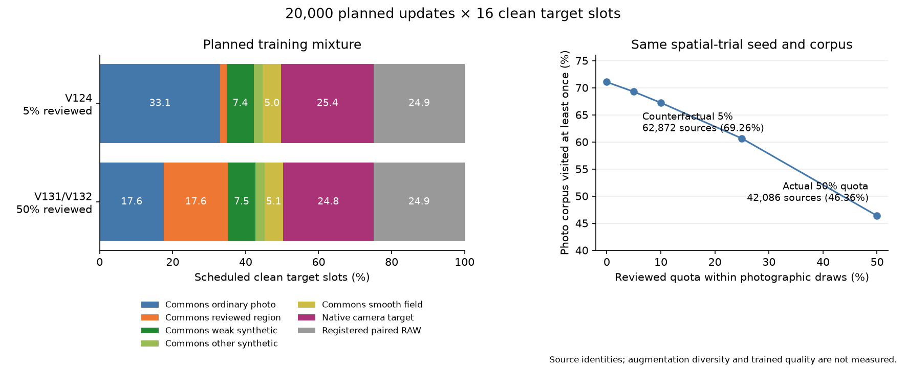

# Photographic-source coverage in 20k training schedules

**The spatial trial's 50% reviewed-region quota concentrates half its photographic
draws on 29 sources.** Its full 20k schedule visits 42,086 of 90,781 training photos
(46.36%). With the same seed, corpus and total budget, a 5% quota would visit
62,872 sources (69.26%). This identifies a concrete diversity tradeoff to test;
it does not establish that lowering the quota improves restored images.

[Standalone SVG](images/training-source-schedule-v1/source-coverage.svg) ·
[Complete counts and executed-reader evidence](results/training-source-schedule-coverage-v1.json) ·
[Ten actual/counterfactual rows, CSV](results/training-source-schedule-coverage-v1.csv).

## Actual recipe schedules

Both recipes plan 20,000 updates with 16 independently indexed clean target slots
per update. Counts below concern source identities before crop/geometry, camera
and noise. They do not mean 320,000 unique photographs or identical repeated
augmented targets. V124's second noisy view does not add a clean source slot.

| Recipe | Planned domain batches, Commons / native / paired | Photographic draws | Reviewed draws / bank size | Unique photo sources | Corpus visited |
| --- | ---: | ---: | ---: | ---: | ---: |
| V124, seed67,5% reviewed |9,943 /5,087 /4,970 |111,410 |5,602 /20 |62,548 /90,784 |68.90% |
| V131/V132, seed70,50% reviewed |10,046 /4,965 /4,989 |112,424 |56,256 /29 |42,086 /90,781 |46.36% |

V124 schedules 239–308 reviewed draws per bank source. The spatial trial schedules
1,848–2,031 per source, within fixed 512×512 bin4 contexts before geometry/area2.
Those are valid reviewed photographs, but repeated source identities alone do
not establish more scene diversity. The sources can receive different transforms,
contrast attenuation, cameras and noise. Diagnosing overfitting would require
trained comparisons.

Within Commons,20% total synthetic includes 15 percentage points of weak texture;
10% is smooth controls and 70% is photographs. The reviewed quota is conditional
on that photographic 70%. Thus the 50% quota directs 17.58% of **all** scheduled
clean target slots to the 29 regions, alongside the native/paired domains.
[Current pipeline and option definitions](training-pipeline.md).

## Same-cohort quota counterfactual

This comparison holds the spatial trial's seed70,90,781-photo manifest,
29-source bank,20k schedule and domain/family decisions fixed. Only source
selection under the reviewed fraction changes. These are prospective metadata
choices, without generating the changed crops or training any alternative.

| Reviewed quota | Reviewed draws | Ordinary photo draws | Unique photo sources | Corpus visited |
| ---: | ---: | ---: | ---: | ---: |
|0% |0 |112,424 |64,500 |71.05% |
|5% |5,601 |106,823 |62,872 |69.26% |
|10% |11,344 |101,080 |61,030 |67.23% |
|25% |27,985 |84,439 |55,045 |60.63% |
|50%, actual recipe |56,256 |56,168 |42,086 |46.36% |

Even at zero reviewed quota, ordinary sources are drawn with replacement:
this finite schedule visits 71.05% of the corpus. These are exact counts for the
stated seed, not an average over training seeds or a full-corpus epoch.

The 5% alternative visits 20,786 additional source IDs. Reviewed draws still cover
all 29 bank sources,165–221 times each. The available corpus and number of clean
slots remain unchanged. Entropy-based source-identity effective counts are also
recorded in the receipt; they are exposure-concentration statistics, not counts
of independent scenes or measures of photographic quality.

## Executed checks

The real `CleanDataset` is invoked at every Commons index in both schedules,
then stopped immediately before image loading or procedural generation. An
independent Python selector must match source/family/ROI selection and the full
local RNG state at all 319,824 stops. Independent domain decisions also match
the real trainer at all 40,000 planned steps. Relevant reader/scheduler definitions
match the original executed/queued source snapshots by AST, including V124's
older module whose later noise code differs from today's implementation.

The immutable saved V124 trace through 7,600 validates 480 actual first-view
source records. Future scheduled selections remain prospective. This does not
replay those scored crops/noise or assert that V124 already completed 20k.
The genuine constructors additionally validate 20+29 reviewed cache/crop hashes
and target hashes; overlapping sources are checked in each catalogue.

A separate Python audit reaggregates all 319,824 saved CSV records,
reproducing actual family/identity counts and the visited/unvisited histogram.
All ten quota summaries reconcile their source counts and draw totals. Python,
NumPy and Torch global RNG states are unchanged by the executed selection audit;
CUDA stays uninitialized. There are zero new training-target draws, geometry
augmentations, neural forwards, sensor-noise observations, RAW decodes or updates.
The figure was actually viewed after rendering.

[Auditor](../scripts/audit_training_source_schedule.py) ·
[Figure/receipt reporter](../scripts/report_training_source_schedule.py).
The frozen plan, complete private per-index CSVs, independent aggregation,
executed sources and original render are hash-referenced in the receipts/diary.

## Next quality comparison

Test a lower reviewed quota while holding the chosen useful architecture,
cleaned corpus and training budget fixed. Compare ordinary/noisy photographic
detail, camera/color tails and both real GFX scenes alongside whole-patch scores.
Source coverage alone cannot choose the best quota or replace native inspection.

The [V124/V125](conditional-mean-training.md) and
[V131/V132](raw-spatial-training.md) recipes, parents, checkpoints, collectors
and original horizons remain unchanged. The newest prepared 90780/31 cohort
still has no trained quality result. V120 remains the general recommendation;
this audit adds no model score or performance-history point.
