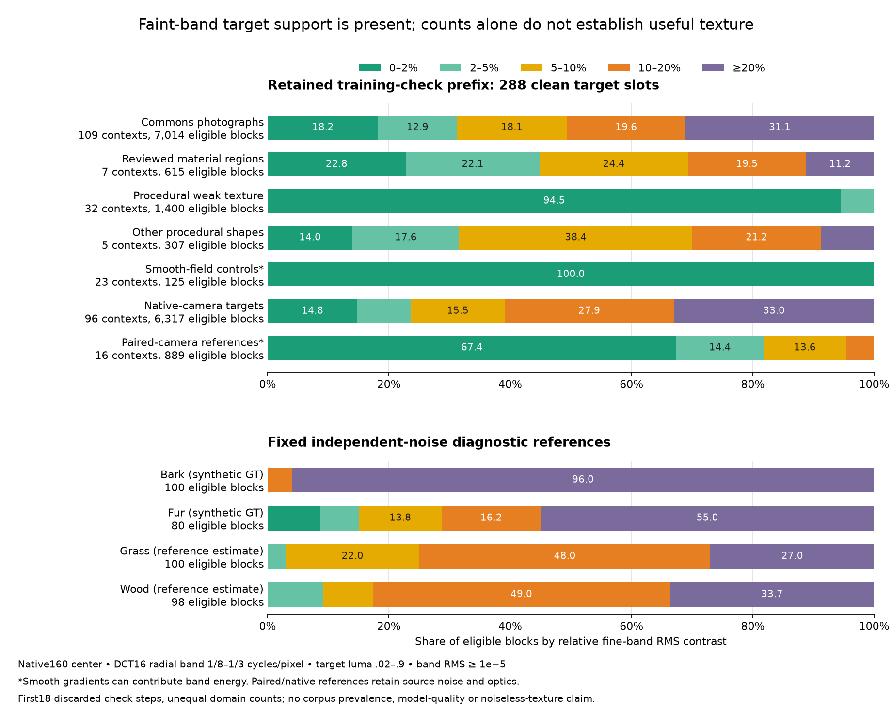
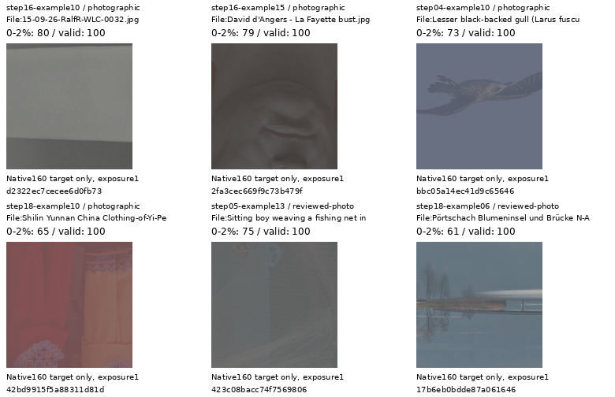
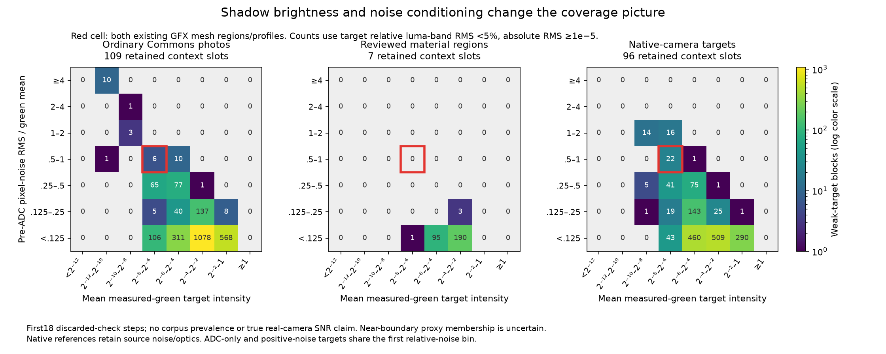

# Fine-detail coverage in prepared training targets

**The retained training batches already contain faint-band target content.**
Among eligible blocks, 31.2% of ordinary Commons-photo blocks and 44.9% of
reviewed-material blocks have relative band contrast below 5%. This argues
against treating the weak-detail problem as an empty contrast range in these
batches. It does not establish adequate material diversity or full-corpus
coverage: flat surfaces, soft backgrounds and smooth gradients can also
contribute to those counts.

The [sensor-domain extension below](#shadow-brightness-and-sensor-noise) finds
that dark/noisy conditions need separate inspection. The optional
[reviewed-material shadow augmentation](reviewed-shadow-exposure.md) passes
CPU/CUDA checks, but its [completed1k pilot](reviewed-shadow-pilot-quality.md)
shows no useful quality gain. It stays off by default.

The [V124/V125 training recipes](conditional-mean-training.md) test conditional
bias with frozen inputs; V124's original20k control is complete and V125 runs. The
[completed V122/V123 comparison](v122-v123-quality.md) finds little weak natural
detail recovery from its frequency input adapter. The new
[full source-schedule audit](training-source-schedule-coverage.md) separately
identifies quota-dependent source concentration, without measuring target pixels
or restored quality.
Future material additions should pass native visual inspection rather than
maximize a weak-band count or increase the procedural quota on this evidence.
These coverage measurements do not change checkpoint selection, inference
policy or the inputs of current trials.



[Standalone SVG](images/training-target-coverage-v1/training-target-contrast.svg) ·
[Complete measurement and independent verification](results/training-target-coverage-v1.json) ·
[All 288 context rows, CSV](results/training-target-coverage-contexts-v1.csv).

## Actual retained targets

These are the first 18 discarded CUDA implementation-check steps for V124:
176 Commons/procedural target slots, 96 native-camera slots and 16 real-paired
slots. Each simulated target appears in two noisy views; the second copy is
removed before counting. The resulting 288 clean context slots contain 28,800
native16 blocks. They are not 288 independent photographs, and this short
prefix has unequal domain counts rather than the full training mixture.

| Prepared-target family | Context slots | Eligible blocks | Contrast 0–2% | Contrast 0–5% | Contexts containing 0–5% blocks |
| --- | ---: | ---: | ---: | ---: | ---: |
| Ordinary Commons photograph branch | 109 | 7,014 | 18.2% | 31.2% | 71 |
| Reviewed photographic material region | 7 | 615 | 22.8% | 44.9% | 7 |
| Procedural weak texture | 32 | 1,400 | 94.5% | 100.0% | 14 |
| Other procedural shapes | 5 | 307 | 14.0% | 31.6% | 3 |
| Smooth-field controls | 23 | 125 | 100.0% | 100.0% | 2 |
| Native-camera targets | 96 | 6,317 | 14.8% | 23.6% | 55 |
| Paired-camera reference estimates | 16 | 889 | 67.4% | 81.8% | 11 |

Percentages use each row's **eligible-block denominator**, not all context
pixels or source counts. Source-family labels replay deterministic selection
metadata; the photograph branch name alone does not establish photographic
content or technical quality for every source.

The measurement matches the [conditional-noise diagnostic](conditional-noise-response.md):
central native160 pixels of a 256px prepared context, orthonormal16px DCT,
radial frequencies 1/8–1/3 cycles/pixel, linear-sRGB luma weights
`.2126/.7152/.0722`. Relative contrast is band RMS divided by block mean.
Eligible blocks have all RGB values within [0,1], mean luma .02–.9 and absolute
band RMS at least 1e−5. Paired references additionally require one valid measured
CFA sample at every block pixel; that does not make their dense RGB reference
exact GT. Native targets also retain residual source noise and optics.
Shadows below .02, clipped/invalid regions and other frequency bands remain
outside this result.

The four fixed diagnostic references reproduce all 32 earlier model/CFA group
histograms exactly. Fur has seven eligible 0–2% blocks; grass and wood have
three and nine 2–5% blocks. Persistent detail bias in those selected bands
therefore coexists with training-target support in the same contrast ranges.
Matching a contrast histogram alone does not match material, orientation,
noise conditioning or scene diversity.

## Native target inspection

All six unchanged native160 cells below were actually viewed. The selection
takes four ordinary photographs and two reviewed-region crops with the most
eligible 0–2% blocks, breaking ties by 0–5% count and then context ID. Selection
uses target statistics only, without restored outputs. Display exposure is ×1,
with the actual recorded WB/matrix; no crop pixel is resized.



Top row, left to right: [Ralf Roletschek, Gin Fizz](https://commons.wikimedia.org/wiki/File:15-09-26-RalfR-WLC-0032.jpg),
[CC BY-SA3.0](https://creativecommons.org/licenses/by-sa/3.0/);
[Selbymay photograph of David d'Angers' La Fayette bust](https://commons.wikimedia.org/wiki/File:David_d%27Angers_-_La_Fayette_bust.jpg),
[CC BY-SA3.0](https://creativecommons.org/licenses/by-sa/3.0/);
[Charles J. Sharp / Sharp Photography, juvenile gull](https://commons.wikimedia.org/wiki/File:Lesser_black-backed_gull_%28Larus_fuscus_graellsii%29_juvenile_in_flight_Sagres.jpg),
[CC BY-SA4.0](https://creativecommons.org/licenses/by-sa/4.0/).

Bottom row: [Photo by CEphoto, Uwe Aranas, Yi clothing](https://commons.wikimedia.org/wiki/File:Shilin_Yunnan_China_Clothing-of-Yi-People-01.jpg),
[CC BY-SA3.0](https://creativecommons.org/licenses/by-sa/3.0/);
[Basile Morin, fishing-net weaving](https://commons.wikimedia.org/wiki/File:Sitting_boy_weaving_a_fishing_net_in_Laos.jpg),
[CC BY-SA4.0](https://creativecommons.org/licenses/by-sa/4.0/);
[Johann Jaritz / CC BY-SA4.0, Pörtschach reeds](https://commons.wikimedia.org/wiki/File:P%C3%B6rtschach_Blumeninsel_und_Br%C3%BCcke_N-Ansicht_29112020_8502.jpg).
Modified by binning, training geometry, sampled contrast/exposure/camera
augmentation, cropping and display conversion. Derivative crops retain their
sources' respective licenses.

Some selected ordinary targets are dominated by flat surfaces or soft
backgrounds. The net retains faint repeated strands; the reeds retain naturally
mist-softened structure. Their presence is useful evidence, without proving
that every fine fluctuation is noiseless scene detail. Even two smooth-field
contexts meet the band-energy filter, demonstrating why these counts cannot
serve as a fine-material admission rule. These are training-target inspections,
not noisy/denoised/GT performance comparisons.

[Source/ROI/WB/matrix and actually viewed image metadata](images/training-target-coverage-v1/manifest.json) ·
[Corrected photograph credits](results/training-target-coverage-source-credits-v2.csv) ·
[Preserved attribution clarification](results/training-target-coverage-publication-v1.json).
The frozen bust source's author field identifies the sculptor; its Commons
source field credits the photograph to Selbymay. Original source rows and
machine receipts retain their bytes, with the photograph credit clarified here.

## Independent checks and limits

An independent even-extension FFT computes the DCT without the analyzer's
cosine-matrix implementation. Across all 28,800 blocks, valid masks and contrast
bins match exactly; maximum band-RMS difference is 5.87e−16 and maximum eligible
relative-contrast difference is 2.00e−15. Original frozen-reader source-choice
methods, specialized to stop before source-cache access, reproduce all 176
Commons family/source choices. All 16 actual source-loss trace rows also match.

Explicit-channel NumPy rendering verifies all 460,800 native crop channels
exactly and their placements inside the viewed board. Published crop and chart
PNGs retain the actually viewed bytes. Ten focused tests cover analytic DCT
carriers, flat/out-of-gamut targets, measured-CFA support, source exclusion and
independent ROI selection. Ruff passes. The original overlapping chart layout
is preserved; separately rendered v2 fixes only its legend/title spacing.

There are no new neural/encoder calls, sensor observations, source-cache image
reads, RAW decodes or optimizer updates. Active and queued training inputs pass
their original file guards. This measurement does not establish population
coverage, calibrated source noise, a sufficient bank or a learned-quality gain.

Implementation: [NumPy analyzer](../scripts/analyze_training_target_coverage.py) ·
[Plotter](../scripts/plot_training_target_coverage.py).

## Shadow brightness and sensor noise

The earlier .02 luma cutoff excluded1,064 ordinary-photo blocks and2,472 native
blocks. This extension reuses the same actual targets, now measuring clean
**measured-green sensor samples** separately from rendered-luma fine contrast.
It covers272 simulated target slots, which retain the exact arrays supplied to
the noise generator. The sixteen real-paired slots do not have those latent
input signals. Native simulated targets still retain source noise/optics.

Within each native16 block, the128 physically sampled green sites give a mean
intensity and pre-ADC **pixel-noise** RMS:

```text
mean_green = mean(green samples)
pixel_noise_RMS = sqrt(mean(shot * max(green samples, 0) + read))
relative_pixel_noise_RMS = pixel_noise_RMS / mean_green
```

This is neither the noise of a block mean nor a luma-band SNR. Validity requires
positive green mean, all true green sites in[0,.98), and rendered target RGB
within[0,1]. The fine-band definition remains DCT16/1⁄8–1⁄3 cycles per pixel,
relative RMS below5%, absolute RMS at least1e−5 and positive rendered mean.
No lower .02 rendered-luma cutoff is applied here; shadow means below.02.

| Retained target family | Valid blocks | Valid shadow blocks | Weak shadow blocks |
| --- | ---: | ---: | ---: |
| Ordinary Commons-photo branch | 7,939 | 937 | 240 |
| Reviewed material regions | 678 | 63 | 13 |
| Procedural weak texture | 3,000 | 1,500 | 847 |
| Other procedural shapes | 396 | 0 | 0 |
| Smooth-field controls | 2,300 | 1,575 | 75 |
| Native-camera targets | 8,617 | 2,305 | 173 |

The changed validity rule and shadow support mean these denominators differ
from the earlier midtone table. ADC-only draws remain separate recorded
conditions, without inventing a noise floor. Counts can include smooth or
source-noisy structure; they do not admit material automatically.



The two DSCF3842 native160 mesh regions have observed-green means
.005871/.006489. Their existing nominal prior gives relative pixel-noise proxies
.6401/.5949; the fixed nearby3879 prior gives.5312/.5022. These are unchanged
supplied profiles applied to signed observed samples, **not calibrated camera
noise, clean brightness, real band SNR or GT**. No RAW is decoded and no model
output is consulted.

All four proxies fall in the predeclared coarse cell:
green mean[2⁻⁸,2⁻⁶), relative pixel-noise RMS[.5,1). In this short prefix:

| Family | Valid blocks in that cell | Weak blocks | Context slots represented |
| --- | ---: | ---: | ---: |
| Ordinary Commons photos | 60 | 6 | 11 |
| Reviewed material regions | 0 | 0 | 0 |
| Native-camera targets | 291 | 22 | 12 |

This sparse same-cell result is sensitive to boundaries. The right nearby-profile
proxy is only.0022 above the.5 boundary, without a calibrated uncertainty
estimate. Including the immediate3×3 neighboring cells gives161 ordinary-photo
weak blocks,174 native weak blocks and400 weak-procedural blocks; the reviewed
draws have25 valid neighboring blocks with none meeting the weak criterion.
These counts support exploring dark material exposures without establishing
a global distribution gap or a definitive source of the mesh failure.

Independent native-pixel masks verify all27,200 blocks: green means match exactly,
maximum pixel-variance difference is4.34e−19 and maximum valid relative-noise
difference is1.43e−14. All validity/condition bins and the four GFX ROI/profile
combinations match. This extension reads retained target/GFX arrays only, with
no new neural calls, noise observations, original-photo reads, RAW decodes or
optimizer updates.

[Complete measurement, neighboring-cell sensitivity and independent checks](results/shadow-sensor-coverage-v1.json) ·
[Family counts, CSV](results/shadow-sensor-coverage-summary-v1.csv) ·
[Analyzer](../scripts/analyze_shadow_target_coverage.py).
The [new shadow-exposure policy](reviewed-shadow-exposure.md) preserves material
geometry and current noise priors, with an actual old/default/preparation
comparison. All active and queued training recipes stay fixed; its trained
effect needs a later matched comparison.
