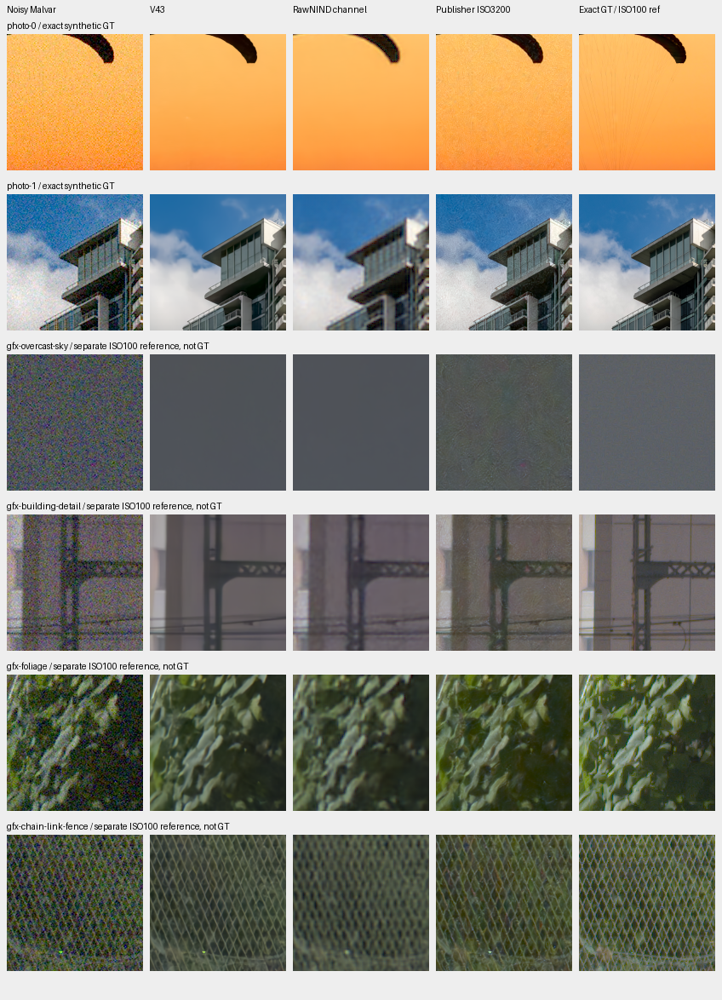
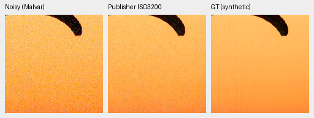
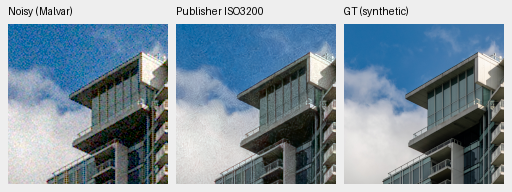
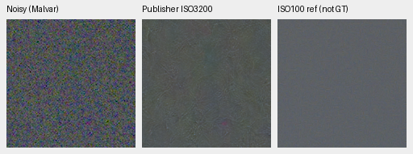
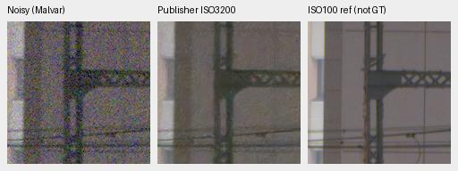
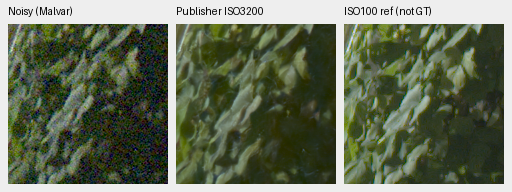
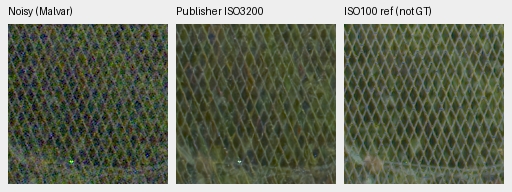

# Publisher ISO 3200 reference on six saved inputs

The transferred publisher default retains substantial grain in both photos and
the GFX sky, with textured artifacts around fine structures. These selected
views do not establish an overall improvement over V43. Keep V43 as the working
reference and leave the active matched training unchanged.

[Complete source, ROI, checkpoint, noise/display metadata and audits](results/unified-ISO3200-CPU-pilot-v1.json).
[Compatibility inspection](results/unified-demosaicing-CPU-preparation-v1.json).
This is a small transfer study using a fixed source ISO profile. Its calibration
is not matched to the tested cameras; it does not reproduce the paper benchmark
or rank the architecture generally.

The reference is the unchanged SamsungLabs implementation of
[Tedla, Punnappurath, Zhao and Brown, ICCP 2025](https://arxiv.org/abs/2504.07145v2),
pinned at `d17aa7ebba5730c6259d256da028a84c521007c7`. ISO 3200 was selected
from the publisher's test YAML before any photo outputs. The genuine checkpoint
SHA256 is `fef899dc7c08c492d82e0c27a99fd9a2f067ef927088ec61348384b6078a8919`.
All 336 tensors match the original 3,203,107-parameter model. The code/weights
remain in an isolated reference cache, outside production and training. The
repository license says CC BY-NC-SA 4.0; the main model header says CC BY-NC 4.0.

## Fixed input and output handling

All six saved observations use RGGB. Nominal black-subtracted RAW is mapped to
the publisher's integer range: `floor(clip(raw * 13496, 0, 13496))`. A mosaic
channel and three RGB sampling masks follow its exact normalization,
`(codes/13496 - .5)/.5`. The original 12-channel forward executes all three
branches; the other slots repeat the same input and only the ordinary-Bayer
output is retained. There is no geometric transform or new noise draw.

Original publisher postprocessing denormalizes, clips and truncates to uint16
codes from 0 through 13,496. Scores/rendering use those codes divided by 13,496.
This is 13,497 output levels, approximately 13.7 bits of code precision.
Below-zero input samples are explicitly clipped by this transfer. Continuous
network outputs, integer codes, normalized predictions and inputs are retained.
The fixed source ISO 3200 profile receives no per-input shot/read map or ISO.

The two synthetic photographs use the existing ISO12800-prior observations:
shot `.00256`, read variance `.0000262144`. Their display exposure is 1, with
fixed WB `[2,1,1.5]` and the saved camera matrix. The real GFX observation is
cached DSCF3879, ISO6400/f1.7/1/240s; the preserved input-only estimate is shot
`.0014635775921166604`, read variance `.0000010715704128646712`.
All real previews use exposure 4 (+2EV) and the same saved WB/matrix across methods.

DSCF3880, ISO100/f5.6/3s, is the independently demosaiced qualitative reference.
Aperture, depth of field and moving content differ. It is not exact GT and
receives no pixelwise score. Neither RAF nor its siblings enter training; only
cached normalized arrays were read.

| GFX region | Noisy sensor ROI, xywh | Reference sensor ROI, xywh |
| --- | --- | --- |
| Sky | `[5800,1400,160,160]` | `[5800,1400,160,160]` |
| Building | `[5790,2690,160,160]` | `[5791,2690,160,160]` |
| Foliage | `[8890,5570,160,160]` | `[8890,5570,160,160]` |
| Fence | `[2240,6000,160,160]` | `[2241,6000,160,160]` |

Real predictions use `[176,176,160,160]` inside the saved native512 context.
Photo previews use `[48,48,160,160]` inside their fixed native256 observation.
The 240-pixel score ROI is `[8,8,240,240]`; it is separate from the native preview.

| Fixed photograph | sRGB PSNR, 240px | SSIM, 240px | sRGB PSNR, native160 ROI |
| --- | ---: | ---: | ---: |
| Parachute | 32.64516 | .775416 | 33.08002 |
| Building | 31.79885 | .841478 | 31.70192 |

These are two selected observations, without a source confidence interval or
claim of equivalence to the publisher's trained noise distribution.

## Native comparisons

Every image pixel is copied at native scale. No crop is resized or sharpened;
open the original PNG at 100% if the viewer scales it. The comparison board
contains 30 exact 160-pixel cells from preserved noisy/V43/RawNIND controls,
the new reference and the exact synthetic GT or independent ISO100 reference.
All cells were actually viewed at original resolution.

V43 has cleaner fields but also smooths cords, foliage and wires. RawNIND has
soft/wavy building and fence structure. The publisher default retains conspicuous
grain and textured waviness; the selected results do not justify replacing V43.
V43 SHA256 is `0d74cf31fb1c7e3f97fc692c855a2ca0ee3ebf562b454e4f8b135c28fc0aa5c5`.
RawNIND's retained CFA-channel reference uses weights
`c1f7de3de24cb12f4803ee65e11cfb467e9a5b80c3cb7126746ef026106c15e0`.
Their original CPU FP32 crop records are reused, with no repeated control inference.

Photo credits: [Roy Egloff, Swiss Riviera parachute](https://commons.wikimedia.org/wiki/File:CH.VD.Villeneuve_2007-08-25_Vertigo-Swiss-Riviera_2392_3x2-R_4K.jpg)
and [Dietmar Rabich, Vancouver building](https://commons.wikimedia.org/wiki/File:Vancouver_(BC,_Canada),_Coal_Harbour_Seaside_Park,_Blick_in_den_Himmel_--_2022_--_2158.jpg),
both CC BY-SA 4.0. Derived binned/simulated/restored previews retain complete
credits in the result metadata. GFX photographs are user-provided.

## Verification and limits

The CPU worker completed and exited. Independent reconstruction checks all six
inputs against publisher normalization and every output code against NumPy.
All 32 scalar metric fields reload exactly; independent float64 PSNR reductions
differ by at most `2.46e-6` dB. Every new native panel rerenders exactly and
all shared noisy/reference panels match the preserved V43 PNGs byte for byte.
All 20 inputs/50 frozen source guards and seven published PNG copies verify.

The original model, input and RNG remain unchanged; the first photo repeats
exactly. CUDA remains uninitialized. A derived metadata record clarifies that
scores use publisher-quantized RGB; original producer records, arrays and pixels
stay intact. There is no GPU parity, full-frame speed or broad quality result.
The top-level README retains V43, and the matched 160k-example review remains
the next main model decision.
