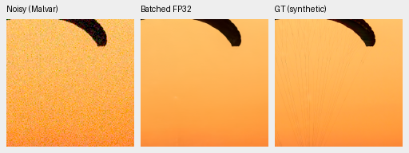
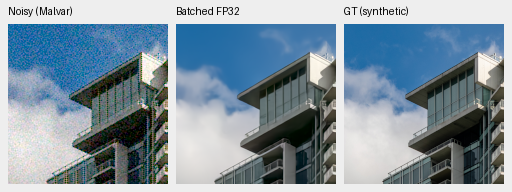
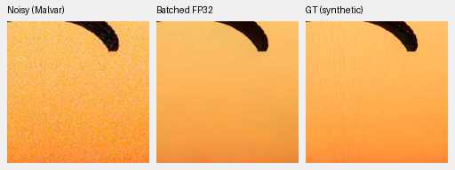
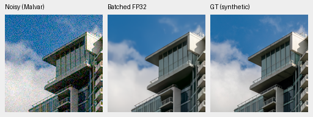
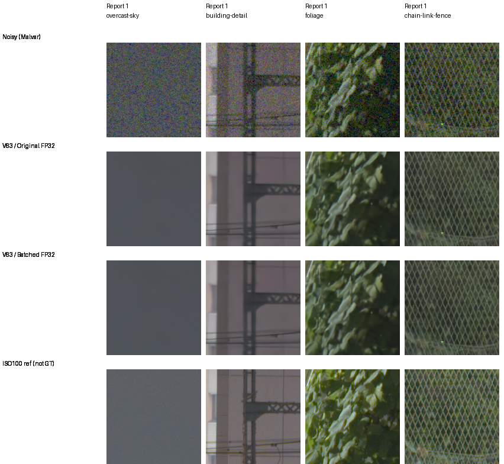

# Uniform-prior batching: exact outputs, mixed resident timing

The unchanged-weight scalar-prior batching prototype passes all eight CUDA
array checks **byte-for-byte across13,369,344 RGB positions per policy**.
All48 native comparison cells were actually viewed, with no visible difference.
Resident timing is mixed: V43 is.87% slower; V63 is1.59% faster. It is not
integrated, and no new full-frame or restoration-quality gain is claimed.

[Final decision](results/uniform-physics-CUDA-final-review-v1.json),
[actual GPU receipt](results/uniform-physics-CUDA-GPU-receipt-v1.json),
[independent array/timing audit](results/uniform-physics-CUDA-array-audit-v1.json),
[actual native viewing record](results/uniform-physics-CUDA-native-review-v1.json),
[complete native source/ROI/noise/display metadata](results/uniform-physics-CUDA-published-native-assets-v1.json).

## Fixed implementation and numerical coverage

The [CPU study](uniform-physics-batching.md) batches GAT, initial Malvar and
expectation inverse when one scalar shot/read prior serves the whole batch.
Per-image normalization/anchors and the neural forward remain unchanged.
Mixed/equal-vector-profile fallback subtrees remain identical in the AST.
Reducing Python calls alone did not predict a consistent GPU latency benefit.

| Unchanged EMA | Checkpoint SHA256 |
| --- | --- |
|V43|`0d74cf31fb1c7e3f97fc692c855a2ca0ee3ebf562b454e4f8b135c28fc0aa5c5`|
|V63 original20k|`ed70952dd33c5d7da39199bf1306b58b579862920fb0cccd6b222f19871bc9b5`|

Each model runs two fixed native256 photographic observations, four standing
native512 GFX contexts in B4, and a B4/native512 generated low/high-signal
field spanning all four CFAs. The eight full output pairs retain negative
and over-white values; nothing is clipped or quantized before comparison.
All maximum/RMS errors are0DN16, within the unchanged1/.25DN16 gates.
Candidate repeats and restored-original outputs are exact; model/DINO state,
parameter identities and RNG remain unchanged. All gates pass before timing.

The separate CPU reader independently checks every saved FP32 value using
FP64 subtraction/scalar summation and replays timing medians. The earlier
CPU component tests cover48 cases,192 fields, five noise families, layouts,
odd dimensions and fallback profiles; these do not substitute for this actual
CUDA result. No training, GT-based camera score or source-drive read occurs.

## Resident timings

Actual GB10, IEEE FP32 CNN/DINO, channels-last, unchanged physical arithmetic,
cuDNN search with16GiB allocator cap. Three warmups precede four synchronized
samples per policy, interleaved ABBA/BAAB at B4/native512 on the same resident
GFX input. Ranges are observed samples on a shared machine, not confidence
intervals. Timings exclude loading/search/transfers/tiling/blending/RAF decode
and16-bit export.

| Model | Original median, ms | Batched median, ms | Time change | Original range, ms | Batched range, ms |
| --- | ---: | ---: | ---: | --- | --- |
|V43|757.03|763.64|+.87%|755.64–762.57|758.30–767.18|
|V63|781.11|768.67|−1.59%|767.75–809.86|763.93–772.46|

The working V43 has no measured improvement. The small V63 reduction has
overlapping sample ranges and does not establish a consistent or whole-frame
benefit. This fixed probe is closed without production integration, repeat
timing, automatic retry or full-frame continuation. The existing
[mature full-frame result](mature-cudnn-fullframe.md) still applies to its
original implementation;100MP/10s remains unmet.

## Native photo triplets

Native160px panels: noisy Malvar, batched FP32 result, exact synthetic GT.
Both sources use RGGB, shot.00256/read variance.0000262144, exposure1× and
the same WB/matrix/ROIs as the fixed fixture. Full hashes and source/cache
coordinates are in the index. PNGs are display copies; numerical checks use
complete unquantized predictions.

V43, two fixed sources:

V63, identical sources:

Sources: Roy Egloff and Dietmar Rabich, CC BY-SA4.0. These are binned/cropped,
synthetic-noise/restoration derivatives; source pages, credits and licenses
are preserved in the index and the
[shared source descriptions](late-rgb-original4k-review.md#native-synthetic-triplets).
Original/batched full photo boards are also retained in the index. Missing
fine canopy lines are unchanged by this implementation experiment.

## Standing real capture

The cached DSCF3879 ISO6400 / DSCF3880 ISO100 scene and its siblings remain
excluded from training. All crops share the same source, ROI, conditioning
and exposure; the independent ISO100 f/5.6 capture is a qualitative reference,
not exact GT. Sky, building, foliage and fence show no visible implementation
difference. All four boards/24 triplets/48 native cells pass source/pixel checks.

## Provenance

The [package-owner recovery](late-rgb-queue-recovery.md) preserves the original
interrupted waiter and old queues. They exit without GPU work. The new GPU
queue waits for those exact owners and the recovered complete package, then
executes this first GPU probe. CUDA outputs live under
`/mnt/external/demosaic/experiments/uniform-physics-CUDA-v2/`;
the independent CPU/native closure is in `uniform-physics-CUDA-review-v3/`.
All numerical/model/fixture fields and limits remain fixed.

Native views preceded timing interpretation in the tool sequence. Their
first receipt assembly had a missing-validator import path and wrote nothing;
the corrected frozen validator checks all cells. The saved manual record
explicitly records its later assembly time. No inference or native pixels
were regenerated for that correction. The distinct future-watcher startup
guard passes29 focused tests; live frozen jobs retain their original copies.
