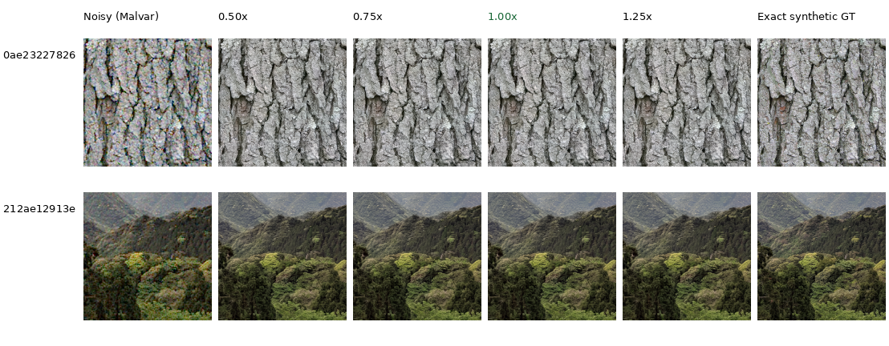
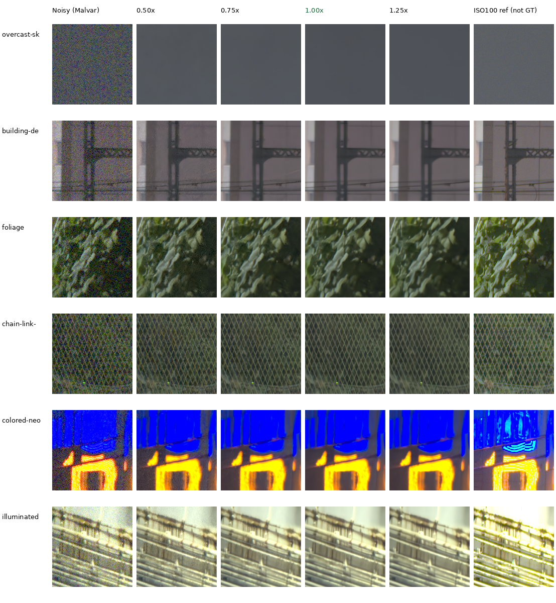
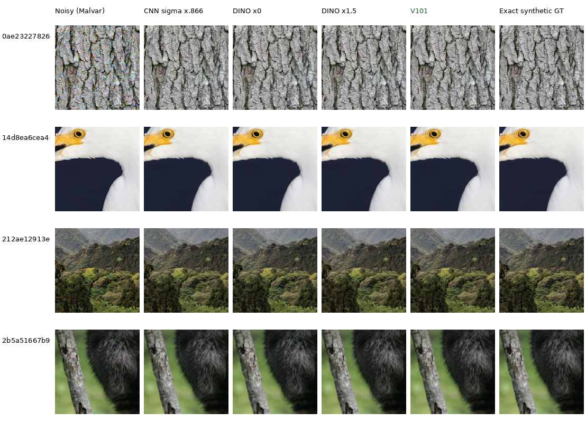
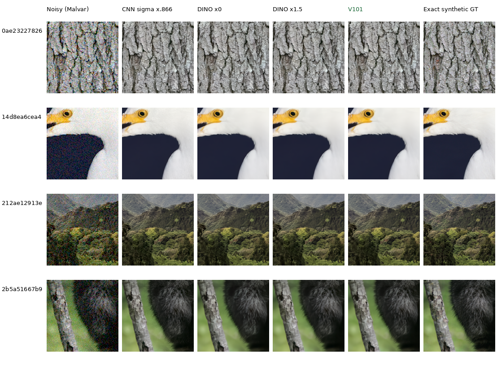
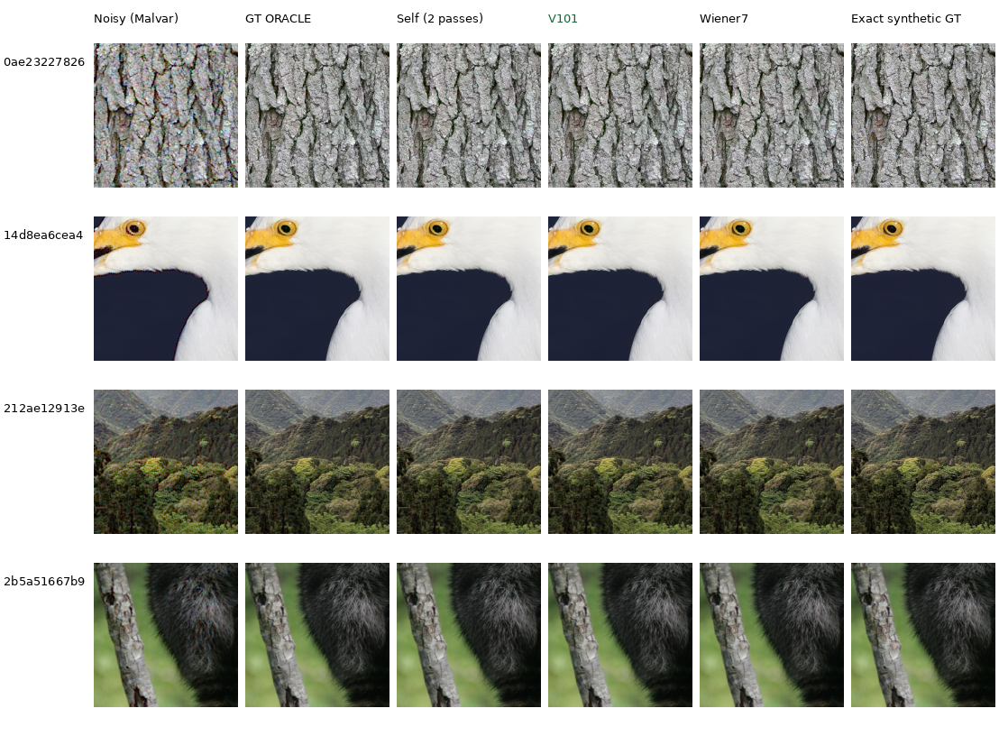

Current V104 guidance and comparisons: [noise conditioning](noise-conditioning.md).
The V101 study below retains its original measured protocol and results.

# Noise conditioning and fine detail

**Lower noise conditioning trades stronger fine structure for residual grain;
it is not a general quality fix for V101.** On the four fixed held-out natural
contexts, all three alternative strengths lose high-noise PSNR against the
original conditioning. The native crops also show that some additional detail
is useful. Keep that tradeoff visible alongside the [training improvements](quality-first-training.md).
Controlled path and DINO-preview checks below now localize that tradeoff:
the CNN noise channel drives most of the tested strength effect, while changing
only the DINO preview gives no consistent improvement on these cases.

This diagnostic holds the V101 final10000 EMA and all noisy/target arrays fixed.
Factors .50/.75/1.00/1.25 multiply both the supplied shot/read-variance
coefficients and the variance map. These are variance factors, not standard
deviation factors. The simulated observation still has its original physical
noise. Crop metadata records the actual generation condition and effective
conditioning separately; this is a declared prior mismatch, not a different
exposure or noise realization. All outputs use CPU IEEE FP32, without training,
additional ADC correction or a change to production defaults.

## Fixed photographic results

| Conditioning strength | ISO100 PSNR | ISO12800 PSNR | ISO12800 SSIM | ISO12800 gradient MAE |
| --- | ---: | ---: | ---: | ---: |
| .50× | 40.34055 | 31.43948 | .868022 | .026434 |
| .75× | 40.34904 | 33.06758 | .918281 | .021273 |
| **1.00×** | 40.35352 | **33.42612** | **.923598** | **.020436** |
| 1.25× | **40.35552** | 33.28616 | .917192 | .020777 |

Means balance the four sources: bark, egret, forest canopy and fur. Scoring
uses native 240 interiors from the fixed 256 contexts, RGGB and unquantized
predictions. At ISO12800, .50/.75/1.25× lose 1.98664/.35854/.13996dB on average;
each loses PSNR on all four sources. At ISO100 the means remain close, including
a +.00200 dB change at 1.25×. ADC-only predictions are byte-identical across all
four factors, as multiplying zero coefficients preserves the zero-noise input.

All 12 original 1× score rows and native PNGs reproduce the previous V101 report
exactly. The model, frozen DINO, config, parameter identities and cached inputs
remain unchanged. Independent NumPy F64 PSNR calculations on all 48 saved float
predictions differ by at most 3.4e-6 dB, and every source-mean calculation agrees.
[Complete cases, conditioning, predictions and verification](results/V101-conditioning-probe-CPU-v1.json).

## Native comparisons

Columns: noisy Malvar, .50×, .75×, **1.00×**, 1.25× and exact synthetic GT.
Every cell is an unchanged 160×160 crop at the 8×-binned evaluation resolution,
with the same source coordinates and display exposure ×1 across methods.
The labels describe conditioning strength; every restored column uses the
same checkpoint SHA256
`6f691c653a618bdde0d7db501f3efc557a9699e2dbba73cf94c7440b364ef3e3`.

At ISO12800, lower conditioning retains more hair/canopy structure but also
grain, most apparent on smooth feathers/backgrounds. Higher conditioning
smooths additional fine structures. Those changes matter alongside the score
differences; they are not all explained by PSNR alone.

[ISO12800 source/ROI/checkpoint/actual-noise/effective-conditioning/display metadata](images/conditioning-v101/iso12800-prior/manifest.json).
The source set was selected from clean inputs before reviewing these outputs;
it is not a collection of the biggest gains from the conditioning probe.

Low-noise bark and canopy remain visually close:

[ISO100 metadata and source triplets](images/conditioning-v101/iso100-prior/manifest.json).
All 36 unique board cells were actually viewed. Shared noisy/GT pixels and
physical/display settings match exactly; effective conditioning stays explicit
inside each method record.

## Detail versus off-target structure

A descriptive projection onto exact-GT luminance frequencies helps separate
some retained structure from additional error. The following uses the entire
240px scoring interior, mean subtraction, a separable Hann window and the
predeclared radial band 1/16–1/4 cycles/pixel. The projected gain is the real
GT/prediction cross-energy divided by GT energy. The residual is orthogonal
to that projected GT band and includes noise and restoration error.

| ISO12800 conditioning | Mean GT-projected band gain | Off-target band RMS, sRGB luminance |
| --- | ---: | ---: |
| .50× | .98518 | .004799 |
| .75× | .97498 | .004420 |
| 1.00× | .96356 | .004278 |
| 1.25× | .95192 | .004269 |

For the fur context, gain rises from .93338 at 1× to .97951 at .5×, while off-target
RMS rises .004432→.005505. Lower conditioning therefore retains additional
GT-correlated signal as well as additional error. Projection can also include
sharpening and chance noise/GT correlation from a single noise draw; it does
not prove that every retained hair or edge is real. RMS uses the same Hann
window without power compensation, and is not whole-image sensor-noise RMS.
[Exact definitions, per-source values and saved-input analysis](results/V101-conditioning-probe-CPU-v1.json).

These are four selected synthetic-photo contexts, not full427 or real-camera
quality proof. The current calibrated 1× default remains unchanged. The
[completed V102/V103 comparison](v102-v103-quality-review.md) improves full-panel
quality and tested weak-carrier response, with fine high-noise detail still open.

## Real GFX contexts

The same four strengths were evaluated on all six standing GFX regions, using
only the previously cached packed Bayer/reference arrays. No RAF or source
HDD read was needed. These are CPU 512 contexts, not full-frame blends. The
original 1× column exactly reproduces all six prior floating predictions and
triplet PNGs; every column shares the same native 160 coordinates, noisy pixels,
independent reference and +2EV display transform.

At .50× the wall, foliage and fence background retain more texture and grain.
.75× produces a milder change; 1.25× smooths additional structure. Sky stays
relatively uniform in the displayed crops. The fence strands remain coherent
and fine lit-sign structure stays soft. The independent ISO100 f/5.6 exposure
has different optics, time and moving subjects: **it is not GT**, and no RGB
reference scores rank these outputs.

[All 24 triplets, source/ROI/weights/actual-estimate/effective-conditioning metadata](images/conditioning-v101/gfx/manifest.json) ·
[Exact baseline replay, 24 float predictions and 36 actually viewed native cells](results/V101-GFX-conditioning-CPU-v1.json).
These variants make the denoising/detail tradeoff explicit; the current 1×
default and completed full-frame comparisons remain unchanged.

## Which path responds to conditioning?

Seven predefined interventions made84 actual CPU FP32 forwards on the same12
cached observations. Only the named input/path changes; weights, physical
measurements, other input tensors, parameter identities and RNG remain exact.
The baseline reproduces all12 previous float predictions and scores exactly.
These are fixed-weight interventions, not retrained architecture ablations.

| Intervention | ADC PSNR | ISO100 PSNR | ISO12800 PSNR |
| --- | ---: | ---: | ---: |
| Original V101 | **38.88476** | **40.35352** | **33.42612** |
| Input variance map only ×.5 | 38.88476 | 40.35352 | 33.42612 |
| Shot/read-variance profile only ×.75 | 38.88476 | 40.34904 | 33.06758 |
| CNN noise standard deviation only ×√.75 | 38.88476 | 40.34833 | 33.08901 |
| CNN noise standard deviation only ×√.5 | 38.88476 | 40.33863 | 31.53461 |
| DINO adapter offsets ×0 | 38.53593 | 40.33152 | 33.41443 |
| DINO adapter offsets ×1.5 | 38.83069 | 40.30618 | 33.41632 |

The map-only intervention is bit-identical to baseline for all12 predictions.
V101's stabilized base uses the scalar physical profile to transform the RAW
and form its CNN noise channel, then replaces the internal variance map with a
normalized proxy. The original map feeds optional directional/spectral heads
that this checkpoint does not have. That is the implemented conditioning path,
rather than evidence of a broken noise input. Profile-only ×.75 exactly replays
the earlier joint ×.75 experiment, as expected from this path.

Changing only the CNN sigma supplies most of the high-noise strength effect:
more visible structure/grain, with lower PSNR. Removing DINO offsets hurts
ADC-only PSNR substantially; multiplying them by1.5 also loses mean PSNR.
All three unscaled ConvNeXt adapter outputs were checked exact across policies.
DINO still executes for the zero-offset control. These results do not establish
that a newly trained fusion or stronger backbone cannot help.

Each unchanged160 cell uses the original source/ROI, exposure×1 and exact GT.
All48 cells were actually viewed. High-noise feathers, canopy and fur remain
smoothed; the sigma reduction restores some structure and grain, without a
general visual win. [ADC triplets/metadata](images/conditioning-paths-v101/adc-only/manifest.json) ·
[ISO12800 triplets/metadata](images/conditioning-paths-v101/iso12800-prior/manifest.json) ·
[All84 scores/predictions, path controls and native review](results/V101-conditioning-paths-CPU-v1.json).

## Cleaner DINO previews

The actual V101 ConvNeXt-Tiny branch was also evaluated with four predefined
preview inputs: noisy Malvar, input-only Wiener7, a first V101 restoration, and
the exact clean image. The final option is an **unavailable GT oracle diagnostic**,
never a usable method or candidate checkpoint. Only the DINO RGB preview changes;
the RAW measurements, physical profile, CNN normalized input/noise channel and
measurement offsets stay exact. Each intervention still executes DINO.

| DINO preview | ADC PSNR | ISO100 PSNR | ISO12800 PSNR |
| --- | ---: | ---: | ---: |
| Original noisy Malvar | **38.88476** | 40.35352 | **33.42612** |
| Input-only Wiener7 | 38.88476 | **40.35409** | 33.42362 |
| First V101 restoration, logically two passes | 38.87790 | 40.34827 | 33.42574 |
| Exact clean image, **ORACLE only** | 38.87069 | 40.34659 | 33.42266 |

All48 genuine forwards completed. Baseline float predictions reproduce the
prior12 cases exactly; Wiener is also exact in ADC-only conditions. Source means
and saved float hashes were independently checked. Self-preview reuses an exact
cached first pass here, but deployment would require two restoration passes;
this supplies no speed claim. Cleaner feature input alone gives no consistent
gain with the fixed trained adapters. Distribution changes and training may
matter; this does not test training on denoised features or establish a general
upper bound for DINO guidance.

The48 native160 cells were actually viewed. Outputs remain close, with no
consistent recovery of weak plumage/canopy/fur. All noisy/GT pixels, coordinates,
conditioning and display exposure×1 are shared exactly.
[ADC triplets/metadata](images/guidance-preview-v101/adc-only/manifest.json) ·
[ISO12800 triplets/metadata](images/guidance-preview-v101/iso12800-prior/manifest.json) ·
[All48 scores/predictions, exact input-path checks and oracle boundary](results/V101-guidance-preview-CPU-v1.json).
These checks favor continuing the cleaned-data/detail training rather than
applying a blanket lower sigma or cleaner-preview override. The current
calibrated policy stays in use. The older [ViT-S feature-similarity study](dino-preview-sensitivity.md)
is a separate encoder/feature diagnostic, rather than this restoration test.

## Sources

| Detail | Source / creator | License |
| --- | --- | --- |
| Bark | [Derek Ramsey](https://commons.wikimedia.org/wiki/File:Kentucky_Coffee-tree_Gymnocladus_dioicus_3264px.jpg) | [CC BY-SA 2.5](https://creativecommons.org/licenses/by-sa/2.5/) |
| Egret | [Serebit](https://commons.wikimedia.org/wiki/File:Snowy_egret_in_profile.jpg) | [CC BY-SA 4.0](https://creativecommons.org/licenses/by-sa/4.0/) |
| Canopy | [Grendelkhan](https://commons.wikimedia.org/wiki/File:Forest_covered_hills_on_Yakushima.jpg) | [CC BY-SA 4.0](https://creativecommons.org/licenses/by-sa/4.0/) |
| Fur | [Korall](https://commons.wikimedia.org/wiki/File:Racoon_clinging_to_a_tree.JPG) | [CC BY 3.0](https://creativecommons.org/licenses/by/3.0/) |

Modifications are binning, cropping, synthetic noise, restoration and shared
display conversion. Full source attribution and hashes accompany every crop.
