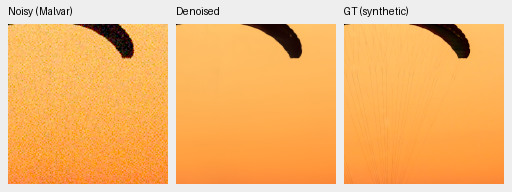
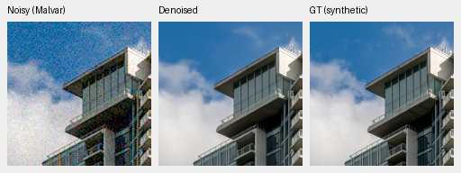
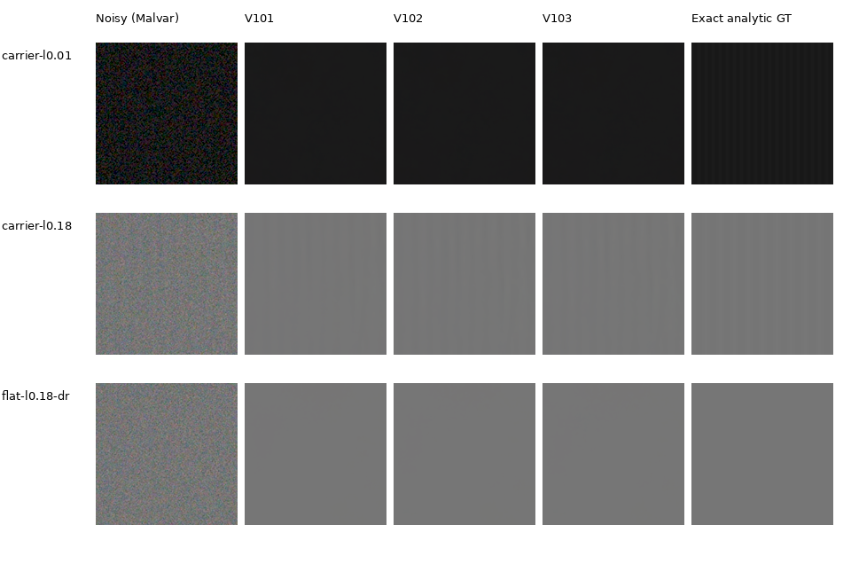
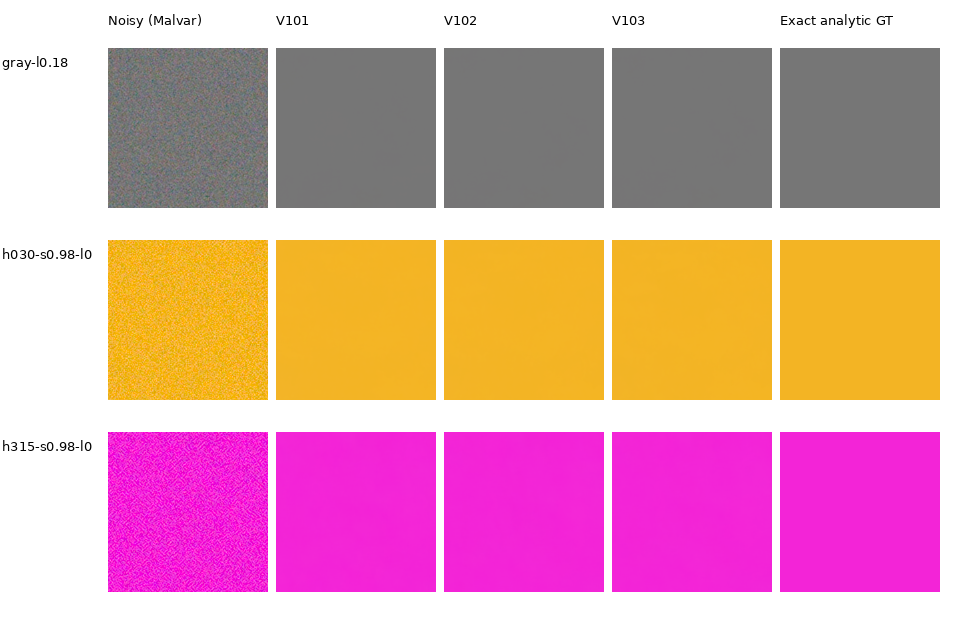
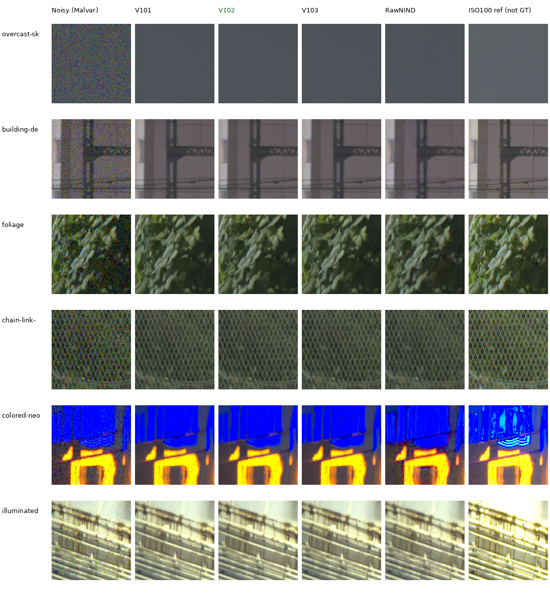

# V102/V103: completed detail-diversity comparison

**V102 final20k is the current quality and training baseline.** It reaches
36.67951dB photographic PSNR, +.17604dB over V101 and about1.78dB over V43.
V103 is a close alternative with a .00140dB higher photo mean. V102 has higher
measured-CFA means, stronger tested weak-texture response and lower ADC flat-color
error. Both improve over V101; real fine detail remains a development target.

## Completed primary panels

| Fixed EMA | Photo PSNR | Photo SSIM | Known4 CFA PSNR | Unseen5 CFA PSNR |
| --- | ---: | ---: | ---: | ---: |
| V101 /10k | 36.50347 | .965485 | 54.17404 | 53.92334 |
| **V102 /20k** | **36.67951** | **.966270** | **54.23709** | **53.97177** |
| V103 /20k | 36.68091 | .966285 | 54.22003 | 53.96410 |

Photo scores balance427 sources over seven conditions/four CFAs. All seven
condition means rise for both continuations. V102 improves425/427 source means
and11,839/11,956 cases; two source means and113 cases regress, with four ties.
Its paired source-bootstrap95% interval for the +.17604dB gain is
[+.17036,+.18167]dB. V103 improves424 sources, gaining+.17744dB
[+.17120,+.18356]. V103−V102 is+.00140dB [−.00073,+.00352], with275/427
source means improving. These describe sampled sources, not seed uncertainty.

| Photo condition | V101 | V102 | V103 |
| --- | ---: | ---: | ---: |
| ADC-only | 36.75531 | 37.12251 | 37.12932 |
| ISO100 prior | 38.39904 | 38.65759 | 38.65767 |
| ISO1600 prior | 37.03428 | 37.19144 | 37.19543 |
| ISO12800 prior | 33.62563 | 33.69355 | 33.69642 |
| Shadows | 39.99513 | 40.04160 | 40.04368 |
| Highlights | 34.09629 | 34.32860 | 34.32024 |
| Legacy noise | 35.61862 | 35.72127 | 35.72358 |

V102 improves photographic linear PSNR39.50788→39.66366, chroma MAE
.00649483→.00637822 and gradient MAE .01089546→.01067861.
Known-camera CFA gains+.06305dB [+.03502,+.09108], with all four scenes
improving. Unseen-camera gains+.04843dB [−.00231,+.11316], with three scenes
improving and two declining. The [camera guide](real-camera-quality.md) records
auxiliary RGB tradeoffs and accurately labeled AHD references.

IEEE FP32 CUDA evaluation independently checks all99,232 full-panel rows and
1,296 camera rows, complete eight-method case sets and every source-balanced
summary within1e-10. Sixteen procedural sources are evaluated separately and
excluded from the427-photo mean. [Source means, case counts, intervals and hashes](results/v101-detail-diversity-primary-statistics-v1.json).

## Native photographic comparisons

Columns: noisy Malvar, V101, V102, V103, RawNIND channel and exact synthetic GT.
Every cell is an unchanged160×160 crop at the8×-binned evaluation resolution.
Noise, coordinates, WB, matrix and exposure match across methods. PNGs are RGB8
sRGB previews; metrics use float predictions. Open originals at100%.

Fine fabric cords remain absent across the learned outputs. Building boundaries
are somewhat cleaner in V102/V103, but the three checkpoints look close at this
noise level. [All source/ROI/checkpoint/noise/display metadata and attributions](images/current-quality-v102-v103/photo/manifest.json).

V102 noisy/restored/exact-GT triplets:

V103 noisy/restored/exact-GT triplets at the identical coordinates:

The [selected natural-detail gallery](heldout-detail.md) separately shows
V102's stronger low-noise bark/canopy results. The [completed V103 material follow-up](heldout-detail.md#v102-versus-v103-on-the-fixed-material-panel)
reproduces V102 exactly and shows similarly small,slightly lower V103 condition
means. It complements the full427 scores above.

## Weak texture and flat color

At linear level.18/contrast.02/period16/ISO12800, mean in-phase carrier gain
rises .31925(V101)→.49887(V102)/.46916(V103). At period8 it is only
.00374/.02135/.01796: the finer carrier remains largely lost. The displayed
coarser carrier is more apparent in the new models; the darker fine carrier
still disappears. ADC-only gains remain near1.0.

[Texture observations, model hashes and native ROI/display metadata](images/current-quality-v102-v103/texture/manifest.json).

The color diagnostic measures absolute maximum-channel mean bias in16-bit DN,
not individual-pixel error. All3,528 case rows and grouped summaries were rebuilt.

| Condition | Model | Mean | 95th percentile | Maximum |
| --- | --- | ---: | ---: | ---: |
| ADC-only | V101 | 16.98 | 48.74 | 756.24 |
| ADC-only | **V102** | **10.04** | **38.29** | **59.23** |
| ADC-only | V103 | 19.56 | 41.69 | 1074.49 |
| ISO12800 | V101 | 23.96 | 76.16 | 161.09 |
| ISO12800 | V102 | 21.27 | 70.27 | 122.47 |
| ISO12800 | V103 | 21.95 | 69.81 | 123.97 |

These selected RGB8 flat crops look close and smooth; they do not display every
worst-case ADC error. [Color crop metadata](images/current-quality-v102-v103/color/manifest.json) ·
[independent diagnostic statistics](results/v101-detail-diversity-diagnostics-v1.json).

## Real GFX and complete16-bit output

Columns: noisy Malvar, V101, V102, V103, RawNIND channel, independent DSCF3880
ISO100 f/5.6 reference, **not GT**. Each cell is160×160 original sensor pixels,
shared+2EV display, cropped after full101.996MP blending. Foliage is still soft,
fence geometry remains clearer than RawNIND, and saturated signs lose structure.
V101/V102/V103 look close. Full-frame overviews show coherent scene geometry;
resized overviews cannot establish native fine-detail quality.

All eight linear/sRGB RGB16 TIFFs were rehashed completely and reopened as
8746×11662×3 uint16. Full-frame inference/blending took199.51/202.31/199.67s
for V101/V102/V103 and17.46s for RawNIND-channel, IEEE FP32,tile512/overlap64/B4.
These shared-machine observations exclude loading/export and do not meet10s.
[Capture protocol, six ROI coordinates and full-frame records](gfx-qualitative.md).

## What changed and what comes next

Both arms start from the exact V101 final10k EMA, fresh AdamW/EMA, seed60,
20k updates, B16/native256/BF16, LR1e-5/warmup200. Both use the same cleaned
88,477 Commons sources,128 native/32 paired targets, zero optical PSFs,
weak synthetic textures and photographic contrast attenuation. The sole matched
difference is six versus32 reviewed source regions at5% conditional-photo
probability; all48 numerical modules match. The tiny photo difference gives
little reason to expand ROI sampling unchanged. Compared with V101, budget,
seed, LR and cohort also change; its gain cannot be attributed to data alone.

V104 now continues from V102 on the reviewed **90,872-source corpus**, initially
keeping its six-ROI recipe and zero blur. The new2,395 eligible arrivals add
scene diversity; the five new eligible fine-detail sources can support a later
controlled ROI intervention. Their quality benefit has not yet been measured.
[Incoming data review](incoming-commons-quality.md) · [Training](quality-first-training.md).

| Canonical checkpoint | SHA256 |
| --- | --- |
| `/mnt/external/demosaic/models/v102-final20000.pt` | `55936a11ca5be7c1ae941953e14c8afe1186123f366e54f1947104a894e64c7a` |
| `/mnt/external/demosaic/models/v103-final20000.pt` | `eb20e21163d0ff411be9598d12d93963fa9cd0be57c22c5a147228230cf26ba1` |

Both fixed endpoints and all seven evaluation stages/full-frame jobs completed
successfully; no intermediate checkpoint search selected them. Official frozen
DINOv3 ConvNeXt-Tiny revision is`10d30274b4d445111e2d5bf75ac93bbd94db274b`.
[Completion,102 actually viewed native cells, four overviews and independent TIFF/history audit](results/v102-v103-quality-complete-v1.json).
Earlier pending-status receipts and source snapshots retain their original bytes;
the completion record closes that review without rewriting the evidence.

Photo sources: [Roy Egloff, Swiss Riviera fabric](https://commons.wikimedia.org/wiki/File:CH.VD.Villeneuve_2007-08-25_Vertigo-Swiss-Riviera_2392_3x2-R_4K.jpg)
and [Dietmar Rabich, Vancouver building](https://commons.wikimedia.org/wiki/File:Vancouver_(BC,_Canada),_Coal_Harbour_Seaside_Park,_Blick_in_den_Himmel_--_2022_--_2158.jpg),
both [CC BY-SA4.0](https://creativecommons.org/licenses/by-sa/4.0/). Complete
attributions and modification/license links are recorded per source in the
[photo manifest](images/current-quality-v102-v103/photo/manifest.json).
Camera images: Raw Natural Image Noise Dataset, Benoit Brummer and Christophe
De Vleeschouwer(2025), [CC BY-SA4.0](https://creativecommons.org/licenses/by-sa/4.0/);
7D-1 by Peter Wemmert, CC0, per cached permissions. Modifications: binning,
cropping, synthetic noise where applicable, restoration and display conversion.
