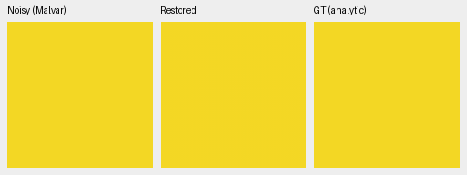
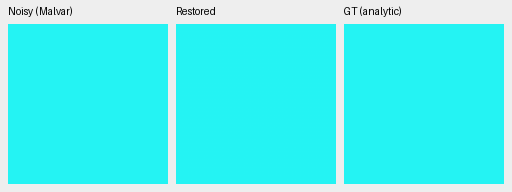
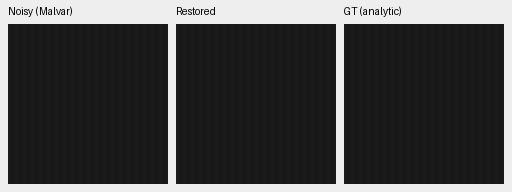
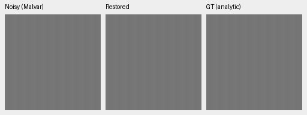

# V104 ADC projection: color and texture

The existing **Malvar residual projection repairs most of V104's ADC-only
flat-color bias** on this analytic grid. Across all 588 ADC observations, its
worst channel-mean bias falls **1,218.06→31.91 DN16**; mean bias falls
14.46→2.57 DN16. A subsequent ADC texture check finds useful carrier gains
and individual regressions; sites-only has smaller color-tail repair. No
checkpoint export or recommendation change has been made. V104 remains
the positive-noise/training baseline; V102 remains the lower-bias unprojected
ADC alternative. [Current models](current-model.md).

## Complete flat-color grid

Every method uses the same retained float32 camera-RGB predictions, input
samples and exact uniform targets from the completed V102/V104 study. There
are 147 palette/level choices × four Bayer patterns = 588 observations per
method. Shot=read=0; the input still includes ADC quantization. Metrics use
the same 160×160 interior at [48,48,160,160] inside each 256×256 context.
Values below are normalized camera-RGB codes ×65535, not physical sensor ADC codes.

| Weights / postprocess | Mean max-channel bias | p95 bias | Worst bias | Mean RGB RMSE | RGB MSE better / worse |
| --- | ---: | ---: | ---: | ---: | ---: |
| V102 original | 10.04 | 38.29 | 59.23 | 7.73 | — |
| V102 + sites | 7.25 | 28.37 | 46.25 | 6.48 | 557 / 31 |
| V102 + Malvar | 2.74 | 10.46 | 25.16 | 3.10 | 547 / 41 |
| V104 original | 14.46 | 43.70 | 1218.06 | 10.63 | — |
| V104 + sites | 9.45 | 32.83 | 610.67 | 8.58 | 547 / 41 |
| V104 + Malvar | 2.57 | 9.60 | 31.91 | 2.94 | 531 / 57 |

“Bias” is the maximum absolute **channel mean** error per observation, not
maximum pixel error. RMSE includes spatial variation. Counts compare each
operator with its own unchanged original model. Both projections have small
individual regressions: the largest V104 Malvar RMSE increase is .369 DN16.
These descriptive grid counts are not independent photographic samples.

## Flat-color native triplets

Noisy Malvar → V104 + Malvar residual projection → exact analytic GT. Each
panel is an unchanged 160×160 crop. Both cases were selected **after** the
original grid: V104's largest mean-bias case (bright yellow, RGGB, case1008)
and V102's largest mean-bias case (bright cyan, BGGR, case1081). Every original
model and projection is compared on both cases, with identical inputs, ROI,
WB=[2,1,1.5], camera matrix and display exposure ×1. No target fitting or
method-specific exposure is used. RGB8 previews show only small tint shifts.

[All six methods on both cases, 16 native cells](images/v104-adc-color-projection/native-comparison.png) ·
[12 source triplets, full checkpoint hashes, noise/display and ROI metadata](images/v104-adc-color-projection/manifest.json) ·
[Execution, independent metric audit and actual-viewing receipt](results/v104-adc-color-projection-diagnostic-v1.json).

## What the color result establishes

On the original yellow outlier, the green mean error is +.018586 camera units
(+1,218.06 DN16), while observed-CFA quantization residuals are below 8e-6.
Replacing only measured sites leaves a maximum channel-mean bias of 610.67
DN16 on that case. Interpolating the CFA residual with the existing WB-aware
Malvar operator reduces that case's largest bias to 16.45 DN16; the grid's new
worst case is different, at 31.91 DN16. This suggests that enforcing observed
samples can remove much of the outlier, while replacing measured sites alone
leaves biased unmeasured RGB channels.

The operators use `src/demosaic/cfa.py:adc_cfa_projection`. Sites writes only
valid measured channels; all other channels remain bit-identical. Malvar adds
`K(y−A(prediction))`. Both exclude observations at or beyond 1/65535 and
1−1/65535. On this grid the largest valid observed-site discrepancy after
projection is 3.73e-9 camera units. Neither operator fits the target or clamps
RGB. The production model requires explicit shot=read=0 and bypasses projection
for positive priors.

All 1,764 input/prediction bindings were rehashed. The original metrics reproduce
exactly in NumPy64; all 3,528 case/method results were independently recomputed
in Torch64. All 36 source-triplet panels render exactly from retained floats;
all 16 board cells were checked and viewed at native resolution. Original
predictions, inputs and checkpoint bytes remain unchanged. Historical execution
details remain in the linked receipt and timestamped diary.

## ADC texture check

A separate CPU FP32 run compares the same three V104 output policies on
48 horizontal-carrier cases and eight flat fields: levels .01/.18, relative
contrasts .02/.10, periods 4/8/16 sensor pixels and all four CFAs. ADC observations
are deterministic, so only one copy of each specification is scored. No
interpolation or optical PSF is used. These are controlled signals rather
than independent photographs or training seeds.

Mean in-phase gain at level .18 / relative contrast .02, averaged over four CFAs:

| Period | V104 | + Malvar residual | + observed sites |
| --- | ---: | ---: | ---: |
| 4 | .92019 | .93348 | .92189 |
| 8 | .98626 | .99928 | .98803 |
| 16 | .98215 | .99995 | .98661 |

Gain 1 recovers the target carrier. Malvar improves linear-sRGB RMSE in
**39/48** carrier cases and worsens it in **9/48**; sites improves **48/48**.
Malvar increases noncarrier RMS in 18/48 cases. At period4 in this table,
mean noncarrier RMS rises .00011170→.00023065 despite the mean gain increase.
Both operators improve flat-field RGB RMSE in 7/8 cases and worsen it in 1/8.
The bright flat's spatial-luma RMS falls .00001410→.00000827 with Malvar.
These metrics retain the tradeoff between carrier recovery, color and residual
structure; a better gain alone does not establish a better reconstruction.

Noisy Malvar → V104 + Malvar residual → exact analytic GT. The two fixed
examples below are level .01 / contrast .10 / period8 and level .18 / contrast
.02 / period16, both RGGB. Each panel is an unchanged 160×160 crop at
[48,48,160,160] inside its native256 context. WB, matrix and exposure ×1 match
the flat-color display. Four native examples were declared before inference.

[All four fixed cases and three policies, 20 native cells](images/v104-adc-texture/fixed/native-comparison.png) ·
[12 source triplets and full source/ROI/checkpoint/noise/display metadata](images/v104-adc-texture/fixed/manifest.json).

The largest Malvar carrier RMSE increase is selected **post hoc**: level .18,
contrast .02, period4, **GBRG**. Its gain falls .87907→.78821 and linear-sRGB
RMSE rises .00095437→.00103016. Sites gives .00092788 RMSE. This is a phase
counterexample hidden by the four-CFA mean above. The preview remains close;
all three methods and the exact target use the same original center crop.
It is rendered from retained arrays with no new inference.

[Compare original/Malvar/sites on the adverse case](images/v104-adc-texture/adverse/native-comparison.png) ·
[Adverse selection and three source triplets](images/v104-adc-texture/adverse/manifest.json).

The texture run also checks the **actual production gate**: three whole-model
forwards on a mixed batch spanning all four CFAs, with positive shot-only,
read-only and shot-plus-read priors. Enabling either ADC operator leaves all
four outputs byte-identical to the original V104 output. All 91 EMA tensors,
official frozen encoder, weights, configuration, parameter identities, inputs
and per-forward Torch RNG remain unchanged. This verifies bypass behavior;
it does not improve high-noise detail.

All 56 saved input archives and 224 prediction arrays were rehashed. All
1,504 scalar metrics were independently rebuilt in NumPy64, along with grouped
statistics. All 45 panels across 15 triplets render exactly, and all 25 native
board cells were checked and viewed.
[Execution, independent audit and actual native review](results/v104-adc-texture-projection-v1.json).

## Photographic validation still running

**A completed V104 photographic comparison remains pending.** In
the [completed V84 photograph study](adc-consistency.md), Malvar repaired linear
error but produced more rendered-color tradeoffs than sites. Therefore flat
bias alone does not choose V104's output policy. Compare noise-free photographic
sources and clipped/near-black regions before exporting
or recommending a projected V104 checkpoint. A CPU FP32 comparison of all 427
validation photos/four CFAs is now running with two threads and batch size two,
sharing each V104 neural prediction across the three policies. No final
comparison result is available.
[Frozen plan and actual production launch](results/v104-adc-photo-comparison-started-v1.json).
A [verified waiting queue](results/v104-adc-photo-review-queued-v1.json) will
process all complete rows, source intervals and separate adverse cases for both
operators after the exact existing owners finish. Actual native viewing will
still be required. These diagnostics change neither
the current selector nor the running V111/V112 training/evaluation plans.

V104 SHA256: `8a3a7d94f2b1465cbdddbeec201fb37a2f69b12c74f9298527a94e3a7bbf6300`.
V102 SHA256: `55936a11ca5be7c1ae941953e14c8afe1186123f366e54f1947104a894e64c7a`.
[Original full quality report](v104-reviewed-corpus-quality.md).
