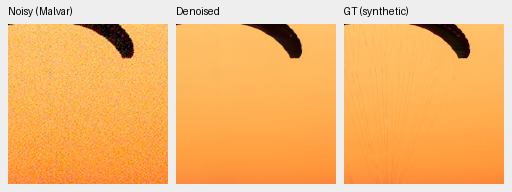
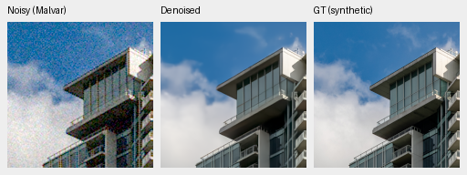
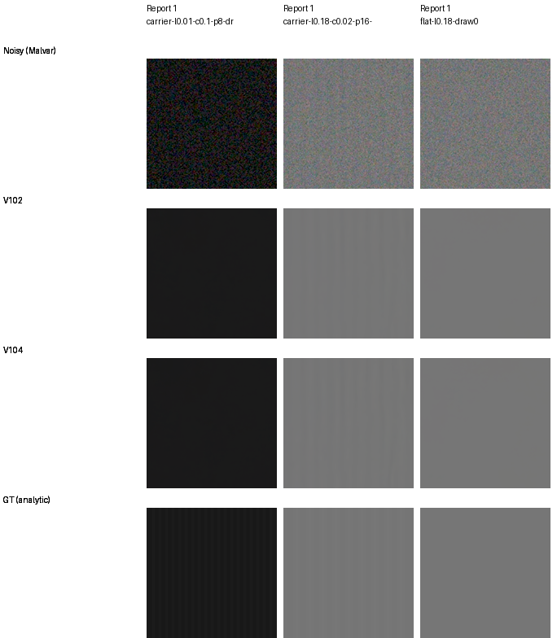
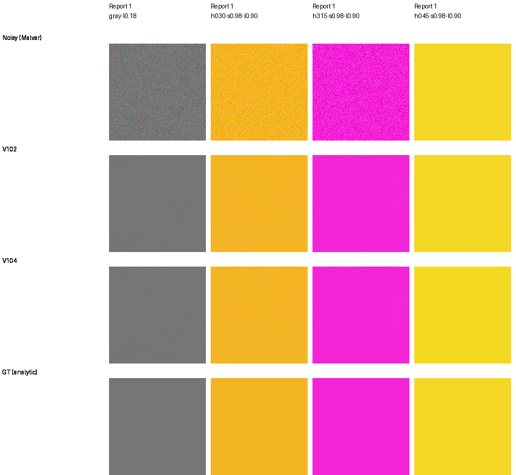

# V104: larger-corpus continuation and current quality tradeoffs

**V104 is the working baseline for positive-noise captures and continued
quality training.** Its full 427-photo mean rises by **.12134dB to 36.80085dB**, with higher
SSIM and lower chroma/gradient error. Known-camera CFA PSNR rises .02897dB;
unseen-camera CFA PSNR falls .05477dB. V102 remains a useful reference for that
unseen panel and lower ADC flat-color bias. All seven panels and full-frame
exports are complete; the strengths and remaining weaknesses are shown below.

## Completed primary panels

| Fixed final 20k EMA | Photo PSNR | Photo SSIM | Known4 CFA PSNR | Unseen5 CFA PSNR |
| --- | ---: | ---: | ---: | ---: |
| V102 | 36.67951 | .966270 | 54.23709 | 53.97177 |
| V104 | **36.80085** | **.966849** | **54.26606** | 53.91700 |

Photo scores balance 427 sources over seven conditions and four CFAs. V104
improves **424/427 source means** and 11,815/11,956 cases; 137 cases regress and
four tie. All 427 source SSIM and gradient-error means improve; chroma error
improves for 420 sources. The paired source-bootstrap 95% interval for the PSNR
gain is **[+.11705, +.12573]dB**. This measures sampled-source uncertainty,
separate from training-seed uncertainty.

| Photo condition | V102 PSNR | V104 PSNR |
| --- | ---: | ---: |
| ADC-only | 37.12251 | 37.39257 |
| ISO100 prior | 38.65759 | 38.81781 |
| ISO1600 prior | 37.19144 | 37.29952 |
| ISO12800 prior | 33.69355 | 33.74524 |
| Shadows | 40.04160 | 40.07956 |
| Highlights | 34.32860 | 34.47786 |
| Legacy noise | 35.72127 | 35.79337 |

Linear PSNR rises 39.66366→39.76545dB, chroma MAE falls
.00637822→.00628534 and gradient MAE falls .01067861→.01054623. Sixteen
procedural sources are scored separately. RawNIND with input-only CFA-channel
gain reaches 26.68357dB on this synthetic photo panel; that comparison does not
establish broad superiority on real captures.

Known-camera CFA improves in three of four scenes, with a mean difference of
.02897dB [−.01271, +.06782]. Unseen-camera CFA improves in two of five scenes,
with a mean difference of −.05477dB [−.13994, +.01515]. The largest unseen drop
is the Coulicoco scene, −.20550dB. The [camera guide](real-camera-quality.md)
shows all scene changes and accurately labeled AHD references.

Independent aggregation verifies all **86,828 photo/procedural rows and 1,134
camera rows**, complete seven-method case coverage and every source-balanced
summary within 1e-10. All 12,404 V102 photo/procedural case metrics and all 162
V102 camera case metrics reproduce the previous report exactly.
[Scores, intervals, case counts, raw archives and hashes](results/v104-reviewed-corpus-primary-statistics-v1.json).

## Native photographic comparisons

Each cell below is an unchanged 160×160 crop at the 8×-binned evaluation
resolution. Methods share the noisy input, coordinates, noise conditioning,
WB/matrix and display exposure. The final row is exact synthetic GT. PNGs are
RGB8 previews; scores use float predictions. All ten native cells were viewed
at original resolution.

V102/V104 look close at this ISO12800 prior. Both miss the fine fabric cords
and retain sharper architectural contours than RawNIND here. Two V104
noisy/restored/exact-GT triplets use ROI [48,48,160,160] within their fixed256
contexts, RGGB, shot .00256, read variance .0000262144 and display exposure ×1:

[Source, ROI, full weight hashes and display/noise metadata](images/quality-v102-v104-photo/manifest.json).
Sources: [Roy Egloff](https://commons.wikimedia.org/wiki/File:CH.VD.Villeneuve_2007-08-25_Vertigo-Swiss-Riviera_2392_3x2-R_4K.jpg)
and [Dietmar Rabich](https://commons.wikimedia.org/wiki/File:Vancouver_(BC,_Canada),_Coal_Harbour_Seaside_Park,_Blick_in_den_Himmel_--_2022_--_2158.jpg),
both [CC BY-SA 4.0](https://creativecommons.org/licenses/by-sa/4.0/), modified
by binning, cropping, simulated noise, restoration and display conversion.

The [separate material panel](heldout-detail.md#v104-versus-v102-on-the-fixed-material-panel)
improves PSNR, SSIM and gradient error in all 12 selected cases, with mean PSNR
gains +.246/.166/.024dB at ADC-only/ISO100/ISO12800. Low-noise bark/canopy changes
are small; high-noise plumage, distant foliage and individual hairs remain soft.

## Weak texture and flat color

At level .18 / contrast .02 / ISO12800, mean in-phase carrier gain rises
.49887→.60487 for period16 and .02135→.05945 for period8. The coarser carrier
is clearer; the fine carrier remains largely absent, and noncarrier residual
energy also rises. These analytic patterns complement the photographic results.

[Texture source/ROI/weights/noise/display metadata](images/quality-v102-v104-texture/manifest.json).

Color scores measure maximum absolute camera-channel **mean bias in DN16**,
separate from individual-pixel error:

| Condition | Model | Mean | 95th percentile | Maximum |
| --- | --- | ---: | ---: | ---: |
| ADC-only | V102 | 10.04 | 38.29 | 59.23 |
| ADC-only | V104 | 14.46 | 43.70 | 1218.06 |
| ISO12800 | V102 | 21.27 | 70.27 | 122.47 |
| ISO12800 | V104 | 19.34 | 59.85 | 115.84 |

The final column below is V104's worst ADC case, selected after the completed
grid: bright yellow, hue45° / saturation .98 / peak .9, RGGB. Its green mean
error is +.018586 camera units, versus input quantization residuals below
8e-6. The same case and display are shown for both models. The RGB8 previews
show only a small tint difference; the float bias is substantial relative to
V102. V102 remains the lower-bias choice for explicit zero-shot/read workflows.

[Color source/ROI/checkpoint/noise/display metadata](images/quality-v102-v104-color/manifest.json).
All 2,352 saved float predictions and 1,176 input archives were rehashed; all
six metric fields were independently recomputed in NumPy64. All 1,344 texture
rows and grouped statistics were rebuilt. The 28 diagnostic cells were viewed
at original resolution.
[Independent color/texture statistics and original array evidence](results/v104-reviewed-corpus-diagnostics-v1.json).

A subsequent [saved-float ADC projection diagnostic](v104-adc-color-projection.md)
reduces V104's worst analytic-grid bias to 31.91 DN16 with the existing Malvar
residual operator. It does not change the original scores above or the current
checkpoint: a full ADC photo comparison is running. The completed ADC texture
check shows carrier gains and individual Malvar regressions, including a
native GBRG counterexample.

## Complete real GFX outputs

All 30 cells are unchanged 160×160 sensor pixels from complete 101.996MP
blended outputs, with shared +2EV display and the separate ISO100 f/5.6
reference, **not GT**. V102/V104 remain close; fence/building geometry is clearer
than RawNIND, while foliage surfaces and saturated-sign detail remain soft.
All six linear/sRGB RGB16 TIFFs were rehashed and reopened at 8746×11662×3
uint16. The three resized overviews were also viewed; their coherent scene
geometry does not establish native detail quality.

V104 inference/blending took 168.73s in this shared-machine IEEE FP32/B4,
tile512/overlap64 run. It does not meet 100MP/10s. This excludes loading/export
and is separate from earlier timings.
[Capture protocol, six ROIs and full-frame audit](gfx-qualitative.md).

The additional [Q2/Sony a7R II/GFX50R gallery](cross-camera-qualitative.md) now
compares V102/V104 on six fixed low-ISO native regions. The 24 viewed cells
show little visual separation and no clear overall gain or regression. It
uses saved, bit-exact original inputs and no additional RAW decoding; RawNIND
is a comparator, with no clean reference or pixelwise scores.

## Training boundary and next work

V104 completes its original 20,000 fresh-AdamW/EMA updates from the exact V102
final EMA on 90,872 reviewed Commons sources. It keeps the same V84-family
pretrained DRUNet RGB trunk, official frozen DINOv3 ConvNeXt-Tiny pyramid,
zero optical PSFs, weak textures, photo contrast attenuation, six reviewed ROIs
and native128/paired32 recipe. The corpus adds 2,395 eligible sources; training
duration, seed and data change together, so this does not isolate a corpus effect.

The read-only checkpoint is `/mnt/external/demosaic/models/v104-final20000.pt`,
SHA256 `8a3a7d94f2b1465cbdddbeec201fb37a2f69b12c74f9298527a94e3a7bbf6300`.
[Original fixed endpoint and source evidence](results/V104-original20000-training-boundary-v1.json).

The [next V111/V112 trial](loss-scale-training.md) retains this exact EMA and
learned fusion gates on the further-cleaned 90,864-source corpus, changing only
reconstruction epsilon .001 versus .0003. V111 is now training after the
original V104 exports finished; V112 follows at the same fixed 20k budget.
[Actual launch and corrected zero-update queue handoff](results/v104-loss-scale-training-started-v2.json).
Fine real-photo detail and the 100MP/10s target remain open.

[Completed native review, recommendation and immutable presentation snapshots](results/v104-reviewed-corpus-quality-complete-v1.json).
