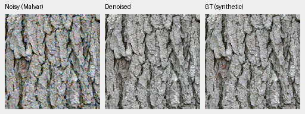
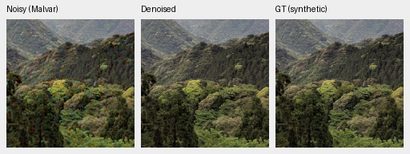
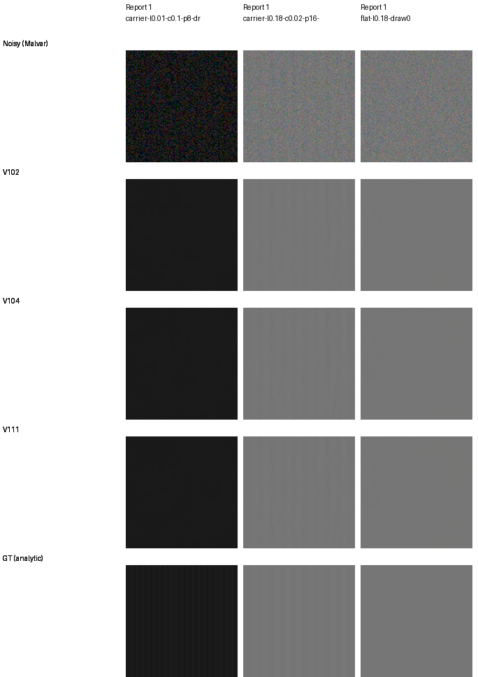
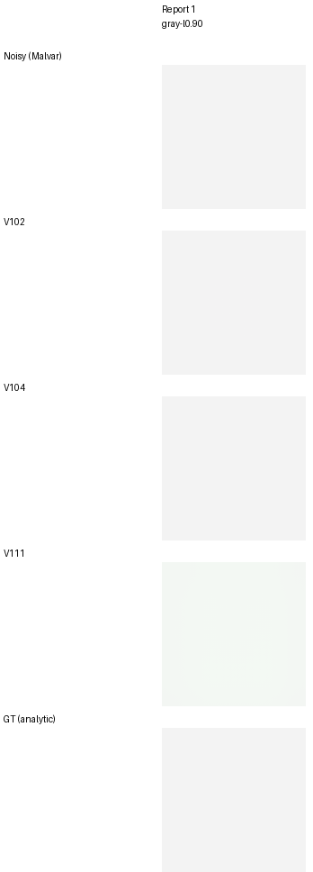
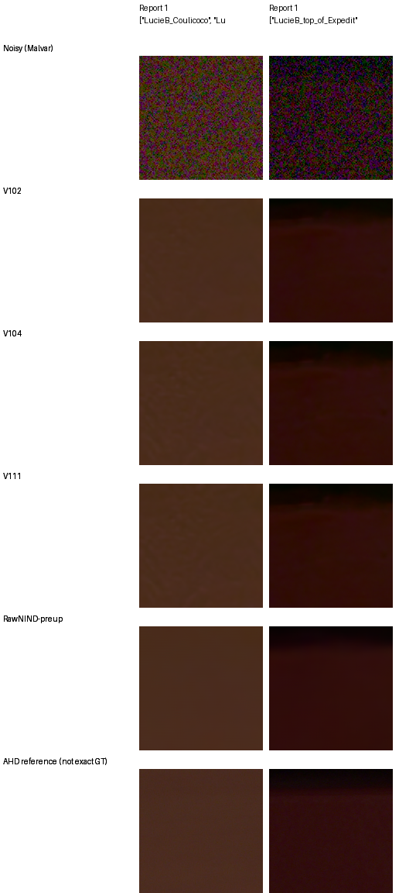
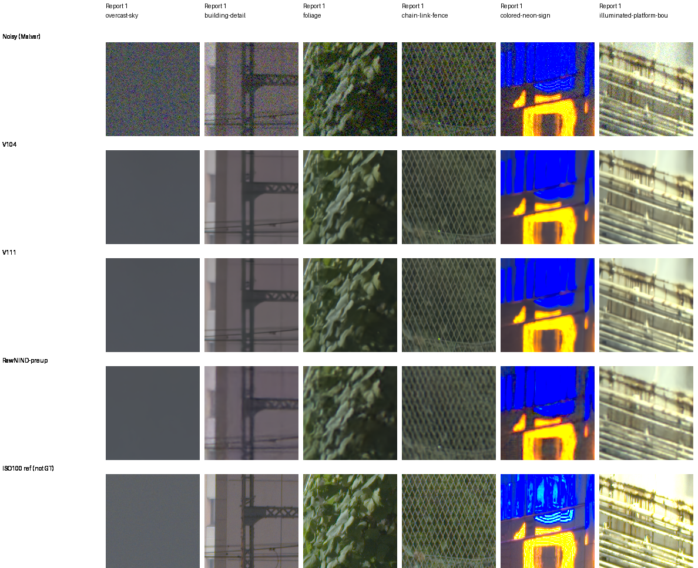

# V111 final20k: material gains and ADC color tradeoffs

**V111 improves PSNR, SSIM, chroma error and gradient error on all twelve fixed
material cases over V104.** It is a useful new detail candidate in the same
DRUNet RGB / frozen DINOv3 ConvNeXt-Tiny family. Native low-noise bark and
canopy improve slightly; high-noise feather/hair detail and real GFX foliage
remain soft. Complete camera panels show a small known-scene loss and unseen-scene
gain versus V104. The [complete primary panels](v111-v112-primary-quality.md) now show
V111/V112 at36.90367/36.90238dB on full427. The completed analytic grids show stronger coarse
carriers and high-noise color, but a worse ADC flat-bias tail.

[Material/GFX checkpoint, training boundary and native evidence](results/v111-final20000-early-quality-v1.json) ·
[Complete camera execution, independent audit and original adverse views](results/v111-camera-complete-v1.json) ·
[Complete weak-texture/color execution, independent audit and native review](results/v111-texture-color-complete-v1.json).
The material comparison covers four selected sources, the GFX comparison six
real contexts and the camera panels all72/90 development crops. All seven matched panels are now complete, and [V112 is the current baseline](v112-quality.md)
with higher camera means and a repaired ADC tail. This page retains the earlier
CPU material/camera/analytic evidence with its original scope.
The [matched material comparison](v111-v112-material.md) is now complete:
V112 also improves all twelve cases over V104 and looks close to V111, with
slightly lower condition PSNR means and slightly lower gradient errors.

## Fixed material observations

Four source IDs absent from the actual 90,864-source training cohort; original
native256 inputs, RGGB, 240-pixel scoring interiors and unchanged noise draws.
These contexts were selected from clean images before inspecting these outputs.
They include mixed contrast and fine detail rather than globally faint images.

| Condition | V104 PSNR | V111 PSNR | Change, dB |
| --- | ---: | ---: | ---: |
| ADC-only | 39.49290 | 39.74670 | +.25379 |
| ISO100 prior | 40.80494 | 40.90464 | +.09971 |
| ISO12800 prior | 33.49300 | 33.51175 | +.01875 |

All twelve cases improve in each of PSNR, SSIM, chroma MAE and gradient MAE.
The PSNR gain ranges .01336–.33945 dB. These are descriptive results from four
selected sources, without a full-photo or training-seed uncertainty claim.
V104's exact retained float outputs are reused; no baseline inference is repeated.

Noisy Malvar → **V111 final20k** → exact synthetic GT. Each panel is native
160×160 at [48,48,160,160] within its original native256 context. Both use
ISO100-prior shot=.00002/read variance=.0000000016, WB=[2,1,1.5], the original
shared camera matrix and display exposure ×1. The stored observation hashes
bind the actual WB/matrix and sensor samples; crop pixels are never resized.

| Source | 8× cache context xywh | Attribution |
| --- | --- | --- |
| Bark, `0ae232278265…` | [104,38,256,256] | Derek Ramsey, [CC BY-SA 2.5](https://creativecommons.org/licenses/by-sa/2.5/) |
| Canopy, `212ae12913ef…` | [133,67,256,256] | Grendelkhan, [CC BY-SA 4.0](https://creativecommons.org/licenses/by-sa/4.0/) |

The manifests retain full Commons page URLs, authors and source hashes.
Modifications are binning, cropping, synthetic noise and restoration.

[ISO100 V104/V111 board and eight triplets](images/v111-early-material/iso100-prior/comparison.png)
([metadata](images/v111-early-material/iso100-prior/manifest.json)) ·
[ADC-only board](images/v111-early-material/adc-only/comparison.png)
([metadata](images/v111-early-material/adc-only/manifest.json)) ·
[ISO12800 board](images/v111-early-material/iso12800-prior/comparison.png)
([metadata](images/v111-early-material/iso12800-prior/manifest.json)).

All 48 board cells were viewed at native resolution. Low-noise bark grain and
canopy separation improve modestly. Fine white feathers and hairs remain
smoothed, especially at high noise; the numerical gains do not imply restored
fine structure everywhere.

## Complete weak-texture and flat-color panels

The original 384 weak carriers, 64 neutral flats and 1,176 color cases are
complete. At level .18 / relative contrast .02 / ISO12800, mean in-phase
carrier response across four CFAs/four draws changes as follows:

| Period, pixels | V104 gain | V111 gain |
| --- | ---: | ---: |
| 4 | .00156 | .00182 |
| 8 | .05945 | .08697 |
| 16 | .60487 | .62498 |

The fine 4/8-pixel patterns remain largely missing. Period8 noncarrier RMS
rises .000720→.000813; period16 residual RMS falls .001254→.001222. More
carrier response alone does not establish clean detail recovery.

The original selected high-noise carriers and neutral flat look close to V104;
the visible period16 carrier remains uneven/soft. [Native source/ROI/noise/display metadata](images/v111-full-diagnostics/texture/manifest.json).

Color values below are the maximum absolute camera-channel **mean bias** in
DN16 across each 160-pixel scoring ROI, separate from pixel error. Each
condition contains all 588 original palette/CFA cases.

| Condition | Model | Mean | 95th percentile | Maximum |
| --- | --- | ---: | ---: | ---: |
| ADC-only | V102 | 10.04 | 38.29 | 59.23 |
| ADC-only | V104 | 14.46 | 43.70 | 1218.06 |
| ADC-only | V111 | 27.64 | 45.43 | 2142.98 |
| ISO12800 | V102 | 21.27 | 70.27 | 122.47 |
| ISO12800 | V104 | 19.34 | 59.85 | 115.84 |
| ISO12800 | V111 | 17.85 | 50.84 | 91.89 |

High-noise color improves; the ADC tail worsens. The original three prospective
colors and original V104 worst ADC field are retained in the
[four-case board](images/v111-full-diagnostics/color/comparison.png)
([metadata](images/v111-full-diagnostics/color/manifest.json)).
The new **post hoc V111 worst ADC field** is bright neutral gray, linear-sRGB
.9, GBRG, case787, shown identically for all three models:

V111 has green mean error +.03269975 camera units, or 2,142.98 DN16. The RGB8
preview has a slight green tint; the float bias is large relative to 16-bit
precision. V102 retains the lower ADC flat-color bias.

A [controlled fusion-gate diagnostic](fusion-gate-quality.md) lowers this
selected V111 bias to 1,505.66 DN16 when the three DINO gates are zeroed. Large
error remains, while photo means and both adverse-camera scores regress.
The useful implementation keeps its learned fusion; this intervention is not
a trained replacement or a full-grid repair.
[Exact palette, ROI, checkpoint and conditioning metadata](images/v111-full-diagnostics/worst-adc/manifest.json).

All 1,176 new color metrics reproduce exactly in independent NumPy64. All
896 weak/Malvar rows reproduce within 1.58e-13, with every original input and
all 448 earlier Malvar rows exact. Earlier audited V102/V104 controls are reused;
four actual V104 color replays agree with their GPU outputs within .001 DN16
mean-channel bias. This bounds those checked cases, not all-case device parity.
All 40 new native cells were actually viewed. Analytic grids complement the
photo/camera evidence and do not establish broad scene superiority.

## Complete development camera panels

The original known72/unseen90 native512 crops, original case noise profiles,
448-pixel scoring interiors and registered low-ISO measured CFA references
remain fixed. Means balance nine crops per capture, two captures per scene,
then four/five scenes. Independently demosaiced AHD RGB is auxiliary, **not exact GT**.

| Method | Known4 CFA PSNR | Unseen5 CFA PSNR |
| --- | ---: | ---: |
| V102 | 54.23709 | 53.97177 |
| V104 | 54.26606 | 53.91700 |
| V111 | 54.25270 | 53.93706 |
| RawNIND pre-upsampled | 54.26068 | 53.86528 |

V111−V104 is **−.01336dB** known, source-bootstrap95% interval
[−.02103,+.00130], improving1/4 scenes; **+.02006dB** unseen,
[+.00869,+.03304], improving5/5 scenes. V102 retains the higher unseen mean.
V111−RawNIND-preup is −.00797/+.07178dB, with intervals
[−.40182,+.41106]/[−.27981,+.36162] spanning zero. These intervals describe this
fixed small scene set, not training-seed or broad-camera uncertainty.
“Unseen” means held out from our training; external RawNIND membership/overlap
remains unproven. The protected16-scene test remains unscored.

The two source/ROI selections predate V111. Display cells are native160 with
shared+2EV; every method uses identical input/reference pixels and coordinates.
Full448-interior CFA PSNR for the selected crops:

| Scene | V102 | V104 | V111 | RawNIND pre-upsampled |
| --- | ---: | ---: | ---: | ---: |
| Coulicoco | 57.82471 | 56.98928 | 56.95765 | 58.98999 |
| top_of_Expedit | 61.15482 | 60.67192 | 60.88411 | 62.07481 |

V111 still has broad spatial/color blotches in these fields. Coulicoco's
selected crop declines.03164dB versus V104 while top_of_Expedit gains.21219dB;
both remain below RawNIND-preup. All12 native cells were viewed.
[All eight triplets, source/ROI/weights/conditioning/display metadata](images/v111-full-camera-adverse/manifest.json).
All five unseen **scene means** improving does not repair every local crop.

All162 input fingerprints match the earlier reference comparison. NumPy64
independently rebuilds the new measured-CFA and AHD-rendered PSNR/chroma/gradient
scores, maximum PSNR difference under.000005dB. Earlier V102/V104 GPU controls
and RawNIND CPU controls are reused. Four actual V104 CPU replays reproduce
stored CPU floats exactly and agree with GPU primary PSNR within.000008dB;
this does not replay every original model/crop. Broader matched GPU evaluation
remains queued after V112. This camera follow-up adds162 V111 forwards and
four parent replays, with zero other-reference inference or training.

## Standing GFX100S test

The original DSCF3879 ISO6400 and DSCF3880 ISO100 pair, all six fixed
sky/building/foliage/fence/sign/platform regions, common +2EV display and native
160-pixel crops are retained. These are **512-pixel context restorations**;
V111 has no new complete102MP export yet. The ISO100 f/5.6 capture differs in
aperture, exposure, motion and time; it is a qualitative reference, **not GT**
or a pixelwise scoring target. [All eighteen triplets and metadata](images/v111-early-gfx/manifest.json).

V111 and V104 look close. Both retain coherent mesh and building edges relative
to the stronger pre-upsampled RawNIND reference. Sky remains smooth; fine
foliage and saturated-light structure remain soft. Shared clipping also limits
sign comparisons. All thirty cells were viewed; this does not show a decisive
new real-photo gain or establish broad superiority over RawNIND.

## Training, verification and use

V111 completed its original 20,000 updates from all 91 original V104 EMA tensors,
preserving learned fusion gates and the default reconstruction epsilon .001.
Fresh AdamW/EMA, seed62, B16/native256/BF16, LR1e-5/warmup200, zero optical PSFs,
weak textures, photographic contrast attenuation, six reviewed ROIs and
native128/paired32 remain as declared. Its 90,864-source corpus removes eight
more targets relative to V104. Extra updates, seed and cohort change together;
this does not isolate the cleaning effect or test the smaller loss scale.

All91 final model/EMA tensors and89 Adam states are finite at step20000.
The original worker exited, its controller adopted the completed receipt and
the actual source/manifest snapshot verifies. V112 starts from the same V104
EMA at epsilon .0003; its first input, loss and gradient replay its CUDA
preflight exactly. The [completed matched test](v112-quality.md) now favors V112.

The read-only candidate checkpoint is
`/mnt/external/demosaic/models/v111-final20000.pt`, SHA256
`97ab9ca5f1f182ff42a4245c630bba810607a3d13b61cf8aae5842192a18da15`.
It works with the existing inference commands. The complete primary panels
now show V111's36.90367dB photo result, while [V112 is the working default](v112-quality.md)
with higher camera means and repaired ADC color tails. The original early
material/camera/analytic evidence remains preserved here.

The earlier material/GFX reviews made eighteen V111 CPU FP32 forwards: twelve native256
material inputs and six native512 GFX contexts, with zero new other-model
inference, training or RAW decoding. Independent NumPy64 rebuilds24 paired
score rows for linear/sRGB PSNR and chroma/gradient MAE; maximum PSNR difference
is under .000004dB. SSIM/shadow/highlight values retain their original implementation.
All126 native panels reproduce exactly from saved floats, and all78 distinct
board cells were actually viewed. The audit preflight caught a missing board
helper before execution; the failed attempt is retained and a separately pinned
helper passes the corrected replay. Active training and original queues retain
their frozen bytes. The complete texture/color follow-up adds 1,624 V111 CPU
observations plus four parent replays, with no CUDA, optimizer or RAW decode.
Full427, complete exports and the protected test reserve are outside this
report. No speed or SOTA claim follows.
