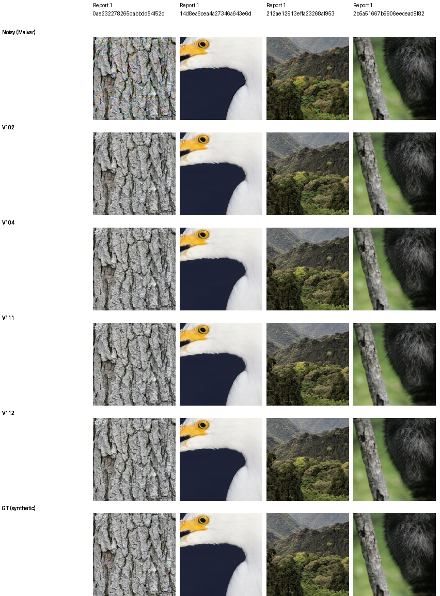

# V111/V112: matched loss-scale material comparison

**V112 improves all twelve material cases over V104, but gives no clear native
advantage over V111.** Its four-source PSNR means are slightly lower; mean
gradient errors are slightly lower too. Bark/canopy changes remain modest and
high-noise feather/fur detail stays smooth. The smaller reconstruction epsilon
does not establish a quality win on this selected panel.

The [complete primary and analytic comparison](v112-quality.md) now favors
V112 for camera/color quality: photo means stay close, while its large ADC
bias tail is repaired. The selected material result below remains unchanged
and does not stand in for those broader panels.

[Checkpoints, original execution, paired scores and native metadata](results/v111-v112-material-review-v1.json).
Both completed their original 20,000 updates from the same V104 EMA on the
90,864-source corpus, seed62 and identical schedule. Epsilon .001 versus .0003
is the recipe difference. All 801 logged input/domain/LR rows match. Raw losses
use different objectives and are not compared as quality measurements.

## Fixed photo panel

Four original held-out sources × ADC-only/ISO100/ISO12800, RGGB, native256
contexts and 240-pixel scoring interiors. Mean sRGB PSNR, dB:

| Condition | V104 | V111, .001 | V112, .0003 | V112 − V111 |
| --- | ---: | ---: | ---: | ---: |
| ADC-only | 39.49290 | 39.74670 | 39.74086 | −.00584 |
| ISO100 prior | 40.80494 | 40.90464 | 40.90266 | −.00198 |
| ISO12800 prior | 33.49300 | 33.51175 | 33.51165 | −.00010 |

V112 gains +.24795/.09773/.01866dB over V104. All twelve cases improve in PSNR,
SSIM, chroma MAE and gradient MAE. Against V111, PSNR and gradient MAE improve
in 6/12 cases, SSIM and chroma MAE in 5/12. Individual PSNR changes versus V111
range from −.05096 to +.01353dB. Mean gradient errors fall slightly in all
three conditions; SSIM/chroma changes are mixed. These are descriptive results
from four selected sources and one matched training seed, not full427 or
training-repeat uncertainty.

[ADC-only board](images/v111-v112-material/adc-only/comparison.png) ·
[ISO12800 board](images/v111-v112-material/iso12800-prior/comparison.png).
Every cell is a native160 crop. All 72 distinct cells were actually viewed.
V111/V112 are visually close; neither restores the fine high-noise feather
structure visible in GT.

## V112 native triplets

Noisy Malvar → **V112 final20k** → exact synthetic GT. Both are unchanged
160×160 crops at [48,48,160,160] within the original native256 contexts,
with shared WB=[2,1,1.5], recorded common matrix, exposure ×1 and the ISO100
prior (shot .00002/read variance .0000000016).

[Bark source/ROI/weights/conditioning/display metadata](images/v111-v112-material/iso100-prior/crop-647b560234a48ad7.json) ·
[Canopy metadata](images/v111-v112-material/iso100-prior/crop-277f4c06ef24083e.json).
All twelve V112 triplets are retained alongside the three condition boards.

The original final checkpoint is
`/mnt/external/demosaic/models/v112-final20000.pt`, SHA256
`21c3cca8370df21e3412f9ccbf441c35afcfad8fd03174c7727f4f88874783b1`.
V111 uses SHA256
`97ab9ca5f1f182ff42a4245c630bba810607a3d13b61cf8aae5842192a18da15`.
Architecture, official frozen Tiny encoder, observations and display transforms
match. Neither checkpoint was selected from intermediate training steps.

## What remains open

The [full matched workflow](v112-quality.md) has completed all seven panels
and full102MP exports. This page remains the selected material report; broader
camera/color gains and remaining fine-detail limits are in the complete review. The [V111 report](v111-early-quality.md) retains its completed
camera/analytic gains and ADC bias regression. GFX ISO100 remains a separately
captured qualitative reference, not exact GT.

The original four-model CPU reporter supplied these scores and 48 triplets.
All twelve earlier V111 score rows and all 36 of its native panels replay
exactly. Board construction verifies common metadata and noisy/GT pixels,
and copies source crop pixels without resizing. This review runs no new neural
inference. The original reporter did not retain V112's full float predictions;
this review checks scalar aggregation, control replay and native pixels rather
than claiming a new independent float-based reconstruction of V112 metrics.

Keep both useful trained versions visible while the broader comparisons run.
The [larger-encoder initializer](small-feature-transfer.md) provides a separate
next architecture experiment; the epsilon change alone has not solved faint
detail loss.

Photo attribution: [Derek Ramsey, bark](https://commons.wikimedia.org/wiki/File:Kentucky_Coffee-tree_Gymnocladus_dioicus_3264px.jpg),
[CC BY-SA 2.5](https://creativecommons.org/licenses/by-sa/2.5/), and
[Grendelkhan, canopy](https://commons.wikimedia.org/wiki/File:Forest_covered_hills_on_Yakushima.jpg),
[CC BY-SA 4.0](https://creativecommons.org/licenses/by-sa/4.0/).
Modifications: 8× binning/cropping, synthetic noise, restoration and common
display conversion. Complete attribution for all four sources accompanies
the board metadata.
