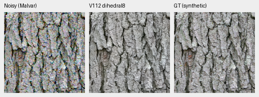
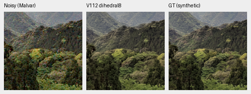
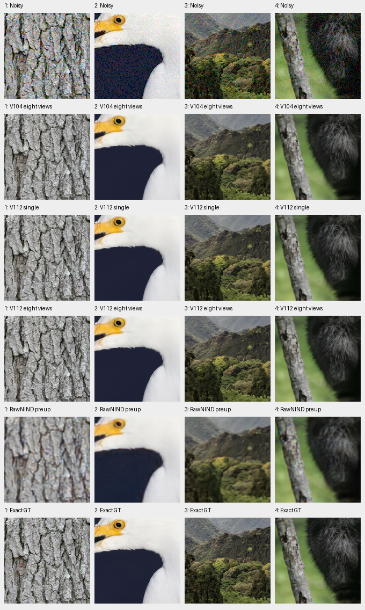
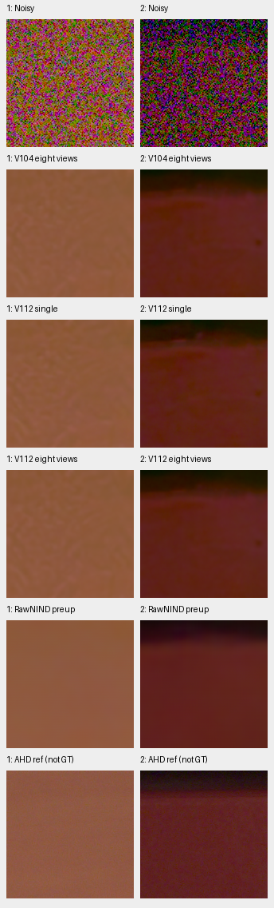

# V112 eight-view restoration

**Eight-view V112 improves all twelve fixed material cases over single view.**
Mean sRGB PSNR gains are +.54335/.27285/.07936 dB for ADC-only/ISO100/ISO12800.
Both selected adverse camera crops improve, and all four selected color fields
have lower bias and spatial error. Native changes are modest: high-noise fine
texture, real foliage and dark-field blotches remain weaknesses.

This is a useful optional quality mode with the **same V112 weights**, requiring
eight evaluations per tile. The measured panel contains four original held-out
material sources × three conditions, two previously selected adverse camera
crops, all six standing GFX contexts and four pre-existing color cases. It does
not supply new full427, full-camera, full-color-grid or complete102MP results.
The [completed full V104 eight-view results](dihedral-quality.md) remain separate.

[Exact execution, independent checks, native review and source records](results/v112-dihedral8-pilot-v1.json) ·
[Native image/ROI/conditioning/display metadata](images/v112-dihedral8-pilot/manifest.json).

## Fixed photographic comparison

Four original native256 observations per condition, RGGB, scored240 interiors:

| Condition | V104 eight views | V112 single | V112 eight views | Eight − single |
| --- | ---: | ---: | ---: | ---: |
| ADC-only | 40.06104 | 39.74086 | **40.28421** | +.54335 |
| ISO100 prior | 41.09810 | 40.90267 | **41.17552** | +.27285 |
| ISO12800 prior | 33.57486 | 33.51165 | **33.59101** | +.07936 |

All twelve sRGB PSNRs improve, with changes from +.06221 to +.61416 dB.
Mean chroma and gradient errors fall in every condition. These four-source means
describe this fixed panel, without training-repeat or general-camera uncertainty.

Noisy Malvar → **V112 eight views** → exact synthetic GT. Bark and canopy use
unchanged160×160 pixels at[48,48,160,160] in the original256 contexts, at the
8×-binned evaluation resolution. ISO100 shot=.00002/read variance=.0000000016,
WB=[2,1,1.5], shared matrix and exposure×1 agree across methods. No resizing:





[Bark source/ROI/checkpoint/noise/display](images/v112-dihedral8-pilot/crop-ae5e2918b2f5d748.json) ·
[Canopy metadata](images/v112-dihedral8-pilot/crop-eab57f7bf8e44af3.json) ·
[ISO100 comparison](images/v112-dihedral8-pilot/photo-iso100-prior.png) ·
[ADC comparison](images/v112-dihedral8-pilot/photo-adc-only.png).

Rows below: noisy, V104 eight views, V112 single, V112 eight views, stronger
RawNIND pre-upsampled, exact synthetic GT. Columns: bark, egret, canopy, fur.
Every cell is an unchanged native160 crop with the same transform.



Bark changes slightly; high-noise feather, distant canopy and individual fur
structures remain smoothed. In the predeclared fine1/8–1/3-cycle band, high-noise
mean GT-projected gain changes only .92438→.92575 and orthogonal RMS
.00384969→.00382735. ISO100 projected gain falls slightly while residual falls.
The whole-patch statistic mixes contrasts and can include chance noise/GT
correlation; it does not establish faint four-pixel detail recovery. The
separable Hann window is not power-compensated. Definitions and per-source
values remain in the independent analysis.

## Adverse real-camera crops

The original two M100 crops, input-only priors, fixed masks and448px scoring
interiors are unchanged. Primary PSNR uses measured clean CFA samples.
Independent AHD RGB is auxiliary, **not exact GT**.

| Selected crop | V104 eight views | V112 single | V112 eight views | Stronger RawNIND |
| --- | ---: | ---: | ---: | ---: |
| Coulicoco | 57.30272 | 57.11509 | 57.29109 | **58.98999** |
| top_of_Expedit | 60.93926 | 60.97539 | 61.20614 | **62.07481** |

Eight views gain .17599/.23075 dB over V112 single. Coulicoco remains slightly
below V104 eight views; both remain below stronger RawNIND. Coarse colored
variation remains visible. These are selected crops, not complete scene means.



Rows follow the photo board, ending in AHD. All native160 cells share +2EV.
[ROI, capture, weights and conditioning](images/v112-dihedral8-pilot/camera.json).

## Standing GFX and color


Columns: sky, building, foliage, chain-link fence, neon sign, platform boundary.
Rows follow the photo board, ending in the **independent ISO100 f/5.6 reference**.
DSCF3879/3880 differ in aperture and moving subjects; the reference is not exact
GT and receives no pixelwise score. These160px crops come from512px contexts,
with common exposure/WB/matrix and no resizing or warping. They are separate
from the [complete V112 single-view frame](gfx-qualitative.md). Sky is smooth and
mesh/building geometry stays coherent; foliage and saturated-sign detail remain
soft, with small changes between the three V104/V112 variants.
[Sources and transforms](images/v112-dihedral8-pilot/gfx.json).

Maximum absolute channel-mean bias in DN16 on four previously identified cases:

| Case | Condition / field | V104 eight views | V112 single | V112 eight views |
| --- | --- | ---: | ---: | ---: |
| 787 | ADC, gray .90, GBRG | 13.89 | 20.78 | 15.06 |
| 1008 | ADC, hue45°, saturation .98, peak .90, RGGB | 420.90 | 32.73 | 12.87 |
| 1035 | ADC, hue90°, saturation .98, peak .90, GBRG | 33.81 | 50.89 | 42.79 |
| 1020 | ISO12800, hue60°, saturation .98, peak .90, RGGB | 96.36 | 91.07 | 86.99 |

All four improve versus V112 single in both bias and centered RGB RMS. V104
eight views still has lower bias in two ADC cases. Case1035 was V112 single's
worst ADC case, but its improvement does not establish a new full-grid maximum.
[Native fields](images/v112-dihedral8-pilot/color.png) ·
[Observations and display records](images/v112-dihedral8-pilot/color.json).

## Execution and use

The existing public eight-view implementation makes **192 actual neural and
DINO calls**, using CPU2/IEEE FP32 on the24 fixed observations. Each identity
view contributes to the new mean and checks retained controls; no separate
control-only inference occurs. V104 eight-view and stronger RawNIND arrays are
reused. All24 means reconstruct exactly with independent NumPy64 arithmetic;
NumPy64/Torch64 metrics differ by at most7.11e-15. All140 displayed native cells
were inspected; twelve candidate triplets remain in the original result.

All91 EMA tensors match V112 at load. Weights, official frozen encoder, inputs
and Torch RNG remain unchanged. There is no optimizer update, new noise draw or
RAW decoding. Compared GFX/color identity arrays differ from retained CUDA floats
by at most2.15e-6 camera units. V104 color controls also reuse
their original CUDA floats. Setup and two CPU-only audit corrections are
preserved; saved arrays supply the corrected review without neural reruns.

Use the existing option with the current checkpoint:

```bash
source scripts/env.sh
uv run demosaic infer /mnt/external/demosaic/models/v112-final20000.pt photo.raf \
  /mnt/external/demosaic/output/photo-linear.tiff \
  --self-ensemble dihedral8 --precision float32 \
  --shot 0.001 --read 0.000001 --tile 512 --overlap 64 --batch-size 4
```

Noise values are examples. Checkpoint SHA256:
`21c3cca8370df21e3412f9ccbf441c35afcfad8fd03174c7727f4f88874783b1`.
The original single-view/training baseline and Tiny/Small/data comparison jobs
are unchanged. V112 eight-view full-frame timing is unmeasured; it requires
eight model evaluations per tile. The100MP/10s goal and broad real-photo
superiority remain open. Further training still targets faint detail and
adverse cases through the [active data/architecture work](fine-detail-data-training.md).

Photo sources: [Derek Ramsey, bark](https://commons.wikimedia.org/wiki/File:Kentucky_Coffee-tree_Gymnocladus_dioicus_3264px.jpg),
[CC BY-SA2.5](https://creativecommons.org/licenses/by-sa/2.5/), and
[Grendelkhan, canopy](https://commons.wikimedia.org/wiki/File:Forest_covered_hills_on_Yakushima.jpg),
[CC BY-SA4.0](https://creativecommons.org/licenses/by-sa/4.0/);
[Serebit, egret](https://commons.wikimedia.org/wiki/File:Snowy_egret_in_profile.jpg),
[CC BY-SA4.0](https://creativecommons.org/licenses/by-sa/4.0/); and
[Korall, raccoon](https://commons.wikimedia.org/wiki/File:Racoon_clinging_to_a_tree.JPG),
[CC BY3.0](https://creativecommons.org/licenses/by/3.0/).
Modifications: binning, cropping, simulated noise,
restoration and common display conversion.
