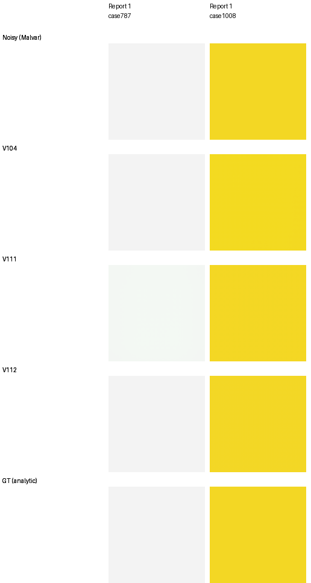

# V112: current quality baseline

**V112 final20k is the current restoration and quality-training baseline.**
It combines V111-like photographic quality with higher camera means and a much
lower flat-color error tail. All seven matched panels and complete 101.996MP
linear/sRGB RGB16 exports are verified. FP32 inference/blending takes 167.51s.
The 100MP/10s goal remains open.

[Selection, original stage receipts, independent float checks and native review](results/v112-quality-current-v1.json) ·
[Complete primary statistics](v111-v112-primary-quality.md) ·
[Recipe and original training execution](loss-scale-training.md).

| Endpoint | Photo sRGB PSNR | Known4 CFA | Unseen5 CFA | Worst ADC flat bias, DN16 |
| --- | ---: | ---: | ---: | ---: |
| V104 | 36.80085 | 54.26606 | 53.91700 | 1,218.06 |
| V111 | 36.90367 | 54.25270 | 53.93706 | 2,142.98 |
| **V112** | **36.90238** | **54.26914** | **53.95378** | **50.89** |

V112 gains+.10154dB over V104 on all427 photos/seven conditions/four CFAs,
with425/427 source means improving and all seven condition means rising.
Its photo mean is only.00129dB below V111, while known/unseen camera means
rise+.01644/+.01672dB. The [source/scene intervals](v111-v112-primary-quality.md)
describe this fixed evaluation set and one matched training seed.

Both start from V104's exact EMA, retaining learned gates, on90,864 reviewed
sources with zero optical blur, weak textures and photographic contrast
attenuation. The fixed20k/seed62 recipes differ only in reconstruction epsilon,
.001 versus.0003. Further training, seed and the eight source withholds also
differ from V104; its gains do not isolate epsilon alone.

## Native photographic triplets

Noisy Malvar → **V112** → exact synthetic GT. Bark and canopy use unchanged
160×160 crops at[48,48,160,160] within native256 contexts. Shared WB=[2,1,1.5],
matrix, exposure×1, ISO100 shot2e-5/read variance1.6e-9 match across methods.

[Bark metadata](images/v111-v112-material/iso100-prior/crop-647b560234a48ad7.json) ·
[Canopy metadata](images/v111-v112-material/iso100-prior/crop-277f4c06ef24083e.json) ·
[V104/V111/V112 boards](v111-v112-material.md).
These illustrate the separate four-source material panel; full means above
use all427 sources. No crop pixels are resized.

Checkpoint: `/mnt/external/demosaic/models/v112-final20000.pt`, SHA256
`21c3cca8370df21e3412f9ccbf441c35afcfad8fd03174c7727f4f88874783b1`.
Architecture remains V84's pretrained DRUNet RGB trunk and official frozen
DINOv3 ConvNeXt-Tiny pyramid. This is a trained loss-scale improvement.

## Color and faint detail

The complete1176-case grid per model now has an independent Torch64 check of
all4704 saved float predictions and28,224 metric fields; maximum difference
from saved NumPy64 metrics is3.33e-16. This adds no neural inference.

| Max-absolute channel mean bias, DN16 | V104 | V111 | V112 |
| --- | ---: | ---: | ---: |
| ADC mean / worst | 14.46 / 1,218.06 | 27.64 / 2,142.98 | **7.45 / 50.89** |
| ISO12800 mean / worst | 19.34 / 115.84 | 17.85 / 91.89 | **17.53 / 91.07** |

Both cases were already selected as V111/V104 failures: gray case787 and yellow
case1008. Native160 crops use identical observations, ROI and exposure×1.
V111's gray field has a visible green cast; V112 returns close to the analytic
target. [Original arrays, checkpoints, conditioning and display](images/v112-quality/adc/manifest.json).
The remaining V112 worst ADC case is1035, hue90°/saturation.98/peak.90/GBRG.
These fixed-grid quantiles are descriptive, not a broad photographic guarantee.

At18% gray,2% contrast and ISO12800, in-phase carrier gains at periods4/8/16
are.00136/.09580/.65759 for V112, versus V104's.00156/.05945/.60487.
The8/16-pixel carriers improve, but four-pixel structure is nearly absent and
most8-pixel contrast is still lost. Smaller epsilon has not solved fine detail.

## Standing GFX scene and next work

All36 native160 cells were viewed, from complete101.996MP blended outputs,
with common+2EV and no resizing. V112 remains close to V104; fine foliage and
sign/fence detail still need work. DSCF3880 ISO100 f/5.6 is an independent
qualitative reference to DSCF3879 ISO6400, **not GT**.
[Source/ROI/weights/noise/display metadata](images/v112-fullframe/manifest.json) ·
[Verified RGB16 files and167.51s FP32 observation](results/v112-fullframe-review-v1.json).
The separately preserved [V104/V111/V112 context gallery](images/v112-quality/gfx/comparison.png)
contains the earlier512px-context observations. Broad real-camera superiority
is still unachieved. The [current stronger-reference comparison](rawnind-variants.md#current-v112-camera-comparison)
shows four of nine camera scene means still favoring pre-upsampled RawNIND,
despite V112's substantial gains on the selected synthetic material cases.

The [larger-encoder transfer](small-feature-transfer.md) now uses V112 teacher
targets and retained Small training features/previews. Matched Tiny/Small
continuations passed actual CPU/CUDA optimizer checks; [V114 has completed 20,000 updates and V115 is training](small-aligned-training.md)
on the same budget. Endpoint quality remains pending; the old idle
V113 plan and evidence remain preserved. V104/sites and V102 remain useful
alternatives; the 100MP/10s target remains open.

The [optional V112 eight-view mode](v112-eight-view.md) now improves all twelve
fixed material cases, both selected adverse camera crops and four selected
color fields over single view. Native material/GFX comparisons show modest
changes with persistent soft fine detail. It uses the same weights and eight
evaluations per tile; full V112 eight-view panels/frame are unmeasured.

Photo attribution: [Derek Ramsey, bark](https://commons.wikimedia.org/wiki/File:Kentucky_Coffee-tree_Gymnocladus_dioicus_3264px.jpg),
[CC BY-SA2.5](https://creativecommons.org/licenses/by-sa/2.5/), and
[Grendelkhan, canopy](https://commons.wikimedia.org/wiki/File:Forest_covered_hills_on_Yakushima.jpg),
[CC BY-SA4.0](https://creativecommons.org/licenses/by-sa/4.0/). Modifications:
8× binning/cropping, synthetic noise, restoration and shared display conversion.
