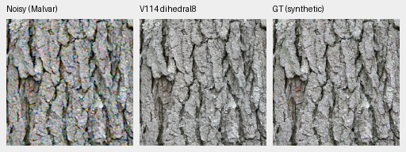
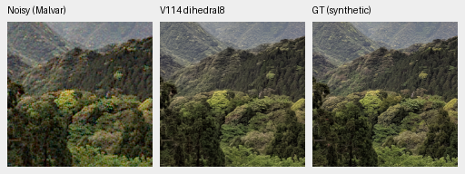
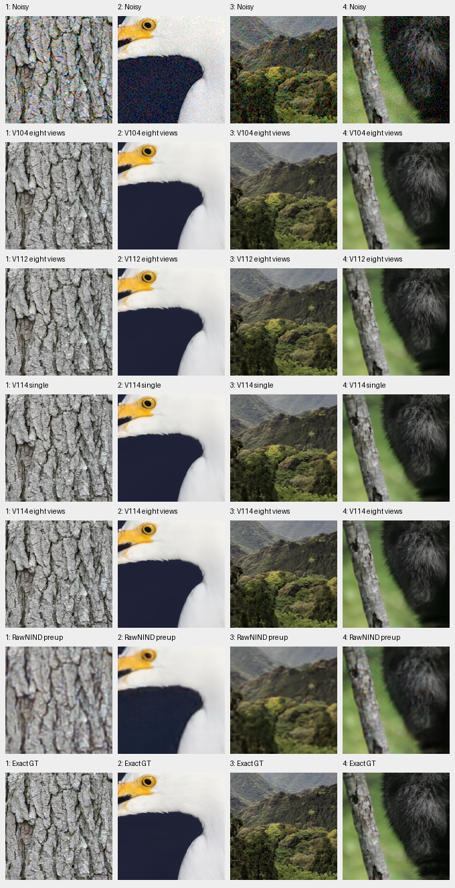
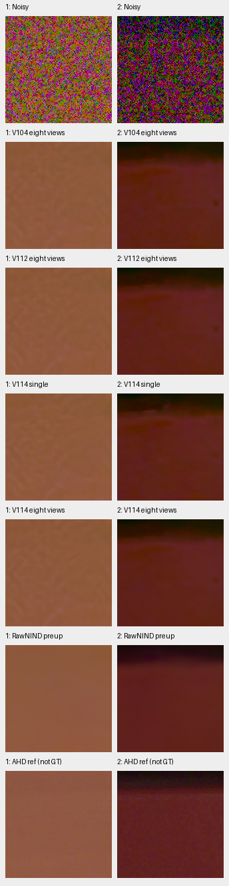

# V114 eight-view restoration

**Eight-view V114 improves all twelve fixed material cases and both selected
adverse camera crops over V114 single view.** Mean material gains are
**+.55750/.26416/.07938dB** at ADC-only/ISO100/ISO12800. Native changes are
modest: finest texture, real foliage/neon detail and dark-camera mottling remain
weak. All four selected color cases have slightly higher mean bias and lower
spatial variation after averaging.

This is a useful optional inference mode with the **same V114 weights**, using
eight model evaluations per tile. The fixed24 pilot reuses the exact earlier
inputs and V112/V104/stronger RawNIND predictions. It does not measure full427,
complete camera scenes, all1176 colors or a complete102MP eight-view export.
The [single-view full V114/V115 results](v114-v115-quality.md) and
[full V104 eight-view results](dihedral-quality.md) retain their separate scope.

[Execution, independent checks, native review and source records](results/v114-dihedral8-pilot-v1.json) ·
[Image/ROI/noise/checkpoint/display receipts](images/v114-dihedral8-pilot/manifest.json).

## Fixed photographic comparison

Four original native256 observations per condition, RGGB, scored240 interiors:

| Condition | V104 eight views | V112 eight views | V114 single | V114 eight views | Eight − single |
| --- | ---: | ---: | ---: | ---: | ---: |
| ADC-only | 40.06104 | 40.28421 | 39.89018 | **40.44768** | +.55750 |
| ISO100 prior | 41.09810 | 41.17552 | 40.96366 | **41.22782** | +.26416 |
| ISO12800 prior | 33.57486 | 33.59101 | 33.52263 | **33.60201** | +.07938 |

All twelve eight-minus-single changes are positive, ranging+.06459 to+.62312dB.
Mean chroma and gradient errors fall in each condition. Compared with V112
eight views, V114 gains+.16347/.05230/.01100dB on these same observations.
These are fixed four-source descriptive means, not training-repeat or
general-camera uncertainty estimates.

Noisy Malvar → **V114 eight views** → exact synthetic GT. Bark/canopy cells
are unchanged160×160 pixels at[48,48,160,160] in native256 contexts, at the
8×-binned evaluation resolution. ISO100 shot=.00002/read variance=.0000000016,
WB=[2,1,1.5], shared matrix and exposure×1 agree across methods. No resizing:





[Bark metadata](images/v114-dihedral8-pilot/crop-9670fee970171aad.json) ·
[Canopy metadata](images/v114-dihedral8-pilot/crop-b38f8be4dde85710.json) ·
[ISO100 board](images/v114-dihedral8-pilot/photo-iso100-prior.png) ·
[ADC board](images/v114-dihedral8-pilot/photo-adc-only.png).

Rows below: noisy, V104 eight views, V112 eight views, V114 single, V114 eight
views, stronger RawNIND pre-upsampled, exact GT. Columns: bark, egret, canopy,
fur. Each cell has the same native160 pixels, coordinates and transform.



Bark/fine color edges change slightly; high-noise feather, canopy and fur
structures remain smoother than GT. In the predeclared1/8–1/3-cycle band,
high-noise GT-projected gain changes only.92426→.92550 and orthogonal RMS
.00384294→.00382256. At ISO100 gain falls slightly while residual falls.
The whole-patch statistic mixes contrasts and can include chance noise/GT
correlation; it does not establish recovery of faint four-pixel structure.
The separable Hann window is not power-compensated.

## Adverse real-camera crops

The same two previously selected M100 crops use fixed input-only priors,
masks and448px scoring interiors. Primary PSNR uses measured low-ISO CFA samples.
Independent AHD RGB is auxiliary, **not exact RGB GT**.

| Selected crop | V112 eight views | V114 single | V114 eight views | Stronger RawNIND |
| --- | ---: | ---: | ---: | ---: |
| Coulicoco | 57.29109 | 57.52369 | 57.67331 | **58.98999** |
| top_of_Expedit | 61.20614 | 61.33315 | 61.55987 | **62.07481** |

Eight views add+.14961/+.22673dB over V114 single and+.38222/+.35373dB over
V112 eight views. Both crops remain below stronger RawNIND. Coarse colored
variation persists; RawNIND looks flatter in these fields. These selected crop
scores are separate from the complete scene-balanced camera panels.



Rows follow the photographic board, ending in AHD. All native160 cells share
+2EV. [Capture/ROI/conditioning/weights](images/v114-dihedral8-pilot/camera.json).

## Standing GFX and color tradeoff


Columns: sky, building, foliage, chain-link fence, neon sign, platform boundary.
Rows follow the photographic board, ending in the separate **ISO100 reference,
not GT**. DSCF3879/3880 differ in aperture, time and moving subjects. Native160
cells come from512px contexts with shared exposure/WB/matrix and no resizing or
warping; these are not complete-frame eight-view crops. Sky is smooth and
mesh/building geometry remains coherent; foliage is painterly and neon markings
smear. Differences between V114 single/eight views and V112 eight views are
small. [Source and display records](images/v114-dihedral8-pilot/gfx.json).

Maximum absolute channel-mean bias, DN16, on four prior color cases:

| Case / field | V112 eight views | V114 single | V114 eight views |
| --- | ---: | ---: | ---: |
| 787, ADC gray .90 | 15.06 | **11.86** | 14.78 |
| 1008, ADC hue45° / saturation.98 | 12.87 | **9.66** | 13.48 |
| 1035, ADC hue90° / saturation.98 | 42.79 | **32.70** | 36.93 |
| 1020, ISO12800 hue60° / saturation.98 | 86.99 | **67.01** | 67.35 |

V114 eight-view bias rises in every selected case, while centered camera-RGB
RMS falls7.36→2.87,11.32→5.88,20.66→6.10 and64.10→52.66DN16 respectively.
The small mean shifts are difficult to see at RGB8; both error components
matter. Case1035 was V112 single's worst ADC case, not V114's. These four
cases do not establish the eight-view full-grid maximum.
[Native fields](images/v114-dihedral8-pilot/color.png) ·
[Definitions and display](images/v114-dihedral8-pilot/color.json).

## Execution and use

The pilot makes exactly192 new root/official Tiny encoder calls, CPU2/IEEE FP32.
Every identity view is a component of the new mean; no separate identity-only
inference is run. All24 means reconstruct bit-exactly using NumPy64 averaging;
separate NumPy64/Torch64 metrics differ by at most7.11e-15. All164 native board
cells and both small triplets were actually viewed. Shared copied cells are not
distinct observations.

All91 EMA tensors match V114 at load. Weights, official frozen encoder,
inputs and Torch RNG stay unchanged. There are no optimizer updates, new
noise draws, RAW decodes or CUDA calls. Existing reference outputs are reused.
The856.23s CPU execution is not GPU timing. Original V116 training and complete
single-candidate evaluation/audit/comparison queues continue unchanged.

Use the existing option with explicit V114 weights:

```bash
source scripts/env.sh
uv run demosaic infer /mnt/external/demosaic/models/v114-final20000.pt photo.raf \
  /mnt/external/demosaic/output/photo-linear.tiff \
  --self-ensemble dihedral8 --precision float32 \
  --shot 0.001 --read 0.000001 --tile 512 --overlap 64 --batch-size 4
```

Noise values are examples. Checkpoint SHA256:
`2285c84b7015bcf122e71b890723f80aaf216bde849256c77f070c2493f9d2d2`.
The learned baseline remains V114. Full V114 eight-view panels, complete-frame
export and timing are unmeasured. Broad real-camera superiority, finest-detail
recovery and100MP/10s remain open. [Running data trial](fine-detail-data-training.md).

Sources: [Derek Ramsey, bark](https://commons.wikimedia.org/wiki/File:Kentucky_Coffee-tree_Gymnocladus_dioicus_3264px.jpg),
[CC BY-SA2.5](https://creativecommons.org/licenses/by-sa/2.5/);
[Grendelkhan, canopy](https://commons.wikimedia.org/wiki/File:Forest_covered_hills_on_Yakushima.jpg),
[CC BY-SA4.0](https://creativecommons.org/licenses/by-sa/4.0/);
[Serebit, egret](https://commons.wikimedia.org/wiki/File:Snowy_egret_in_profile.jpg),
[CC BY-SA4.0](https://creativecommons.org/licenses/by-sa/4.0/);
[Korall, raccoon](https://commons.wikimedia.org/wiki/File:Racoon_clinging_to_a_tree.JPG),
[CC BY3.0](https://creativecommons.org/licenses/by/3.0/).
Modified by binning, cropping, simulated noise, restoration and common display.
