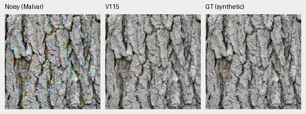
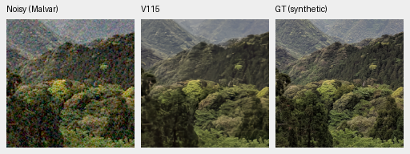
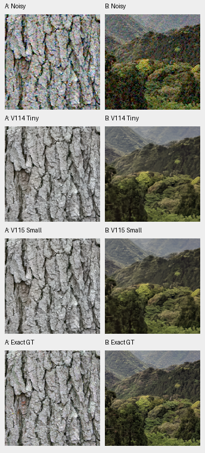

# V114 Tiny and V115 Small: completed quality comparison

**V114 is the current general restoration and quality-training baseline.** Both
20k continuations improve on V112. Small has the higher known-camera mean and
stronger tested eight-pixel weak carriers; Tiny has slightly higher photographic
PSNR and lower tested color bias. Native differences are small, and neither
resolves fine foliage, saturated-sign detail or dark-camera mottling.

[Completed evidence, checkpoints and independent statistics](results/v114-v115-quality-complete-v1.json) ·
[Matched training and initialization](small-aligned-training.md) ·
[Current model choices](current-model.md). The later optional [V114 eight-view
pilot](v114-eight-view.md) has independent/native review and selected gains with
a color-bias tradeoff; the complete tables here use single-view inference.

## Complete primary panels

| Endpoint | Full427 photo sRGB PSNR | Known4 measured-CFA PSNR | Unseen5 measured-CFA PSNR |
| --- | ---: | ---: | ---: |
| V112 parent | 36.90238 | 54.26914 | 53.95378 |
| **V114 Tiny** | **36.97973** | 54.28627 | 54.00290 |
| V115 fitted Small | 36.97700 | **54.32405** | **54.00417** |

Tiny gains **+.07735dB** over V112, source-bootstrap 95% interval
[+.07175,+.08262], with422/427 source means improving. Small gains **+.07462dB**,
interval[+.06862,+.07987], with420/427 improving. Their direct photo difference
is −.00273dB for Small, interval[−.00503,−.00050], with173/427 source means
rising. These small differences accompany the camera, color and native results;
they are not a promotion gate.

Small minus Tiny is **+.03778dB** on known cameras, with4/4 scene means rising,
and **+.00127dB** on unseen cameras, with3/5 rising. Both improve4/5 unseen
scene means over V112. Both still lose to the stronger released RawNIND
reference on four of nine camera scene means. Broad real-camera superiority
remains unachieved.

All427 photographs use seven conditions/four CFAs and native256 contexts.
Sixteen procedural sources are separate. Camera scoring covers72 known and90
unseen crops, using measured reference CFA samples. Means balance crops within
capture, captures within scene, then scenes. Source/scene intervals describe
this fixed evaluation set, not training-repeat or general-camera uncertainty.
AHD RGB references are independently demosaiced and are not exact GT.

Both models received the same seed63, data recipe, parent history and20k new
updates. Small additionally changes the official frozen encoder and eight
fitted initial lateral maps; this is a transfer-method comparison, not pure
capacity alone. All28,380 numerical method observations have independent
NumPy64 metric checks. The direct join verifies14,190 matched pairs with
identical noisy inputs, targets/masks and display values. Existing V112 and
RawNIND controls require no new inference. Primary PSNR, chroma/gradient and
analytic metrics are independently checked; SSIM remains the original evaluator's
measurement.

## Native100% noisy/restored/GT triplets

Each cell is160×160 pixels, without resizing, at[48,48,160,160] in the retained
native256 context. These are the two predeclared bark/canopy sources under the
ISO12800 prior: shot.00256, read variance2.62144e-5, RGGB, WB[2,1,1.5], shared
matrix and display exposure×1. GT is the exact saved synthetic target at the
8×-binned evaluation resolution. These two observations illustrate limitations;
the table above uses the complete427-source panel.

**V114 Tiny:**

**V115 Small:**

Both retain bark fissures and coarse canopy shapes while losing fine texture.
The separately inspected original photo triplets also show missing faint
paraglider lines in both models. Four native camera selections per model retain
gross edges but show residual dark-field mottling and soft surface detail.
Small does not produce a large visible repair in these examples.

[Image/checkpoint/source/ROI/noise/display receipts](images/v114-v115-quality/manifest.json).
Bark: [Derek Ramsey](https://commons.wikimedia.org/wiki/File:Kentucky_Coffee-tree_Gymnocladus_dioicus_3264px.jpg),
[CC BY-SA2.5](https://creativecommons.org/licenses/by-sa/2.5/).
Canopy: [Grendelkhan](https://commons.wikimedia.org/wiki/File:Forest_covered_hills_on_Yakushima.jpg),
[CC BY-SA4.0](https://creativecommons.org/licenses/by-sa/4.0/).
Modified by binning, cropping, simulated noise and restoration.

## Color and low-contrast detail

| Endpoint | ADC mean / max bias, DN16 | ISO12800 mean / max bias, DN16 |
| --- | ---: | ---: |
| V112 | 7.45 / 50.89 | 17.53 / 91.07 |
| V114 Tiny | **7.08** / 51.73 | **17.08 / 85.40** |
| V115 Small | 7.80 / 65.64 | 18.21 / 106.79 |

Each condition covers588 analytic color cases. Bias is the largest absolute
camera-RGB channel mean error, expressed on a16-bit scale. Tiny's ADC maximum
is slightly above V112's, while its mean and high-noise tail improve. Small's
larger color errors accompany its camera gains; the original large magenta
failures of earlier versions are not a reason to hide either current model.

At2% contrast/ISO12800, four/eight/sixteen-pixel carrier gains are:

| Endpoint | 4px | 8px | 16px |
| --- | ---: | ---: | ---: |
| V112 | .00136 | .09580 | .65759 |
| V114 Tiny | .00123 | .13371 | **.71335** |
| V115 Small | **.00210** | **.15217** | .68865 |

A gain of one would preserve amplitude. Four-pixel structure remains almost
absent. Higher eight/sixteen-pixel gains also accompany higher noncarrier RMS;
the complete phase/residual/flat-field metrics remain in the bound comparison.
Small improves eight-pixel response but does not fix the finest tested detail.

The [full natural-detail comparison](local-material-detail.md#tiny-versus-fitted-small-on-the-same-full-photo-support)
uses these same saved predictions across427 sources/5124 cases/96,075 unique
GT blocks. Weakest-stratum ISO12800 gain is.36334/.36422 for Tiny/Small, with
band-error RMS.00318289/.00318445. Broad weak natural detail is nearly unchanged.
This CPU analysis adds no neural inference or new noise observations.

## Standing GFX and complete RGB16 exports

Rows below are noisy, Tiny, Small and the separate ISO100 reference. Columns1–3
are building, fence and neon; columns4–6 are foliage, platform and sky.
All cells use native160 pixels from complete blended101.996MP FP32 outputs,
shared WB/matrix and exposure×4 (+2EV), with no resizing. DSCF3879 ISO6400 and
DSCF3880 ISO100 f/5.6 differ in aperture, time and moving subjects. ISO100 is an
approximate qualitative reference, **not GT**, and receives no pixelwise score.

Both recover coherent fence wires and building edges. Foliage remains painterly,
neon markings smear, and fine surface/lattice detail is weak. Sky noise is
strongly reduced. Native full-frame and512-context comparisons look close
between architectures; these images do not establish a large real-photo gain.
[Standing scene and other useful versions](gfx-qualitative.md).

Both linear and sRGB16 TIFFs are8746×11662×3 uint16. All four file hashes and
headers pass;921,600 channel values across all twelve retained native ROIs match
the original FP32 clipping/rounding into linear RGB16 exactly. Original inference/
blending observations are116.57s for Tiny and101.66s for Small, tile512/overlap64/B4,
FP32. Their ordered single-run timings include different warmup/workspace states
and do not establish a speed ranking. The100MP/10s target remains open.

## Current use and next work

V114 keeps the V84-family pretrained DRUNet RGB trunk and official DINOv3
ConvNeXt-Tiny pyramid. It is selected for its general photo/color balance, with
V115 documented as a useful camera/eight-pixel-detail alternative. Checkpoint
SHA256 values:

* V114: `2285c84b7015bcf122e71b890723f80aaf216bde849256c77f070c2493f9d2d2`.
* V115: `fee5d05c599cb32f5a1e587c31979f040a06152c8e14676481eee83a4ce04d84`.

The [V116 data trial](fine-detail-data-training.md) passed its eight discarded
CUDA updates and completed the original20k run and [full quality review](v116-quality.md).
It tests fine weak sources
and reviewed paired-reference masks against completed V114, preserving the
original matched parent/seed/budget. All executed sources and receipts remain
unchanged. Its analytic eight-pixel response improves,
but broad weak-material gain does not and ADC tails worsen. Reducing fine-detail
loss remains the priority before speed work.
