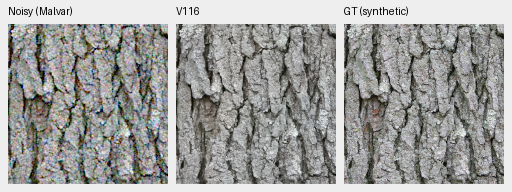
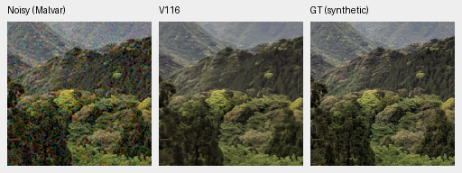
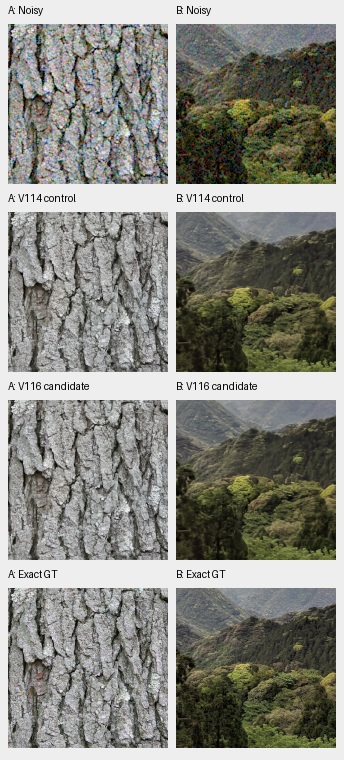
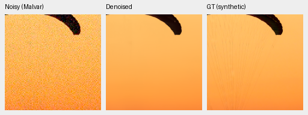
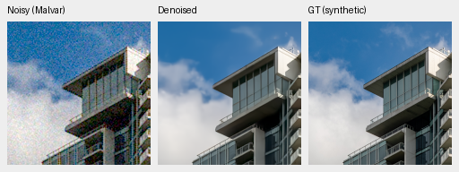

# Fine-source data tradeoff: V116 versus V114

**V116 improves the tested eight-pixel weak carrier, but does not improve broad
natural-detail quality. V114 remains the general baseline.** V116's photo and
unseen-camera means are slightly lower, its weakest natural-detail gain is
unchanged, and its ADC color tail is worse. Native bark, canopy and GFX views
show similar remaining softness. These are useful measured tradeoffs, without
a significance rule deciding which results can be documented.

[Complete evidence](results/v116-quality-complete-v1.json) ·
[Publication checks](results/v116-quality-publication-verification-v1.json) ·
[Native image metadata](images/v116-quality/manifest.json) ·
[Matched training recipe](fine-detail-data-training.md).

Both runs start from the exact V112 EMA with the same Tiny architecture,
seed63 and fresh20,000-update schedule. V116 replaces half of the .15 weak-source
quota with fine generators and revises four paired-reference crop masks.
The90,864-source corpus, geometry before final2× reduction, zero optical PSFs
and reconstruction epsilon.0003 stay fixed. This combines two data changes;
it does not isolate the effect of either one.

## Complete matched results

| Independent metric | V114 | V116 | V116 − V114 |
| --- | ---: | ---: | ---: |
| Full427 photographic sRGB PSNR | 36.97973 | 36.97478 | −.00495dB |
| Known-camera measured-CFA PSNR | 54.28627 | 54.28701 | +.00074dB |
| Unseen-camera measured-CFA PSNR | 54.00290 | 53.99497 | −.00793dB |
| ADC mean / worst max-channel bias, DN16 | 7.081 / 51.731 | 7.223 / 239.154 | Worse tail |
| ISO12800 mean / worst bias, DN16 | 17.083 / 85.400 | 17.116 / 85.540 | Nearly unchanged |

149/427 photo means and2/4 known-camera /1/5 unseen-camera scene means rise.
The photo change's fixed-source95% interval is[−.00690,−.00329]dB; the unseen
scene interval is[−.01258,−.00247]dB. These are source/scene resamples, **not
training-seed uncertainty**. Photo chroma/gradient errors increase slightly;
some auxiliary AHD RGB metrics improve. Independently demosaiced AHD RGB is
not exact GT. Relative to V112, V116 still gains+.07239dB on photos, with416/427
source means improving; it does not improve the current overall balance.

The worst ADC case is954: GRBG, magenta hue300°, saturation.50, linear-sRGB
peak.90. Its palette group's worst bias grows from12.356 to239.154DN16, while
the overall V114 maximum is51.731. This identifies a specific tail regression,
rather than treating the modest mean change as the whole result.

| Weak carrier: level.18, contrast.02, ISO12800 | V114 gain | V116 gain | V114 / V116 noncarrier RMS |
| --- | ---: | ---: | --- |
| Four-pixel period | .00123 | .00588 | .0004792 / .0004865 |
| Eight-pixel period | .13371 | .19123 | .0009533 / .0010062 |
| Sixteen-pixel period | .71335 | .64922 | .0013341 / .0012783 |

Gain is interpreted relative to one, with phase, residual and flat-field error.
Four-pixel recovery remains very weak. Higher eight-pixel gain also has higher
noncarrier RMS; sixteen-pixel gain falls. This analytic gain does not establish
better natural texture.

## Natural low-contrast detail and native views

The [full-photo local audit](local-material-detail.md#full-photo-follow-up)
checks5124 matched photo/noise/CFA observations, using GT-only16px blocks and
the1/8–1/3 cycles/pixel band. Its weakest stratum covers326 photos and15,008
unique GT blocks. Equal-source projected gain is:

| Weakest GT band contrast, below2% of local mean | V114 | V116 |
| --- | ---: | ---: |
| ADC-only | .94581 | .94688 |
| ISO100 prior | .78329 | .78293 |
| ISO12800 prior | .36334 | .36302 |

High-noise weak-group band-error RMS is.00318289/.00318291; orthogonal RMS is
.00198759/.00198121. The data intervention does not recover more weak natural
signal. Source coverage is much broader than the earlier feather/fur pilot;
the two analyses keep their own targets, policies and weighting.

Each cell is160×160 unchanged pixels, ROI[48,48,160,160] in its retained256px
context. Both use RGGB, shot.00256/read2.62144e−5, exposure×1, common WB
[2,1,1.5] and the recorded matrix/display transform. Bark fissures and larger
canopy structure remain; fine bark grain and leaf structure are attenuated
in both models. No clear visual improvement appears in these two contexts.
Photos: Derek Ramsey, CC BY-SA2.5; Grendelkhan, CC BY-SA4.0. Sources, licenses,
checkpoint/input hashes and display parameters are in the adjacent JSON receipts.

The additional fixed first-validation examples show the same limitation.
Both methods erase faint paraglider suspension lines and smooth cloud detail;
main canopy/building edges remain coherent. These are high-noise observations,
not a claim about recovery at every noise level.

Photos: Roy Egloff and Dietmar Rabich, CC BY-SA4.0. Identical source/ROI,
conditioning, target/WB/matrix arrays and noisy/GT display pixels are checked.

## Standing GFX and full-resolution output

These are native160px crops of complete blended101.996MP outputs, with shared
+2EV/WB/matrix. Both preserve coherent fence/building geometry and a smooth sky;
foliage remains waxy, platform detail soft and saturated neon smeared.
DSCF3880 ISO100 f/5.6 differs in aperture, time and moving subjects from DSCF3879
ISO6400 f/1.7. It is an independently demosaiced **approximate reference, not GT**;
no pixelwise quality score is assigned.

V116's two8746×11662×3 uint16 TIFFs pass hash/shape/type checks, with460,800
linear-RGB16 channel values at the six retained ROIs exactly matching original
FP32 clip/round quantization. Its recorded FP32 inference/blending interval is
113.86s, a separate execution observation rather than a controlled speed gain.
The100MP/10s target remains open; quality remains the priority.

V116 checkpoint SHA256:
`5ca4fc829de631ea718e324eb567b807e15f3bfb7ba3ed0f1305a489ae030a2c`.
All14,190 new numerical observations were independently rebuilt in NumPy64;
the direct comparison matches their noisy inputs, supervision and transforms
to retained V114 controls. Review/publication adds no neural calls, optimizer
updates, noise observations or RAW decodes. The reviewed reference masks remain
useful data corrections, but this combined trial does not establish their
isolated effect. [Current model choices](current-model.md) · [PSNR history](performance-history.md).
