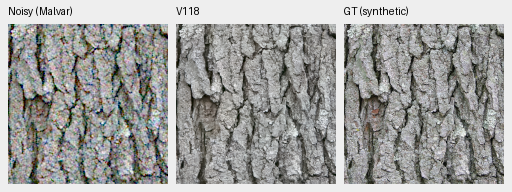
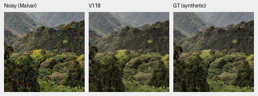
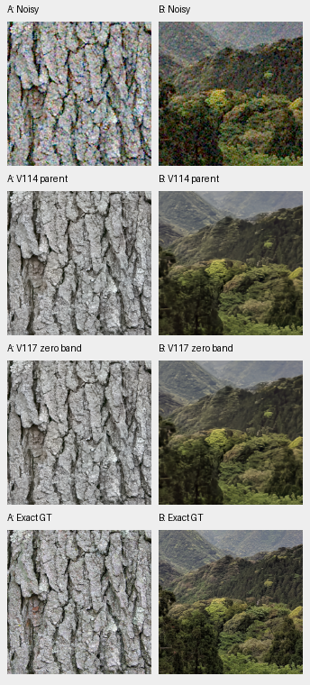

# V117 photo gain and V118 band-loss tradeoffs

**V117 is a useful single-view photo-score option: 37.04408dB, +.06435 over
V114, with421/427 source means improving.** V114 retains higher camera means
and lower ADC color bias; V115 Small retains its higher known-camera mean.
These are measured choices for different priorities. V118's added band term
slightly improves the tested eight-pixel carrier, but lowers weak natural-detail
response versus its control and raises worst ADC color bias to843.05DN16.
Leave that term disabled for further quality work. Real fine-detail softness
persists in both new models.

[Complete evidence](results/v117-v118-quality-complete-v1.json) ·
[Publication checks](results/v117-v118-quality-publication-verification-v1.json) ·
[Native assets and metadata](images/v117-v118-quality/manifest.json) ·
[Training and full-budget receipts](band-loss-training.md) ·
[Current model choices](current-model.md).

## Complete results

| Independent metric | V114 parent | V117 zero band | V118 normalized band |
| --- | ---: | ---: | ---: |
| Full427 photo sRGB PSNR | 36.97973 | **37.04408** | 37.03982 |
| Known-camera measured-CFA PSNR | **54.28627** | 54.27303 | 54.27562 |
| Unseen-camera measured-CFA PSNR | **54.00290** | 53.97339 | 53.97449 |
| ADC mean / worst max-channel bias, DN16 | **7.081 / 51.731** | 8.187 / 63.890 | 9.185 / 843.046 |
| ISO12800 mean / worst bias, DN16 | 17.083 / 85.400 | 17.431 / 85.289 | 17.091 / 93.379 |

V117 adds20k updates to V114's EMA, with seed64, fresh AdamW/EMA and the same
Tiny architecture. Both new arms use90,864 Commons sources, the common reviewed
paired-mask correction, native128 targets, legacy weak sources, six photographic
ROIs, contrast attenuation,4×→geometry→area2 and zero optical PSFs. V118 changes
only normalized-band weight0→.0003. The separate prepared90,791-source cleanup
is **not used in these runs**. Parent comparisons combine extra training,
seed and the common mask correction; they do not isolate a data effect.

V117's photo change has fixed-source95% interval[+.06005,+.06916]dB. V118 loses
.00426dB to its matched control, interval[−.00671,−.00217], while gaining
.06009dB over V114 with420/427 source means rising. Camera means balance four
known/five unseen scenes. V117's changes from V114 are−.01325/−.02951dB;
V118 gives−.01065/−.02841dB. These are source/scene resamples, not training-seed
or general-camera uncertainty. Independent AHD RGB is an auxiliary approximate
reference, not exact GT. Stronger released RawNIND still wins4/9 scene means
against either new model.

V118's worst ADC fixture is case953: BGGR, hue300°, saturation.50 and linear-sRGB
peak.90. This is a specific magenta-tail regression; the mean alone hides it.
High-noise centered RGB variation falls modestly, with mixed bias. The measured
tradeoff does not justify adding this loss to the next quality recipe.

## Low-contrast detail

The [same full-photo local definitions](local-material-detail.md#full-photo-follow-up)
cover427 sources,5124 source/noise/CFA cases and96,075 unique GT blocks per
contrast. The weakest stratum contains326 photos and15,008 unique blocks.
Three contrasts reuse this support rather than tripling independent coverage.
Equal-source GT-projected gain is:

| Weakest GT band contrast, below2% | V114 | V117 | V118 |
| --- | ---: | ---: | ---: |
| ADC-only | .94581 | .94533 | .94376 |
| ISO100 prior | .78329 | .79506 | .78995 |
| ISO12800 prior | .36334 | .36629 | .36470 |

V117 modestly increases the noisy weak response over its parent; high-noise
band-error RMS rises slightly .00318289→.00318382. V118 lowers error to.00318145
and orthogonal RMS .00200803→.00199328 versus V117 while also lowering gain.
That is an attenuation/error tradeoff, without a visible recovery of faint
natural structure in the reviewed material or GFX examples.

| ISO12800 carrier, level.18 / contrast.02 | V114 gain | V117 gain | V118 gain |
| --- | ---: | ---: | ---: |
| Four-pixel period | .00123 | .00142 | .00153 |
| Eight-pixel period | .13371 | .13788 | .14585 |
| Sixteen-pixel period | .71335 | .74713 | .73377 |

V118's eight-pixel analytic gain is real within this fixture, but sixteen-pixel
and weak photographic response fall against its control. Four-pixel recovery
remains nearly absent. Gain is interpreted with phase, noncarrier noise and
flat-field errors; the complete records preserve all these quantities.

## Native noisy / denoised / exact synthetic GT

Each cell is an unchanged160×160 crop, ROI[48,48,160,160] in its retained256px
context. Both sources use RGGB, shot.00256/read2.62144e−5, display×1, WB[2,1,1.5]
and the same recorded matrix/transform. PNGs are8-bit previews; numerical scores
use unquantized predictions. Source/ROI/checkpoint/conditioning/display receipts
are adjacent to each image and in the manifest.

V117:

V118, identical noisy/GT pixels and display:

Main bark fissures and canopy forms remain, with fine bark grain and leaves
attenuated in both. The direct parent/control board shows subtle differences:

[Matched V117/V118 board](images/v117-v118-quality/V117-V118-materials.png) ·
[Matched V114/V118 board](images/v117-v118-quality/V114-V118-materials.png).
Photos: Derek Ramsey, CC BY-SA2.5; Grendelkhan, CC BY-SA4.0; modified by binning,
cropping, noise, restoration and display. Full source/author/license links are
retained in each image receipt.

The fixed first-validation scenes also retain the limitation: both erase faint
paraglider suspension lines and soften fine cloud/building structure.
[V117 paraglider](images/v117-v118-quality/V117-generic-1.png) ·
[V118 paraglider](images/v117-v118-quality/V118-generic-1.png) ·
[V117 building](images/v117-v118-quality/V117-generic-2.png) ·
[V118 building](images/v117-v118-quality/V118-generic-2.png).
Roy Egloff and Dietmar Rabich, CC BY-SA4.0; identical noisy/GT/display pixels.

## Standing GFX and real cameras

Rows: noisy, V114, V117 and separate ISO100 reference. Each cell is160 native
sensor pixels from the complete blended101.996MP outputs, with shared+2EV/WB/
matrix and no resizing. The ISO100 exposure is approximate, **not GT**.

All three pairwise native boards were actually reviewed. Fence/building
geometry stays coherent and sky smooth; fine foliage remains waxy, neon
markings flatten and platform detail stays soft. No clear real-photo gain is
apparent in these six regions. DSCF3879 ISO6400/f1.7 and DSCF3880 ISO100/f5.6
differ in aperture, time and moving subjects; no pixelwise score uses this
reference. The scene and siblings remain excluded from training.
[V117/V118 regions1–3](images/v117-v118-quality/V117-V118-gfx-1.png) ·
[regions4–6](images/v117-v118-quality/V117-V118-gfx-2.png) ·
[Full GFX guide](gfx-qualitative.md).

Eight fixed known/unseen camera triplets were also viewed. Both new arms
smooth plate striations and retain broad uneven brown variation in the dark
three-apples region. Their native differences are small. The independently
demosaiced low-noise AHD panels are approximate references, not exact RGB GT.
[V117 plates](images/v117-v118-quality/V117-camera-2pilesofplates.png) ·
[V118 plates](images/v117-v118-quality/V118-camera-2pilesofplates.png) ·
[V117 dark region](images/v117-v118-quality/V117-camera-LucieB_3apples.png) ·
[V118 dark region](images/v117-v118-quality/V118-camera-LucieB_3apples.png).
Source and reference-unit caveats remain in the linked receipts.

## Output, usage and next quality work

All four new8746×11662×3 uint16 TIFFs pass hash/shape/type checks. At the six
retained ROIs per endpoint,921,600 linear-RGB16 values exactly match FP32
clip/round quantization. V117/V118 FP32 inference/blending observations are
112.94s/95.39s; different warmup/workspace states prevent a speed ranking.
The100MP/10s target remains open; quality remains the priority.

V117 is available at `/mnt/external/demosaic/models/v117-final20000.pt`, SHA256
`f69452432a852ac4c5ffdcbf7d6fe6837a3ab46adbc8a7fdae073111220b8ab0`.
V118's retained checkpoint SHA256 is
`5307c1789a9d29343de9e6c1ee35fd31f7551ef9b2b40bbf7e7cbf28cdaee751`.
Use the normal [inference/linear DNG commands](usage.md) with the explicit V117
path when choosing its photo-score tradeoff. V114 remains the lower-bias
camera-balance choice; V115 Small has the higher known-camera mean.

All28,380 new numerical observations were independently rebuilt in NumPy64.
Each of the three contrasts matches14,190 input/target/mask/WB/matrix records.
Review/publication adds no neural calls, noise draws, RAW decodes or optimizer
updates. Existing model outputs and receipts are reused. The next data-quality
experiment can use the prepared cleaned90,791-source reader while keeping the
band term off; this result does not lock its architecture or parent to an older
version. [Current choices](current-model.md) · [PSNR history](performance-history.md).
