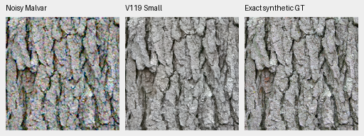
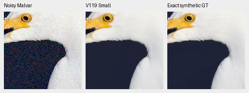
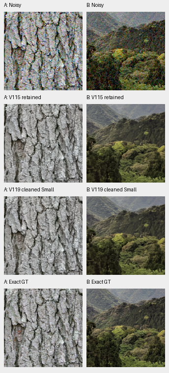

# V119: cleaned-data Small continuation, gains and regressions

**V119 improves photographic PSNR over its V115 Small parent, but regresses on
known cameras and introduces a large ADC-only color outlier.** Its weak-detail
gain is small, with no clear recovery of the difficult real green mesh. Keep
V114 for general camera/color balance, V115 for its known-camera mean, and V117
for the higher single-view photo score. This records the new gains directly;
an older study's promotion gate does not determine those choices.

[Complete evidence](results/v119-quality-complete-v1.json) ·
[Publication and native-pixel checks](results/v119-quality-publication-verification-v1.json) ·
[Native assets and metadata](images/v119-quality-v1/manifest.json) ·
[Training/data recipe](cleaned-diverse-small-training.md) ·
[Current choices](current-model.md).

## Complete primary and color results

| Metric | V114 Tiny | V115 Small parent | V117 Tiny | V119 Small |
| --- | ---: | ---: | ---: | ---: |
| Full427 photo sRGB PSNR | 36.97973 | 36.97700 | **37.04408** | 37.03831 |
| Known measured-CFA PSNR | 54.28627 | **54.32405** | 54.27303 | 54.10063 |
| Unseen measured-CFA PSNR | 54.00290 | 54.00417 | 53.97339 | **54.00742** |
| ADC mean / maximum max-channel bias, DN16 | **7.08 / 51.73** | 7.80 / 65.64 | 8.19 / 63.89 | 16.91 / 2526.70 |
| ISO12800 mean / maximum bias, DN16 | 17.08 / 85.40 | 18.21 / 106.79 | 17.43 / 85.29 | 17.51 / **78.33** |

Primary means use independent NumPy64 reductions of retained predictions.
V119 gains .06131dB over V115 on420/427 photo-source means, fixed-source95%
interval[+.05679,+.06616]. It gains .05858dB over V114 on417 sources but loses
.00577dB to V117, interval[−.00908,−.00244]. Source resampling does not measure
training-seed uncertainty.

The known-camera change against V115 is−.22342dB, with all four scene means
lower: plates−.16025,7D−.16580,D60−.55996,museum−.00769dB. The five-scene
unseen change is+.00325dB, interval[−.02635,+.03285], with only two scenes
improving. The small aggregate increase is not evidence of broad camera gains.
Measured CFA samples are the primary camera reference; independently demosaiced
AHD RGB is an auxiliary approximate reference, not exact GT.

V119's worst ADC case is1017: BGGR, hue60°, saturation.98, peak.90. Its
green-channel mean error is+.038555, or2526.70DN16. Mean bias alone hides this
bright-yellow failure. The high-noise maximum falls, while average centered
RGB variation rises to30.10DN16. These are distinct tradeoffs, not a uniform
color improvement. No corrective fit was applied to these predictions.

An all72-known-crop error decomposition independently reproduces the stored
scores within.0000061dB. The D60 regression is distributed: its average largest
single-error contribution is only.11% of measured-sample squared error. Mean
per-channel bias energy fraction rises .29256→.33556. This motivates checking
training/conditioning and broad error, rather than attributing the change to
one defective pixel. Fractions do not establish a causal training mechanism.

## Low-contrast photographic detail

The full local analysis reuses427 photos,5124 source/noise/CFA cases and96,075
unique GT blocks for each parent contrast. The weakest band stratum has326
photos and15,008 unique blocks. Equal-source GT-projected gain is:

| GT band contrast below2% | V115 | V117 | V119 |
| --- | ---: | ---: | ---: |
| ADC-only | .94340 | .94533 | **.94847** |
| ISO100 prior | .78286 | **.79506** | .78799 |
| ISO12800 prior | .36422 | **.36629** | .36523 |

V119's high-noise gain rises only.00101 over V115. Band-error RMS falls
.00318445→.00318371, while orthogonal RMS rises .00198998→.00199898. These
small changes do not establish visible recovery of faint photographic detail.
At level.18/contrast.02 under ISO12800, analytic four/eight/sixteen-pixel gains
are .00497/.21825/.65446. The eight-pixel response improves over V115's.15217,
while sixteen-pixel response falls from.68865. Four-pixel recovery remains weak.

## Native noisy / denoised / exact synthetic GT

Each cell is160 unchanged pixels at8×-binned evaluation resolution: retained
ISO12800-prior observation, V119 single view, exact synthetic GT. Both use RGGB,
shot.00256/read2.62144e−5, ROI[48,48,160,160] within256px, display×1 and shared
WB[2,1,1.5]/recorded matrix. PNGs are8-bit previews; scores use floating arrays.
[Source, ROI, checkpoint and display receipts](images/v119-primary-progress-v1/manifest.json).

Bark fissures remain but fine grain softens. The egret's eye stays sharp while
fine white feather structure is smoothed away. Sources: [Derek Ramsey,
CC BY-SA2.5](https://commons.wikimedia.org/wiki/File:Kentucky_Coffee-tree_Gymnocladus_dioicus_3264px.jpg)
and [Serebit,CC BY-SA4.0](https://commons.wikimedia.org/wiki/File:Snowy_egret_in_profile.jpg),
modified by binning,cropping,simulated noise and restoration. The executed
private render plan informally said “bark/canopy”; its fixed second source ID
is the egret. The saved source/ROI/noise was not changed.

The matched bark/canopy board provides direct parent context. Rows: noisy,
V115,V119,exact GT; each cell remains160px.

[V114/V119](images/v119-quality-v1/V114-V119-matched-materials.png) ·
[V117/V119](images/v119-quality-v1/V117-V119-matched-materials.png).

## Standing real GFX comparisons

Rows: noisy,V115,V119,separate ISO100 reference. Columns cover building/fence/
neon and foliage/platform/sky. Cells are160 native sensor pixels from complete
101.996MP blended outputs with shared+2EV/WB/matrix. DSCF3879 ISO6400/f1.7 and
DSCF3880 ISO100/f5.6 differ in aperture,time and moving subjects: **not GT**.

All nine parent/material/GFX boards were actually inspected. Differences are
subtle: fence geometry stays coherent and sky smooth; foliage remains waxy and
neon markings flatten. The highlight-specific crops show flattened saturated
lettering and soft platform boundaries.
[Neon](images/v119-quality-v1/V119-highlight-colored-neon-sign.png) ·
[Platform](images/v119-quality-v1/V119-highlight-illuminated-platform-boundary.png) ·
[All six regions](gfx-qualitative.md).

The additional [fine green mesh](gfx-green-mesh.md#v119-after-cleaned-data-training)
uses DSCF3842 and the corrected **DSCF3835 ISO100 reference**. At either matched
fixed noise profile, V119 shows no clear lattice-recovery gain over V115. The
nearby-capture profile reveals more diagonal structure in both than the nominal
prior, with much detail still missing. Neither AHD nor camera-JPEG reference is
exact GT. All these captures and siblings remain excluded from training.

The four selected measured-camera triplets retain plate smoothing and dark
brown mottling; V119's7D crop also retains a bright isolated pixel.
[Plates](images/v119-quality-v1/V119-camera-2pilesofplates.png) ·
[Dark apples](images/v119-quality-v1/V119-camera-LucieB_3apples.png) ·
[7D](images/v119-quality-v1/V119-camera-7D-1.png).

## Supplementary native-camera comparison and output

The [completed native development comparison](native-camera-development.md)
adds20 regions from11 withheld captures, three added-noise priors and four
CFAs. V119 improves over V115 slightly but stays below V117 on all three
camera-RGB condition means. The joint models retain substantially finer grass,
rail grain, mortar and lettering than released RawNIND on these binned inputs;
high-noise foliage remains soft. Low-noise reference estimates retain source
noise/optics and are not exact GT or real high-ISO validation.

All eight endpoint stages and the independent primary/analytic audit completed.
The two full-frame RGB16 exports pass exact FP32 quantization checks at460,800
native channel values. V119's measured FP32 inference/blending time is163.09s
for101.996MP with512px tiles/64overlap/B4; peak CUDA allocation3.27GB.
Warmup/workspace differences prevent a speed ranking. The100MP/10s goal remains
open, with quality the priority.

Endpoint: `/mnt/external/demosaic/models/v119-final20000.pt`, SHA256
`b3c0d43264c6ad8446dd930aafa337298e4690d0d08f2967824f03ecd844f427`.
This trial combines cleaned90,791 Commons sources, expanded83-ID paired data
and20k extra updates from V115; it does not isolate any individual data change.
Keep the band term off and optical blur at zero. Further quality work should
use the reviewed weak-detail source bank while investigating the camera/color
regressions. The [V120/V121 controlled trials](paired32-weak-detail-training.md)
now test corrected paired32 and that bank with per-source loss tracing; all
discarded checks pass, V120 is training and V121 is queued. Their quality remains
unmeasured.
