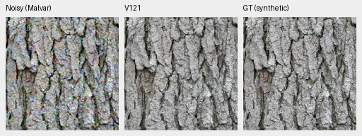
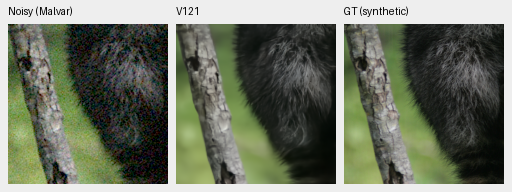
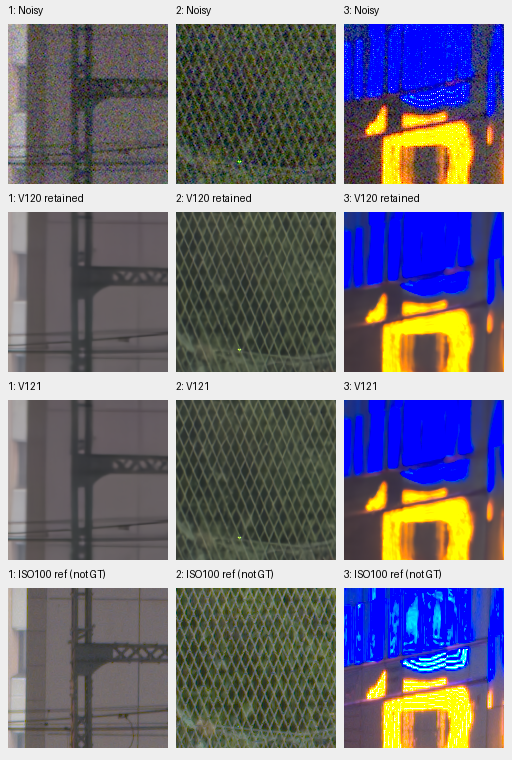
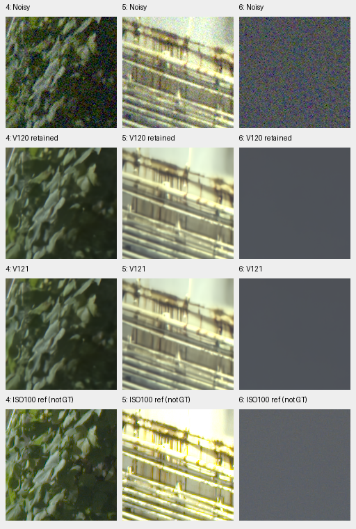
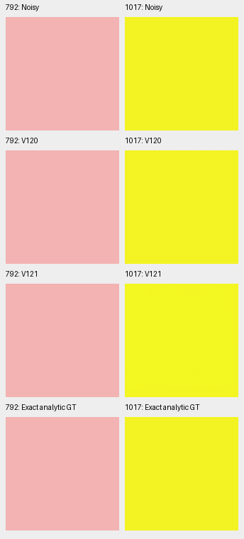

# V120/V121 completed primary results

**V120 is a useful balanced Small continuation.** Restoring corrected paired32
keeps V119's photo score while recovering most of its known-camera regression
and removing its large tested ADC color outlier. The further cleaned-source/
fourteen-region V121 arm has a small photo/known-camera change, lower unseen
mean and a large remaining ADC outlier. These are single-run observations.
Full saved/local-detail comparisons and the selected native review are complete,
including all six main GFX regions and both fine-mesh profiles. Additional
fixed-Haar full-frame operators now match older models' inputs exactly.
The primary panels, independent audit, matched-profile native review and
selected ADC-tail inspection below are complete.
It is now the [current general recommendation](current-model.md); active
controlled trials retain their original V115 parents.

| Model | Photo sRGB PSNR | Known CFA PSNR | Unseen CFA PSNR | Largest ADC mean-RGB error, DN16 |
| --- | ---: | ---: | ---: | ---: |
| V114 Tiny | 36.97973 | 54.28627 | 54.00290 | 51.73 |
| V115 Small parent | 36.97700 | 54.32405 | 54.00417 | 65.64 |
| V117 photo option | 37.04408 | 54.27303 | 53.97339 | 63.89 |
| V119 expanded paired set | 37.03831 | 54.10063 | 54.00742 | 2526.70 |
| **V120 corrected paired32** | **37.04008** | **54.31272** | **54.00872** | **55.52** |
| V121 cleaner90787 /14 regions | 37.04157 | 54.32184 | 53.98947 | 1645.36 |

Photo means balance427 fixed sources over seven conditions/four CFAs. Camera
means balance captures within4/5 known/unseen scenes (72/90 crops), using measured
CFA samples. Independently demosaiced RGB is not exact GT. ADC maxima describe
588 fixed analytic cases, not all possible colors. All models here use single-view
FP32 evaluation; budgets, architecture and data histories differ across versions.
[New audited means, hashes and provenance](results/v120-v121-primary-v1.json) ·
[Publication and history checks](results/v120-v121-publication-v2.json) ·
[Parent comparison](v114-v115-quality.md) · [V117](v117-v118-quality.md) · [V119](v119-quality.md).

V120 versus V119 changes photo by+.00177dB, known by+.21209dB and unseen
by+.00130dB. Against V115 it gains+.06308dB on photos with a−.01133dB known
and+.00455dB unseen change. V121 versus V120 changes photo by+.00149dB,
known by+.00912dB and unseen by−.01926dB. These differences alone do not establish
repeatability or a real-photo ranking. The paired-data intervention's stronger
camera/color balance is useful even while that broader review continues.

Both completed their original20,000 updates from V115 Small EMA with the same
Small architecture, seed65 and quality recipe. V120 uses90,791/six regions;
V121 uses90,787/fourteen regions. [Exact recipe/accounting](paired32-weak-detail-training.md).
V120 SHA256: `a9d9b6b4f974e24a6b11e5e740aab32314233a7f53c056cf37c7d2aac1c589fb`.
V121 SHA256: `40fb6369064aaf82d513728110a6823ed72be50e79394988303c392b3a02f077`.

## Native exact-GT triplets

Each cell is160×160 pixels at100% with identical coordinates and display
transform: noisy Malvar → restored → exact synthetic GT. These use the saved
ISO12800-prior observation (shot.00256/read2.62144e−5), RGGB, native256 context,
ROI `[48,48,160,160]`, shared WB/matrix, exposure×1 and clipped sRGB display.
No crop pixels resize. Full source/ROI/checkpoint/input/conditioning metadata
is in the [native manifest](images/v120-v121-primary-v1/manifest.json).

Actually viewed at native resolution: bark structure is coherent; fine raccoon
fur remains softer and less irregular than GT. These examples show no clear
large V120/V121 detail difference. All921,600 published panel channels match
their original audited pixel hashes exactly; no new model/noise/RAW work occurs.

Sources: [Derek Ramsey, Kentucky Coffee-tree](https://commons.wikimedia.org/wiki/File:Kentucky_Coffee-tree_Gymnocladus_dioicus_3264px.jpg),
[CC BY-SA2.5](https://creativecommons.org/licenses/by-sa/2.5/), and
[Korall, Racoon clinging to a tree](https://commons.wikimedia.org/wiki/File:Racoon_clinging_to_a_tree.JPG),
[CC BY-SA3.0](https://creativecommons.org/licenses/by-sa/3.0/). Modified by binning,
cropping, synthetic sensor noise, restoration and display conversion.

## Completed local and native review

All four contrasts complete14,190 matched numerical observations each. The local
analysis uses427 photos/5,124 source-noise-CFA cases and96,075 unique GT blocks.
For the weakest high-noise group, source-balanced projected detail gain is
.36422(V115), .36523(V119), .36476(V120) and .36575(V121); V117 is.36629.
The small changes leave substantial weak-detail attenuation. V121's photo
change from V120 has a paired-source95% interval of[−.00080,+.00401]dB;
187/427 source means rise. This does not establish repeatable improvement.

Both linear/sRGB full101.996MP exports have verified hashes/types/shapes.
921,600 native linear-camera values match exact FP32 clip/round quantization;
native sRGB quantization is not independently recomputed.
[Completed comparisons, local statistics and actual viewing](results/v120-v121-native-review-v1.json).

The matched nominal-profile main GFX boards below show noisy → V120 → V121 →
independent ISO100 reference. All cells are native160 pixels at shared+2EV.
Fence/building edges remain coherent and sky quiet; foliage is painterly and
saturated sign detail is smeared. No clear large V121 real-detail gain appears.
The separate ISO100/f5.6 exposure remains **not GT**.

## Supplementary camera-linear reference recovery

The [completed11-capture camera comparison](native-camera-development.md#v120v121-extension)
adds240 stored observations per endpoint and reuses all existing controls.
At high noise V120 gains+.01081dB camera-RGB PSNR over V115 and+3.69903dB
over RawNIND, while V117 retains higher condition means. V121 changes only
slightly from V120, with no clear large native detail gain. Grass, wood grain
and lettering remain substantially finer than RawNIND, but faint foliage stays
soft. Two native noisy/restored/reference triplets per new endpoint and all
twelve boards are published. These binned low-noise references are **not exact
noiseless GT**, and the inputs have added noise rather than real high ISO.
[Full metrics, independent reductions and actual native review](results/native-camera-development-v120-v121-v1.json).

## Matched-profile full-frame GFX

The additional V120/V121 operators use the **fixed historical input-Haar profile**:
shot `.0014635775921166604`, read `1.0715704128646712e−6`.
Each of130 complete five-argument input batches exactly matches the original
V119 sequence, including variance, CFA, WB and matrix. The unchanged checkpoints
and neural source restore all101.996MP in IEEE FP32, B4/native512/overlap64.
Both linear/sRGB RGB16 TIFFs per model verify;921,600 native linear values
exactly match retained FP32 clip/round quantization. This adds260 root/encoder
calls and two shared cached RAW decodes, with no estimator or training work.

All ten saved comparison boards were actually viewed. V115/V119/V120/V121 show
subtle differences: fence/building geometry is coherent and sky quiet, while
foliage stays painterly and neon markings smear. There is no clear large
V120/V121 fine-detail recovery at matched conditioning. Rows below are noisy →
V115 → V120 → independent ISO100 reference, with unchanged160px cells/+2EV.

[V119/V120 first three regions](images/v120-v121-fixed-Haar-GFX-v1/V119-V120-fixed-Haar-matched-gfx-1.png) ·
[last three](images/v120-v121-fixed-Haar-GFX-v1/V119-V120-fixed-Haar-matched-gfx-2.png) ·
[V120/V121 first three](images/v120-v121-fixed-Haar-GFX-v1/V120-V121-fixed-Haar-matched-gfx-1.png) ·
[last three](images/v120-v121-fixed-Haar-GFX-v1/V120-V121-fixed-Haar-matched-gfx-2.png).

The same-weight nominal/Haar contrasts also change only subtly at these regions;
neither profile resolves the fine foliage or saturated sign detail.
[V120 profile-only comparison, first three](images/v120-v121-fixed-Haar-GFX-v1/V120-profile-only-conditioning-different-gfx-1.png) ·
[last three](images/v120-v121-fixed-Haar-GFX-v1/V120-profile-only-conditioning-different-gfx-2.png) ·
[V121 first three](images/v120-v121-fixed-Haar-GFX-v1/V121-profile-only-conditioning-different-gfx-1.png) ·
[last three](images/v120-v121-fixed-Haar-GFX-v1/V121-profile-only-conditioning-different-gfx-2.png).
The original nominal outputs and estimator diagnostics remain preserved.

The [archived profile](results/DSCF3879-fixed-historical-Haar-v1.json) is a fixed
comparison convention, **not newly verified camera calibration**. The current
ADC-floor-aware estimator still falls back here; its behavior is unchanged.
The separate ISO100 f/5.6 exposure remains **not GT**, and shared-device timings
do not establish a speed ranking.
[Complete CPU checks and four native triplets](results/v120-v121-fixed-Haar-GFX-v1.json) ·
[Actual viewing, source/ROI/checkpoint/display bindings and publication checks](results/v120-v121-fixed-Haar-GFX-native-review-v1.json).
All132 published native cells verify exactly, without resizing.

## Selected ADC-tail inspection

V121's largest ADC error is a predominantly coherent green bias on a bright
saturated yellow flat field. Its green mean error is+1645.36DN16;98.19% of
the squared RGB error comes from channel-mean shifts. The green error's
1st–99th pixel percentiles are+1002.23 to+2077.33DN16. This is a broad field
error rather than one isolated bright pixel. The original quantized CFA
phase-mean errors stay within.40DN16. V120's maximum channel-mean error on
this same case is36.02DN16.

| Adverse analytic case | V120 maximum channel-mean error, DN16 | V121 |
| --- | ---: | ---: |
| V120's worst: pink, RGGB, case792 | 55.52 | 18.48 |
| V121's worst: saturated yellow, BGGR, case1017 | 36.02 | 1645.36 |

These two cases were selected **after** the complete grid by each model's
largest ADC mean bias. They are deliberately adverse examples, not a
representative sample. The native160 cells below share the retained input,
exact analytic GT, WB/matrix and exposure×1. The clipped sRGB8 previews look
similar despite the linear-camera error; no obvious strong blotch is visible.
This does not identify which training intervention caused the bias.

[Selected metrics and four native noisy/restored/GT triplets](results/v120-v121-ADC-tail-v1.json) ·
[Source bindings, publication and actual native review](results/v120-v121-ADC-tail-native-review-v1.json).
The saved-array inspection uses zero model calls, RAW decodes or new noise.

## Real-photo limits and remaining work

V120's [matched two-profile fine green mesh review](gfx-green-mesh.md#v120-after-correcting-the-paired-data-mix)
shows no clear lattice-recovery gain over V115/V119. The
[completed V121 mesh review](gfx-green-mesh.md#v121-after-adding-the-fourteen-region-bank)
also shows no clear gain over V120 under either matched profile. Separate ISO100 captures remain qualitative
references, not exact GT.

The original new main-GFX outputs use nominal ISO conditioning; older outputs
use the Haar-fit profile. The additional fixed-profile operators above close
the matched full-frame comparison, while the
[report repair](endpoint-quality-review.md#material-selection-and-gfx-conditioning)
preserves and labels the original pipeline difference. No broad real-photo
superiority,10-second102MP
runtime or overall final model ranking is claimed here.
