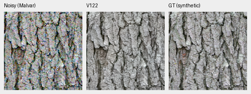
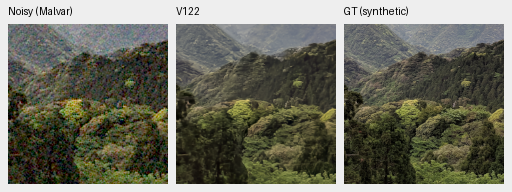
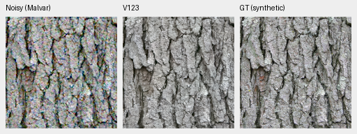
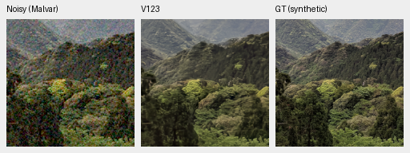
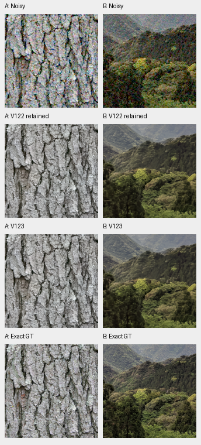

# V122/V123: learned RAW-frequency quality results

**V123 improves photographic PSNR over V122, but neither frequency-adapter arm
provides a large weak-detail recovery.** Jointly training the restoration path
raises full-photo PSNR by 0.05493 dB, with 411/427 source means rising. Unseen-camera
PSNR falls by 0.02781 dB and the ADC color tail grows substantially. Adapter-only
V122 slightly improves weak eight-pixel carrier response while leaving natural
fine detail almost unchanged. V120 remains the general recommendation.

[Completed results and independent reductions](results/v122-v123-quality-complete-v1.json) ·
[Native source/ROI/checkpoint/noise/display metadata](images/v122-v123-quality-v1/manifest.json) ·
[Publication verification](results/v122-v123-quality-publication-verification-v1.json) ·
[Architecture and training](learned-raw-frequency-training.md).

## Completed comparison

Both arms start from V115 Small's EMA and add the same zero-output 3,264-value
RAW-frequency adapter. V122 trains only its five tensors, retaining all 91
common model/EMA tensors exactly. V123 also trains the common restoration path,
with 94 optimizer states. Official DINOv3 ConvNeXt-Small remains frozen.
Both completed the original 20,000 updates with seed66, native256/B16/BF16,
90,786 Commons sources/fourteen reviewed regions, corrected paired32/native128,
zero optical PSFs and geometry before final downsampling. V123 retains its
12,249-update prefix and adds exactly 7,751 updates after its memory guard;
no prefix or implementation check was repeated.

V122 versus V123 isolates trainable scope within this recipe. Comparisons with
V115 additionally include training and the newer data; comparison with V120
also changes parent/training history. All selected primary input joins pass:
noisy tensors, targets, masks, transforms and observation identities agree.
Controls reuse saved predictions, without repeated inference or noise draws.

| Model | Full427 photo sRGB | Known CFA, four scenes | Unseen CFA, five scenes | Worst ADC color bias, DN16 |
| --- | ---: | ---: | ---: | ---: |
| V115 parent |36.97700 |54.32405 |54.00417 |65.64 |
| V120 current |37.04008 |54.31272 |54.00872 |55.52 |
| V122 adapter only |36.97786 |54.32375 |54.00030 |65.64 |
| V123 joint |37.03279 |54.32306 |53.97248 |4190.02 |

Photo scores balance 427 sources across seven conditions/four CFAs. Camera
scores balance captures within scenes, then four/five scenes, on 72/90 crops.
Measured CFA targets differ from independently demosaiced AHD RGB references;
the latter are not exact GT. Independent float64 scoring differs from the
original FP32 reporter by about 0.000002 dB without changing these rounded values.
The source-based paired bootstrap interval for V123 minus V122 photo PSNR is
[+0.04935,+0.06130] dB; this does not measure training-seed or general-camera
uncertainty.

V123's ISO12800 color maximum improves against V122, 103.48→89.88 DN16, but
V120 remains lower at78.82. The separate ADC regression is large and is not
hidden by the photographic mean. Architectural choices follow these actual
strengths and weaknesses rather than a promotion gate.

Checkpoints, both step20,000:

- V122: `691823cefa44adf94c431e0bfa9539f0ceb1917e089682496f0abf388726a437`.
- V123: `4e9f1165c57ee7b3955ffd1dba1dfc13df2b192fcc28f7b86b17a2c1ae8c1c8a`.

## Native synthetic-target comparisons

Each triplet is noisy Malvar → restored → exact processed synthetic GT.
Native160px cells use RGGB, ISO12800 prior shot0.00256/read0.0000262144,
16-bit ADC/black0.03, central ROI48,48,160,160,+0EV and the same WB/matrix/sRGB
transform. No crop pixels are resized. Original source IDs, processing,
checkpoint hashes and complete display metadata are in the manifest.

Bark: Derek Ramsey, CC BY-SA2.5; forest canopy: Grendelkhan, CC BY-SA4.0.
Source links and attribution are retained in the manifest. Fine bark/canopy
remains softer than GT; differences between models are subtle.

Rows below: noisy → V122 → V123 → exact GT; columns are bark and canopy:

Parent comparisons: [V115/V122](images/v122-v123-quality-v1/V115-V122-materials.png) ·
[V115/V123](images/v122-v123-quality-v1/V115-V123-materials.png).

## Full-photo local detail

The saved-output local audit covers all 427 photographic sources, three fixed
noise conditions and four CFAs: 5,124 paired observations and 96,075 unique
eligible source blocks. Its target-only native16 DCT strata use the established
1/8–1/3 cycle/pixel annulus, luminance/gamut/RMS rules and source balancing.
Independent cosine/FFT calculations agree within1.85e−14. Noise/CFA variants
do not multiply the number of independent photos.

At ISO12800 in the weakest0–2% stratum, source-balanced projection gains are
V1150.36422 → V1220.36465 → V1230.36500. V123's band-error RMS changes
0.00318511→0.00318046 against V122, with slightly lower orthogonal residual.
These small gains leave most weak fine detail attenuated.

On the separate 2%-contrast eight-pixel carrier at mean0.18/ISO12800,
V122's gain rises from V115's0.15217 to0.15883, alongside higher noncarrier
residual. V123 falls to0.15263. Four-pixel structure remains nearly absent.
The adapter supplies a small carrier benefit, without establishing photographic
mesh recovery or a broad quality improvement.

## Real GFX and RGB16

All six main DSCF3879/3880 regions were viewed from both complete101.996MP
outputs. The strict V122/V123 comparison uses the same nominal shot0.00128/
read0.0000065536, shared WB/matrix,+2EV and native160px cells. Rows: noisy →
V122 → V123 → separate DSCF3880 ISO100/AHD reference, **not GT**.

Sky is smooth and broad rails/fence stay coherent. Foliage remains painterly;
neon and platform edges smear. Older V115/V117 main-GFX controls use a different
fixed Haar noise profile. Their explicitly labeled boards are pipeline
comparisons and cannot isolate model effects. Source/ROI/display checks still
pass; no new matching-profile inference was performed for this report.

The extra DSCF3842 ISO6400 / **DSCF3835 ISO100 f/5.6** case includes both camera
JPEGs and both fixed noise profiles, using native768px contexts,+4EV and160px
crops. Columns: ISO6400 JPEG → noisy Malvar → nominal → nearby3879 profile →
ISO100/AHD → ISO100 JPEG. Exposure, aperture and moving subjects differ;
these are qualitative references, never exact GT or scoring targets.

Nominal conditioning still mostly removes the lattice. The nearby profile
retains weak, irregular diagonal texture without a clear new recovery. Both
left regions were also inspected: [V122](images/v122-v123-quality-v1/V122-fine-green-mesh-left.png) ·
[V123](images/v122-v123-quality-v1/V123-fine-green-mesh-left.png).

Both linear-camera and sRGB TIFFs have verified full dimensions and uint16 type.
The retained-FP32 linear quantization audit checks921,600 RGB16 values at the
six native ROIs per model; it does not independently recompute sRGB16
quantization. Timings remain observations, not a controlled speed comparison.

## Review and next quality work

All five material boards, ten main-GFX comparison boards and four two-profile
extra-mesh boards were actually viewed. The earlier four exact-GT and twelve
full-frame GFX triplet views are retained. Saved RGB panel hashes verify
12,288,000 channels exactly. Independent float64 mesh rendering checks1,843,200
channels: only four differ by one DN8 at FP32 rounding boundaries. Publication
copies23 PNGs unchanged, checking19,226,304 channels. No inference, stochastic
observations or RAW decoding occurs during reporting. Original receipts and
failed runs remain intact.

The [conditional-mean trial](conditional-mean-training.md) now runs V124's
original two-noise-view control; V125 follows with the additional mean loss.
It keeps the V120 architecture and frozen90,784-source/twenty-region data.
The newest [90,781/29 curated cohort](current-source-loss-review.md) remains
prepared and untrained. Weak-detail bias remains the quality priority;
frequency features stay optional, and no speed work replaces that objective.
