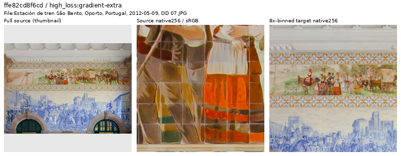
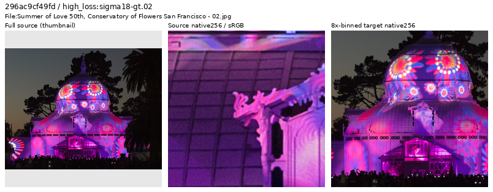
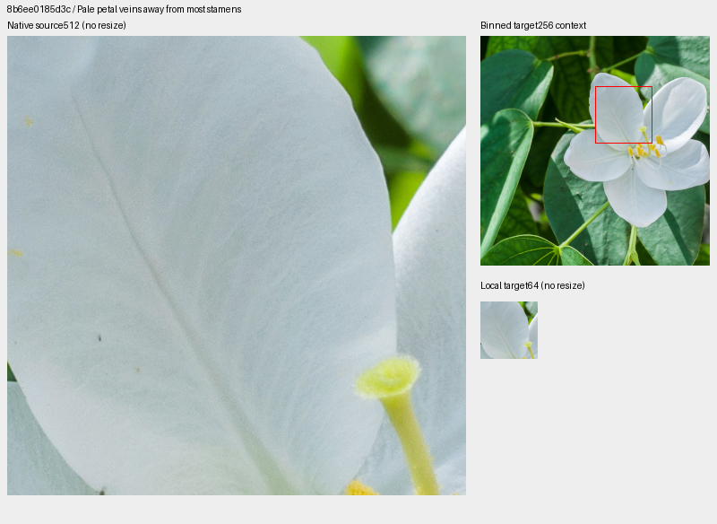
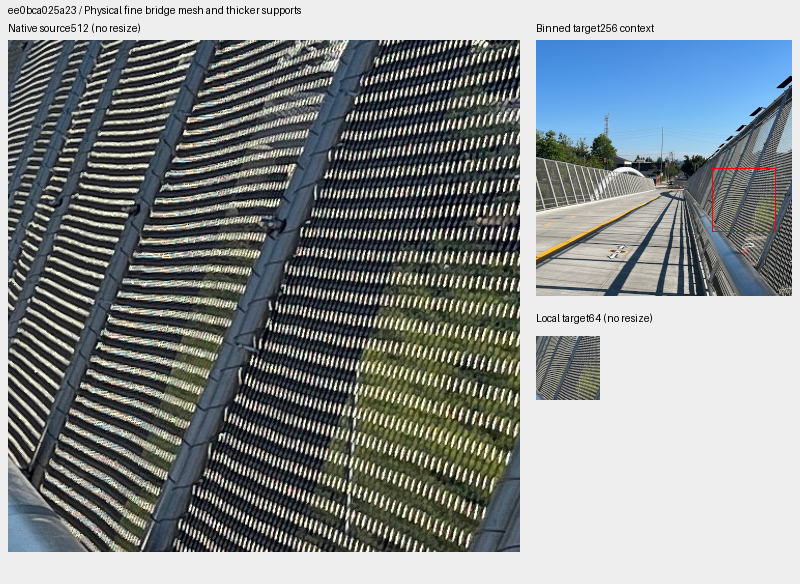
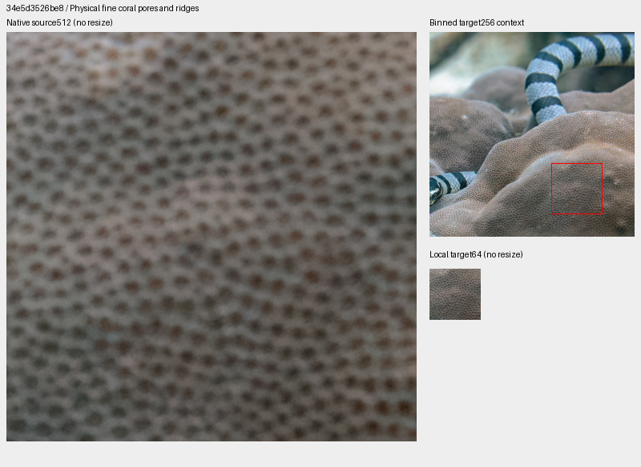
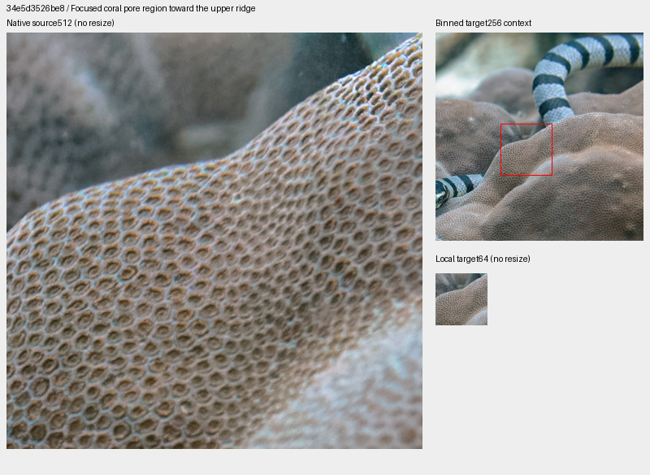
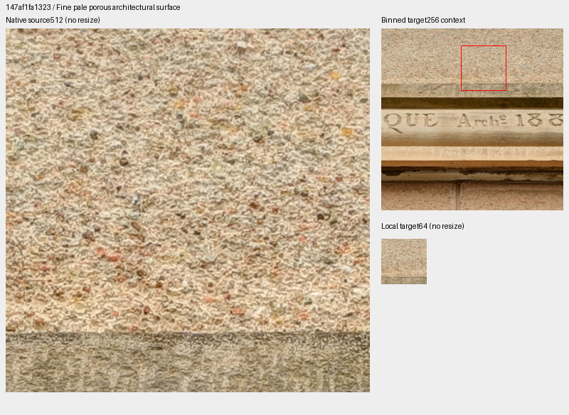

# Final-stage V123 source review

**Forty new loss-nominated sources have been inspected:39 retained and one
painted-tile-dominated frame withheld from a separate future cohort.**
The prepared cohort has90,781 training photos and29 regions, adding actual
weak petal veins and sharp bridge mesh while preserving all27 preceding region
objects. The deduplicated review ledger now contains1,839 source IDs.
Active and queued training/evaluation inputs remain unchanged; learned quality
on this new cohort is unmeasured.

[All40 decisions and credits](results/v123-final-source-decisions-v1.csv) ·
[Trace, independent audit and actual reader proof](results/v123-final-source-review-v1.json) ·
[Native image/source/ROI metadata](images/v123-final-source-review-v1/manifest.json) ·
[Prepared29-region catalogue](../configs/low-contrast-training-rois-cleaned90781-v1.json).

## Final training traces nominate inspection

The completed original/resumed V123 traces contain1,680 diagnostic draws,
1,190 photographic draws and1,125 distinct photographic IDs through20,000.
This review nominates only draws from updates15,801–20,000:294 photographic
draws, with19 already covered by the preceding1,799-ID ledger. The remaining
275 draws represent274 IDs. Eight distinct sources per noise group and eight
remaining high-gradient cases form the40-source selection.

| Nomination stratum | Eligible draws / IDs | Inspected |
| --- | ---: | ---: |
| ADC-only |27 /27 |8 |
| Positive sigma18≤.005 |93 /92 |8 |
| .005<sigma18≤.02 |127 /127 |8 |
| sigma18>.02 |28 /28 |8 |
| Remaining highest gradient loss | Same eligible pool |8 |

Sigma18 is`sqrt(.18×shot+read)`. Losses depend on the evolving model, exposure,
noise and camera transforms; they nominate sources rather than label bad photos.
Scored augmentation/noise is not regenerated. Actually viewed: seven sheets,
40 thumbnails,80 native256 source/target cells, six native1024 follow-ups and
eight native512/local64 proposal boards across two proposal versions.

## Graphic dominance and uncertain source quality

The São Bento frame is genuine photography of ceramic tilework, with real seams
and optical surfaces. Painted motifs dominate the frame and traced target, so
it is withheld from the future generic photographic quota. This does not call
the photograph fake, assert poor optics, or delete its source/cache.

[Diego Delso](https://commons.wikimedia.org/wiki/File:Estaci%C3%B3n_de_tren_S%C3%A3o_Bento,_Oporto,_Portugal,_2012-05-09,_DD_07.JPG),
CC BY-SA3.0. Strip: resized whole-source thumbnail → unchanged native256 source
crop → native256 area8 target. Only the thumbnail resizes pixels.

The projected-light night scene remains: native1024 inspection shows physical
building frames and projected illumination, with visible grain. Its binned
geometry remains useful, without certifying noiseless texture or processing history.

[Frank Schulenburg](https://commons.wikimedia.org/wiki/File:Summer_of_Love_50th,_Conservatory_of_Flowers_San_Francisco_-_02.jpg),
CC BY-SA4.0. The same thumbnail/native-source/native-target layout applies.

The retained sources include genuine relief sculpture, engraved metal, smooth
plaster, naturally defocused plants and distant soft foliage. Text/art/noise
titles are not automatic exclusion rules. The Golden Gate frame is actually in
color despite “BW” in its title. The distant villa has visible softness at native
scale but coherent binned architecture; it is retained with uncertainty and is
not selected as pristine fine-foliage supervision. This targeted review does
not certify the entire corpus clean.

## Two selected material contexts

The pale petal has visible veins/folds in the native512 source. The revised
annotation avoids most stamens;10/16 local DCT16 blocks lie below5% band contrast,
including six below2%. The whole256 context still contains mixed contrast.

[Joydeep](https://commons.wikimedia.org/wiki/File:Bauhinia_acuminata_31_08_2012_(2).jpg),
CC BY-SA3.0. Source512 at left; target256 context and native64 annotation at right.
The red rectangle only marks the context; the local64 pixels are unchanged.

The sharp bridge mesh supplies real periodic geometry and thin supports.
Its16 local blocks are all at≥20% contrast, so it is explicitly fine-pattern
diversity rather than a uniformly weak-detail sample.

[Another Believer](https://commons.wikimedia.org/wiki/File:Blumenauer_Bridge_(August_3,_2022)_-_15.jpg),
CC BY-SA4.0. All native source/target pixels keep their original scale.

| Inspected local64 proposal |0–2% |2–5% |5–10% |10–20% |≥20% | Specialized bank |
| --- | ---: | ---: | ---: | ---: | ---: | --- |
| Petal veins |6 |4 |4 |1 |1 | Add |
| Bridge mesh |0 |0 |0 |0 |16 | Add, strong-pattern diversity |
| Pale textured surface |0 |0 |0 |16 |0 | Keep source, do not add |
| Revised coral ridge |0 |0 |2 |10 |4 | Keep source, do not add |

These are descriptive linear-source-sRGB luminance DCT16 statistics over16
annotation blocks, annulus1/8–1/3 cycles/pixel. They do not measure whole-context,
augmented-training or corpus-wide contrast coverage.

The initial coral proposal is too soft to use as the intended focused fine-detail
region. A revised view resolves the physical pores along a focused ridge, but
mostly stronger contrast adds little to this specialized weak-detail bank.
Both proposal versions remain preserved; the ordinary photograph is retained.

The pale architectural surface is also retained as ordinary photographic data;
its measured local region is entirely10–20% contrast.

All source links, authors and licenses for these derivatives are in the CSV and
image manifest. Views use cropping, area binning and sRGB display conversion;
they are source-quality views rather than restoration triplets or exact-GT claims.
Field contexts use the recorded even-aligned bin4 origins; these source-only
views do not replay the exact scored augmentation.

## Future data and executable checks

The manifest removes exactly one training line from90,782 and preserves every
remaining line's bytes/order. Counts are90,781 train /2,303 validation /2,255 test.
All27 preceding example objects remain exact; both new region IDs are active
future training members. Standing private GFX captures, JPEGs and siblings
remain excluded. Existing90782/27 and older recipes/receipts stay unchanged.

The actual `CleanDataset` reader validates and visits all29 regions at native256,
seed70, zero PSF blur and the existing.5 region quota. A reader-only27-region
control is rebound to the same future manifest. Forcing common region identity
gives27 exact shared targets; four ordinary and four procedural controls also
match, totaling6,881,280 FP32 values across72 actual clean reads. Different-size
banks need not choose the same random region IDs. RNG stays unchanged, CUDA
remains uninitialized and a neural-call guard records zero module calls.

Independent heap ranking reproduces all40 nominations. Checks pass7,864,320
native-source,30,294,720 sheet,18,874,368 large-view and6,291,456 proposal-source
channels exactly. Of7,864,320 independently binned target channels,24 differ by
one DN8 under FP32/FP64 display rounding. All98,304 local-target channels agree
within one DN8; saved target arrays match independent area reduction. Mirrored-FFT
DCT independently verifies all64 refined local contrast blocks. No neural
forward, noise observation, RAW decode or optimizer update is added.

Retained evidence:
`.cache/current-quality-20261023-v1/V123-complete-source-loss-review-v1/`.
