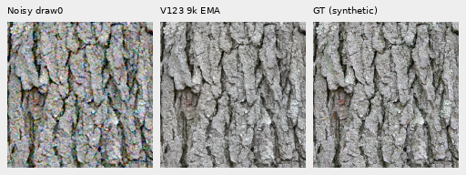
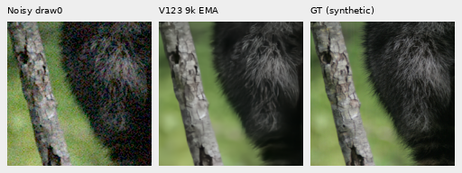
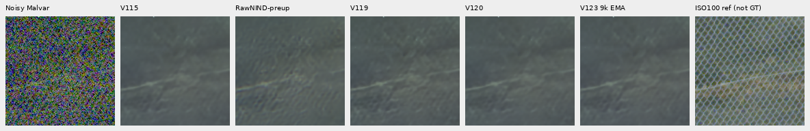

# V123 at 9,000 updates: material and GFX quality

**This midpoint shows no clear fine-detail recovery over V120.** Larger bark
and scene edges remain coherent; weak fur, grass, foliage and fine green mesh
remain attenuated. The original V123 run continues toward20,000 updates.
Full427 photo, camera, color and complete-frame results remain pending.
V120 Small remains the current general recommendation.

[Execution and measurements](results/v123-mid9000-quality-pilot-v1.json) ·
[Native images, source/ROI/display metadata and credits](images/v123-mid9000-v1/manifest.json) ·
[Per-CFA scores](results/v123-mid9000-material-metrics.csv) ·
[Publication verification](results/v123-mid9000-publication-verification-v1.json) ·
[Architecture, recipe and original endpoint review](learned-raw-frequency-training.md).

## Material measurements

Four retained256px targets use all four Bayer patterns and the previously stored
**draw0 only**, with shot`.00256`, read`2.62144e−5`,16-bit ADC/black`.03`.
There are16 new V123 predictions and32 reused V120/V117 controls. Scores use the
central native160px ROI`[48,48,160,160]`, shared WB/matrix and display exposure×1.
Values average four per-CFA PSNRs, not four sources.

| Target | V120 sRGB PSNR | V1239k sRGB PSNR | Change |
| --- | ---: | ---: | ---: |
| Bark, exact synthetic GT | 30.029878 | 30.023991 | −.005887dB |
| Raccoon fur, exact synthetic GT | 33.975223 | 33.968555 | −.006668dB |
| GFX50S II grass, binned reference estimate | 31.434981 | 31.434030 | −.000951dB |
| Leica SL wood rail, binned reference estimate | 33.776971 | 33.777454 | +.000483dB |

The camera references are **not exact noiseless GT**. One draw per CFA cannot
separate conditional bias from noise variation. V123/V120 have different data
and training histories; this is a candidate comparison, not an isolated adapter
ablation or a whole-corpus quality estimate.

The previously examined DCT16 strata give the following reference-projected
gain and band error. Gain1 matches the reference projection; increasing gain
alone does not establish recovery.

| Target / reference contrast | Blocks | Gain V120→V1239k | Band error RMS V120→V1239k |
| --- | ---: | ---: | ---: |
| Bark ≥20% | 96 | .96960→.96722 | .0182223→.0182216 |
| Fur <2% | 7 | .32484→.33346 | .00380475→.00381749 |
| Grass 2–5% | 3 | .69148→.68478 | .00575641→.00574538 |
| Wood rail 2–5% | 9 | .65732→.64927 | .00221148→.00221574 |

Fur's small gain increase accompanies higher error and orthogonal residual
RMS`.00228444→.00235570`. Grass has slightly lower error alongside lower gain.
All occupied strata and V117 controls are in the receipt. These few weak blocks
do not support a broad detail-improvement claim.

Two native100% triplets: noisy draw0 → V1239k EMA → exact retained synthetic GT.
Each panel is160×160 pixels without resizing or warping. The matched
[bark](images/v123-mid9000-v1/bark-comparison.png) and
[fur](images/v123-mid9000-v1/raccoon-fur-comparison.png) boards add V120/V117.

Bark: Derek Ramsey (Ram-Man),
[Kentucky Coffee-tree](https://commons.wikimedia.org/wiki/File:Kentucky_Coffee-tree_Gymnocladus_dioicus_3264px.jpg),
[CC BY-SA2.5](https://creativecommons.org/licenses/by-sa/2.5/).
Fur: Korall,
[Racoon clinging to a tree](https://commons.wikimedia.org/wiki/File:Racoon_clinging_to_a_tree.JPG),
[CC BY3.0](https://creativecommons.org/licenses/by/3.0/).
These are binned/cropped, camera-transformed and synthetically noised derivatives;
the manifest binds source IDs and original supervision. CC0 raw.pixls.us
captures5002/1951 supply the native
[grass](images/v123-mid9000-v1/pixls-5002-fine-comparison.png) and
[wood](images/v123-mid9000-v1/pixls-1951-field-comparison.png) reference estimates.

## Main GFX scene

Four new512px contexts reuse the original nominal-profile V120/V121 inputs and
predictions. Columns: noisy → V120 → V121 → V1239k → independent DSCF3880
ISO100 AHD reference, **not GT**. Each cell is native160px, with shared WB/matrix
and +2EV display (×4). Shot`.00128`/read`6.5536e−6` is the disclosed nominal
prior, distinct from the fixed-Haar full-frame profile in the
[main gallery](gfx-qualitative.md).

All four regions were actually viewed, including
[sky](images/v123-mid9000-v1/main-overcast-sky-comparison.png) and
[building](images/v123-mid9000-v1/main-building-detail-comparison.png).
Sky is quiet and larger fence/building geometry coherent; fine foliage remains
painterly. Newer-model changes are small. These are context results, not new
full-frame outputs; aperture/time/moving-subject differences preclude ISO100 scoring.

## Extra fine green mesh: DSCF3842 / DSCF3835

The corrected ISO100 capture is **DSCF3835**,46 seconds before DSCF3842 ISO6400.
DSCF3879/3880 remains the main scene. Both extra160px regions were viewed under
both fixed profiles using two new768px context predictions and saved controls.
Display +4EV (×16), WB/matrix and coordinates are shared across methods.

The nominal prior largely erases the lattice. Right-region columns: noisy →
V115 → RawNIND pre-upsampled → V119 → V120 → V1239k → independent DSCF3835
ISO100 AHD reference, **not GT**:

The fixed nearby-DSCF3879 profile (shot`.0014635775921166604`,
read`1.0715704128646712e−6`) reveals more diagonal texture; V1239k still does
not clearly recover the lattice. Columns: noisy → V115 → V119 → V120 → V1239k
→ independent ISO100 reference. The blue point remains.

[Left nominal](images/v123-mid9000-v1/mesh-nominal-fine-green-mesh-left-comparison.png) ·
[Left nearby profile](images/v123-mid9000-v1/mesh-profile3879-fine-green-mesh-left-comparison.png) ·
[Native right triplet](images/v123-mid9000-v1/mesh-profile3879-fine-green-mesh-right-triplet.png) ·
[Camera JPEGs, coordinates and profile limits](gfx-green-mesh.md).
The independent aperture/exposure/time references are not GT or scoring targets.
Both profiles were fixed before viewing the new model outputs.

## Checkpoint and verification

Source9k checkpoint SHA256:
`7e7abbc890ffa875be5cd0cd99ab72f1bf0f4e7cf66070378fc936e7a29493b9`.
Inference-only EMA copy SHA256:
`53e5e450cac7d98748a2cfb96d45aa1afed15d37efb8e22267c36a78ad06da78`.
All32,907,974 EMA values across96 tensors exactly match the preserved source.
The original full training budget, parent and queue plans are unchanged.

The frozen-source collector performed exactly22 root/encoder forwards in IEEE
FP32 CUDA/B1 without ensemble or warmup:16 materials,4 main GFX and2 mesh
contexts. It reused47 saved controls, generated no noise, decoded no RAW and
performed no optimizer work. All five actual input fingerprints match;
full-model hash`402042ecb5ad696a9c2614fb72e1aa844ec2656aa5e32fbab1fc5c29d8de6cdf`
and official DINOv3 Small identity are unchanged before/after inference.
Peak CUDA allocation9,356,137,472 bytes stayed within the12GiB cap; this is
an observed resource bound, not a speed benchmark.

An independent NumPy64 audit recomputed all48 material score rows and DCT strata
using a mirrored FFT and channelwise color transform. All636 scalar fields
pass: maximum gain discrepancy`2.998e−15`, identical PSNRs. All7,833,600 crop
channel values across24 PNGs match their retained sources at native coordinates;
twelve comparison boards were actually viewed. V122's completed endpoint is
not reevaluated early; final-model review follows V123 completion.
