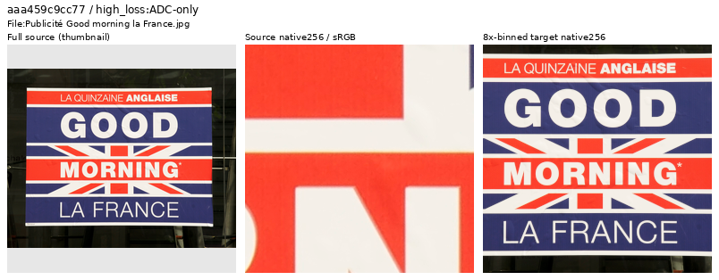
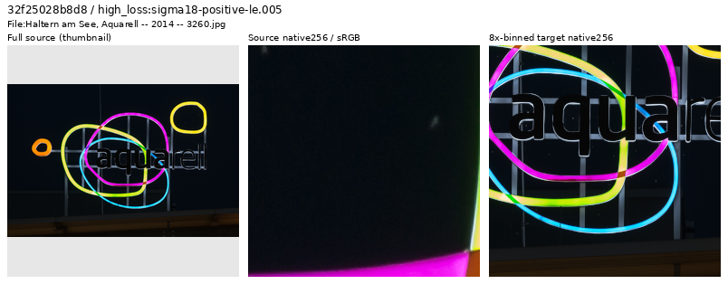
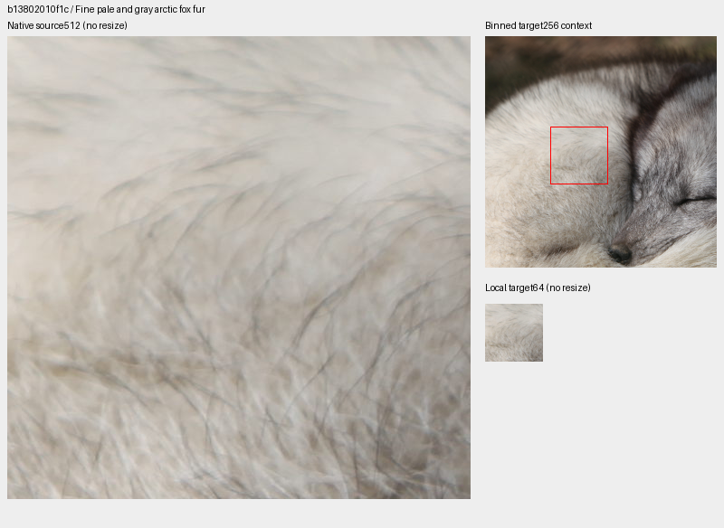
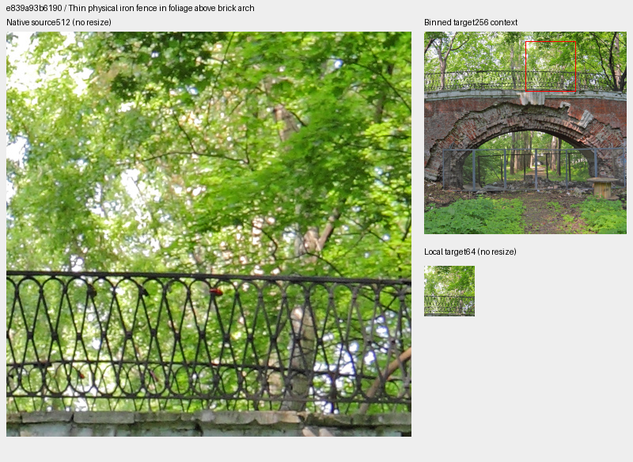
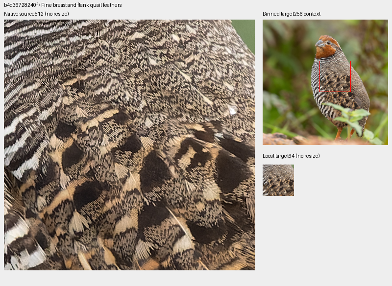
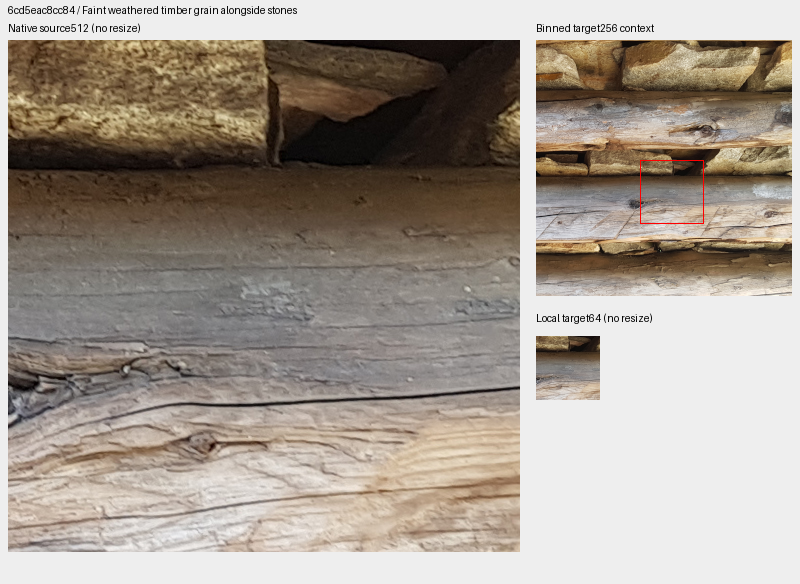

# Clean-target review through V123 update15,800

**Thirty-nine newly inspected sources are retained; one poster-dominated source
is withheld from a separate future cohort.** Four inspected physical-detail
regions extend the future bank from23 to27. The prepared cohort contains
90,782 training photos, with validation/test rows unchanged. Existing V123,
V124/V125 and V128 inputs remain fixed; no trained-quality gain is established.

[All40 decisions and credits](results/v123-source-loss-through15800-decisions-v1.csv)
· [Independent verification and actual reader evidence](results/v123-source-loss-through15800-review-v1.json)
· [Image/source/ROI metadata](images/v123-source-loss-through15800-v1/manifest.json)
· [Future27-region catalogue](../configs/low-contrast-training-rois-cleaned90782-v1.json).

## Loss-nominated sources, followed by actual inspection

The original and resumed V123 traces contribute disjoint, byte-verified prefixes
through15,800:1,248 diagnostic draws,896 photographic draws from847 IDs.
Removing204 draws already covered by the1,759-ID review ledger leaves692
eligible draws from690 IDs. Eight distinct sources per noise stratum and eight
remaining high-gradient cases receive actual native inspection.

| Stratum | Eligible draws / IDs | Newly inspected |
| --- | ---: | ---: |
| ADC-only | 71 /71 | 8 |
| Positive sigma18 ≤.005 | 267 /266 | 8 |
| .005 < sigma18 ≤.02 | 308 /308 | 8 |
| sigma18 >.02 | 46 /46 | 8 |
| Highest remaining gradient errors | Same eligible pool | 8 |

Sigma18 is`sqrt(.18×shot+read)`. Evolving weights, noise, exposure and camera
transforms confound these losses; they nominate inspection, not automatic source
labels. Source review does not regenerate scored augmentation or noise.
Actually viewed: seven sheets,40 thumbnails,80 native256 source/target cells,
five native1024 follow-ups and four native source512/local-target64 boards.
The deduplicated review ledger now has1,799 IDs.

## Graphic dominance and physical photographed detail

The advertising poster below dominates its source frame and traced target.
It is withheld from the future photographic quota as graphic-dominated content.
This does not assert that the photograph is fake or optically poor; original
files stay intact. The other39 decisions remain separate from this exclusion.

[Jebulon](https://commons.wikimedia.org/wiki/File:Publicit%C3%A9_Good_morning_la_France.jpg),
[CC0](https://creativecommons.org/publicdomain/zero/1.0/).

The title “Aquarell” could have suggested a painting, but actual native inspection
shows a physical illuminated sign: luminous tubes, metal lettering, reflections
and supports. It is retained. Text/art/HDR titles alone are not exclusion rules.

[Dietmar Rabich](https://commons.wikimedia.org/wiki/File:Haltern_am_See,_Aquarell_--_2014_--_3260.jpg),
[CC BY-SA4.0](https://creativecommons.org/licenses/by-sa/4.0/).

These strips show resized whole-source thumbnail → native256 original →
native256 area8 target. Only the thumbnail resizes pixels. They are data-quality
views, without restoration outputs or an exact noiseless-GT claim.
Authors/licenses/source pages are recorded in the linked image manifest and CSV;
published derivatives are cropped, binned and display-converted.

Some retained native originals show grain, softness or coarse processing-like
texture. Larger views of the mountain and cast-metal object were inspected
against their binned targets. Their physical geometry remains coherent;
microtexture/noise origin and processing history are not certified. This is
targeted curation rather than a whole-corpus cleanliness guarantee.

## Four additional physical-detail contexts

The four aligned512×512 bin4 regions yield native256 area8 targets. Each board
shows native source512 on the left, target256 at top right, and an unchanged
local64 target below. The red box only annotates the larger target context.

[Rama](https://commons.wikimedia.org/wiki/File:Alopex_lagopus_IMG_9019.JPG),
[CC BY-SA2.0 France](https://creativecommons.org/licenses/by-sa/2.0/fr/deed.en).

[A.Savin](https://commons.wikimedia.org/wiki/File:Moscow_05-2012_Lustgarten_02.jpg),
[CC BY-SA3.0](https://creativecommons.org/licenses/by-sa/3.0/).

[Tisha Mukherjee](https://commons.wikimedia.org/wiki/File:Jungle_Bush-Quail_in_Mahabaleshwar_August_2025_by_Tisha_Mukherjee_18.jpg),
[CC BY-SA4.0](https://creativecommons.org/licenses/by-sa/4.0/).

[Mænsard vokser](https://commons.wikimedia.org/wiki/File:Tetto_in_legno_e_pietra_alla_Colma_di_Fuori_-_Val_Vigezzo_Toceno_VCO,_Piedmont,_Italy_2020-09-12.jpg),
[CC BY-SA4.0](https://creativecommons.org/licenses/by-sa/4.0/).
All views are cropped/binned/display-converted derivatives.

The bank adds mixed-contrast physical detail rather than labeling every selected
pixel weak. In the sixteen local DCT16 blocks per annotation, the fox has8 blocks
at2–5% relative band contrast and none below2%. Quail and fence each have0 below5%,
with15/14 respectively at≥20%; timber has0 below5%,4 at5–10%,8 at10–20% and4 at≥20%.
The annulus is1/8–1/3 cycles/pixel in linear source-sRGB. These finite annotations
do not describe whole-target, augmented training or corpus distributions.

## Future-only preparation and checks

The new manifest removes exactly the one reviewed training ID from the previous
90,783-source cohort; every remaining manifest line retains its original bytes
and order. Counts are90,782 train /2,303 validation /2,255 test. All23 preceding
ROI example objects remain exact and all27 region sources are active training
members. Private GFX captures/JPEGs/siblings stay outside training.

The actual `CleanDataset` reader visits all27 regions using seed70, native256,
zero optical blur and the current.5 reviewed-region quota. Its reader-only
23-region control is rebound to the same future manifest. Forcing identical
region identity/index gives23 exact common targets; four ordinary and four
procedural controls also match, totaling6,094,848 FP32 values across66 actual
clean reads. This does not claim that different-size banks select the same
random region IDs. Python/NumPy/Torch RNG remains unchanged, CUDA stays
uninitialized, and a neural-call guard records zero module calls.

Independent heap ranking reproduces all40 nominations. All7,864,320 native-source,
30,294,720 sheet,15,728,640 large-view and3,145,728 local-source channels match
exactly. Of7,864,320 independently binned target channels,35 differ by one DN8
under FP64 versus FP32 display rounding. All49,152 local-target channels agree
within one DN8; all four saved target arrays match independent area reduction.
Curation and reader work generate no noise, RAW decode or optimizer update.

The retained cache root is
`.cache/current-quality-20261023-v1/V123-source-loss-through15800-review-v1/`.
[V129 now tests this prepared cohort](reviewed-detail-training-pilot.md), with
learned quality unmeasured. Earlier experiment recipes and frozen receipts remain
unchanged. The catalogue retains its original preparation-status text because
the V129 plan binds those bytes; actual pilot status is documented separately.
