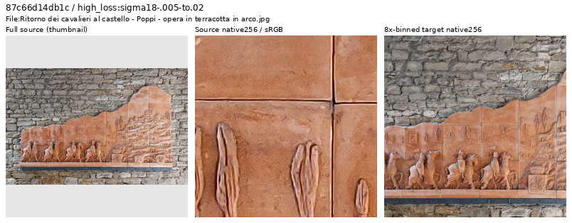
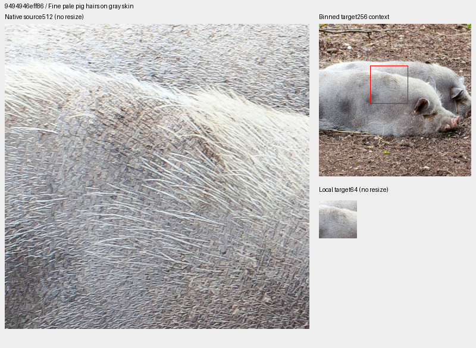
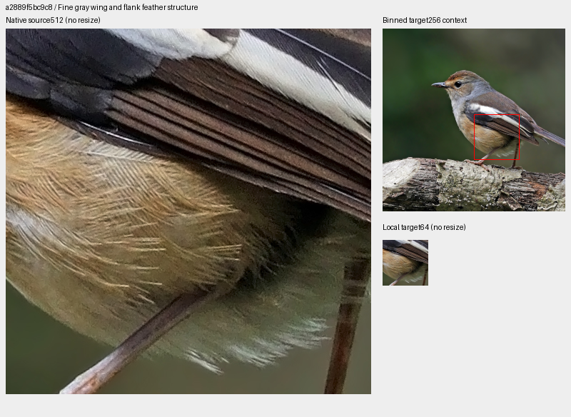
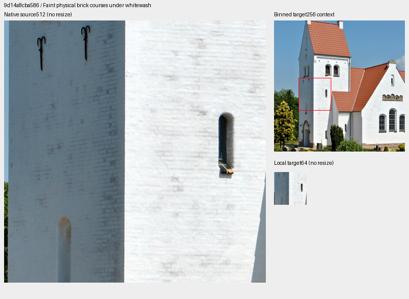

# V123 high-loss source review through update9,800

**Forty newly inspected source IDs remain eligible; three physical-detail
contexts extend a separate future bank from20 to23 regions.** This pass finds no
source requiring exclusion in the inspected views. It does not prove noiseless
targets, absence of processing, whole-corpus cleanliness or a trained quality gain.
V120 remains the current general recommendation; original training/review
jobs and queued V124/V125 inputs are unchanged.

[All40 decisions and source credits](results/v123-source-loss-through9800-decisions-v1.csv) ·
[Frozen trace, actual inspection and independent verification](results/v123-source-loss-through9800-review-v1.json) ·
[Publication checks](results/v123-source-loss-through9800-publication-v1.json) ·
[Published native-image metadata](images/v123-source-loss-through9800-v1/manifest.json).

## Nomination and actual inspection

The frozen V123 prefix through update9,800 contains752 diagnostic draws,
including546 photographic draws from517 IDs. Skipping95 draws covered by the
earlier1,679-ID ledger leaves451 draws from450 eligible IDs. Eight distinct
sources are selected per noise group, then eight remaining sources with the
largest gradient error. Repeated IDs are counted separately from diagnostic
draws and are inspected once.

| Noise group | Eligible draws / IDs | Selected distinct sources |
| --- | ---: | ---: |
| ADC-only, shot/read both zero | 49 / 49 | 8 |
| Positive sigma18 ≤.005 | 177 / 177 | 8 |
| .005 < sigma18 ≤.02 | 195 / 195 | 8 |
| sigma18 >.02 | 30 / 30 | 8 |
| Highest remaining gradient error | Same eligible pool | 8 |

Sigma18 means`sqrt(.18×shot+read)`. Scores reflect changing training weights,
noise, exposure and camera transforms; they nominate inspection rather than
rank endpoint image quality. All seven sheets were viewed:40 source thumbnails
and80 native256 source/area8-target cells. Four native1024 views check pale pig
hair, distant railway focus, chandelier geometry and rock/lichen texture.

The pig hairs follow the physical surface and remain coherent after binning.
The railway's distant signal and vegetation are soft while nearer rails/snow
retain structure. Sculpture, terracotta, engraved metal, printed fabric and
physical signs remain photographs; an artwork/HDR title is not an exclusion rule.
Some sources have visible grain, softness or edge processing, but these inspected
binned targets retain usable photographic content. All originals remain intact.

Anna.Massini,
[terracotta relief in Poppi](https://commons.wikimedia.org/wiki/File:Ritorno_dei_cavalieri_al_castello_-_Poppi_-_opera_in_terracotta_in_arco.jpg),
[CC BY4.0](https://creativecommons.org/licenses/by/4.0/).
[Distant-focus railway](images/v123-source-loss-through9800-v1/retained-depth-soft-railway.png):
[mattbuck, Bingham station](https://commons.wikimedia.org/wiki/File:Bingham_railway_station_MMB_04.jpg),
[CC BY-SA3.0](https://creativecommons.org/licenses/by-sa/3.0/).
[Machinery example](images/v123-source-loss-through9800-v1/retained-HDR-machinery.png):
[Diego Delso, Walchensee hydroelectric station](https://commons.wikimedia.org/wiki/File:Central_hidroel%C3%A9ctrica_de_Walchensee,_Kochel,_Baviera,_Alemania,_2014-03-22,_DD_16-18_HDR.jpg),
[CC BY-SA3.0](https://creativecommons.org/licenses/by-sa/3.0/).

## Three future material contexts

The new [23-region catalogue](../configs/low-contrast-training-rois-cleaned90783-v2.json)
preserves all20 previous example objects exactly and uses the same unchanged
90,783-source manifest. Added512px bin4 contexts are even-aligned, reviewed and
bound to exact source/crop/area8-target hashes:

| Physical detail | Source ID prefix | Bin4 xywh |
| --- | --- | --- |
| Pale animal hair over gray skin | `9494946eff86` | [304,6,512,512] |
| Gray wing/flank feathers | `a2889f5bc9c8` | [220,30,512,512] |
| Faint brick courses under whitewash | `9d14a8cba586` | [22,98,512,512] |

Each board shows a native512 source field, a native256 binned context with an
ROI annotation, and an unaltered local64 target. Source and target cells are
not resized. Display exposure×1; ICC-to-sRGB conversion applies where present.
These are mixed-contrast contexts with real fine structure, **not uniformly
low-relative-contrast targets**. Strong feather/skin edges and building corners
coexist with finer surface variations. The cabinet candidate was retained as
an ordinary source; its mixed/strong pattern was not added to this bank.

[Diego Delso, Turopolje pig](https://commons.wikimedia.org/wiki/File:Cerdo_Turopolje,_Tierpark_Hellabrunn,_M%C3%BAnich,_Alemania,_2012-06-17,_DD_02.JPG),
[CC BY-SA3.0](https://creativecommons.org/licenses/by-sa/3.0/).

[Charles J. Sharp, Madagascar magpie-robin](https://commons.wikimedia.org/wiki/File:Madagascar_magpie-robin_(Copsychus_albospecularis_pica)_female.jpg),
[CC BY-SA4.0](https://creativecommons.org/licenses/by-sa/4.0/).

[Saethwr, Lonne church](https://commons.wikimedia.org/wiki/File:Lonne_kirke,_south_face.jpg),
[CC BY-SA3.0](https://creativecommons.org/licenses/by-sa/3.0/).
All published examples are cropped/binned/display-converted derivatives.
Only the full-source thumbnails in the source-review strips resize.

## Reader and independent checks

The actual frozen reader validates and samples all23 regions. It makes59 clean
reads with no model/encoder call, sensor-noise draw, RAW decode or optimizer work;
CUDA remains uninitialized and global Python/NumPy/Torch RNG states unchanged.
All20 common regions match the previous bank exactly when source-region identity
and draw index are held fixed, as do four ordinary and four procedural controls:
**5,505,024 FP32 target values**. Expanding the bank intentionally changes which
region some sampler indices select; this check does not claim unchanged selections.

Independent selection replay reproduces all40 nominations. Original JPEG SHA1
and cache SHA256 checks pass. All7,864,320 native-source256 channel values match;
23 of7,864,320 target-preview values differ by one DN8 at FP32/FP64 rounding,
with all others exact. Four source1024 views match12,582,912 values exactly.
Across seven local-field boards,5,505,024 source512 values and86,016 local-target64
values match exactly. Six published PNGs are byte-identical to the viewed files.

No source is removed, so the90,783/2,303/2,255 train/validation/test membership
and literal manifest bytes remain unchanged. The deduplication ledger now has
1,719 inspected IDs; it is not an exclusion list or uniform corpus audit.
The23-region option is **untrained**. Active V122/V123 keep90,786/fourteen;
queued V124/V125 keep90,784/twenty. The
[shadow-preparation proof](reviewed-shadow-exposure.md) remains bound to its
original twenty-region bank; this addition verifies clean-reader readiness.
