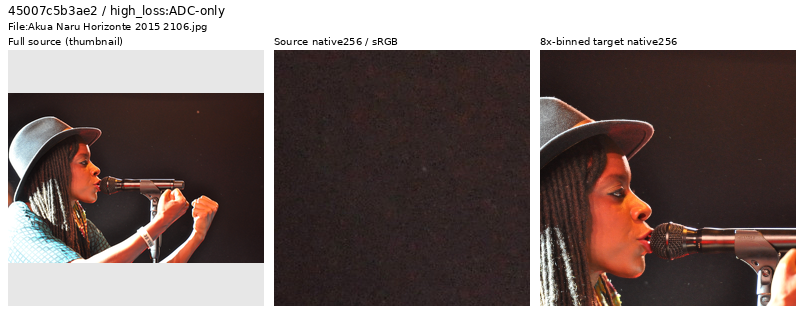
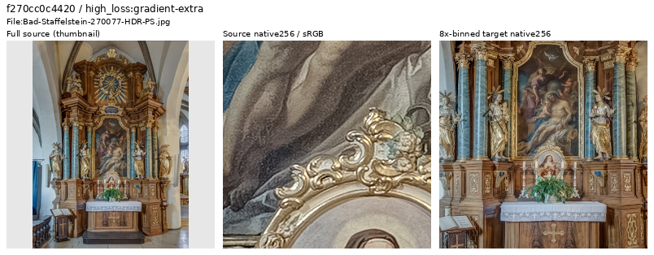
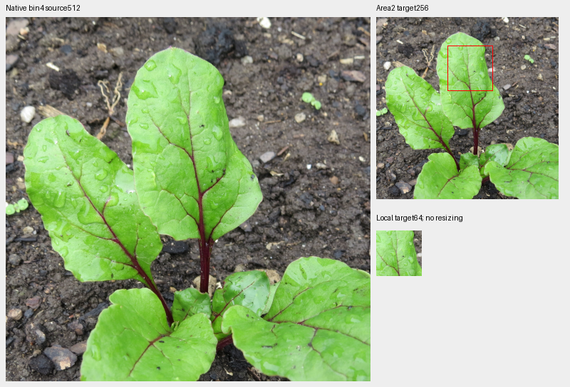
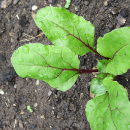

# V124: final high-loss source review

**Forty new sources were inspected: 38 retained, two withheld from future
clean-target training, and one mixed-contrast leaf region added.** The prepared
future dataset now contains90,776 photos/35 reviewed regions. The deduplicated
inspection ledger has1,963 IDs. Existing experiments retain their frozen data;
the new cohort has no measured model-quality result.

[All decisions and credits](results/v124-final-source-decisions-v1.csv) ·
[Descriptive contrast counts](results/v124-final-source-contrast-v1.csv) ·
[Selection, pixels and reader evidence](results/v124-final-source-review-v1.json) ·
[Native image metadata](images/v124-final-source-review-v1/manifest.json) ·
[35-region catalogue](../configs/low-contrast-training-rois-cleaned90776-v1.json).

## Inspection support

V124's original20k training is complete. Its final diagnostic trace has1,344
draws from84 traced Commons batches; the last traced batch is19,800. This is
sparse first-noise-view tracing, not all training examples. The new
11,200<step≤20,000 window contains452 photographic draws. Deduplication against
1,923 inspected IDs and the current future cohort leaves385 draws/383 IDs.
Eight distinct highest-loss sources per noise group plus eight remaining
highest-gradient sources nominate40 inspections. Changing weights, exposure,
noise and camera transforms confound these scores; they nominate viewing,
without automatically classifying source quality or replaying scored geometry.

| Eligible noise group | Draws / IDs | Inspected |
| --- | ---: | ---: |
| ADC-only |38 /38 |8 |
| Positive sigma18≤.005 |161 /161 |8 |
| .005<sigma18≤.02 |162 /161 |8 |
| sigma18>.02 |24 /24 |8 |
| Remaining highest gradient loss | Same pool |8 |

Sigma18 is`sqrt(.18×shot+read)`. Actual viewing covers seven sheets with40
whole-source thumbnails and80 native256 source/target cells, sixteen native1024
follow-ups, five full native-bin4 views and four native512/target256/local64
proposal boards. A saved actual-reader native256 draw was also viewed. Native
crop pixels are never resized; only labeled whole-source thumbnails resize.

## Future exclusions

[Rs-foto](https://commons.wikimedia.org/wiki/File:Akua_Naru_Horizonte_2015_2106.jpg),
[CC BY-SA3.0](https://creativecommons.org/licenses/by-sa/3.0/).
The original shows strong chroma grain across skin, hat and dark stage; fine
mottling remains visible in the binned background. It is withheld as a future
clean-target source. It remains a genuine performance photograph, with original
and cache preserved. Strip: resized whole source → native256 JPEG/ICC source →
native256 area8 target.

[Ermell](https://commons.wikimedia.org/wiki/File:Bad-Staffelstein-270077-HDR-PS.jpg),
[CC BY-SA4.0](https://creativecommons.org/licenses/by-sa/4.0/). Same strip layout.
Large flat paintings dominate the scored context, with strongly outlined,
processed-looking surfaces. The source is withheld from the future generic
photographic quota; it is not labeled fake or CGI, and its filename alone was
not the decision rule.

Physical sculptures, carved architecture, botanical specimens, natural bokeh,
water speculars and saturated flowers remain ordinary photography. Native grain,
soft distant foliage and uncertain processing are recorded for retained images
without a pristine fine-detail guarantee. High loss alone does not remove them.

## Leaf detail and declined specialized annotations

[GT1976](https://commons.wikimedia.org/wiki/File:2018-06-01_%28130%29_Leaves_of_Beta_vulgaris_%28beetroot%29_at_Bichlh%C3%A4usl_in_Frankenfels,_Austria.jpg),
[CC BY-SA4.0](https://creativecommons.org/licenses/by-sa/4.0/).
Pale veins and droplets remain coherent after binning. This is a mixed-contrast
context with stronger red veins, leaf boundaries and soil. Its bin4 ROI is
`[200,40,512,512]`; the local annotation is`[100,40,64,64]` in the area2 target.
The board shows native source512, target256 and local64 at+0EV. Red lines only
mark the annotation. Source/target boards are not restored-model comparisons
or a claim of exact noiseless GT. EXIF/ICC, cropping and binning modifications
are disclosed in the manifest.

| Fixed proposal | Local64 blocks below5% / eligible | Whole256 below5% / eligible | Specialized region |
| --- | ---: | ---: | --- |
| Ostrich down |0 /16 |87 /256 | Not admitted |
| Fibres beside spider |1 /16 |46 /256 | Not admitted |
| Leaf veins |4 /16 |12 /256 | Admitted as mixed contrast |
| Rock grain/fractures |0 /16 |6 /250 | Not admitted |

Counts use linear-sRGB Rec709 luminance, DCT16 radial frequencies1/8–1/3
cycles/pixel, fine-band RMS divided by block mean, and eligibility mean.02–.9
with RMS≥1e−5. They are descriptive, without an automatic admission threshold.
The [down](images/v124-final-source-review-v1/down-not-admitted.png),
[fibres](images/v124-final-source-review-v1/fibres-not-admitted.png) and
[rock](images/v124-final-source-review-v1/rock-not-admitted.png) show coherent
physical fine structure but predominantly stronger local contrast. Quiet or
soft background blocks do not qualify a fine-detail annotation. These three
sources remain ordinary photos; all credits are in the manifest/decision CSV.

Same GT1976 credit/license. The saved new-region draw is index796/seed866,
native256 after geometry and final area2, before camera/Bayer/noise. This draw
was **not contrast-attenuated** and has12/256 eligible fine-band blocks below5%.
The configured25% attenuation policy is unchanged. One draw does not establish
training-wide weak-detail coverage.

## Verification and use

Independent heap ranking reproduces all40 nominations. Source/cache hashes,
native cells, sheets, full-bin4 images and original1024 crops verify. UINT32
area2 and FP64 display check8,696,880 target channels;29 differ from the primary
FP32 display by exactly1 DN8. Original1024 views match50,331,648 channels exactly.
Mirrored-FFT DCT independently checks1,344 source/augmented blocks with maximum
statistic error7.78e−16.

The actual clean reader visits all35 regions over85 reads and matches8,257,536
common FP32 values exactly across34 fixed-identity regions and four ordinary/
four procedural controls. The parent catalogue is rebound to the same future
manifest only for this reader control. Source exclusions and bank expansion
can intentionally change selected identities; this is not a claim that every
old sampler index is unchanged. Global RNG remains unchanged, CUDA stays
uninitialized, and neural/noise/RAW/optimizer calls are zero.

The future manifest removes exactly two train rows from90,778, preserving every
remaining line's bytes/order, all34 preceding region objects and validation/test
at2,303/2,255. V134/V135 retain90,778/33 and V138 retains90,782/27. Existing order
headers and recipes are not substituted. Both GFX pairs, camera JPEGs and
siblings remain held out. The [current source guide](current-source-loss-review.md)
tracks prepared data; the [local-time diary](../diary/2026-10-27-16-35-35-v124-final-source-curation.md)
records this revision. Restoration quality under these data changes is unmeasured.
