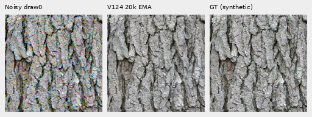
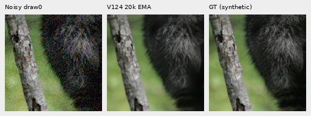
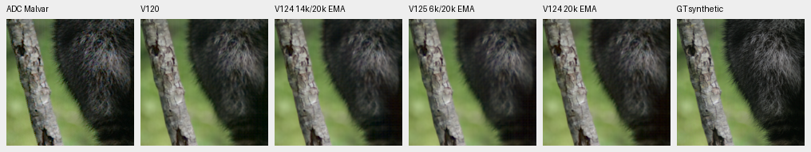
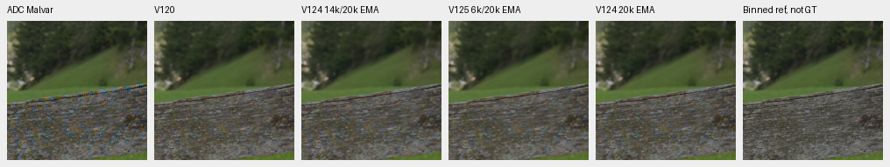
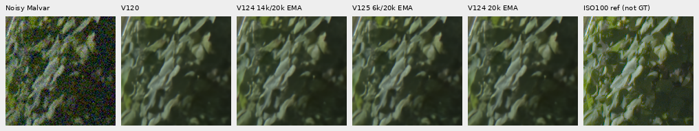
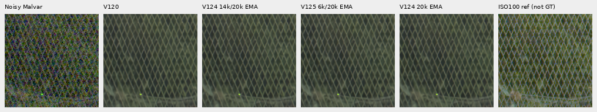
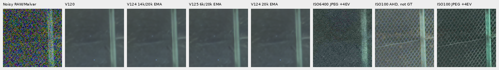
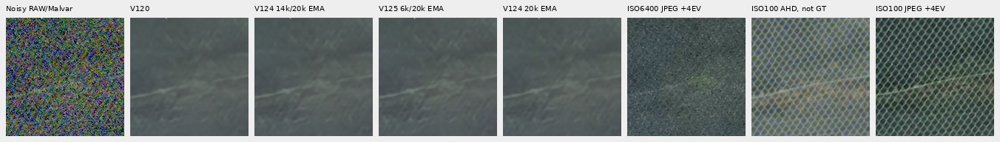

# V12420k: late faint-detail recovery, limited ordinary gain

**The completed V12420k control gains 0.0095 dB ordinary PSNR over V120 on the
four retained contexts, while its faint-ADC mean remains 0.0856 dB lower.**
Faint PSNR recovers 0.411 dB from the saved14k control and spatial error approaches
V120. Native changes are small; foliage stays painterly and the difficult green
mesh has no clear new recovery. V120 remains the general choice on the broader
measured balance of quality.

This is a **completed training checkpoint with a limited native diagnostic**.
The original full photographic/camera/color/full-frame and matched V125 endpoint
reviews remain queued. CPU/CUDA differences limit interpretation of tiny deltas;
V1256k's unequal budget does not supply a matched mean-loss comparison.

[Execution and score evidence](results/v124-final20000-native-v1.json) ·
[All local metrics](results/v124-final20000-native-metrics-v1.csv) ·
[Native image/source/ROI/noise/display metadata](images/v124-final20000-native-v1/manifest-v1.json) ·
[Original training](conditional-mean-training.md) ·
[Earlier14k study](v124-progress14000.md) ·
[V1256k progress](v125-progress6000-quality.md).

## Checkpoint and fixed comparison

V124 uses V120's Small architecture and frozen official DINOv3 encoder. It
continues from the same V12020k EMA on90,784 photos/20 reviewed regions, seed67,
with two independent sensor observations per simulated target and the existing
per-view reconstruction loss. Mean-loss weight is zero. Training retains zero
optical PSF, geometry before final area reduction and the original20k horizon.
The newer prepared dataset remains separate.

Original endpoint SHA256:
`d562ae2fc4e9bf903501a3db1f2192b93e465a48f150eec6de5f232d510f0cc6`.
All91 model/EMA tensors and89 Adam states belong to20,000 updates, with
131,618,917 finite saved values. The original worker has exited successfully.
All59 actual trained source modules match the V125 implementation.

Exactly14 new CPU IEEE-FP32 root/encoder forwards reuse42 V120/V12414k/V1256k
predictions. The inputs, targets, ROIs, conditioning and display fields match
the earlier declarations exactly. Peak RSS is2.71GB; CUDA stays uninitialized
and weights/backbone/RNG remain unchanged. No old-model inference, new noise,
RAW decoding, optimizer updates or original job/budget changes occur.

Support is four ordinary/four faint material contexts at **RGGB draw0 only**,
four main-GFX512 contexts and both extra-mesh768 profiles. The original14k
study's tables elsewhere average four CFAs; the values here are its RGGB subset.
V12414k and some V120 controls use CUDA, versus the new CPU path. Tiny deltas
have limited interpretation. V1256k uses the same CPU implementation but a
different training budget and objective; this does not isolate mean-loss effects.

| Four-context sRGB PSNR mean | V120 | V12414k | V1256k | V12420k |20k−V120 |20k−14k |
| --- | ---: | ---: | ---: | ---: | ---: | ---: |
| Ordinary |32.305381 |32.314511 |32.305190 |32.314886 |+0.009506 |+0.000375 |
| Faint ADC |67.505224 |67.008812 |66.496567 |67.419647 |−0.085578 |+0.410835 |

These are finite context means, not a new full427-photo or real-camera score.

## Native100% exact-GT triplets

Noisy → V12420k → exact simulated GT. Native160×160 crops use
ROI[48,48,160,160] inside256px contexts, without resizing. Ordinary RGGB draw0
uses shot0.00256/read variance0.0000262144, ADC16/black0.03, WB[2,1,1.5], the
recorded camera matrix and display exposure×1. GT is exact for this simulation;
the processed/binned photograph is not certified physically noiseless.

Sources: [Derek Ramsey, Kentucky Coffee-tree](https://commons.wikimedia.org/wiki/File:Kentucky_Coffee-tree_Gymnocladus_dioicus_3264px.jpg),
[CC BY-SA2.5](https://creativecommons.org/licenses/by-sa/2.5/), and
[Korall, Racoon clinging to a tree](https://commons.wikimedia.org/wiki/File:Racoon_clinging_to_a_tree.JPG),
[CC BY3.0](https://creativecommons.org/licenses/by/3.0/). Modified by binning,
crop, simulated noise, restoration and display conversion. Other references
retain per-file credits in the image metadata. Bark relief and larger hair clumps
remain coherent; finer material stays softer than the targets.

## Faint response and spatial error

Below: ADC noisy/Malvar → V120 → V12414k → V1256k → V12420k → reference.
The fixed40× camera-linear contrast display uses original target channel means.
Target contrast is0.025, with zero shot/read and the existing16-bit ADC. Every
cell retains native160 pixels; binned-camera references remain labeled non-GT.

Aggregate faint-target fine-band gain uses99–100 eligible blocks per context:

| Context | V120 | V12414k | V1256k | V12420k |
| --- | ---: | ---: | ---: | ---: |
| Bark |0.988807 |0.990970 |0.996510 |0.990511 |
| Fur |0.956566 |0.941139 |0.937340 |0.947066 |
| Grass |1.007498 |1.001361 |0.978198 |1.001807 |
| Wood |0.986733 |0.969965 |0.954084 |0.975844 |

Band errors fall from14k in all four contexts. Bark error becomes slightly lower
than V120; fur/grass/wood errors remain higher. Fur and wood response improves
from14k but stays below V120. Gain alone does not establish better reconstruction.

Mean faint sRGB total/spatial MSE falls9.11%/11.11% from14k, while DC MSE rises
31.62%. Against V120, total/spatial/DC MSE is0.68%/0.39%/4.78% higher. The spatial
component is nearly back to V120 on this support. PSNR means and MSE means are
different reductions. Fixed original-source contrast masks yield60 method/stratum
rows; masks are not chosen from attenuated inputs or restored outputs.
[Bands](results/v124-final20000-native-bands-v1.csv) ·
[Source strata](results/v124-final20000-native-faint-strata-v1.csv) ·
[DC/spatial decomposition](results/v124-final20000-native-faint-decomposition-v1.csv).

Statistics use linear-sRGB Rec709 luminance and orthonormal16 DCT-II in
1/8≤radial frequency<1/3 cycles/pixel. Reference eligibility requires in-gamut
RGB, mean0.02–0.9 and band RMS≥1e−5. These selected contexts do not establish
training-wide detail preservation or a broad two-view quality effect.

## Real GFX comparisons

Main scene: noisy → V120 → V12414k → V1256k → V12420k → independent DSCF3880
ISO100 reference, **not GT**. Native160 cells share512px contexts,+2EV/×4,
WB/matrix and nominal shot0.00128/read variance6.5536e−6. Foliage remains
painterly, fence diamonds coherent, building edges soft and sky quiet. No clear
large fine-detail gain appears.

Extra mesh: noisy → V120 → V12414k → V1256k → V12420k → DSCF3842 ISO6400 JPEG
→ corrected DSCF3835 ISO100/AHD → ISO100 JPEG. Native160 cells share768px
contexts and +4EV/×16. Both JPEGs receive the same fixed inverse-sRGB/×16/sRGB
display transform, without fitting.

The nominal profile uses shot/read0.00128/6.5536e−6. The fixed nearby3879 profile
uses0.0014635775921166604/1.0715704128646712e−6. These are supplied priors,
without new calibration or an output-selected strength sweep. Nominal restoration
largely erases the mesh; nearby conditioning retains weak diagonals without clear
new20k recovery. Both profiles and both regions were actually viewed.

ISO100 differs in aperture, shutter and moving subjects; camera JPEGs retain
independent tone/WB/sharpening. These are qualitative comparators, without real
PSNR or exact-GT claims. Both GFX pairs, JPEGs and siblings remain outside training;
originals are read-only and cached media are reused.
[Main gallery](gfx-qualitative.md) · [Mesh gallery](gfx-green-mesh.md).

## Verification and remaining work

All38 boards were viewed through ten pixel-exact sheets. Independent FFT/display
checks584 metric fields,32 rows and11,059,200 native RGB channels in32 primary
PNGs. Faint analysis checks60 strata,32 decompositions and1,843,200 channels;
the two JPEG boards check1,228,800 channels against a scalar256-entry LUT.
No new monitor inference or primary-history point is added.

The [saved monitor plot](v125-progress6000-quality.md#saved-monitor-plot-and-limits)
already includes V124's original20k trajectory, with separate monitoring support
and limitations. This new native result does not replace the full endpoint suite.
The original matched V124/V125 reviews and V12520k training continue with their
original inputs, owners, budgets and deadlines. Finish those comparisons before
making broad photographic/camera/color/full-frame or causal mean-loss claims.
