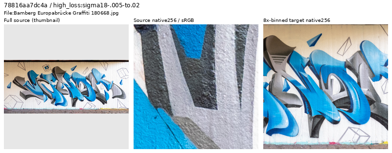
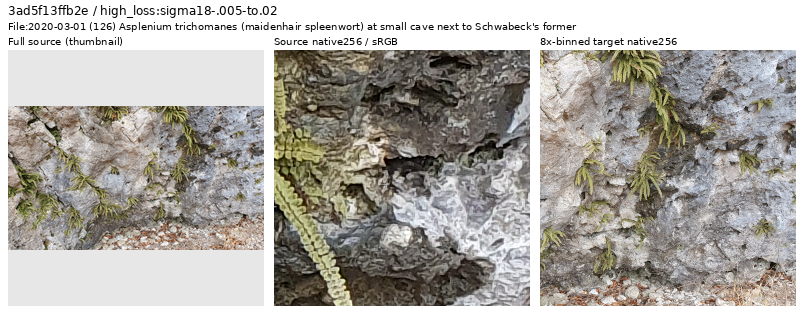
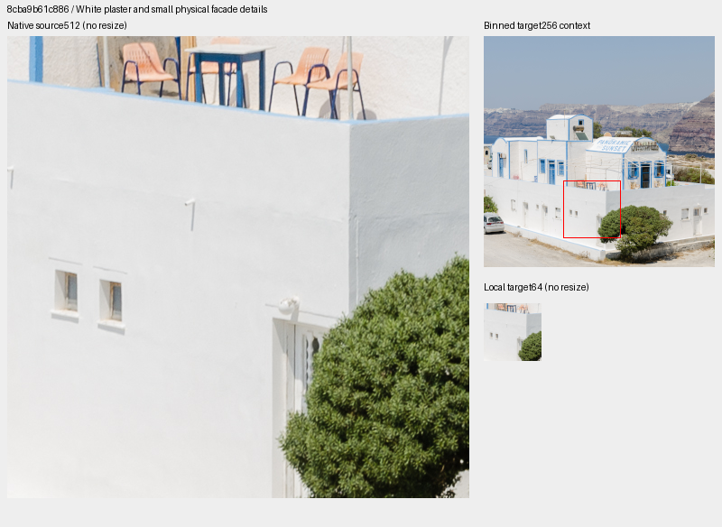
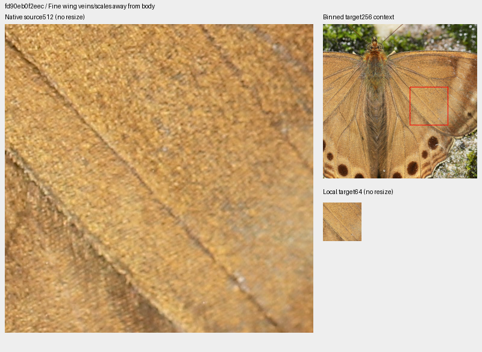
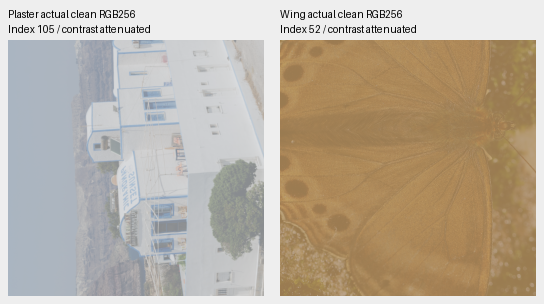

# V124: source review through5,600 updates

**Forty new photographic sources have been inspected:39 retained and one mural-
dominated frame withheld from a separate future dataset.** The future set has
90,780 training photos and31 reviewed regions, adding subtle plaster/facade
detail and moderate butterfly wing detail. The review ledger now contains1,879
unique inspected IDs. Current V124/V125 and queued V131/V132 inputs stay fixed;
this preparation has no measured model-quality result.

[All40 decisions and credits](results/v124-first-source-decisions-v1.csv) ·
[Trace, independent pixel audit and actual reader evidence](results/v124-first-source-review-v1.json) ·
[Image/source/ROI metadata](images/v124-first-source-review-v1/manifest.json) ·
[Future31-region catalogue](../configs/low-contrast-training-rois-cleaned90780-v1.json).

## Losses nominate inspection

The immutable prefix through5,600 contains368 draws from23 traced Commons
batches:271 photographic draws from266 IDs. Removing the prior1,839-ID review
ledger leaves203 draws from202 new IDs. Eight distinct highest-loss sources per
noise group and eight remaining high-gradient sources give40 nominations.
Losses depend on evolving weights, noise, exposure and camera transforms; they
do not classify source quality. Only the first noise view is traced. No scored
augmentation/noise observation is replayed.

| Eligible noise group | Draws / IDs | Inspected |
| --- | ---: | ---: |
| ADC-only |28 /28 |8 |
| Positive sigma18≤.005 |80 /80 |8 |
| .005<sigma18≤.02 |78 /77 |8 |
| sigma18>.02 |17 /17 |8 |
| Remaining highest gradient loss | Same eligible pool |8 |

Sigma18 is`sqrt(.18×shot+read)`. Actual viewing covers seven sheets,40 source
thumbnails,80 native256 source/area8-target cells, eight native1024 follow-ups
and11 distinct source512/local64 proposal boards. Two additional rendered files
reuse identical already-viewed pixels. This is targeted inspection, not a uniform
corpus audit or a claim that every retained photo is pristine.

## Graphic dominance and native uncertainty

The excluded frame is genuine photography of painted graffiti on a textured
wall. The flat painted motifs dominate both frame and traced context. It is
withheld only from the future generic photographic quota; it is not labeled
fake/CGI, and originals/caches remain untouched. Sculptures, signs within wider
scenes and vehicle paint remain ordinary photographic data.

[Ermell](https://commons.wikimedia.org/wiki/File:Bamberg_Europabr%C3%BCcke_Graffiti_180668.jpg),
[CC BY-SA4.0](https://creativecommons.org/licenses/by-sa/4.0).
Strip: whole-source thumbnail → unchanged native256 original-source crop →
unchanged native256 area8 target. Only the thumbnail resizes pixels.

The fern/rock photo has crunchy native contours of uncertain processing or
resampling origin. Native1024 and a separate native256 target inspection still
show coherent binned fern/rock structure. It is retained as ordinary data, without
adding a pristine fine-texture annotation. Distant forest softness, natural
background bokeh, soft feather regions and native sky/night grain are likewise
recorded explicitly rather than turned into automatic whole-photo exclusions.

[GT1976](https://commons.wikimedia.org/wiki/File:2020-03-01_(126)_Asplenium_trichomanes_(maidenhair_spleenwort)_at_small_cave_next_to_Schwabeck's_former_castle,_Texingtal,_Austria.jpg),
[CC BY-SA4.0](https://creativecommons.org/licenses/by-sa/4.0). Same native strip layout.

## Two selected regions

The pale plaster context supplies subtle surface variation and small physical
facade details. Its local64 contains five of16 blocks below2% relative fine-band
contrast and six below5%, alongside stronger window/foliage edges. The butterfly
wing is moderate fine-pattern diversity: one block below5% and twelve at5–10%.
Neither whole context is uniformly weak.

[Norbert Nagel](https://commons.wikimedia.org/wiki/File:Restaurant_at_the_crater_rim_near_Akrotiri_-_Santorini_-_Greece_-_02.jpg),
[CC BY-SA3.0](https://creativecommons.org/licenses/by-sa/3.0).

[Thamblyok](https://commons.wikimedia.org/wiki/File:Open_wing_basking_position_of_Lethe_ramadeva_(de_Nic%C3%A9ville,_1887)_-_Single_Silverstripe_WLB_IMG_8096.jpg),
[CC BY-SA4.0](https://creativecommons.org/licenses/by-sa/4.0).
Both boards: native source512 at left, area8 target256 at upper right, native
local64 below. Red rectangles annotate the context; source/local pixels are
unchanged. Images are modified by EXIF orientation, ICC-to-sRGB when present,
cropping and binning, with original licenses retained.

| Selected local64 |0–2% |2–5% |5–10% |10–20% |≥20% |
| --- | ---: | ---: | ---: | ---: | ---: |
| Plaster/facade |5 |1 |4 |4 |2 |
| Wing veins/scales |0 |1 |12 |3 |0 |

These are descriptive source-linear-sRGB luminance DCT16 annulus statistics,
1/8–1/3 cycles/pixel. Other inspected metal, slate, petal, pale relief, leaf and
feather annotations remain ordinary photos; they offer stronger edges or less
convincing focused weak detail. Initial body/cleft and alternate-wing proposals
remain preserved. Contrast counts alone do not determine admission.

The real reader also exercises the existing photographic contrast attenuation
on these two selected draws, with geometry before final area2 and zero optical
PSFs. In the saved256×256 targets, plaster has90/256 valid fine-band blocks below
2% and169 below5%; wing has48/256 below2% and223 below5%. All256 blocks pass the
mean.02–.9 and fine-band RMS≥1e−5 filter. These are two particular draws, not training-wide
or corpus coverage estimates; no camera, Bayer or noise simulation is added.

Same Norbert Nagel/Thamblyok sources and licenses above. Common unit-exposure
sRGB display of source-linear RGB; no resizing. [Exact indices, target hashes,
display and contrast definitions](images/v124-first-source-review-v1/actual-reader-display-manifest-v1.json).

## Verification and use

Independent heap ranking reproduces all40 nominations. Original native crops,
sheets, eight large follow-ups and all13 rendered field files are checked against
source pixels. UINT32 binning/FP64 display agrees within1DN8; only22 of7,864,320
target channels differ by that amount from the FP32 display. Mirrored-FFT DCT
reproduces144 local contrast blocks. Actual clean-reader use visits all31 regions
over76 reads, matching7,274,496 common FP32 values across29 fixed-identity regions
and four ordinary/four procedural controls. Global RNG is unchanged; CUDA stays
uninitialized and there are zero neural/noise/RAW/optimizer calls.

The future manifest removes exactly one training row, preserves every remaining
line's bytes/order and keeps validation/test at2,303/2,255. All29 preceding region
objects remain exact. Model/queue source bindings and current V120 selection
remain unchanged. Both GFX pairs and siblings stay outside training. The new
90780/31 data are prepared for future quality work, not substituted into an
existing controlled trial.
