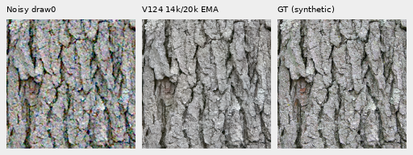
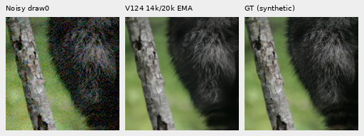
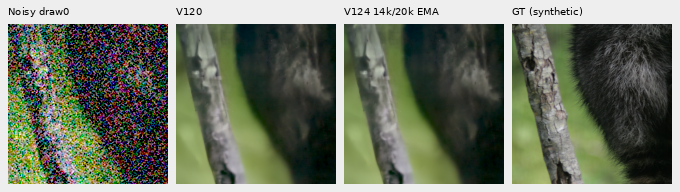
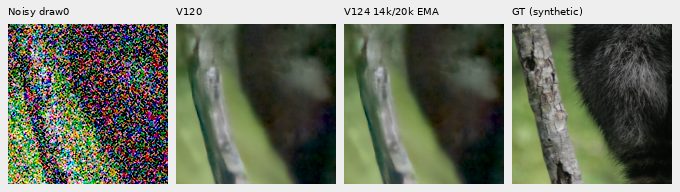
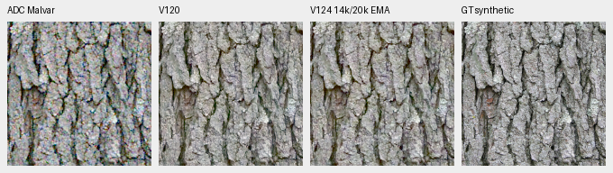
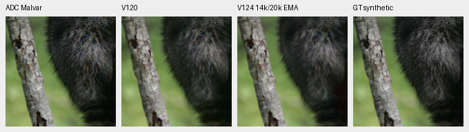
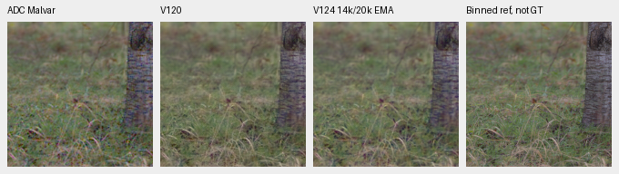
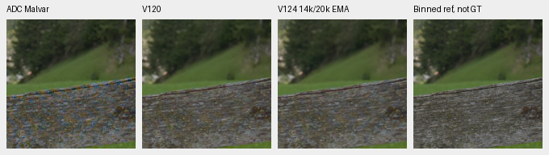

# V124 at 14,000 updates: small score gains, weak detail still missing

**V124's two-view control shows small noisy/shadow PSNR gains over V120, with
worse faint-ADC scores and no clear large recovery of fine photographic detail.**
This is the retained 14k checkpoint within its original 20k training run.
V125's conditional-mean loss is still pending. V120 Small remains the general
recommendation on the measured balance of quality.

[Measurements and execution receipt](results/v124-progress14000-v1.json) ·
[Per-CFA scores](results/v124-progress14000-metrics-v1.csv) ·
[All detail bands](results/v124-progress14000-bands-v1.csv) ·
[Native image/source/ROI/noise/display metadata](images/v124-progress14000-v1/manifest.json) ·
[Publication verification](results/v124-progress14000-publication-v1.json) ·
[Original training and endpoint review](conditional-mean-training.md).

## What was measured

One regular progress checkpoint was claimed before quality inference, without
choosing among checkpoints by their outputs. Its SHA256 is
`4f71adcbd536b0b87b0ec2d39eb35eb4a782c74e26ac5cee112add6ee06a1b14`.
All 91 model/EMA tensors and 89 Adam states belong to step14,000 of20,000.
Inference uses the original trained model source, V120's Small architecture and
the pinned official DINOv3 encoder. A legacy absent spatial-feature config field
is interpreted as false; no model branch is added.

Exactly **102 new root/DINO forwards** used existing distinct five-tensor
inputs:64 shadow-material,16 ordinary high-noise material,16 faint-ADC,
four main GFX512px contexts and two extra-mesh768px profile contexts.
All V120 predictions were reused. IEEE FP32, batch1, channels-last model
inference used9,339,516,928 peak allocated CUDA bytes under a12GiB cap.
Loaded weights, backbone and RNG stayed unchanged. There was no new noise,
reference inference, RAW decoding or optimizer update for this review.

The material support comprises just **four source contexts**: bark, raccoon
fur, grass and wood. Each condition uses all four Bayer patterns, one retained
observation per CFA. These are neither64 independent photographs nor a new
427-source benchmark. The processed Commons targets are exact synthetic GT;
the binned native-camera grass/wood references are **approximate, not GT**.
This compares a partially trained candidate with its parent, rather than
isolating the effect of two-view training or a particular data change.

## Scores and local detail

Values are equal means of16 per-observation sRGB PSNRs, measured in the central
native160×160 ROI of each256px context. Shadows receive the declared8×/32×
exposure compensation **before scoring**, shared with their displays; ordinary
and faint cases use1×. The40× diagnostic below changes only the display.

| Condition | V120 | V12414k | Change, dB |
| --- | ---: | ---: | ---: |
| Ordinary ISO12800 prior |32.304263 |32.312171 |+.007907 |
| Target gain1/8, ISO6400 prior |28.561316 |28.570715 |+.009398 |
| Target gain1/8, ISO12800 prior |26.777249 |26.788682 |+.011433 |
| Target gain1/32, ISO6400 prior |25.008258 |25.029228 |+.020970 |
| Target gain1/32, ISO12800 prior |23.261062 |23.294457 |+.033395 |
| Faint contrast0.025, ADC only |67.480668 |67.130761 |−.349907 |

Ordinary high-noise conditioning is shot`.00256`, read`2.62144e−5`,16-bit ADC,
black`.03`, draw0. Shadow ISO6400 uses shot`.00128`, read`6.5536e−6`;
ISO12800 uses the ordinary profile. Input geometry, noise observations,
WB/matrix, ROI and display transforms match V120 exactly.

The established DCT16 fine band covers1/8≤radial frequency<1/3 cycle/pixel in
linear-sRGB luminance. Eligible reference blocks use in-gamut RGB, mean.02–.9
and band RMS≥1e−5. The following ordinary noisy strata show why a small PSNR
gain is insufficient evidence of detail recovery. Counts are physical16px
blocks repeated across CFAs, not independent photographs.

| Original region / band contrast | Blocks | Projected gain V120→V124 | Band error RMS V120→V124 |
| --- | ---: | ---: | ---: |
| Fur,0–2% |7 |.324842→.320260 |.00380475→.00380358 |
| Fur,2–5% |5 |.594593→.587170 |.00497084→.00496335 |
| Grass,2–5% |3 |.691481→.685656 |.00575641→.00571507 |
| Wood,2–5% |9 |.657325→.656055 |.00221148→.00221719 |

Gain1 matches the reference projection; gain alone does not establish accuracy.
Fur/grass errors decrease slightly while their projected detail response falls;
wood's response and error both worsen. One observation per CFA cannot separate
conditional bias from noise variation. The queued trained conditional-response
comparison will use repeated independent observations for that purpose.

## Native material crops

Noisy draw0 → V12414k EMA → exact processed synthetic GT. RGGB,
ROI`[48,48,160,160]`,+0EV, common WB/matrix/sRGB; each cell is160×160 pixels,
without resizing. Bark's larger structure stays coherent; fine fur remains
softer than the target.

Parent comparisons: [bark](images/v124-progress14000-v1/bark-comparison.png),
[fur](images/v124-progress14000-v1/raccoon-fur-comparison.png),
[grass](images/v124-progress14000-v1/pixls-5002-fine-comparison.png) and
[wood](images/v124-progress14000-v1/pixls-1951-field-comparison.png).
Columns are noisy → V120 → V12414k → GT or accurately labeled binned reference.

Shadow fur at gain1/32, displayed/scored at+5EV; ISO6400 then ISO12800:

Differences are subtle and fine hairs remain attenuated. The less severe
gain1/8 crops use+3EV:
[ISO6400](images/v124-progress14000-v1/raccoon-fur-gain1over8-iso6400-prior-comparison.png) ·
[ISO12800](images/v124-progress14000-v1/raccoon-fur-gain1over8-iso12800-prior-comparison.png).

Bark: Derek Ramsey (Ram-Man),
[Kentucky Coffee-tree](https://commons.wikimedia.org/wiki/File:Kentucky_Coffee-tree_Gymnocladus_dioicus_3264px.jpg),
[CC BY-SA2.5](https://creativecommons.org/licenses/by-sa/2.5/).
Fur: Korall, [Racoon clinging to a tree](https://commons.wikimedia.org/wiki/File:Racoon_clinging_to_a_tree.JPG),
[CC BY3.0](https://creativecommons.org/licenses/by/3.0/).
These derivatives use binning, cropping, camera transforms, sensor simulation
and restoration. The raw.pixls.us5002/1951 camera references are CC0.
The manifest binds source IDs, target hashes and original supervision indices.

## Faint ADC detail

The retained operator scales each camera channel's whole256px deviations by
.025 around its original spatial mean, without spatial interpolation.
Shot=read=0, ADC16 and black.03 remain fixed. These are deliberately faint
processed targets, not newly captured exposures; their high PSNRs are not
comparable to the full photo benchmark.

| Source | sRGB PSNR V120→V12414k |
| --- | ---: |
| Bark, exact processed GT |65.425934→65.074597 |
| Fur, exact processed GT |70.640781→70.138388 |
| Grass, approximate binned reference |66.543675→66.155351 |
| Wood, approximate binned reference |67.312283→67.154706 |

All transformed eligible blocks fall below2% band contrast. The
[original-source masks](faint-adc-precision.md#results-and-original-source-detail),
defined in the earlier precision study, distinguish previously weak detail
from detail made faint by this operator. This explanatory analysis was added
after observing the primary result; it introduces no new model calls or inputs.

| Original region | Blocks | Gain V120→V12414k | Relative band error V120→V12414k |
| --- | ---: | ---: | ---: |
| Fur,0–2% |7 |.851840→.811982 |.286240→.313537 |
| Fur,2–5% |5 |.833865→.802871 |.311091→.337091 |
| Grass,2–5% |3 |.965485→.954767 |.248960→.230688 |
| Wood,2–5% |9 |.880826→.870111 |.182871→.200207 |

Fur/wood response and error worsen; grass has lower gain alongside lower error.
[All original-source strata](results/v124-progress14000-faint-strata-v1.csv).
The sRGB error decomposition also shows that the regression is mostly spatial:
mean MSE increases1.951714e−7→2.108438e−7, while the centered spatial part
increases1.849838e−7→2.027520e−7. Per-channel ROI-mean error accounts for
5.22%/3.84% of pooled total MSE, respectively. This descriptive decomposition
does not fit or apply a restoration correction.
[Camera/sRGB decompositions](results/v124-progress14000-faint-decomposition-v1.csv).

Normal faint [bark](images/v124-progress14000-v1/bark-contrast0p025-adc-comparison.png)
and [fur](images/v124-progress14000-v1/raccoon-fur-contrast0p025-adc-comparison.png)
look almost identical in8-bit display. The following **display-only40× contrast**
uses `original camera DC +40×(value−DC)` for every method before the same
WB/matrix/sRGB,+0EV. A common original-target DC is used, with no fitted model
offset. It approximately restores original contrast and amplifies every error.
Scores above use the unamplified faint targets.

Columns: ADC Malvar → V120 → V12414k → exact processed GT or binned reference.
All cells remain native160 pixels:

## Main GFX and corrected extra mesh pair

DSCF3879 ISO6400 remains paired with DSCF3880 ISO100 f/5.6 for the main test.
Columns: noisy → V120 → V12414k → independent ISO100/AHD reference, **not GT**.
Native160px cells share512px contexts,+2EV and nominal
shot`.00128`/read`6.5536e−6`. This is distinct from the fixed-Haar full-frame
profile in the [main gallery](gfx-qualitative.md).

Foliage stays soft; larger fence/building geometry remains coherent and sky
quiet, with no clear large recovery. All four contexts were viewed, including
[sky](images/v124-progress14000-v1/main-overcast-sky-comparison.png) and
[building](images/v124-progress14000-v1/main-building-detail-comparison.png).
These context outputs are not a new complete-frame evaluation.

The extra mesh uses **DSCF3842 ISO6400 / corrected DSCF3835 ISO100 f/5.6**,
taken46 seconds apart. The main pair remains in use. Native160px cells share
768px contexts and+4EV. Columns again are noisy → V120 → V12414k → independent
ISO100/AHD reference, **not GT**. Both camera JPEGs remain available in the
[standing mesh comparison](gfx-green-mesh.md).

The nominal profile largely erases the lattice. The fixed nearby3879 profile
uses shot`.0014635775921166604`/read`1.0715704128646712e−6` and leaves weak,
irregular diagonal texture in both models, without clear correct lattice
recovery. The left blue point persists. No conditioning sweep or reference
fitting occurred. Different aperture, exposure time and moving subjects prevent
pixelwise ISO100 scoring. Both real pairs, JPEGs and siblings remain held out.

## Verification and remaining scope

Independent NumPy mirrored-FFT scoring checked192 metric rows,48 summaries and
2,850 fields, with maximum PSNR error1.43e−14dB. All64 primary PNGs contain
17,203,200 independently exact panel channels. The supplemental independent
audit checks120 original-stratum rows,64 error decompositions and1,228,800
exact channels across four enhanced PNGs. No neural/noise/RAW work was repeated.

Actual native viewing covered all32 primary comparison boards, two exact-GT
triplets and all four enhanced boards. Other primary triplets are pixel-audited
subsets of those viewed comparison boards, without a claim of separate viewing.
The public selection copies26 original PNGs byte for byte.

The original V12420k training and subsequent V125 comparison retain their data,
parent, schedule, budgets and endpoint queues. Full427 photo, camera, color,
complete GFX and repeated-noise endpoint results remain pending. This partial,
different-support review adds no primary PSNR-history point and does not justify
a default change. It records the measured tradeoff now, without waiting for a
study-specific promotion gate.
