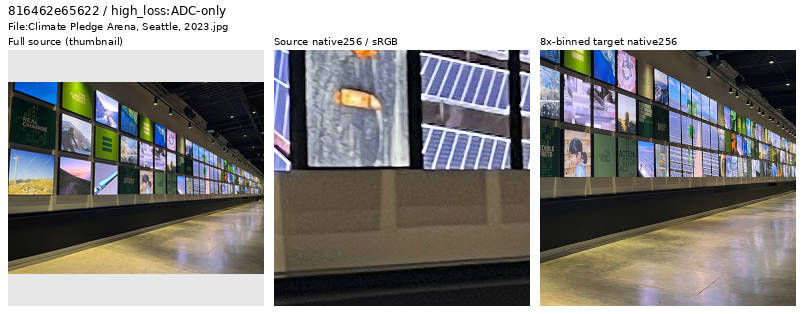
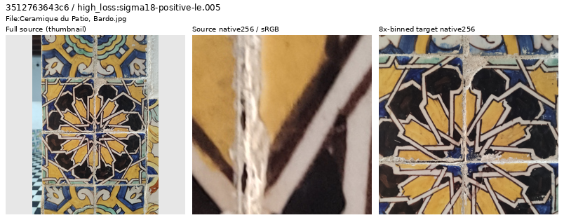
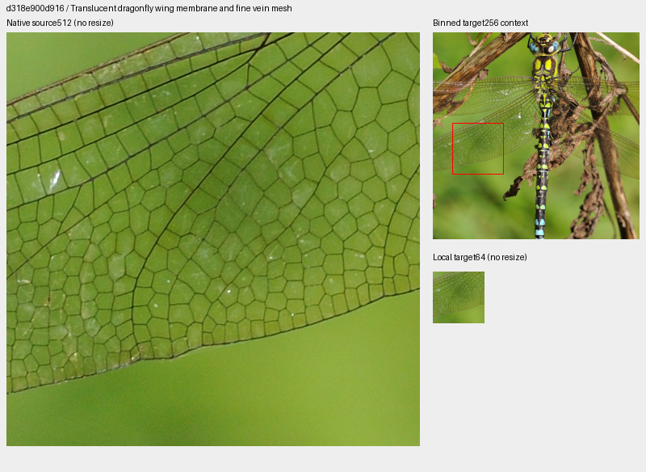
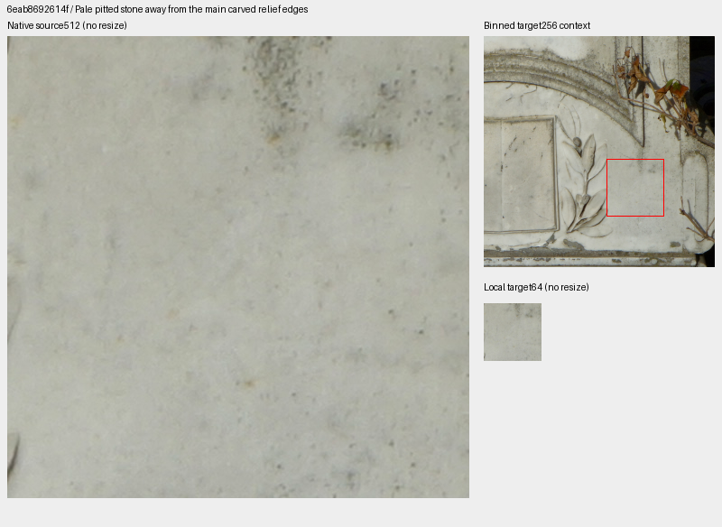
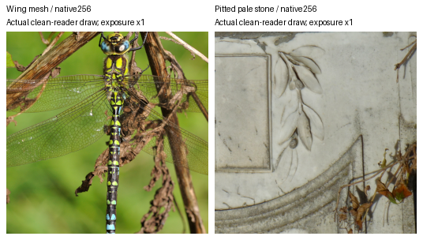

# V124: source review from 5,600 to 11,200 updates

**Forty new sources have been inspected: 38 retained and two display/artwork-heavy
frames withheld from a separate future dataset.** Two admitted contexts add fine
dragonfly-wing mesh and pale pitted stone. The prepared set now contains **90,778
training photos and 33 reviewed regions**, with 1,919 unique inspected source IDs
in the ledger. Existing training and queued comparisons keep their frozen inputs.
The prepared data have no measured model-quality result.

[All 40 decisions and credits](results/v124-second-source-decisions-v1.csv) ·
[Selection, pixel audit and reader evidence](results/v124-second-source-review-v1.json) ·
[Exact image/source/ROI metadata](images/v124-second-source-review-v1/manifest.json) ·
[33-region catalogue](../configs/low-contrast-training-rois-cleaned90778-v1.json).

## Inspection support

The immutable trace prefix through the requested 11,200-step boundary contains
704 draws from 44 traced Commons batches; its last traced batch is at 11,100.
Only the first noise view is traced. Selecting **5,600 < step ≤ 11,200** gives
247 photographic draws. Deduplication against the preceding 1,879 reviewed IDs
leaves 218 draws from 217 eligible sources. Eight distinct highest-loss sources
per noise group, plus eight remaining highest-gradient sources, nominate 40.
Evolving weights, exposure, noise and camera transforms confound these scores;
they nominate inspection rather than classify source quality. Scored geometry
and noise are not replayed.

| Eligible noise group | Draws / IDs | Inspected |
| --- | ---: | ---: |
| ADC-only | 18 / 18 | 8 |
| Positive sigma18 ≤ .005 | 77 / 77 | 8 |
| .005 < sigma18 ≤ .02 | 102 / 101 | 8 |
| sigma18 > .02 | 21 / 21 | 8 |
| Remaining highest gradient loss | Same eligible pool | 8 |

Sigma18 is `sqrt(.18 × shot + read)`. Actual viewing covers seven sheets,
40 thumbnails, 80 native256 source/area8-target cells, ten native1024 follow-ups
and six native source512/local-target64 proposal boards. Native cells keep their
original pixel sizes. Only whole-source thumbnails resize pixels.

## Future exclusions and retained uncertainty

The arena frame centers on emissive reproduced images and text, with physical
floor/framing still visible. The tile close-up centers on flat decorative motifs,
although glaze, grout and cracks are real material features. Both are genuine
photographs. Their display/artwork dominance motivates withholding them from the
future generic photographic quota; neither is labeled fake or CGI. Originals
and caches remain intact.

[Another Believer](https://commons.wikimedia.org/wiki/File:Climate_Pledge_Arena,_Seattle,_2023.jpg),
[CC BY-SA 4.0](https://creativecommons.org/licenses/by-sa/4.0).
Strip: whole-source thumbnail → native256 source → native256 area8 target.

[Reda Kerbush](https://commons.wikimedia.org/wiki/File:Ceramique_du_Patio,_Bardo.jpg),
[CC BY-SA 4.0](https://creativecommons.org/licenses/by-sa/4.0). Same strip layout.

Photographed sculptures, a fossil and a three-dimensional scale-model car remain
ordinary photography, as do real action photos with panning blur and portraits
with bokeh. Distant landscape softness, native grain and strongly outlined
fountain texture of uncertain processing origin are recorded explicitly; those
sources receive no pristine fine-detail annotation. High loss alone does not
justify deleting them.

## Admitted mesh and subtle stone detail

[Quartl](https://commons.wikimedia.org/wiki/File:Aeshna_cyanea_qtl6.jpg),
[CC BY-SA 3.0](https://creativecommons.org/licenses/by-sa/3.0).
Thin physical wing veins survive binning over translucent membranes. This is
mixed-contrast mesh support; stronger body/branch edges remain elsewhere.

[Neoclassicism Enthusiast](https://commons.wikimedia.org/wiki/File:Grave_of_the_Hagi-Panteli_Family_in_the_Bellu_Cemetery_in_Bucharest,_Romania_%2807%29.jpg),
[CC0](https://creativecommons.org/publicdomain/zero/1.0/).
The revised annotation avoids main relief edges and retains irregular pits and
surface variation. The earlier relief-edge proposal remains in the evidence.

Both boards show native source512 at left, area8 target256 at upper right and
native local64 below. Red rectangles annotate context. EXIF orientation, ICC
conversion where present, cropping and binning are disclosed modifications.

| Local64 fine-band contrast | 0–2% | 2–5% | 5–10% | 10–20% | ≥20% |
| --- | ---: | ---: | ---: | ---: | ---: |
| Wing membrane/vein mesh | 2 | 2 | 9 | 3 | 0 |
| Revised pale pitted stone | 2 | 12 | 2 | 0 | 0 |

These source-linear-sRGB luminance measurements use 16px DCT blocks and a
1/8–1/3 cycles/pixel annulus; fine-band RMS is divided by block mean. All 16 blocks
in each annotation pass mean .02–.9 and RMS ≥ 1e−5. The reader samples the full
512px bin4 context, not just the local64. Neither whole context is uniformly weak.
Butterfly, grass and dark fountain proposals remain ordinary photos, with
stronger contrast or less convincing pristine fine detail.

Same Quartl/Neoclassicism Enthusiast credits and licenses above. These saved
reader draws use indices 121 and 324, after geometry and final area2, before
camera/Bayer/noise. Both use unit-exposure sRGB display without resizing. Neither
draw applied photographic contrast attenuation; the configured 25% policy stays
unchanged. Of 256 valid blocks, 57 wing-context and 82 stone-context blocks fall
below 5%. These particular draws do not measure training-wide or corpus-wide
weak-detail coverage. [Target hashes, traces and exact contrast values](images/v124-second-source-review-v1/actual-reader-display-manifest-v1.json).

## Verification and use

Independent heap ranking reproduces all 40 nominations. Source/cache hashes,
native cells, sheets, ten large views and six proposal boards are checked.
UINT32 binning/FP64 display agrees within 1 DN8: 33 of 7,864,320 target channels
differ by that amount from the FP32 rendering. Mirrored-FFT DCT independently
reproduces 96 local annotation blocks and 512 saved-reader blocks.

Actual `CleanDataset` sampling visits all 33 regions over 80 reads, matching
7,667,712 common FP32 values across 31 preceding regions forced to identical
identity/index and four ordinary/four procedural controls. Global RNG stays
unchanged, CUDA remains uninitialized, and neural/noise/RAW/optimizer calls are
zero. The future manifest removes exactly two training rows, preserves every
remaining line's bytes/order and all 31 preceding region objects, and keeps
validation/test at 2,303/2,255. Existing jobs retain their declared inputs.

The [current source guide](current-source-loss-review.md) records the prepared
snapshot; the [local-time diary](../diary/2026-10-27-10-50-28-v124-second-source-curation.md)
preserves the earlier guide and operational history. Both GFX pairs, their
camera JPEGs and siblings remain held out.
