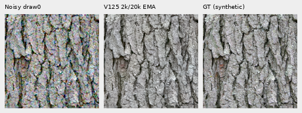
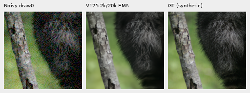
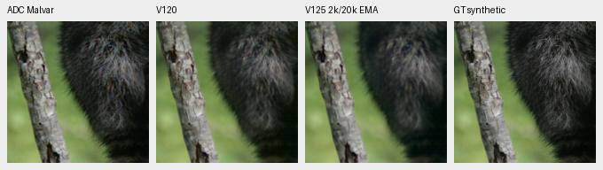
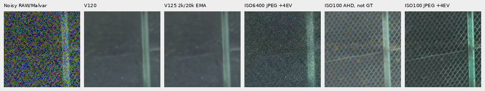
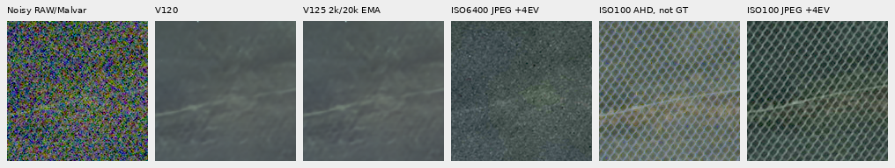

# V125 at 2k: a better monitor, weaker faint detail

**V125's eight-photo monitor improves over V124 at the same 2,000 updates,
but this early crop review finds weaker faint detail and no clear new mesh
recovery.** V120 remains the general recommendation. V125's original 20k
training continues; these are progress measurements, not endpoint results.

[Execution and measurements](results/v125-progress2000-quality-v1.json) ·
[Per-observation scores](results/v125-progress2000-metrics-v1.csv) ·
[Detail bands](results/v125-progress2000-bands-v1.csv) ·
[Faint source strata](results/v125-progress2000-faint-strata-v1.csv) ·
[DC/spatial errors](results/v125-progress2000-faint-decomposition-v1.csv) ·
[Source/ROI/checkpoint/noise/display metadata](images/v125-progress2000-quality-v1/manifest-v1.json) ·
[Publication verification](results/v125-progress2000-publication-v1.json).

## Same-budget training monitor

Both arms continue freshly from V120 Small, on the same 90,784-source/twenty-region
cohort, seed67, native256/B16/BF16 and original20k cosine horizon. Architecture
and frozen official DINOv3 ConvNeXt-Small are unchanged. Simulated batches use
two independent noise observations per target. V124 uses the per-view objective;
V125 mixes .75 per-view loss with .25 loss on the mean restored prediction.
Real paired captures retain their single-observation objective.
[Recipe and original endpoint review](conditional-mean-training.md).

The validation manifest, protocol and all59 trained source modules match.
All81 logged training batches through2k match in hash, domain, LR, target count
and observation count. Unlogged training input bytes and validation argument
witnesses were not retained, so this is not a bitwise audit of all2,000 batches.
The monitor uses eight fixed photos, seven conditions and four CFAs, with EMA
and BF16 restoration/FP32 physical processing. It is separate from full427.

| Monitor condition, sRGB PSNR | V124 at2k | V125 at2k | Change, dB |
| --- | ---: | ---: | ---: |
| ADC only |38.908195 |38.910508 |+0.002313 |
| Highlights |34.219817 |34.631588 |+0.411771 |
| ISO100 prior |40.265429 |40.269110 |+0.003681 |
| ISO12800 prior |35.452236 |35.460943 |+0.008707 |
| ISO1600 prior |38.738861 |38.740783 |+0.001921 |
| Legacy noise |37.334356 |37.337160 |+0.002804 |
| Shadows |41.738931 |41.753966 |+0.015035 |
| Equal condition mean |38.093975 |38.157722 |+0.063747 |

At1k, the mean difference was−0.008142dB. The positive2k result triggered this
crop review after observation; it was not a predeclared model-selection result.
Most of the2k mean gain comes from highlights. This review does not add matched
highlight crops or establish improved highlight appearance.

## Native texture scores and triplets

Fourteen new **CPU FP32** root/encoder calls process retained inputs: four ordinary
material contexts, four faint ADC contexts, four main-GFX512px contexts and two
extra-mesh768px profiles. All14 archived V120 predictions are reused. Material
controls were collected on CUDA; CPU/backend differences accompany this comparison.
V1252k versus V12020k also combines continued training, data, seed and mean loss.
There is no retained V1242k image prediction to isolate the loss term here.

Each condition below contains **four source contexts, RGGB draw0 only**, scored
on the central native160×160 ROI. These are not four-CFA means or full-panel
results. Two Commons targets are exact processed synthetic GT; two native-camera
binned targets remain approximate reference estimates.

| Local sRGB PSNR | V120 | V1252k/20k | Change, dB |
| --- | ---: | ---: | ---: |
| Ordinary ISO12800 prior |32.305381 |32.295424 |−0.009957 |
| Contrast.025, ADC only |67.505224 |66.257088 |−1.248136 |

Ordinary shot/read conditioning is `.00256` / `2.62144e−5`, ADC16, black`.03`.
The following unchanged160px triplets share ROI`[48,48,160,160]`, +0EV and
the same WB/matrix/sRGB transform: noisy → V1252k EMA → exact synthetic GT.

Matched noisy → V120 → V125 → reference comparisons:
[bark](images/v125-progress2000-quality-v1/bark-comparison.png),
[fur](images/v125-progress2000-quality-v1/raccoon-fur-comparison.png),
[grass](images/v125-progress2000-quality-v1/pixls-5002-fine-comparison.png),
[wood](images/v125-progress2000-quality-v1/pixls-1951-field-comparison.png).
Bark edges remain coherent; fur, grass and wood remain soft. Ordinary restored
differences are small in actual native viewing.

Bark: Derek Ramsey (Ram-Man),
[Kentucky Coffee-tree](https://commons.wikimedia.org/wiki/File:Kentucky_Coffee-tree_Gymnocladus_dioicus_3264px.jpg),
[CC BY-SA2.5](https://creativecommons.org/licenses/by-sa/2.5/).
Fur: Korall, [Racoon clinging to a tree](https://commons.wikimedia.org/wiki/File:Racoon_clinging_to_a_tree.JPG),
[CC BY3.0](https://creativecommons.org/licenses/by/3.0/).
Derivatives use binning, cropping, camera transforms, simulated noise and
restoration. raw.pixls.us5002/1951 binned camera references are CC0.

## Faint texture error is mostly spatial

The existing faint operator scales whole256px camera-channel deviations by.025
about the original channel mean, without interpolation. Shot=read=0; ADC16 and
black`.03` remain. For viewing only, every method receives the same40× contrast
expansion about the original target's channel mean before WB/matrix/sRGB. This
keeps native pixels and each method's mean error; no output is fitted or resized.

Columns: ADC Malvar → V120 → V125 → exact synthetic GT.

[Bark](images/v125-progress2000-quality-v1/bark-contrast0p025-adc-contrast40.png) ·
[Grass](images/v125-progress2000-quality-v1/pixls-5002-fine-contrast0p025-adc-contrast40.png) ·
[Wood](images/v125-progress2000-quality-v1/pixls-1951-field-contrast0p025-adc-contrast40.png).
Actual viewing finds softer fine fur/grass/wood and more color irregularity in
V125, without a large recovery. The mean sRGB MSE rises30.65%; its spatial
component rises32.73%, while the channel-mean component rises0.81%.
The regression is not explained by a mean color shift alone.

These bands use original-source-defined DCT16 luminance masks,
1/8≤radial frequency<1/3 cycle/pixel, before contrast attenuation. Eligible
blocks have in-gamut reference RGB, mean.02–.9 and band RMS≥1e−5.

| Original source / contrast | Blocks | Gain V120 / V125 | Relative band error V120 / V125 |
| --- | ---: | --- | --- |
| Fur,0–2% |7 |0.845951 / 0.795248 |0.288062 / 0.336887 |
| Fur,2–5% |5 |0.849726 / 0.788493 |0.310368 / 0.362244 |
| Grass,2–5% |3 |0.969041 / 0.882014 |0.254728 / 0.263329 |
| Wood,2–5% |9 |0.902719 / 0.871630 |0.162755 / 0.208044 |

All four selected weak strata lose target response and have higher relative
band error. Counts are fixed physical blocks in four contexts, not independent
photographs or population estimates.

## Both real GFX comparisons

Main scene: DSCF3879 ISO6400 / DSCF3880 ISO100 f/5.6. Noisy Malvar → V120 →
V125 → independent ISO100 reference. Native160px cells share +2EV and the
established WB/matrix/conditioning, inside512px contexts.

[Sky](images/v125-progress2000-quality-v1/main-overcast-sky-comparison.png) ·
[Building](images/v125-progress2000-quality-v1/main-building-detail-comparison.png).
Sky stays smooth, building/fence geometry is coherent and foliage remains
painterly. No clear new fine-detail recovery is visible.

Additional fine green mesh: DSCF3842 ISO6400 / **corrected DSCF3835 ISO100**,
46s earlier at f/5.6. Native160px cells share +4EV inside768px contexts.
Both fixed nominal and nearby3879 profiles are reviewed; no new strength sweep
or reference fit occurs. Noise/source/registered ROI metadata is in the manifest.

Below: noisy RAW/Malvar → V120 nominal → V125 nominal → ISO6400 camera JPEG →
ISO100 AHD → ISO100 camera JPEG. Both JPEGs receive the same inverse-sRGB →16×
linear exposure →sRGB display boost; camera tone/WB/sharpening still differ.

Nominal restoration largely erases the lattice. The nearby profile retains weak
irregular diagonals, without clear new recovery in either region:
[left](images/v125-progress2000-quality-v1/mesh-profile3879-fine-green-mesh-left-comparison.png),
[right](images/v125-progress2000-quality-v1/mesh-profile3879-fine-green-mesh-right-comparison.png).
The left blue point persists. Aperture, exposure time and moving subjects differ;
all real ISO100/AHD/JPEG references are qualitative comparators, **not exact GT**.
Neither capture pair, JPEGs nor siblings enters training. Only local caches were read.

## Verification and next action

Checkpoint SHA256: `410d5cfeda4977a5c886ae730a352ac76a5437fccf3d3537e916cad9a9cee69f`.
The retained original2k state has91 model/EMA tensors,89 Adam states at2k and
131,618,917 finite saved values. All59 actual trained source modules match.
Collection leaves weights, backbone and RNG unchanged, uses no CUDA and peaks
at2,670,104,576 RSS bytes. This is resource accounting, not a speed benchmark.

Independent audits reproduce292 primary scalar fields and8,601,600 PNG channel
values across32 primary images. The faint audit checks30 strata,16 error
decompositions and1,228,800 channel values; the camera display adds921,600.
All38 source images were actually viewed through ten pixel-exact native contact
sheets. There were14 new root/encoder calls and no new reference inference,
noise observations, RAW decodes or optimizer updates in this review.

The monitor gain is useful evidence of a tradeoff, rather than proof that mean
loss resolves detail bias. Keep the original matched20k endpoint/bias/GFX review
and its declared inputs, schedules and guards. V120 remains current; future
quality decisions must consider weak-detail error as well as the monitor mean.
