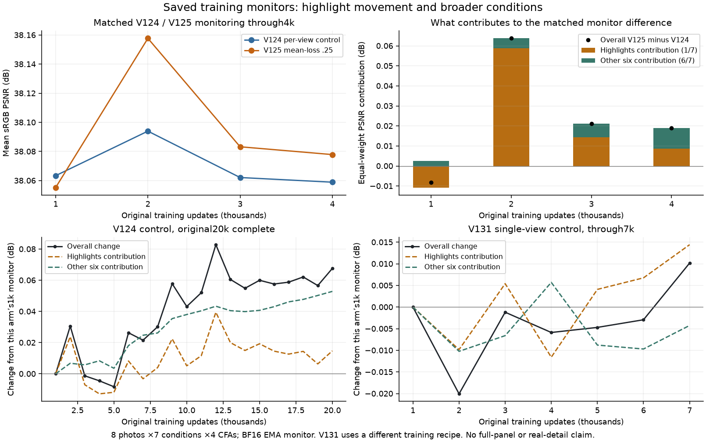
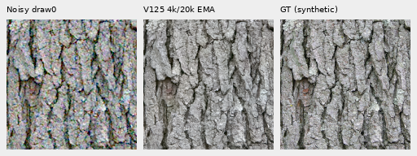
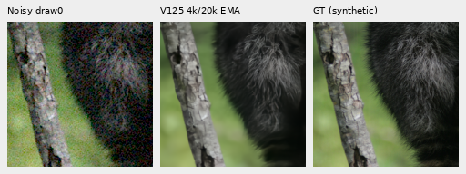
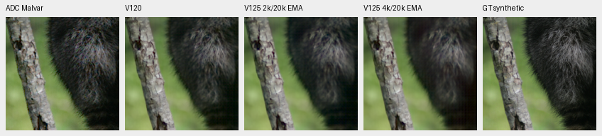
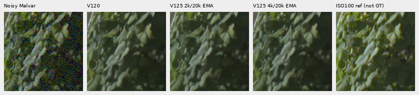
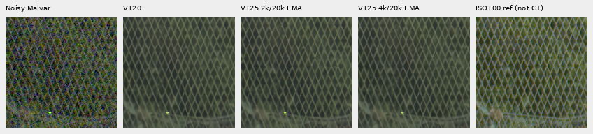
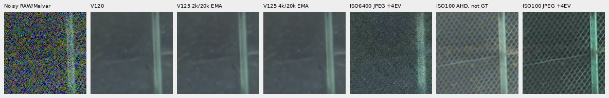
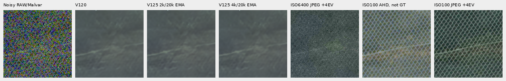

# V125 at4k: small monitor gains, persistent faint-detail loss

**V1254k nearly recovers V120's ordinary four-context mean, but its faint-ADC
mean remains1.144dB lower.** Relative to V1252k, ordinary/faint means improve
0.0086/0.1038dB. Fine-band response falls further on fur, grass and wood; real
foliage remains painterly and the extra green mesh gains no clear new detail.
V120 remains the general recommendation. V125 continues its original20k run;
this is a progress inspection, without an endpoint or mean-loss quality claim.

[Metrics, execution and source evidence](results/v125-progress4000-quality-v1.json) ·
[All local scores](results/v125-progress4000-metrics-v1.csv) ·
[Source/ROI/noise/exposure and native images](images/v125-progress4000-quality-v1/manifest-v1.json) ·
[Original matched training](conditional-mean-training.md) · [Earlier2k review](v125-progress2000-quality.md).

## Saved monitoring over training

[Standalone SVG](images/v125-progress4000-quality-v1/training-monitor-progress.svg) ·
[All31 logged points, CSV](results/v125-progress4000-monitor-v1.csv).

These are **eight-photo, seven-condition, four-CFA BF16 EMA monitors**, separate
from the full427-photo FP32 panel and real-detail crops below. All31 saved
validation points through V12420k, V1254k and V1317k are shown. Bottom panels
use each arm's own1k monitor as their reference. V131 uses different data, seed,
quota and single-view training; it is not a matched mean-loss arm. Lines connect
logged points; no source-level confidence interval can be reconstructed from
these aggregate logs.

| Matched updates | V124 mean | V125 mean | V125−V124 | Highlights delta | Mean delta across other six conditions |
| ---: | ---: | ---: | ---: | ---: | ---: |
|1,000 |38.063398 |38.055256 |−0.008142 |−0.075273 |+0.003046 |
|2,000 |38.093975 |38.157722 |+0.063747 |+0.411771 |+0.005743 |
|3,000 |38.062111 |38.083234 |+0.021123 |+0.100880 |+0.007830 |
|4,000 |38.058903 |38.077873 |+0.018970 |+0.061194 |+0.011933 |

At2k, highlights contribute0.058824dB of the0.063747dB overall difference.
At4k they contribute0.008742dB, versus0.010228dB from the other six conditions
combined. These contributions use the monitor's equal weighting of seven
condition means; they are not pooled-MSE changes. The smaller overall4k gain
does not mean every ordinary condition deteriorated.

The matched recipes differ only in mean-loss weight0/.25 and descriptive/run
paths. All59 trained source modules and validation protocol hashes match;
161 logged training batch hashes/domain/LR/view-count records match through4k.
This verifies the sparse logged batches, without proving all4,000 training
input tensors or validation arguments bitwise equal. The eight selected source
records/protocol and reader AST match the V131 monitor as well; its added
shadow-degradation function is outside this validation path. Its separate
training recipe still prevents a causal cross-arm comparison. Independent
Decimal reductions check361 scalars across31 points/four matched budgets, within
5.68e−15 of saved floating reductions. No monitor inference is rerun.

## Retained checkpoint and fixed crop support

The original4k EMA checkpoint, SHA256
`44eee6dbda4074b21285d26b5deaabbd3444ade2871f87a146adc877fa212290`,
is retained without pausing training. It has91 model/EMA tensors,89 Adam states
at step4,000 and131,618,917 finite saved values. The same59 actual trained
source modules execute14 new CPU IEEE-FP32 root/encoder forwards. All14 V120
and14 V1252k predictions are reused. There are no new noise observations, RAW
decodes, optimizer updates or training-budget changes. Peak RSS is2.71GB;
CUDA stays uninitialized, and weights, encoder and RNG remain unchanged.

The same fixed inputs as the2k review cover four ordinary material contexts,
their four contrast0.025 ADC counterparts at **RGGB draw0 only**, four main GFX
contexts and both extra-mesh768-context profiles. V120 material controls include
CUDA outputs, limiting interpretation of tiny cross-backend deltas. The2k/4k
candidates share the same CPU path. Native-binned and ISO100 references remain
nonexact. Selection followed observation of the monitor trajectory, before
new4k images; this is post-hoc progress analysis.

| Retained four-context mean | V120 | V1252k | V1254k |4k−V120 |4k−2k |
| --- | ---: | ---: | ---: | ---: | ---: |
| Ordinary sRGB PSNR |32.305381 |32.295424 |32.304045 |−0.001335 |+0.008621 |
| Faint-ADC sRGB PSNR |67.505224 |66.257088 |66.360851 |−1.144374 |+0.103762 |

## Native100% exact-GT triplets

Noisy → V1254k → exact simulated GT. Native160×160 at ROI[48,48,160,160] within
256px contexts, with no resized crop pixels. Ordinary RGGB draw0 uses
shot0.00256/read variance0.0000262144, ADC16/black0.03, WB[2,1,1.5], recorded
camera matrix and display exposure×1. The simulated target is exact for this
experiment; the underlying processed/binned Commons photograph is not certified
physically noiseless. Native fine bark/individual hairs remain softer than GT.

Sources: [Derek Ramsey, Kentucky Coffee-tree](https://commons.wikimedia.org/wiki/File:Kentucky_Coffee-tree_Gymnocladus_dioicus_3264px.jpg),
[CC BY-SA2.5](https://creativecommons.org/licenses/by-sa/2.5/), and
[Korall, Racoon clinging to a tree](https://commons.wikimedia.org/wiki/File:Racoon_clinging_to_a_tree.JPG),
[CC BY3.0](https://creativecommons.org/licenses/by/3.0/). Modified by binning,
crop, simulated noise, restoration and display conversion. Other native
development references retain their existing per-file credits in the image metadata.

## Faint detail: recovery is mixed

Below: ADC noisy/Malvar → V120 → V1252k → V1254k → reference, with fixed40×
camera-linear contrast about the original target's channel means. The target
contrast is0.025; shot/read are both zero with the existing16-bit ADC. Crops
retain native160 pixels and common transforms. Fur/grass/wood look softer than
V120; bark improves from2k. Binned-camera references remain labeled non-GT.

The primary faint-target fine-band gain aggregates99–100 eligible blocks per
context, almost all in its below2% stratum after attenuation. Gains are:

| Context | V120 | V1252k | V1254k |
| --- | ---: | ---: | ---: |
| Bark |0.988807 |0.993443 |0.988431 |
| Fur |0.956566 |0.936664 |0.921460 |
| Grass |1.007498 |0.921958 |0.905537 |
| Wood |0.986733 |0.954789 |0.945140 |

The separate original-source analysis preserves fixed DCT16 contrast masks,
without selecting strata from attenuated inputs or restored outputs. Its45
method/stratum rows are linked below. Fur/wood aggregate band errors rise further
from2k; grass error falls slightly while gain
falls. Mean faint sRGB spatial MSE is5.88% lower than2k but24.92% above V120;
DC MSE rises36.63% from2k and remains37.74% above V120. Thus the remaining
error is not just a mean shift. Mean total MSE falls3.75% from2k and remains
25.75% above V120. [Bands](results/v125-progress4000-bands-v1.csv) ·
[Original-source strata](results/v125-progress4000-faint-strata-v1.csv) ·
[DC/spatial decomposition](results/v125-progress4000-faint-decomposition-v1.csv).

## Real GFX detail

Main scene: noisy → V120 → V1252k → V1254k → independent DSCF3880 ISO100
reference, not GT. Shared +2EV/×4,512px contexts and native160 ROIs.
Foliage remains painterly; the main coarse fence geometry is coherent, without
a clear new fine-detail gain. Building edges remain soft and sky quiet.

Extra mesh: noisy → V120 → V1252k → V1254k → DSCF3842 ISO6400 camera JPEG →
independent DSCF3835 ISO100/AHD → DSCF3835 camera JPEG. All RAW cells share
fixed +4EV/×16; both camera JPEGs receive the same fixed inverse-sRGB/×16/sRGB
display transform, without fitting. Each cell is native160 within768px contexts.
Nominal shot/read0.00128/0.0000065536; the nearby profile is
0.0014635775921166604/0.000010715704128646712. Profiles are supplied priors,
not calibrated noise or an output-selected strength sweep.

Nominal mesh remains strongly softened. The nearby profile reveals a weak
diagonal lattice, without clear additional recovery at4k. Both profiles/regions
were viewed. The ISO100 exposure differs in aperture, shutter time and moving
subjects; camera JPEGs have independent tone/WB/sharpening. They are qualitative
comparators, without real-reference PSNR or exact-GT claims. Both pairs, JPEGs
and siblings stay held out. [Main gallery](gfx-qualitative.md) · [Mesh gallery](gfx-green-mesh.md).

## Verification and remaining work

All38 native boards are viewed through ten pixel-exact contact sheets; the
monitor plot is also viewed. Independent FFT/display arithmetic checks438 metric
fields,24 rows and9,830,400 native RGB channels in32 primary PNGs. Faint analysis
checks45 source strata,24 decompositions and1,536,000 channels; camera display
checks1,075,200 channels against a scalar256-entry LUT. Four inherited mesh
control headers were corrected from model/checkpoint provenance without changing
crop pixels or any metric; original reports, audits and sheets remain preserved.

Preparation/cache-start/analysis-dependency and plot/audit metadata failures are
preserved in the receipt. The cache correction occurred before any neural
forward and retained the original absolute deadline/14-call budget. No completed
prediction or old control was replayed. Source/checkpoint identity, numerical
audits and actual native review substantiate this finite result; they do not
establish broad quality or full convergence. Finish the original matched20k
reviews and assess weak material alongside monitor means. The56-point completed
primary version history and current V120 selector remain unchanged.
