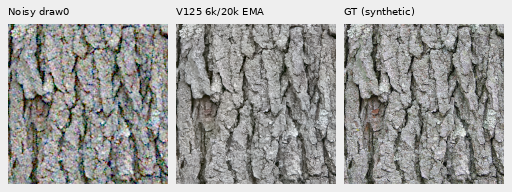
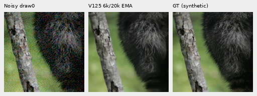
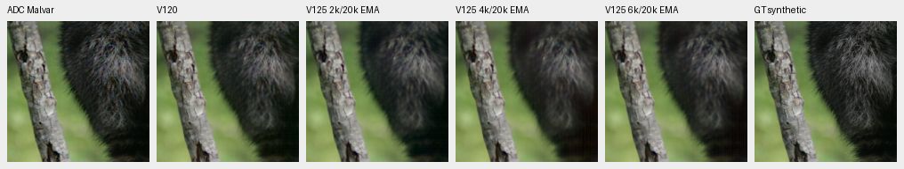
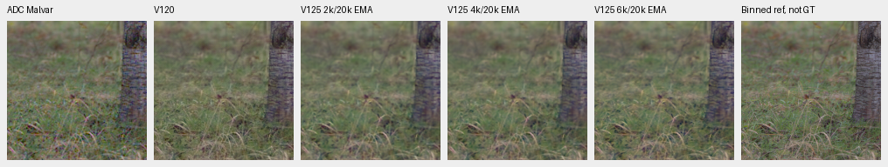
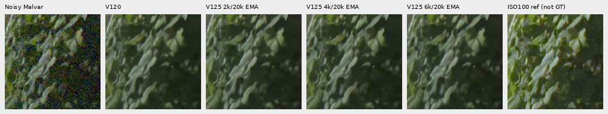
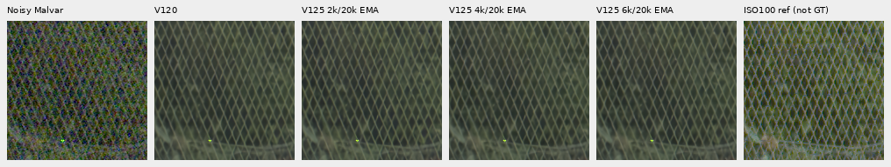
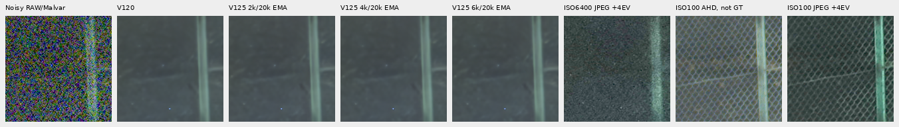
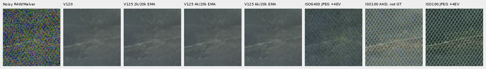
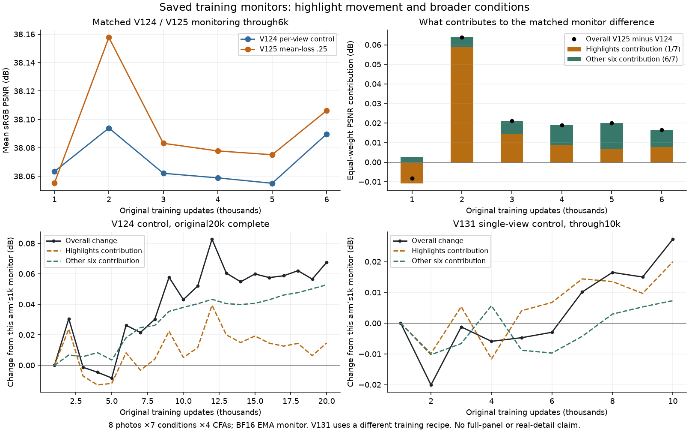

# V125 at6k: partial faint-detail recovery

**V1256k improves the retained faint-ADC mean by 0.136 dB over4k, while remaining
1.009 dB below V120.** Ordinary four-context PSNR is effectively unchanged from
V120. Fine-band response recovers on fur, grass and wood; real foliage remains
painterly and the difficult green mesh shows no clear new recovery. V120 remains
the general recommendation. V125 continues its original20k run; these are
progress measurements, without an endpoint or broad mean-loss quality claim.

[Execution, scores and source evidence](results/v125-progress6000-quality-v1.json) ·
[All local metrics](results/v125-progress6000-metrics-v1.csv) ·
[Source/ROI/checkpoint/noise/display metadata](images/v125-progress6000-quality-v1/manifest-v1.json) ·
[Matched training](conditional-mean-training.md) ·
[Earlier4k review](v125-progress4000-quality.md).

## Fixed inputs and actual execution

V125 continues from V12020k on90,784 photos/20 reviewed regions, seed67, with
two independent noise views and mean-loss weight0.25. V124 is its matched
weight-zero control. The newer prepared dataset remains separate.

The original6k checkpoint has SHA256
`7394a4e7eed9dd11d58c63a4b9f053e7fb35f4b92ae3c0b5cdb872fa572efb0c`.
It retains the20k horizon,91 model/EMA tensors,89 Adam states at6,000 and
131,618,917 finite saved values. The same59 trained source modules execute
exactly14 new CPU IEEE-FP32 root/encoder forwards, reusing all42 V120/V1252k/
V1254k predictions. No new noise observations, RAW decoding or optimizer updates
occur. Peak RSS is2.62GB; CUDA stays uninitialized and weights/backbone/RNG remain
unchanged. The running training job is not paused or restarted.

The same saved support covers four ordinary material contexts, four faint
contrast0.025 ADC counterparts at **RGGB draw0 only**, four main-GFX512 contexts
and both extra-mesh768 profiles. All ROIs, conditioning and display transforms
remain fixed. Some V120 material controls use CUDA; tiny cross-backend deltas
have limited interpretation. V1252k/4k/6k share the same CPU path. Binned-camera
and independently captured ISO100 references remain approximate.

| Four-context sRGB PSNR mean | V120 | V1252k | V1254k | V1256k |6k−V120 |6k−4k |
| --- | ---: | ---: | ---: | ---: | ---: | ---: |
| Ordinary |32.305381 |32.295424 |32.304045 |32.305190 |−0.000191 |+0.001145 |
| Faint ADC |67.505224 |66.257088 |66.360851 |66.496567 |−1.008658 |+0.135716 |

These finite context means are separate from full427-photo and camera results.
The next2k progress boundary was chosen after the earlier review, before new6k
inference. This is post-hoc progress analysis, without a stopping rule.

## Native100% exact-GT triplets

Noisy → V1256k → exact simulated GT. Each crop is native160×160 at
ROI[48,48,160,160] within a256px context, with no resized crop pixels. Ordinary
RGGB draw0 uses shot0.00256/read variance0.0000262144, ADC16/black0.03,
WB[2,1,1.5], the recorded camera matrix and display exposure×1. The target is
exact for this simulation; the processed/binned photograph is not certified
physically noiseless. Fine bark and individual hairs remain softer than GT.

Sources: [Derek Ramsey, Kentucky Coffee-tree](https://commons.wikimedia.org/wiki/File:Kentucky_Coffee-tree_Gymnocladus_dioicus_3264px.jpg),
[CC BY-SA2.5](https://creativecommons.org/licenses/by-sa/2.5/), and
[Korall, Racoon clinging to a tree](https://commons.wikimedia.org/wiki/File:Racoon_clinging_to_a_tree.JPG),
[CC BY3.0](https://creativecommons.org/licenses/by/3.0/). Modified by binning,
crop, simulated noise, restoration and display conversion. Other photographic
references retain their per-file credits in the image metadata.

## Faint fine detail

Below: ADC noisy/Malvar → V120 → V1252k → V1254k → V1256k → reference. The
shared40× camera-linear contrast transform uses the original target's channel
means. Target contrast is0.025; shot/read are zero with the existing16-bit ADC.
Cells retain native160 pixels. Binned-camera references remain labeled non-GT.
Native changes are modest: fur, grass and wood recover some response from4k,
while finer structure remains softened relative to V120/references.

Aggregate faint-target fine-band gains use99–100 eligible blocks per context:

| Context | V120 | V1252k | V1254k | V1256k |
| --- | ---: | ---: | ---: | ---: |
| Bark |0.988807 |0.993443 |0.988431 |0.996510 |
| Fur |0.956566 |0.936664 |0.921460 |0.937340 |
| Grass |1.007498 |0.921958 |0.905537 |0.978198 |
| Wood |0.986733 |0.954789 |0.945140 |0.954084 |

Fur/grass/wood band errors fall from4k. Bark gain moves closer to one while its
band error rises, so response alone does not establish improved reconstruction.
The separate original-source analysis retains fixed contrast masks and60
method/stratum rows, without choosing strata from attenuated inputs or outputs.

Mean faint sRGB spatial MSE falls1.46% from4k but remains23.09% above V120.
DC MSE rises3.45% from4k and remains42.49% above V120. Mean total MSE falls1.11%
from4k and remains24.36% above V120. This is not just a mean-shift problem;
PSNR means and MSE means are different reductions.
[Bands](results/v125-progress6000-bands-v1.csv) ·
[Original-source strata](results/v125-progress6000-faint-strata-v1.csv) ·
[DC/spatial decomposition](results/v125-progress6000-faint-decomposition-v1.csv).

## Real GFX detail

Main scene: noisy → V120 → V1252k → V1254k → V1256k → independent DSCF3880
ISO100 reference, **not GT**. Cells retain native160 pixels,512px contexts,
shared +2EV/×4 and the fixed nominal shot/read0.00128/0.0000065536. Foliage
remains painterly, coarse fence diamonds coherent, building edges soft and sky
quiet. There is no clear new fine-detail recovery.

Extra mesh: noisy → V120 → V1252k → V1254k → V1256k → DSCF3842 ISO6400 camera
JPEG → corrected DSCF3835 ISO100/AHD → ISO100 camera JPEG. RAW cells share
+4EV/×16; both JPEGs receive fixed inverse-sRGB/×16/sRGB without fitting. All
cells are native160 within768px contexts. Both nominal and fixed nearby3879
profiles/regions were actually viewed; these are supplied priors, not calibrated
noise or an output-selected strength sweep.

Nominal conditioning largely wipes the mesh; nearby conditioning shows weak
diagonals without clear new6k recovery. The independent ISO100 exposure differs
in aperture, shutter and moving subjects; camera JPEGs retain independent
tone/WB/sharpening. They are qualitative comparators, without exact-GT or real
PSNR claims. Both pairs, JPEGs and siblings remain outside training.
[Main gallery](gfx-qualitative.md) · [Mesh gallery](gfx-green-mesh.md).

## Saved monitor plot and limits

[Standalone SVG](images/v125-progress6000-quality-v1/training-monitor-progress.svg) ·
[All36 points](results/v125-progress6000-monitor-v1.csv).

These are eight-photo/seven-condition/four-CFA BF16 EMA monitors, separate from
the native review and full427-photo FP32 panel. At6k, V125−V124 is+0.016508dB;
highlights contribute+0.007736dB and the other six conditions+0.008772dB under
equal condition weighting. At2k, highlights dominate the larger+0.063747dB gain.
V131 uses a different recipe and is shown only as its own within-run trend.
Aggregate logs do not support source-level confidence intervals.

The matched recipes and all59 trained modules/protocol hashes agree apart from
the declared mean-loss intervention and descriptive paths. All241 logged batch
hash/domain/LR/view records match through6k; all6,000 training inputs and actual
validation argument tensors were not retained for bitwise comparison. Independent
Decimal reductions check426 scalars across36 points/six budgets within6.25e−15.

All38 native boards and the plot were viewed. Independent FFT/display checks584
metric fields,32 rows and11,059,200 native RGB channels in32 primary PNGs. Faint
analysis checks60 strata,32 decompositions and1,843,200 channels; camera display
checks1,228,800 channels against a scalar256-entry LUT. One failed retention-path
lookup occurred before checkpoint copying or neural work and remains preserved.
The earlier4k receipt's horizon typo has a separate
[correction record](results/v125-progress4000-receipt-correction-v1.json), with
original bytes preserved. All original jobs/budgets/deadlines, current selection
and the56-point completed primary history remain unchanged. Finish the original
matched20k reviews before drawing endpoint or broad mean-loss conclusions.
