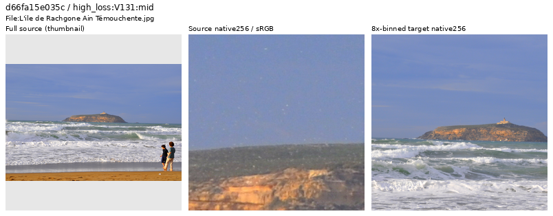
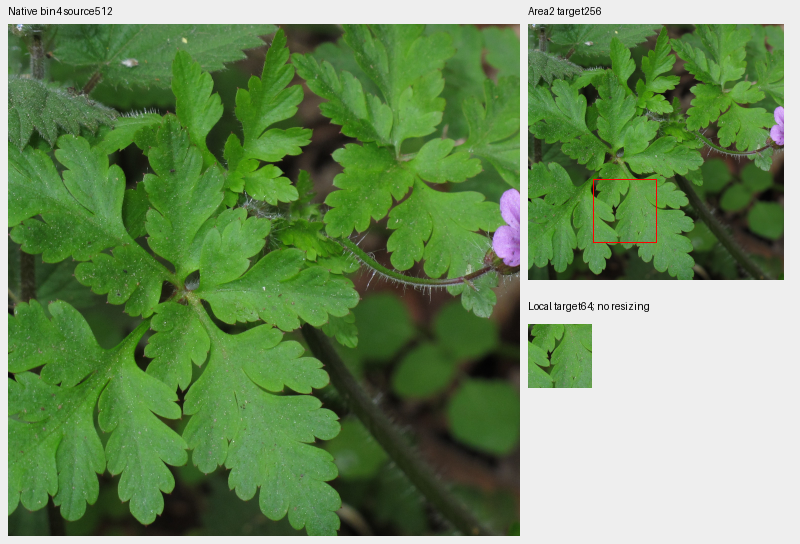
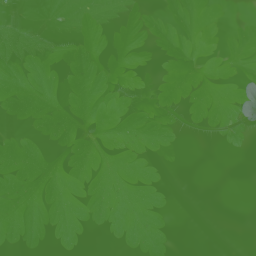

# Additional photographic-source cleanup

**The prepared future dataset has 90,773 training photos and 37 reviewed regions.**
This inspection retains 39 of 40 newly viewed sources, withholds one grainy
coastal photograph from future clean targets, and adds one mixed-contrast leaf
region. All 36 previous region objects remain exact. The inspection ledger reaches
2,083 IDs. Existing training and queued comparisons keep their original data;
the quality effect of this preparation is unmeasured.

[All decisions and credits](results/v125-v131-source-decisions-5600-9800-v1.csv) ·
[Selection, viewing, pixels and reader evidence](results/v125-v131-source-review-5600-9800-v1.json) ·
[Image/source/ROI/license metadata](images/v125-v131-source-review-5600-9800-v1/manifest.json) ·
[37-region catalogue](../configs/low-contrast-training-rois-cleaned90773-v1.json).

## Selection and visual decisions

The immutable sparse trace windows are V125 updates (3,400, 5,600] and V131
(6,000, 9,800]. Previous inspected IDs and sources outside the prepared cohort
are removed before selection.

| Trace | Logged Commons batches | Photographic draws / IDs | Eligible draws / IDs |
| --- | ---: | ---: | ---: |
| V125 | 9 | 104 / 104 | 60 / 60 |
| V131 | 16 | 193 / 132 | 90 / 90 |

The combined pool contains 150 distinct eligible sources. Selection takes up to
four new distinct sources per arm/noise group, then alternates the highest
remaining gradient losses until each arm contributes 20 sources. V125 has only
one eligible high-noise source; three otherwise empty slots become explicitly
labeled gradient choices. Noise groups use sigma at linear intensity 0.18:
ADC-only, positive ≤0.005, 0.005–0.02 and >0.02. Changing weights, exposure,
geometry and noise confound losses; V125 logs only its first noise view. These
scores select inspections, without automatic quality labels or augmentation replay.

Actual viewing covers seven sheets, six native original 1024 crops, six whole
native bin4 views, four fixed proposal boards and four further native original
1024 crops: 27 files. Only labeled whole-source thumbnails are resized. The
native source and binned target cells retain their pixels.

The coastal source has visible granular sky, pale speckles and soft distant
detail, including residual grain/speckles in native bin4 views. It is withheld
from the future clean-target cohort. Its noise or processing cause is unknown;
the original JPEG and cache remain intact. Physical church reliefs, statues,
engraved lettering and printed clothing remain photographic scenes. Strong
native edge rendering, grain and natural depth softness are disclosed where seen.

All source sheets: [1](images/v125-v131-source-review-5600-9800-v1/source-sheet-00.png),
[2](images/v125-v131-source-review-5600-9800-v1/source-sheet-01.png),
[3](images/v125-v131-source-review-5600-9800-v1/source-sheet-02.png),
[4](images/v125-v131-source-review-5600-9800-v1/source-sheet-03.png),
[5](images/v125-v131-source-review-5600-9800-v1/source-sheet-04.png),
[6](images/v125-v131-source-review-5600-9800-v1/source-sheet-05.png),
[7](images/v125-v131-source-review-5600-9800-v1/source-sheet-06.png).

## Fixed detail regions

Coordinates were fixed from source viewing before contrast measurement. Each
board shows native bin4 source512, area2 target256 with a red annotation outline,
and native local64, all at exposure ×1 in sRGB. These are source inspections
before sensor noise, without restored outputs or a noiseless-GT claim.

| Material | Bin4 ROI xywh | Local target ROI xywh | Local blocks below 5% / eligible | Decision |
| --- | --- | --- | ---: | --- |
| Grey feather pattern | 440,330,512,512 | 80,110,64,64 | 0 / 16 | Ordinary photo; stronger fine contrast |
| Leaf veins/surface detail | 120,120,512,512 | 65,155,64,64 | 4 / 16 | Add one mixed-contrast region; another 5 blocks at 5–10% |
| White plinth | 50,400,512,512 | 85,135,64,64 | 16 / 16 | Mostly smooth with sparse pits; decline fine-detail annotation |
| Snow tracks/ridges | 220,40,512,512 | 192,125,64,64 | 4 / 16 | Quiet sky and stronger silhouettes confound this annotation; decline |

The leaf region retains coherent physical veins, hairs and tiny surface features
after binning, with stronger boundaries elsewhere in the context. It is mixed
contrast, without a source-wide noiseless guarantee. Low measured contrast alone
does not establish useful fine material: the plinth is mostly smooth, and sky
contributes to the snow crop's weak counts. These proposals were not retuned
after measurement.

Other fixed proposals: [grey plumage](images/v125-v131-source-review-5600-9800-v1/grey-plumage-source-target.png),
[plinth](images/v125-v131-source-review-5600-9800-v1/plinth-source-target.png),
[snow](images/v125-v131-source-review-5600-9800-v1/snow-source-target.png).
Statistics use linear-sRGB Rec709 luminance, orthonormal16 DCT-II and the radial
band 1/8≤frequency<1/3 cycles/pixel. Fine-band RMS is divided by block mean;
eligible blocks have mean 0.02–0.9 and RMS≥1e−5.
[All descriptive counts](results/v125-v131-source-contrast-5600-9800-v1.csv).

## Actual reader and independent verification

The actual 37-region reader visits every region. A parent catalogue rebound to
the same future manifest supplies controlled comparisons at identical region
identities: all 36 common regions, four ordinary draws and four procedural draws
match 8,650,752 FP32 values over 89 clean reads. Region expansion and exclusions
can change selected identities; unchanged old sampling sequences are not claimed.
Python/NumPy/Torch RNG remain unchanged, CUDA is uninitialized, and neural module
calls are forbidden. Geometry precedes area reduction; optical PSF probability
is zero, with the existing 25% photographic contrast-attenuation probability.

The saved new leaf draw is index617/seed687 and actually contrast-attenuated.
Its whole256 contains 254/256 eligible blocks below 5%, including quiet areas;
140 are below 2%. This one draw demonstrates that the actual reader can provide
very weak photographic structure, without establishing training-wide coverage.

Independent heap nomination reproduces all 40 choices. JPEG SHA1, cache SHA256,
native source cells and all sheet cells verify. UINT32 area2/FP64 display checks
7,864,320 strip-target channels with 37 one-DN8 differences within the declared
≤1DN8 bound; all 832,560 proposal-target channels match. Ten original1024 crops,
six whole-bin4 views and four source512 panels verify. Mirrored-FFT DCT checks
1,088 source blocks within 1.34e−15; the actual reader leaf adds 256 independently
checked blocks and 196,608 exact displayed RGB channels.

The first nomination could not fill V125's high-noise bucket. An early render
attempt had no completed selection plan. The selected gradient group then hit
the renderer's four-per-group cap: its 37 completed strips were preserved and
only three missing strips rendered; five sheets were reused and two recomposed.
The first three completed proposal triples were also preserved when the snow
annotation exceeded the target width by one pixel. That boundary was corrected
before contrast measurement, without redrawing the completed proposals. All
failures and completed prefixes remain bound in the receipt.

Exactly one train row is removed; every remaining manifest line byte and order
is preserved, including validation/test at 2,303/2,255. Originals, caches, model
selection, full score history and all earlier job inputs remain unchanged. Both
GFX pairs, JPEGs and siblings remain held out. This targeted inspection does not
certify the entire corpus or establish improved restoration quality.
