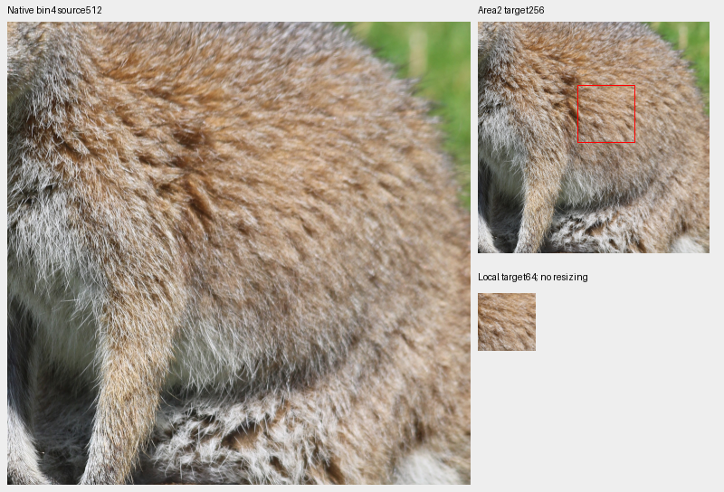
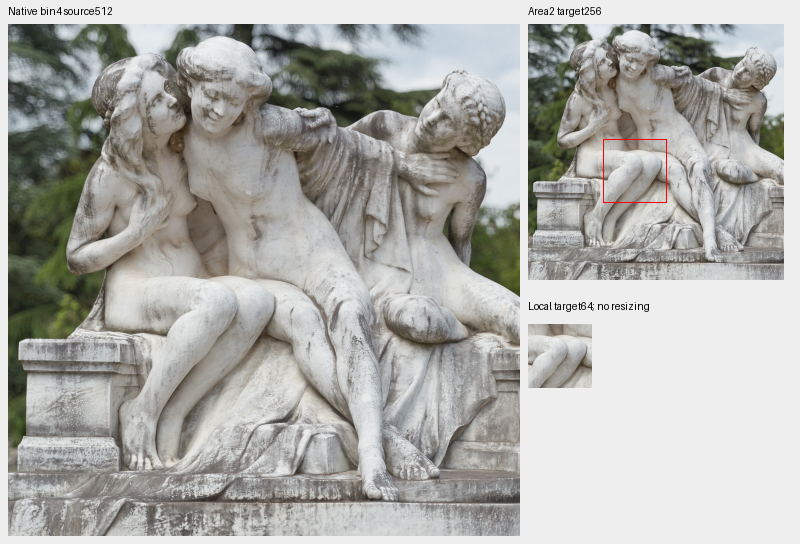
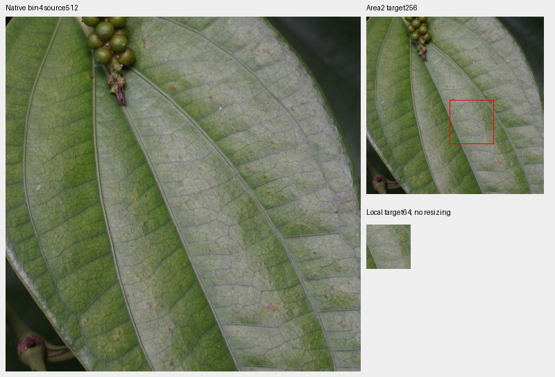
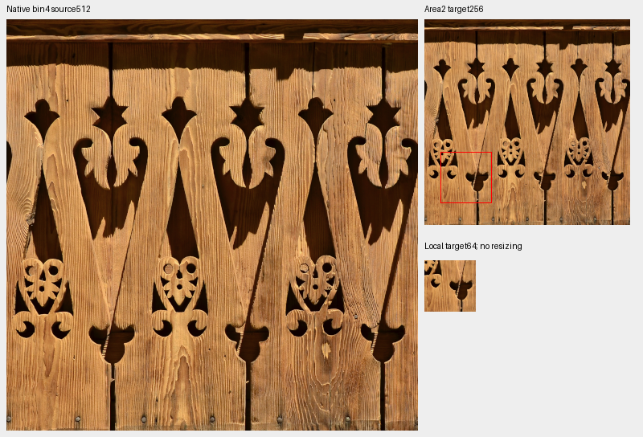

# Additional V125/V131 photographic-source inspection

**All40 newly inspected sources are retained as ordinary photographs.** Four
fixed fur, marble, leaf-vein and wood-grain proposals do not add specialized
weak-detail annotations. The prepared future bank remains **90,774 training
photos/36 reviewed regions**, with exactly the same manifest and catalogue bytes.
The actual-viewing ledger reaches **2,043 unique IDs**. This is source inspection;
it establishes no restoration-quality gain or pristine-source guarantee.

[All40 decisions and credits](results/v125-v131-source-decisions-v1.csv) ·
[Selection, native pixels and unchanged-data evidence](results/v125-v131-source-review-v1.json) ·
[Image coordinates, source pages and licenses](images/v125-v131-source-review-v1/manifest.json) ·
[Current data and trials](current-source-loss-review.md).

## Nomination and actual viewing

Immutable sparse traces cover V125 through3,400 and V131 updates(1,900,6,000].
Previously reviewed IDs and sources outside the prepared training cohort are
excluded before nomination.

| Trace | Logged Commons batches | Photographic draws / IDs | Eligible draws / IDs |
| --- | ---: | ---: | ---: |
| V125 through3,400 |14 |167 /165 |90 /89 |
| V131(1,900,6,000] |19 |218 /141 |102 /102 |

The combined eligible set contains192 draws/180 distinct IDs. Four new distinct
sources per arm/noise group, followed by four additional gradient-loss choices
per arm, give20 per arm/40 total. Group order, source deduplication and tie breaks
are fixed before viewing. Noise groups use sigma at linear intensity0.18:
ADC-only, positive≤0.005,0.005–0.02 and>0.02. Evolving weights, exposure, geometry,
camera and noise confound losses; V125 traces only its first noise view. Scores
nominate inspection, without automatic source-quality labels or input replay.

Actual viewing covers seven sheets (40 thumbnails/80 native256 cells), four
native1024 follow-ups, four whole native-bin4 views, four fixed proposal boards
and four additional native1024 material views:23 files total. Shell ridges,
dragonfly wing mesh, station glazing, thin wires, stone weathering and fur remain
coherent after binning. Three-dimensional sculptures, mosaics in station
architecture, engraved memorials and physical printed clothing are retained in
their photographic context. Native grain, depth softness and strong edge
rendering are disclosed where visible; retention does not certify a noiseless
whole source.

All source sheets, with titles and exact pixels:
[1](images/v125-v131-source-review-v1/source-sheet-00.png),
[2](images/v125-v131-source-review-v1/source-sheet-01.png),
[3](images/v125-v131-source-review-v1/source-sheet-02.png),
[4](images/v125-v131-source-review-v1/source-sheet-03.png),
[5](images/v125-v131-source-review-v1/source-sheet-04.png),
[6](images/v125-v131-source-review-v1/source-sheet-05.png),
[7](images/v125-v131-source-review-v1/source-sheet-06.png).
Only each labeled whole-source thumbnail is resized; source and target cells
retain their native pixels.

## Fixed material proposals

Coordinates were selected from the photographic views before measurement and
were not retuned afterward. Each board shows native bin4 source512, area2
target256 with a red annotation outline, and its native local64 crop. Display
uses linear-sRGB→sRGB at exposure×1. These are clean-source inspections before
sensor noise, without restored outputs or an exact noiseless-GT claim.

| Material | Bin4 ROI xywh | Local target ROI xywh | Local blocks below5% / eligible | Local5–10% | Whole-context blocks below5% / eligible |
| --- | --- | --- | ---: | ---: | ---: |
| Wallaby fur |320,380,512,512 |110,70,64,64 |0 /16 |0 |7 /256 |
| Weathered marble |220,150,512,512 |75,115,64,64 |0 /16 |10 |19 /256 |
| Pepper leaf veins |620,465,512,512 |120,120,64,64 |0 /16 |13 |4 /252 |
| Carved wood grain |40,10,512,512 |20,165,64,64 |0 /16 |0 |0 /252 |

The fur and wood proposals have stronger fine structure throughout their local
annotations. Marble and leaf veins contain coherent, subtler detail, mostly at
5–10% fine-band contrast locally. They remain useful ordinary photographs, but
these particular annotations do not provide convincing coverage of the very
weak material currently under study. Lower whole-context counts can include
quiet background or smoother surfaces; they are not sufficient evidence alone.
This is a visual/descriptive decision, without an automatic admission threshold.

Statistics use linear-sRGB Rec709 luminance, orthonormal16 DCT-II and the radial
band1/8≤frequency<1/3 cycles/pixel. Fine-band RMS is divided by block mean;
eligible blocks have mean0.02–0.9 and RMS≥1e−5.
[Complete descriptive counts](results/v125-v131-source-contrast-v1.csv).
Intrinsic source contrast differs from augmented training-target contrast.

## Verification and limits

Independent heap nomination reproduces all40 IDs, groups and logged cases.
Original JPEG SHA1/cache SHA256, native source crops and all sheet cells verify.
UINT32 area2/FP64 display checks7,864,320 strip-target channels with24 one-DN8
rounding differences, within the declared≤1DN8 display bound. All832,560 checked
proposal-target channels match exactly. Eight native1024 views, four full-bin4
views and four native source512 proposal panels also verify independently.
Mirrored-FFT DCT reproduces1,088 fixed source blocks with maximum statistic error
2.23e−15.

The first renderer completed all40 strips/seven sheets, then failed while
writing its index because two nomination metadata fields were absent. A
metadata-only completion records180 eligible unique IDs and incomplete
full-corpus scoring, preserving the failed driver/log, candidate bytes and all
47 original PNGs. It redraws no images. Both the failure and correction are
bound in the [receipt](results/v125-v131-source-review-v1.json).

No training source, region object or reader implementation changed; the existing
[36-region reader proof](v131-source-review.md#independent-verification-and-use) remains
preserved without replay. Validation/test remain2,303/2,255. All41 original plans,
V138/V139 queues,28 controller identities and the56-point full-primary history
verify unchanged. At publication V125/V131 remain alive at4,250/6,950 of their
original20,000-update horizons. V120 remains the general recommendation.
This inspection makes no model, noise, RAW or optimizer calls. Both GFX pairs,
camera JPEGs and siblings remain held out; protected originals are untouched.
The ledger supports deduplication, without uniform corpus-coverage claims.
